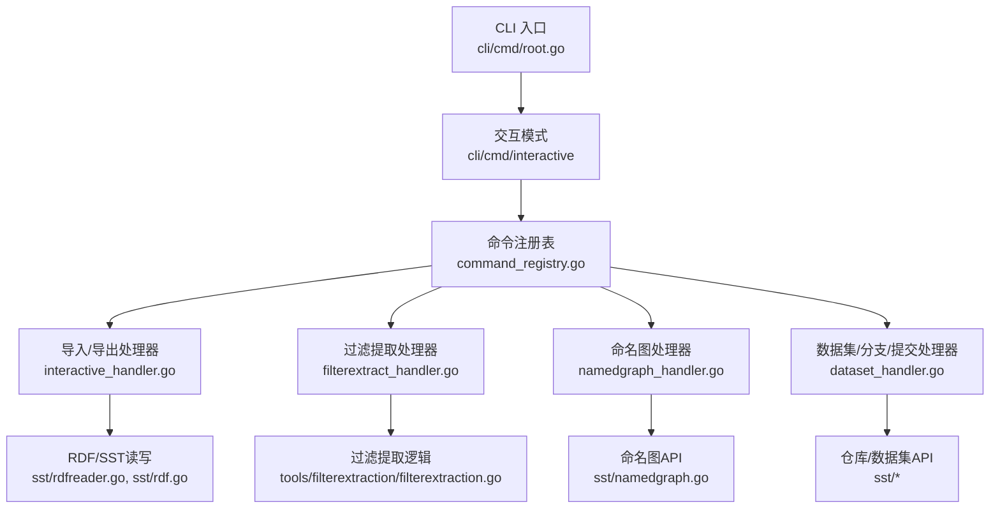
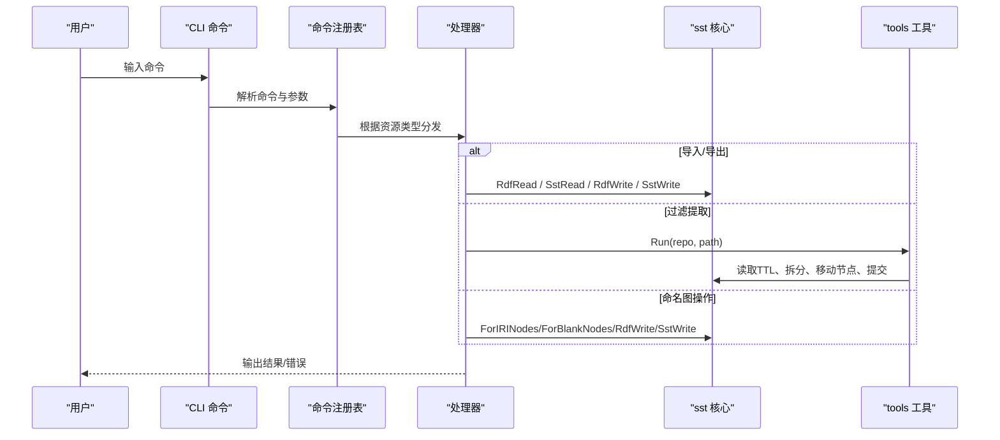
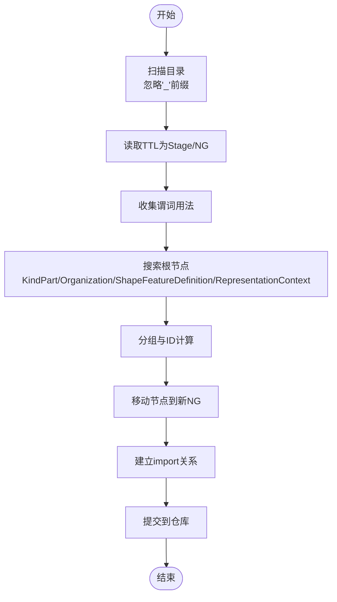
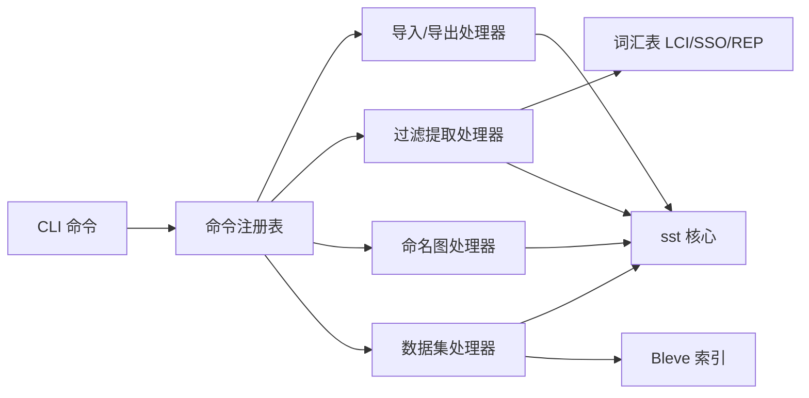

# 数据操作命令

<cite>
**本文引用的文件**
- [root.go](file://cli/cmd/root.go)
- [command_registry.go](file://cli/cmd/interactive/command_registry.go)
- [interactive_handler.go](file://cli/cmd/interactive/interactive_handler.go)
- [filterextract_handler.go](file://cli/cmd/interactive/filterextract_handler.go)
- [namedgraph_handler.go](file://cli/cmd/interactive/namedgraph_handler.go)
- [dataset_handler.go](file://cli/cmd/interactive/dataset_handler.go)
- [filterextraction.go](file://tools/filterextraction/filterextraction.go)
- [run.go](file://tools/validate/run.go)
- [rdf.go](file://sst/rdf.go)
- [rdfreader.go](file://sst/rdfreader.go)
- [namedgraph.go](file://sst/namedgraph.go)
</cite>

## 目录
1. [简介](#简介)
2. [项目结构](#项目结构)
3. [核心组件](#核心组件)
4. [架构总览](#架构总览)
5. [详细组件分析](#详细组件分析)
6. [依赖关系分析](#依赖关系分析)
7. [性能考虑](#性能考虑)
8. [故障排查指南](#故障排查指南)
9. [结论](#结论)
10. [附录](#附录)

## 简介
本文件面向SST数据操作命令的使用者，聚焦以下目标：
- 文档导入导出命令的使用方法（Turtle/TriG、SST二进制）
- 过滤提取功能的命令语法与参数配置
- 命名图操作的命令（创建、修改、删除等）
- RDF数据的序列化与反序列化命令
- 数据验证与格式检查的命令使用方法
- 大数据量处理的性能优化建议

## 项目结构
SST CLI以交互式模式为主入口，顶层命令通过Cobra注册，别名命令按资源类型（仓库、数据集、阶段、命名图、IB节点）分发到具体处理器。核心RDF读写、命名图模型位于sst包；过滤提取与校验工具位于tools子包。

图表来源
- [root.go:13-45](file://cli/cmd/root.go#L13-L45)
- [command_registry.go:45-147](file://cli/cmd/interactive/command_registry.go#L45-L147)
- [interactive_handler.go:583-785](file://cli/cmd/interactive/interactive_handler.go#L583-L785)
- [filterextract_handler.go:15-53](file://cli/cmd/interactive/filterextract_handler.go#L15-L53)
- [namedgraph_handler.go:18-396](file://cli/cmd/interactive/namedgraph_handler.go#L18-L396)
- [dataset_handler.go:15-532](file://cli/cmd/interactive/dataset_handler.go#L15-L532)
- [filterextraction.go:646-708](file://tools/filterextraction/filterextraction.go#L646-L708)
- [rdfreader.go:118-143](file://sst/rdfreader.go#L118-L143)
- [rdf.go:102-117](file://sst/rdf.go#L102-L117)
- [namedgraph.go:117-350](file://sst/namedgraph.go#L117-L350)

章节来源
- [root.go:13-45](file://cli/cmd/root.go#L13-L45)
- [command_registry.go:45-147](file://cli/cmd/interactive/command_registry.go#L45-L147)

## 核心组件
- 命令注册与分发：顶层命令与别名命令集中注册，支持按资源类型路由。
- 导入/导出：支持Turtle/TriG与SST二进制格式的读取与写入。
- 过滤提取：将大型TTL图按语义规则拆分为多个导入子图并持久化到仓库。
- 命名图操作：列出节点、获取节点、导出为TTL/SVG、写SST等。
- 数据集管理：分支、提交、差异、历史等。
- 校验：对Stage进行RDF类型、定义域/值域、函数性属性等规则校验，输出结构化报告。

章节来源
- [command_registry.go:45-147](file://cli/cmd/interactive/command_registry.go#L45-L147)
- [interactive_handler.go:583-785](file://cli/cmd/interactive/interactive_handler.go#L583-L785)
- [filterextract_handler.go:15-53](file://cli/cmd/interactive/filterextract_handler.go#L15-L53)
- [namedgraph_handler.go:18-396](file://cli/cmd/interactive/namedgraph_handler.go#L18-L396)
- [dataset_handler.go:15-532](file://cli/cmd/interactive/dataset_handler.go#L15-L532)
- [run.go:236-473](file://tools/validate/run.go#L236-L473)

## 架构总览
下图展示从CLI命令到核心库的调用链：用户输入命令后，由命令注册表分派至对应处理器，处理器调用sst包完成RDF解析/生成、命名图操作或仓库操作；过滤提取与校验分别调用tools子包实现。

图表来源
- [command_registry.go:45-147](file://cli/cmd/interactive/command_registry.go#L45-L147)
- [interactive_handler.go:583-785](file://cli/cmd/interactive/interactive_handler.go#L583-L785)
- [filterextraction.go:646-708](file://tools/filterextraction/filterextraction.go#L646-L708)
- [namedgraph_handler.go:209-306](file://cli/cmd/interactive/namedgraph_handler.go#L209-L306)
- [rdfreader.go:118-143](file://sst/rdfreader.go#L118-L143)
- [rdf.go:102-117](file://sst/rdf.go#L102-L117)

## 详细组件分析

### 文档导入导出命令
- 导入Turtle/TriG
  - 命令：rdfread <file-path> [--format ttl|trig] [-a <stage-alias>]
  - 行为：打开RDF文件，自动推断格式（扩展名），或按--format指定；解析为Stage并加入会话。
  - 关键点：使用严格解析器StrictHandler，遇到格式错误会终止；支持TriG多图。
  - 参考路径：[interactive_handler.go:583-703](file://cli/cmd/interactive/interactive_handler.go#L583-L703)，[rdfreader.go:118-143](file://sst/rdfreader.go#L118-L143)

- 导入SST二进制
  - 命令：sstread <file-path> [-a <stage-alias>]
  - 行为：读取SST文件，构建Stage并加入会话。
  - 参考路径：[interactive_handler.go:705-785](file://cli/cmd/interactive/interactive_handler.go#L705-L785)

- 导出Turtle/TriG
  - 命令（Stage）：stage.rdfwrite <file>
  - 命令（NamedGraph）：<namedgraph>.rdfwrite <file>
  - 行为：将Stage或NamedGraph序列化为Turtle/TriG输出到文件；默认扩展名处理与覆盖确认。
  - 参考路径：[command_registry.go:123-132](file://cli/cmd/interactive/command_registry.go#L123-L132)，[namedgraph_handler.go:209-259](file://cli/cmd/interactive/namedgraph_handler.go#L209-L259)

- 导出SST二进制
  - 命令：<namedgraph>.sstwrite <file>
  - 行为：将NamedGraph写入SST二进制文件。
  - 参考路径：[command_registry.go:142](file://cli/cmd/interactive/command_registry.go#L142)，[namedgraph_handler.go:261-306](file://cli/cmd/interactive/namedgraph_handler.go#L261-L306)

- 支持的RDF格式
  - 读/写：Turtle、TriG
  - 参考路径：[rdf.go:102-117](file://sst/rdf.go#L102-L117)

章节来源
- [interactive_handler.go:583-785](file://cli/cmd/interactive/interactive_handler.go#L583-L785)
- [command_registry.go:123-142](file://cli/cmd/interactive/command_registry.go#L123-L142)
- [namedgraph_handler.go:209-306](file://cli/cmd/interactive/namedgraph_handler.go#L209-L306)
- [rdf.go:102-117](file://sst/rdf.go#L102-L117)
- [rdfreader.go:118-143](file://sst/rdfreader.go#L118-L143)

### 过滤提取功能（Filter Extraction）
- 命令：<repo>.filterextract <input-directory>
- 行为：遍历目录下所有.ttl文件（跳过以“_”开头的目录/文件），将每个大TTL图按语义规则拆分为多个导入子图，并在仓库中提交结果。
- 限制：当前仅支持本地仓库（含localflat）。
- 关键流程：
  - 扫描目录与文件
  - 读取TTL为Stage/NamedGraph
  - 收集谓词用法、搜索根节点、分组、移动节点、建立import关系
  - 提交到仓库
- 参考路径：
  - 命令入口与校验：[filterextract_handler.go:15-53](file://cli/cmd/interactive/filterextract_handler.go#L15-L53)
  - 核心算法：[filterextraction.go:33-708](file://tools/filterextraction/filterextraction.go#L33-L708)

图表来源
- [filterextract_handler.go:15-53](file://cli/cmd/interactive/filterextract_handler.go#L15-L53)
- [filterextraction.go:190-708](file://tools/filterextraction/filterextraction.go#L190-L708)

章节来源
- [filterextract_handler.go:15-53](file://cli/cmd/interactive/filterextract_handler.go#L15-L53)
- [filterextraction.go:190-708](file://tools/filterextraction/filterextraction.go#L190-L708)

### 命名图操作命令
- 列出节点
  - foririnodes：列出命名图中所有IRI节点
  - forallibnodes：列出所有IBNode（IRI与空白节点）
  - forblanknodes：列出空白节点
  - 参考路径：[namedgraph_handler.go:18-101](file://cli/cmd/interactive/namedgraph_handler.go#L18-L101)

- 获取节点
  - getirinodebyfragment：按片段获取IRI节点
  - getblanknodebyfragment：按UUID获取空白节点
  - 参考路径：[namedgraph_handler.go:103-207](file://cli/cmd/interactive/namedgraph_handler.go#L103-L207)

- 导出与可视化
  - ttl：控制台输出Turtle
  - exportsvg：导出SVG图形
  - sstwrite：导出SST二进制
  - rdfwrite：导出RDF（Stage为TriG，NamedGraph为Turtle）
  - 参考路径：[command_registry.go:123-143](file://cli/cmd/interactive/command_registry.go#L123-L143)，[namedgraph_handler.go:209-396](file://cli/cmd/interactive/namedgraph_handler.go#L209-L396)

- 创建/修改/删除（底层能力）
  - 创建：通过RdfRead/SstRead或工具生成Stage/NamedGraph
  - 修改：MoveIBNode、AddImport/RemoveImport、Diff等
  - 删除：Delete（受引用保护）、Empty（清空内容）
  - 参考路径：[namedgraph.go:191-350](file://sst/namedgraph.go#L191-L350)

章节来源
- [namedgraph_handler.go:18-396](file://cli/cmd/interactive/namedgraph_handler.go#L18-L396)
- [command_registry.go:123-143](file://cli/cmd/interactive/command_registry.go#L123-L143)
- [namedgraph.go:191-350](file://sst/namedgraph.go#L191-L350)

### RDF序列化与反序列化
- 反序列化
  - RdfRead：从Reader读取Turtle/TriG，构造Stage/NamedGraph
  - 支持严格模式与恢复模式
  - 参考路径：[rdfreader.go:118-143](file://sst/rdfreader.go#L118-L143)

- 序列化
  - RdfWrite：将NamedGraph序列化为Turtle/TriG
  - SstWrite：将NamedGraph序列化为SST二进制
  - 参考路径：[namedgraph.go:191-276](file://sst/namedgraph.go#L191-L276)，[rdf.go:102-117](file://sst/rdf.go#L102-L117)

章节来源
- [rdfreader.go:118-143](file://sst/rdfreader.go#L118-L143)
- [namedgraph.go:191-276](file://sst/namedgraph.go#L191-L276)
- [rdf.go:102-117](file://sst/rdf.go#L102-L117)

### 数据验证与格式检查
- 命令：<stage>.validate [-o <file>]
- 行为：对Stage执行多种校验（RDF类型、定义域/值域、函数性属性等），输出人类可读报告或JSON报告到文件。
- 选项：
  - -v/--verbose：详细日志
  - -q/--quiet：静默模式
  - -o：输出文件路径（默认扩展名.txt）
- 参考路径：
  - 命令注册：[command_registry.go:120](file://cli/cmd/interactive/command_registry.go#L120)
  - 校验实现与报告：[run.go:236-473](file://tools/validate/run.go#L236-L473)

章节来源
- [command_registry.go:120](file://cli/cmd/interactive/command_registry.go#L120)
- [run.go:236-473](file://tools/validate/run.go#L236-L473)

### 数据集与版本控制相关命令
- 分支与提交
  - listcommits、commitdetailsbyhash、commitdetailsbybranch
  - branches、leafcommits、history
  - checkoutcommit、checkoutrevision、checkoutbranch
  - setbranchcommit、setbranchrevision、removebranch
  - diff：比较两个NG修订的差异
  - 参考路径：[dataset_handler.go:15-532](file://cli/cmd/interactive/dataset_handler.go#L15-L532)

章节来源
- [dataset_handler.go:15-532](file://cli/cmd/interactive/dataset_handler.go#L15-L532)

## 依赖关系分析
- CLI层依赖命令注册表进行分发，处理器依赖sst核心库完成数据操作。
- 过滤提取依赖vocabularies（LCI、SSO、REP等）识别根节点与关系。
- 校验模块依赖sst的Stage/NamedGraph接口进行遍历与规则检查。

图表来源
- [command_registry.go:45-147](file://cli/cmd/interactive/command_registry.go#L45-L147)
- [dataset_handler.go:359-400](file://cli/cmd/interactive/dataset_handler.go#L359-L400)
- [filterextraction.go:190-708](file://tools/filterextraction/filterextraction.go#L190-L708)

章节来源
- [command_registry.go:45-147](file://cli/cmd/interactive/command_registry.go#L45-L147)
- [dataset_handler.go:359-400](file://cli/cmd/interactive/dataset_handler.go#L359-L400)
- [filterextraction.go:190-708](file://tools/filterextraction/filterextraction.go#L190-L708)

## 性能考虑
- 流式读取：RDF读取采用流式解析，避免一次性加载全部三元组到内存，适合大文件。
- 增量与提交：过滤提取在Stage内移动节点并建立import，最后统一提交，减少多次IO。
- 分页输出：列表类命令使用分页显示，避免终端卡顿。
- 远程限制：过滤提取当前仅支持本地仓库，避免网络开销与上下文问题。
- 建议：
  - 大批量导入时优先使用SST二进制（压缩与随机访问优势）
  - 使用--format显式指定格式以减少推断开销
  - 对超大TTL先做过滤提取再入库，降低单图规模
  - 校验时使用-q减少日志输出，必要时用-o输出JSON便于自动化处理

[本节提供通用指导，不直接分析具体文件]

## 故障排查指南
- 常见错误
  - 路径无效：打开文件或目录失败，检查权限与路径是否存在
  - 格式不支持：rdfread的--format需为ttl或trig
  - 远程仓库限制：filterextract仅支持本地仓库
  - 命名图被引用：删除操作可能因被其他图引用而失败
- 定位方法
  - 使用status查看当前会话中的仓库、数据集、阶段、命名图状态
  - 使用listfield查看索引字段，辅助查询与调试
  - 校验报告包含错误级别、三元组位置、期望与实际值对比
- 参考路径
  - 状态与字段：[interactive_handler.go:287-518](file://cli/cmd/interactive/interactive_handler.go#L287-L518)，[dataset_handler.go:359-400](file://cli/cmd/interactive/dataset_handler.go#L359-L400)
  - 校验报告：[run.go:236-473](file://tools/validate/run.go#L236-L473)

章节来源
- [interactive_handler.go:287-518](file://cli/cmd/interactive/interactive_handler.go#L287-L518)
- [dataset_handler.go:359-400](file://cli/cmd/interactive/dataset_handler.go#L359-L400)
- [run.go:236-473](file://tools/validate/run.go#L236-L473)

## 结论
SST CLI提供了完整的SST数据操作命令集，涵盖导入导出、过滤提取、命名图操作、RDF序列化/反序列化以及数据校验。通过命令注册表与处理器解耦，结合sst核心库与tools工具，既满足日常交互需求，也支持批量与自动化场景。对于大数据量，建议结合流式读取、过滤提取与SST二进制格式以获得更佳性能。

[本节总结性内容，不直接分析具体文件]

## 附录
- 常用命令速查
  - 导入：rdfread、sstread、importap242xml、importp21、importsvg
  - 导出：<stage>.rdfwrite、<namedgraph>.rdfwrite、<namedgraph>.sstwrite、<namedgraph>.exportsvg
  - 过滤提取：<repo>.filterextract <dir>
  - 校验：<stage>.validate [-o file]
  - 命名图：foririnodes、forallibnodes、forblanknodes、getirinodebyfragment、getblanknodebyfragment、ttl
  - 数据集：branches、leafcommits、listcommits、diff、history、checkout*、setbranch*、removebranch

[本节为补充信息，不直接分析具体文件]