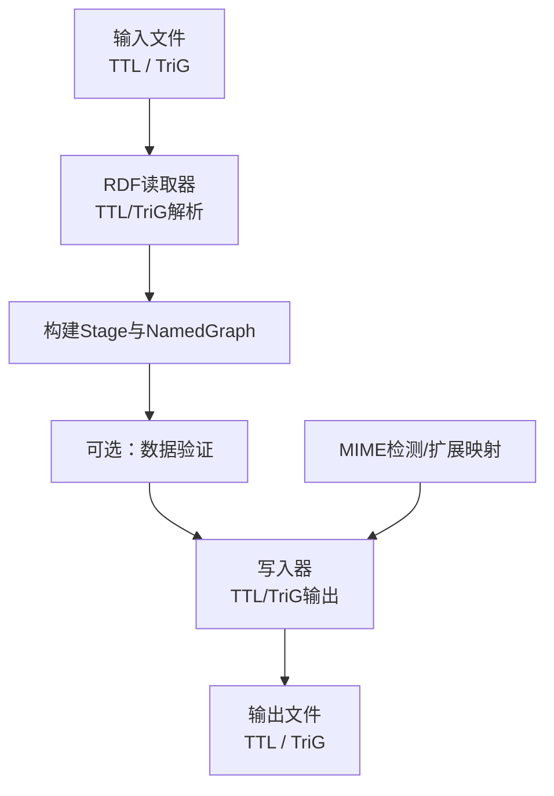
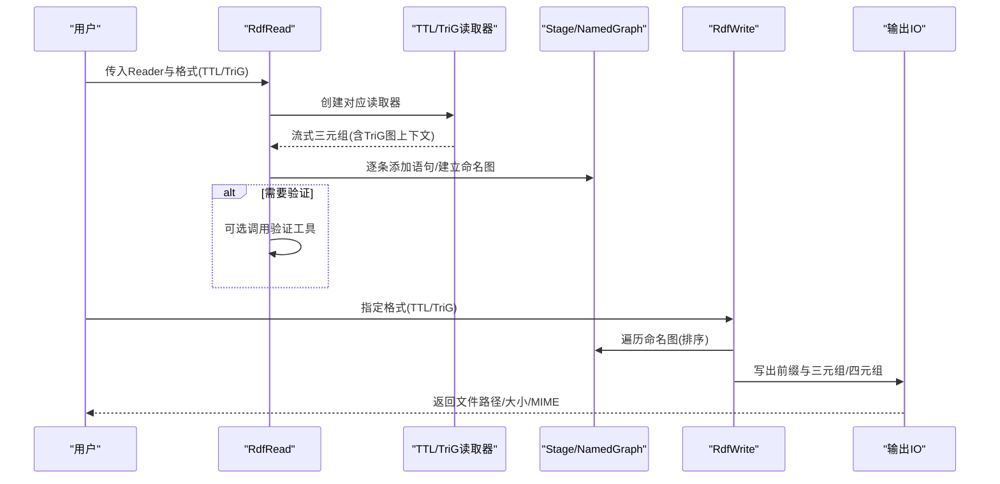
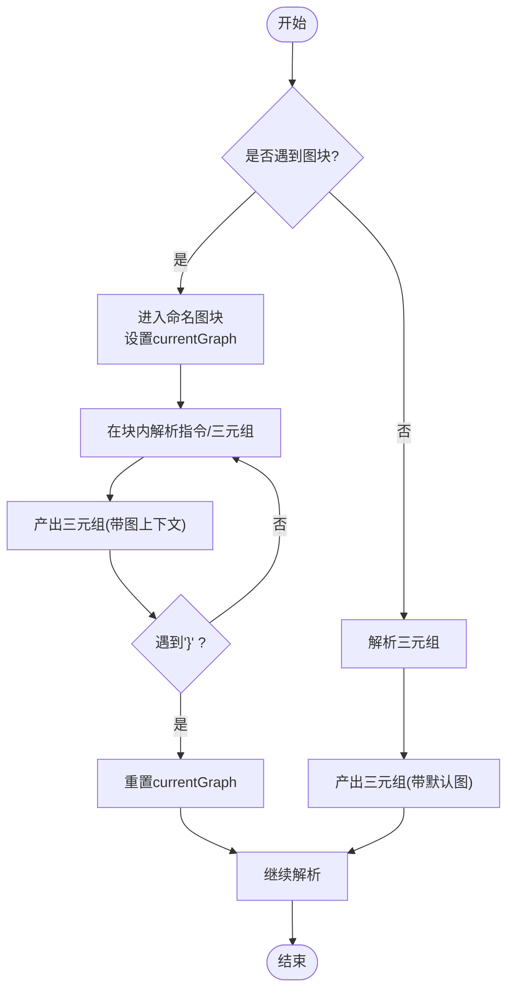
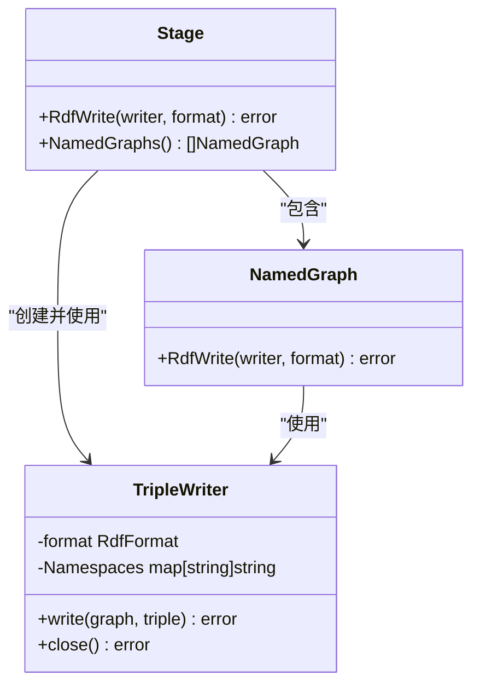
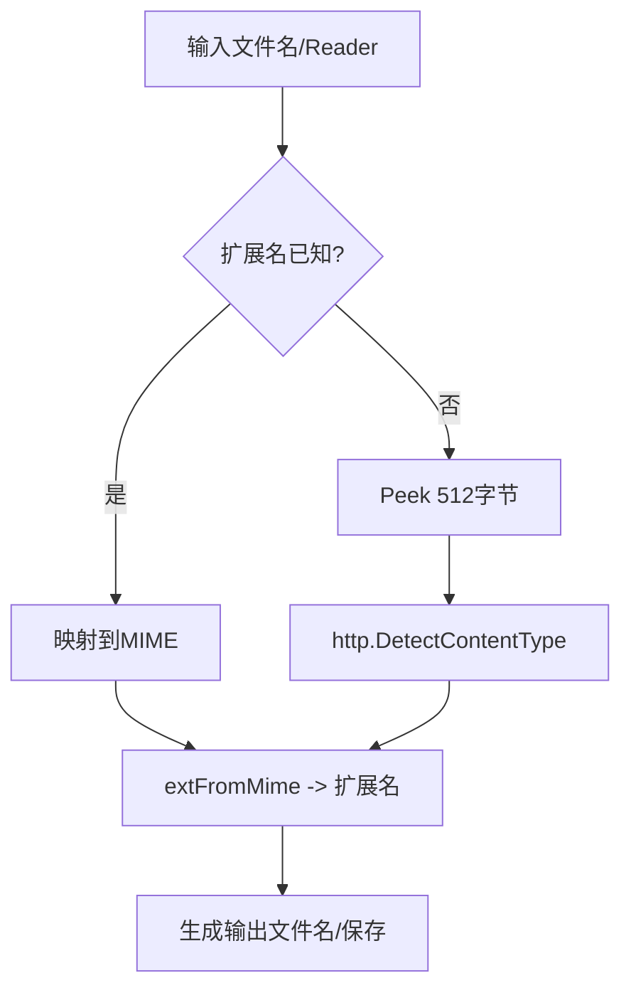
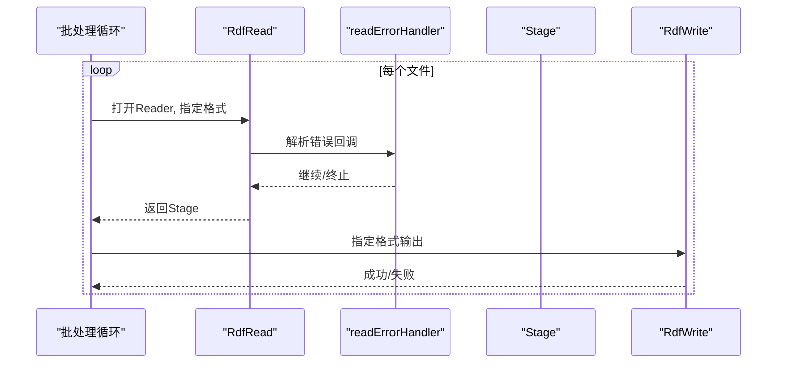
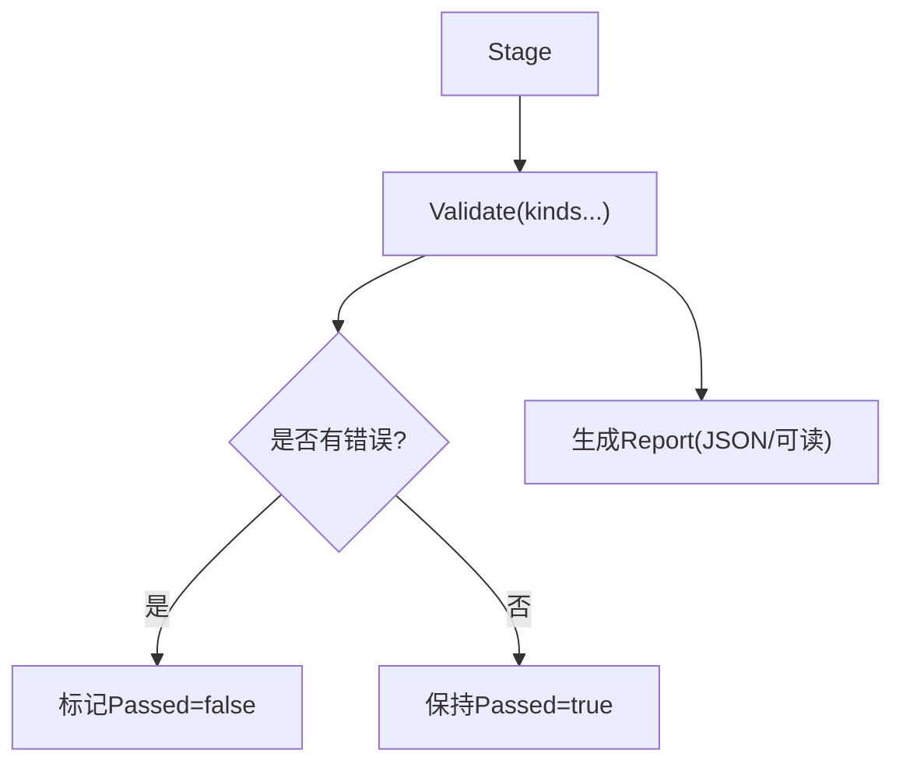
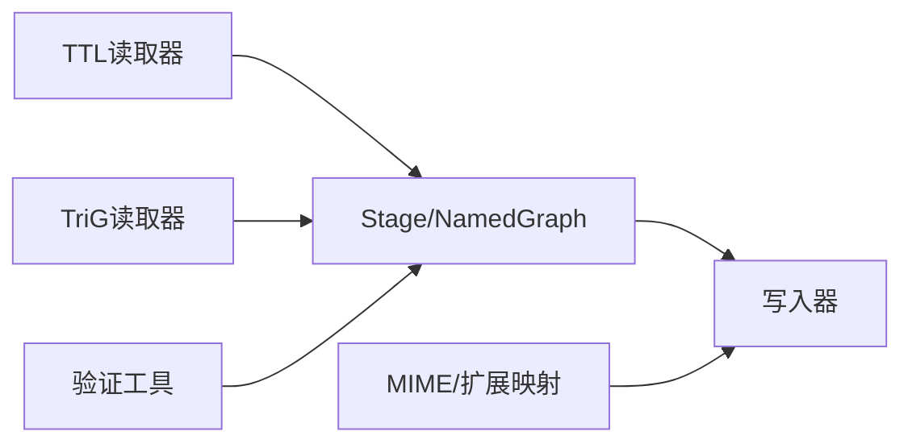

# 文档导入导出

<cite>
**本文引用的文件**
- [rdf.go](file://sst/rdf.go)
- [rdfreader.go](file://sst/rdfreader.go)
- [rdfttl.go](file://sst/rdfttl.go)
- [rdftrig.go](file://sst/rdftrig.go)
- [rdfwrite.go](file://sst/rdfwrite.go)
- [document_helpers.go](file://mcp/cmd/document_helpers.go)
- [session.go](file://mcp/cmd/session.go)
- [helper.go](file://cli/cmd/utils/helper.go)
- [run.go](file://tools/validate/run.go)
</cite>

## 目录
1. [简介](#简介)
2. [项目结构](#项目结构)
3. [核心组件](#核心组件)
4. [架构总览](#架构总览)
5. [详细组件分析](#详细组件分析)
6. [依赖关系分析](#依赖关系分析)
7. [性能考虑](#性能考虑)
8. [故障排查指南](#故障排查指南)
9. [结论](#结论)
10. [附录](#附录)

## 简介
本文件面向SST的“文档导入导出”功能，提供从TTL、TriG等RDF格式到SST内部图结构的导入能力，以及将SST中的命名图导出为TTL或TriG的能力。文档涵盖：
- 支持的文档格式与读写路径
- MIME类型自动检测与文件扩展名映射机制
- 批量导入导出的使用方法、错误处理与日志记录
- 大文件的分块处理策略与内存优化技巧
- 常见格式的转换示例与最佳实践
- 数据验证与格式检查的命令选项

## 项目结构
围绕文档导入导出，核心代码分布在以下模块：
- RDF基础模型与序列化：定义RDF术语、三元组/四元组及Turtle/TriG读写接口
- 读取器：TTL与TriG流式解析，支持命名图上下文
- 写入器：按命名图排序输出，支持多图（TriG）与单图（Turtle）
- 工具层：MIME类型探测、扩展名映射、CLI辅助函数
- 验证工具：对Stage进行规则校验并生成报告

图表来源
- [rdfreader.go:118-143](file://sst/rdfreader.go#L118-L143)
- [rdfttl.go:57-99](file://sst/rdfttl.go#L57-L99)
- [rdftrig.go:35-84](file://sst/rdftrig.go#L35-L84)
- [rdfwrite.go:400-432](file://sst/rdfwrite.go#L400-L432)
- [document_helpers.go:25-75](file://mcp/cmd/document_helpers.go#L25-L75)

章节来源
- [rdf.go:102-117](file://sst/rdf.go#L102-L117)
- [rdfreader.go:118-143](file://sst/rdfreader.go#L118-L143)
- [rdfwrite.go:400-432](file://sst/rdfwrite.go#L400-L432)
- [document_helpers.go:25-75](file://mcp/cmd/document_helpers.go#L25-L75)

## 核心组件
- RDF格式枚举与术语：定义Turtle与TriG两种序列化格式，以及IRI、字面量、空白节点等术语类型
- 读取器：
  - TTL读取器：流式解析，支持前缀、基IRI、集合、列表等语法
  - TriG读取器：在TTL基础上增加命名图块解析，维护当前图上下文
- 写入器：
  - 单图输出（Turtle）：仅写首个命名图
  - 多图输出（TriG）：按IRI排序输出所有本地命名图
- MIME与扩展名：
  - 基于扩展名快速猜测MIME类型
  - 若无法识别，则读取前若干字节调用HTTP内容类型探测
  - 根据MIME反推扩展名用于保存文件
- 验证：
  - 对Stage执行多种规则校验（如rdf:type、域值范围、函数性属性等），输出JSON或人类可读报告

章节来源
- [rdf.go:102-117](file://sst/rdf.go#L102-L117)
- [rdfttl.go:57-99](file://sst/rdfttl.go#L57-L99)
- [rdftrig.go:35-84](file://sst/rdftrig.go#L35-L84)
- [rdfwrite.go:400-432](file://sst/rdfwrite.go#L400-L432)
- [document_helpers.go:25-75](file://mcp/cmd/document_helpers.go#L25-L75)
- [run.go:211-284](file://tools/validate/run.go#L211-L284)

## 架构总览
下图展示了从文件到Stage再到输出的完整流程，包括错误处理回调与命名图上下文传递。

图表来源
- [rdfreader.go:118-143](file://sst/rdfreader.go#L118-L143)
- [rdftrig.go:35-84](file://sst/rdftrig.go#L35-L84)
- [rdfwrite.go:400-432](file://sst/rdfwrite.go#L400-L432)
- [session.go:528-557](file://mcp/cmd/session.go#L528-L557)

## 详细组件分析

### 读取器：TTL与TriG
- TTL读取器
  - 流式状态机驱动，支持@prefix/@base、绝对/相对IRI、语言标签、数据类型、集合与列表
  - read()每次返回一个三元组，readAll()可一次性读取全部
- TriG读取器
  - 继承TTL读取器，增加命名图块解析
  - 维护currentGraph与graphStack，确保每个三元组携带正确的图上下文
  - fromTriGReaderToStage将三元组分配到对应命名图

图表来源
- [rdfttl.go:57-99](file://sst/rdfttl.go#L57-L99)
- [rdftrig.go:86-254](file://sst/rdftrig.go#L86-L254)

章节来源
- [rdfttl.go:57-99](file://sst/rdfttl.go#L57-L99)
- [rdftrig.go:35-84](file://sst/rdftrig.go#L35-L84)
- [rdfreader.go:470-537](file://sst/rdfreader.go#L470-L537)

### 写入器：TTL与TriG输出
- Turtle输出
  - 仅输出第一个命名图
  - 自动注册常用命名空间前缀，必要时生成nsN前缀
- TriG输出
  - 输出所有本地命名图，按IRI排序保证稳定顺序
  - 使用命名图块包裹各图内容

图表来源
- [rdfwrite.go:400-432](file://sst/rdfwrite.go#L400-L432)
- [rdfwrite.go:210-225](file://sst/rdfwrite.go#L210-L225)

章节来源
- [rdfwrite.go:400-432](file://sst/rdfwrite.go#L400-L432)
- [rdfwrite.go:210-225](file://sst/rdfwrite.go#L210-L225)

### MIME类型自动检测与扩展名映射
- 扩展名优先：根据文件扩展名快速推断MIME类型
- 内容探测兜底：若扩展名未知，读取前512字节调用HTTP内容类型探测
- 反向映射：根据MIME类型选择合适扩展名用于保存文件

图表来源
- [document_helpers.go:25-75](file://mcp/cmd/document_helpers.go#L25-L75)
- [session.go:528-557](file://mcp/cmd/session.go#L528-L557)

章节来源
- [document_helpers.go:25-75](file://mcp/cmd/document_helpers.go#L25-L75)
- [session.go:528-557](file://mcp/cmd/session.go#L528-L557)

### 批量导入导出与错误处理
- 批量导入
  - 通过循环调用RdfRead，将多个文件解析为Stage；可使用RecoverHandler忽略部分错误继续处理，或使用StrictHandler在首个错误时终止
- 批量导出
  - 遍历Stage中所有命名图，按格式输出；Turtle仅首图，TriG全图
- 错误处理
  - 读取阶段：readErrorHandler包装行号信息，便于定位
  - 写入阶段：writer.close()确保缓冲刷新，错误传播
- 日志记录
  - 读取/写入过程记录调试日志（主题、谓词、对象、图IRI等）

图表来源
- [rdfreader.go:96-107](file://sst/rdfreader.go#L96-L107)
- [rdfreader.go:118-143](file://sst/rdfreader.go#L118-L143)
- [rdfwrite.go:400-432](file://sst/rdfwrite.go#L400-L432)

章节来源
- [rdfreader.go:96-107](file://sst/rdfreader.go#L96-L107)
- [rdfreader.go:118-143](file://sst/rdfreader.go#L118-L143)
- [rdfwrite.go:400-432](file://sst/rdfwrite.go#L400-L432)

### 大文件分块处理与内存优化
- 流式解析：TTL/TriG读取器以三元组为单位流式产出，避免一次性加载整个文档
- 流式写入：TripleWriter缓冲写入，按需关闭并Flush
- 命名图排序：输出前对命名图IRI排序，保证稳定输出且利于增量处理
- 建议
  - 使用RecoverHandler容忍局部错误，提升批量鲁棒性
  - 合理设置缓冲区大小（底层bufio.Writer已内置）
  - 对超大文件采用分批处理（外部循环控制批次大小）

章节来源
- [rdfttl.go:57-99](file://sst/rdfttl.go#L57-L99)
- [rdftrig.go:35-84](file://sst/rdftrig.go#L35-L84)
- [rdfwrite.go:210-225](file://sst/rdfwrite.go#L210-L225)
- [rdfwrite.go:400-432](file://sst/rdfwrite.go#L400-L432)

### 数据验证与格式检查
- 验证步骤
  - 将文件读入Stage后，调用Validate执行规则集（默认包含rdf_type、domain_range、functional_property）
  - 支持命令行参数选择步骤、静默/详细输出
- 报告格式
  - JSON：包含kinds、passed、findings、generated
  - 人类可读：汇总错误/警告数量与明细
- 典型用法
  - 对TTL/TriG导入后的Stage进行校验，发现缺失类型、域值不匹配等问题

图表来源
- [run.go:211-284](file://tools/validate/run.go#L211-L284)
- [run.go:441-472](file://tools/validate/run.go#L441-L472)

章节来源
- [run.go:211-284](file://tools/validate/run.go#L211-L284)
- [run.go:441-472](file://tools/validate/run.go#L441-L472)

## 依赖关系分析
- 读取器依赖
  - TTL读取器：词法分析、状态机、上下文栈
  - TriG读取器：复用TTL读取器，叠加图块解析逻辑
- 写入器依赖
  - 命名图排序、命名空间前缀管理、三元组/集合/列表序列化
- 工具依赖
  - MIME探测与扩展名映射
  - CLI辅助函数（路径校验、人类可读字节数、扩展名补齐）

图表来源
- [rdfttl.go:57-99](file://sst/rdfttl.go#L57-L99)
- [rdftrig.go:35-84](file://sst/rdftrig.go#L35-L84)
- [rdfwrite.go:400-432](file://sst/rdfwrite.go#L400-L432)
- [document_helpers.go:25-75](file://mcp/cmd/document_helpers.go#L25-L75)
- [run.go:441-472](file://tools/validate/run.go#L441-L472)

章节来源
- [rdfttl.go:57-99](file://sst/rdfttl.go#L57-L99)
- [rdftrig.go:35-84](file://sst/rdftrig.go#L35-L84)
- [rdfwrite.go:400-432](file://sst/rdfwrite.go#L400-L432)
- [document_helpers.go:25-75](file://mcp/cmd/document_helpers.go#L25-L75)
- [run.go:441-472](file://tools/validate/run.go#L441-L472)

## 性能考虑
- 流式I/O：读取与写入均基于流式接口，避免整图驻留内存
- 缓冲写入：TripleWriter使用缓冲写入并在关闭时Flush
- 排序开销：TriG输出对所有命名图按IRI排序，适合大规模但需权衡排序成本
- 建议
  - 大批量任务中结合RecoverHandler提高容错
  - 对超大文件采用外部批处理（例如按文件大小或行数切分）
  - 合理配置日志级别，减少I/O开销

[本节为通用指导，无需特定文件引用]

## 故障排查指南
- 常见问题
  - 内容无法识别：扩展名未知且内容探测失败，将回退为二进制流
  - 语法错误：TTL/TriG解析抛出错误，可通过StrictHandler立即终止或通过RecoverHandler跳过错误继续
  - 命名图冲突：TriG中空节点标签跨图重复会报错
- 定位方法
  - 使用readErrorHandler获取行号信息，结合日志定位问题位置
  - 启用验证工具输出详细错误与警告
- 恢复策略
  - 批量导入时使用RecoverHandler，记录错误并继续处理后续文件
  - 对关键数据先验证再入库，降低污染风险

章节来源
- [rdfreader.go:75-86](file://sst/rdfreader.go#L75-L86)
- [rdfreader.go:96-107](file://sst/rdfreader.go#L96-L107)
- [rdfreader.go:118-143](file://sst/rdfreader.go#L118-L143)
- [document_helpers.go:25-75](file://mcp/cmd/document_helpers.go#L25-L75)
- [run.go:211-284](file://tools/validate/run.go#L211-L284)

## 结论
SST提供了完善的RDF文档导入导出能力，覆盖TTL与TriG格式，具备流式处理、命名图管理、MIME自动检测与扩展名映射、批量处理与错误恢复、以及数据验证等功能。通过合理的错误处理与日志记录，可在大规模场景下稳定运行；借助流式I/O与缓冲写入，有效降低内存占用并提升吞吐。

[本节为总结，无需特定文件引用]

## 附录

### 支持的格式与命令要点
- 导入
  - 格式：TTL、TriG
  - 入口：RdfRead(reader, format, errorHandler, triplexMode)
  - 错误处理：RecoverHandler（继续）、StrictHandler（终止）
- 导出
  - 格式：TTL（仅首图）、TriG（全图）
  - 入口：stage.RdfWrite(writer, format)
- MIME与扩展名
  - 猜测：ext优先，否则Peek 512字节调用http.DetectContentType
  - 映射：extFromMime用于保存文件扩展名

章节来源
- [rdfreader.go:118-143](file://sst/rdfreader.go#L118-L143)
- [rdfwrite.go:400-432](file://sst/rdfwrite.go#L400-L432)
- [document_helpers.go:25-75](file://mcp/cmd/document_helpers.go#L25-L75)

### 常见转换示例（说明性）
- TTL导入到Stage
  - 打开文件Reader，调用RdfRead(RdfFormatTurtle, RecoverHandler/StrictHandler, DefaultTriplexMode)
- TriG导入到Stage
  - 打开文件Reader，调用RdfRead(RdfFormatTriG, RecoverHandler/StrictHandler, DefaultTriplexMode)
- Stage导出为TTL
  - 调用stage.RdfWrite(writer, RdfFormatTurtle)
- Stage导出为TriG
  - 调用stage.RdfWrite(writer, RdfFormatTriG)

章节来源
- [rdfreader.go:118-143](file://sst/rdfreader.go#L118-L143)
- [rdfwrite.go:400-432](file://sst/rdfwrite.go#L400-L432)

### 数据验证命令选项（说明性）
- 选择验证步骤：rdf-type、domain-range、experimental-definitions、experimental-acyclic、experimental-connected
- 输出控制：verbose（详细）、quiet（静默）
- 报告：JSON或人类可读文本，包含错误/警告统计与明细

章节来源
- [run.go:34-53](file://tools/validate/run.go#L34-L53)
- [run.go:211-284](file://tools/validate/run.go#L211-L284)
- [run.go:441-472](file://tools/validate/run.go#L441-L472)