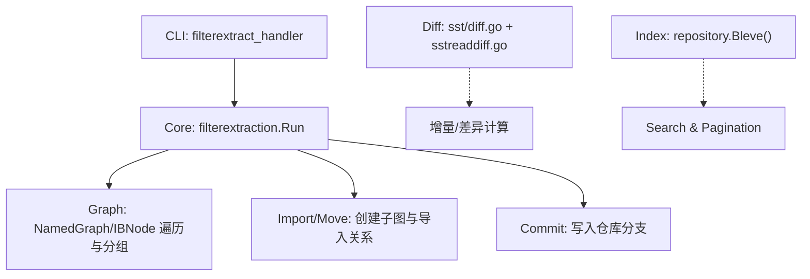
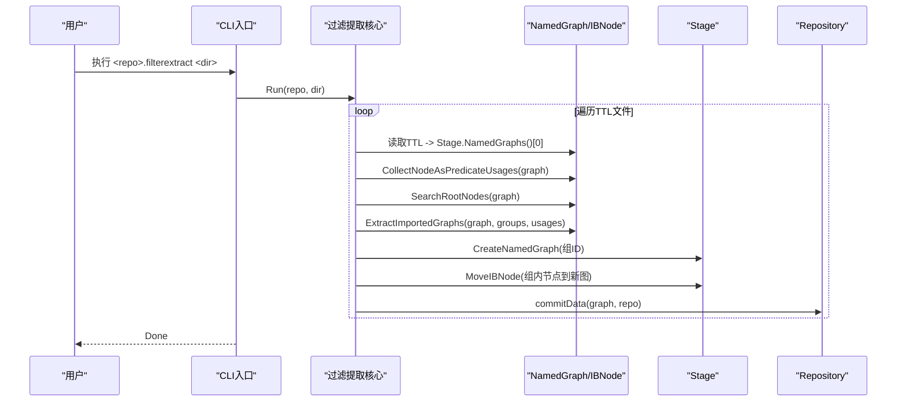
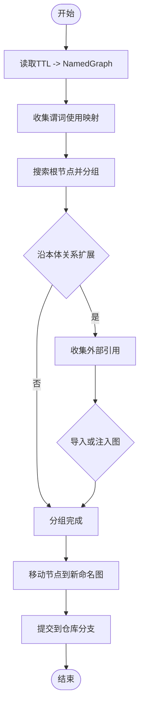
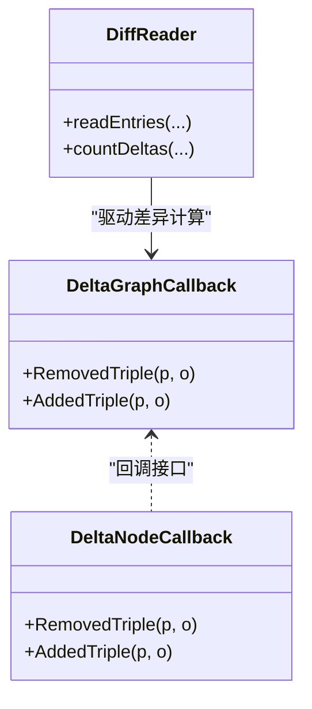
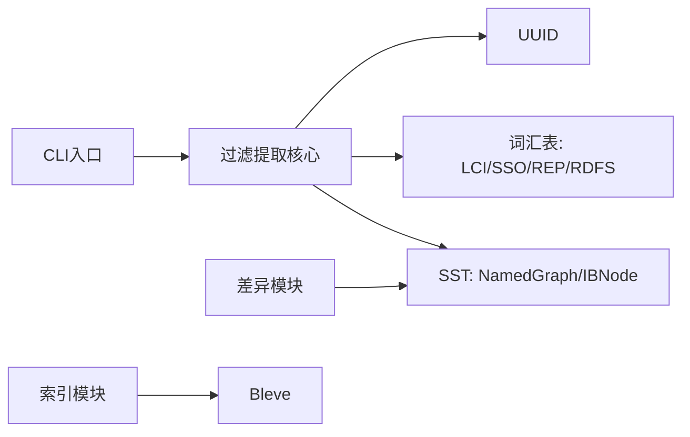

# 过滤提取

<cite>
**本文引用的文件**
- [tools/filterextraction/filterextraction.go](file://tools/filterextraction/filterextraction.go)
- [cli/cmd/interactive/filterextract_handler.go](file://cli/cmd/interactive/filterextract_handler.go)
- [sst/diff.go](file://sst/diff.go)
- [sst/sstreaddiff.go](file://sst/sstreaddiff.go)
- [sst_test/DIFF_FORMAT.md](file://sst_test/DIFF_FORMAT.md)
- [sst/repository.go](file://sst/repository.go)
- [cli/cmd/utils/pagination.go](file://cli/cmd/utils/pagination.go)
- [sst_test/searchInContext_test.go](file://sst_test/searchInContext_test.go)
</cite>

## 目录
1. [简介](#简介)
2. [项目结构](#项目结构)
3. [核心组件](#核心组件)
4. [架构总览](#架构总览)
5. [详细组件分析](#详细组件分析)
6. [依赖关系分析](#依赖关系分析)
7. [性能与优化](#性能与优化)
8. [故障排查指南](#故障排查指南)
9. [结论](#结论)
10. [附录：使用示例与最佳实践](#附录使用示例与最佳实践)

## 简介
本文件面向SST的“过滤提取”功能，说明如何基于RDF模式将大型Named Graph拆分为更小的、语义相关的子图，并持久化到仓库中。该能力主要用于按领域本体（如LCI、SSO、REP等）识别根节点、沿部分-整体关系扩展、收集外部引用，并将结果以独立命名图的形式提交到仓库分支。同时，文档还覆盖增量差异计算、索引查询与分页、以及大数据量场景下的内存与性能建议。

## 项目结构
过滤提取由CLI交互入口与核心处理逻辑组成：
- CLI入口：解析命令、校验参数、调用核心提取流程
- 核心提取：扫描TTL文件、识别根节点、构建分组、移动节点与导入关系、提交到仓库
- 差异与增量：提供两套差异计算机制，支持流式读取与高效对比
- 索引与分页：通过Bleve索引实现检索与分页，便于后续筛选与展示

图表来源
- [cli/cmd/interactive/filterextract_handler.go:15-53](file://cli/cmd/interactive/filterextract_handler.go#L15-L53)
- [tools/filterextraction/filterextraction.go:646-708](file://tools/filterextraction/filterextraction.go#L646-L708)
- [sst/repository.go:102-120](file://sst/repository.go#L102-L120)

章节来源
- [cli/cmd/interactive/filterextract_handler.go:15-53](file://cli/cmd/interactive/filterextract_handler.go#L15-L53)
- [tools/filterextraction/filterextraction.go:646-708](file://tools/filterextraction/filterextraction.go#L646-L708)
- [sst/repository.go:102-120](file://sst/repository.go#L102-L120)

## 核心组件
- 过滤提取核心（filterextraction）
  - 根节点识别：根据类型与词汇表（LCI/SSO/REP）定位起始节点
  - 关系扩展：沿 isPartOf / hasPart 等关系递归收集相关节点
  - 外部引用收集：识别跨图引用并建立导入或注入图
  - 子图生成与提交：为每个分组创建独立命名图并提交到仓库
- 差异与增量（diff/sstreaddiff）
  - 节点级差异：比较两个NamedGraph的IBNode集合，产生新增/删除/修改
  - 三元组级差异：对每个节点的谓词-对象进行有序对比，输出最小变更集
  - 流式读取：基于deltaSpan与翻译表，避免全量加载，降低内存占用
- 索引与分页（repository.Bleve + pagination）
  - 通过Bleve索引进行全文/字段匹配、排序与分页
  - 提供命令行分页工具，便于大结果集浏览

章节来源
- [tools/filterextraction/filterextraction.go:33-188](file://tools/filterextraction/filterextraction.go#L33-L188)
- [tools/filterextraction/filterextraction.go:345-465](file://tools/filterextraction/filterextraction.go#L345-L465)
- [tools/filterextraction/filterextraction.go:608-708](file://tools/filterextraction/filterextraction.go#L608-L708)
- [sst/diff.go:28-327](file://sst/diff.go#L28-L327)
- [sst/sstreaddiff.go:230-852](file://sst/sstreaddiff.go#L230-L852)
- [sst/repository.go:102-120](file://sst/repository.go#L102-L120)
- [cli/cmd/utils/pagination.go:12-59](file://cli/cmd/utils/pagination.go#L12-L59)

## 架构总览
过滤提取的整体流程如下：
1. 从输入目录遍历所有TTL文件（跳过以下划线开头的目录/文件）
2. 读取TTL为Stage与NamedGraph
3. 收集谓词使用情况，识别根节点并按类型分组
4. 沿本体关系扩展，收集外部引用，必要时注入临时图
5. 为每个分组创建独立命名图，移动节点并建立导入关系
6. 将结果提交到目标仓库的默认分支

图表来源
- [cli/cmd/interactive/filterextract_handler.go:15-53](file://cli/cmd/interactive/filterextract_handler.go#L15-L53)
- [tools/filterextraction/filterextraction.go:646-708](file://tools/filterextraction/filterextraction.go#L646-L708)
- [tools/filterextraction/filterextraction.go:345-465](file://tools/filterextraction/filterextraction.go#L345-L465)

## 详细组件分析

### 过滤提取核心（Filter Extraction Core）
- 根节点识别与分组
  - 依据词汇表类型（如KindPart、KindOrganization、KindShapeFeatureDefinition、KindRepresentationContext）识别根节点
  - 对RepresentationContext进行额外判断（是否仅包含放置项、是否为3D几何上下文等）
- 关系扩展与外部引用
  - 沿isPartOf/hasPart关系递归收集节点
  - 收集不在当前图的引用节点，尝试建立导入；若存在循环或冲突，则注入临时图并移动所需节点
- 子图生成与提交
  - 为每个分组创建唯一IRI（基于节点片段哈希），移动节点并维护导入关系
  - 提交到仓库默认分支，形成可版本化的数据集

图表来源
- [tools/filterextraction/filterextraction.go:33-188](file://tools/filterextraction/filterextraction.go#L33-L188)
- [tools/filterextraction/filterextraction.go:345-465](file://tools/filterextraction/filterextraction.go#L345-L465)
- [tools/filterextraction/filterextraction.go:608-708](file://tools/filterextraction/filterextraction.go#L608-L708)

章节来源
- [tools/filterextraction/filterextraction.go:33-188](file://tools/filterextraction/filterextraction.go#L33-L188)
- [tools/filterextraction/filterextraction.go:345-465](file://tools/filterextraction/filterextraction.go#L345-L465)
- [tools/filterextraction/filterextraction.go:608-708](file://tools/filterextraction/filterextraction.go#L608-L708)

### 差异与增量计算（Incremental Diff）
- 节点级差异
  - 对两个NamedGraph的IBNode列表进行归并比较，识别新增、删除、修改
- 三元组级差异
  - 对每个节点的谓词-对象进行有序对比，输出最小变更集
- 流式读取与内存优化
  - 使用deltaSpan与翻译表，边读边写，避免一次性加载全部三元组
  - 支持导入图与引用图的增量处理

图表来源
- [sst/diff.go:5-14](file://sst/diff.go#L5-L14)
- [sst/sstreaddiff.go:230-852](file://sst/sstreaddiff.go#L230-L852)

章节来源
- [sst/diff.go:28-327](file://sst/diff.go#L28-L327)
- [sst/sstreaddiff.go:230-852](file://sst/sstreaddiff.go#L230-L852)
- [sst_test/DIFF_FORMAT.md:68-113](file://sst_test/DIFF_FORMAT.md#L68-L113)

### 索引与分页（Indexing & Pagination）
- 索引注册与重建
  - 本地仓库可通过RegisterIndexHandler注册Bleve索引处理器，支持重建索引
- 搜索与分页
  - 使用bleve.NewSearchRequestOptions设置size与start实现分页
  - 支持字段选择、排序、正则匹配等复杂查询
- 命令行分页显示
  - 提供PaginateOutput/PaginateLogEntries用于交互式分页浏览

章节来源
- [sst/repository.go:102-120](file://sst/repository.go#L102-L120)
- [sst_test/searchInContext_test.go:215-235](file://sst_test/searchInContext_test.go#L215-L235)
- [sst_test/searchInContext_test.go:526-563](file://sst_test/searchInContext_test.go#L526-L563)
- [cli/cmd/utils/pagination.go:12-59](file://cli/cmd/utils/pagination.go#L12-L59)

## 依赖关系分析
- CLI入口依赖过滤提取核心，负责参数校验与路径处理
- 过滤提取核心依赖SST的NamedGraph/IBNode抽象、词汇表（LCI/SSO/REP/RDFS）与UUID
- 差异模块依赖SST内部数据结构与流式读取器
- 索引模块依赖Bleve，提供检索能力

图表来源
- [cli/cmd/interactive/filterextract_handler.go:15-53](file://cli/cmd/interactive/filterextract_handler.go#L15-L53)
- [tools/filterextraction/filterextraction.go:7-27](file://tools/filterextraction/filterextraction.go#L7-L27)
- [sst/diff.go:28-327](file://sst/diff.go#L28-L327)
- [sst/repository.go:102-120](file://sst/repository.go#L102-L120)

章节来源
- [cli/cmd/interactive/filterextract_handler.go:15-53](file://cli/cmd/interactive/filterextract_handler.go#L15-L53)
- [tools/filterextraction/filterextraction.go:7-27](file://tools/filterextraction/filterextraction.go#L7-L27)
- [sst/diff.go:28-327](file://sst/diff.go#L28-L327)
- [sst/repository.go:102-120](file://sst/repository.go#L102-L120)

## 性能与优化
- 流式差异计算
  - 使用deltaSpan与翻译表，边读边写，减少内存峰值
  - 针对导入图与引用图分别处理，避免重复计算
- 索引查询优化
  - 合理选择查询字段，减少返回数据量
  - 使用分页限制单次结果集大小，结合排序提升用户体验
- 批量处理与批大小控制
  - 对大文件分批处理，避免一次性加载过多三元组
- 内存管理建议
  - 在大规模图上优先使用流式API与分页
  - 谨慎使用深度递归的关系扩展，必要时限制扩展层级

[本节为通用指导，不直接分析具体文件]

## 故障排查指南
- 远程仓库不支持
  - 当前filterextract仅支持本地仓库（含localflat），远程仓库会报错提示
- 输入路径错误
  - 确保传入的是目录且包含TTL文件，跳过以下划线开头的目录/文件
- 导入循环与冲突
  - 当检测到命名图导入循环或已存在导入时，会尝试注入临时图；若仍失败，检查数据模型与引用关系
- 差异计算异常
  - 检查基图与新图的节点顺序与三元组一致性；确认deltaSpan读取无误

章节来源
- [cli/cmd/interactive/filterextract_handler.go:22-27](file://cli/cmd/interactive/filterextract_handler.go#L22-L27)
- [tools/filterextraction/filterextraction.go:414-465](file://tools/filterextraction/filterextraction.go#L414-L465)
- [sst/sstreaddiff.go:230-852](file://sst/sstreaddiff.go#L230-L852)

## 结论
SST的过滤提取功能通过本体驱动的根节点识别与关系扩展，将大型RDF图拆分为语义清晰的子图，并以命名图形式持久化到仓库。配合差异计算与索引查询，可实现高效的增量更新与检索。对于大数据量场景，建议采用流式处理、分页与合理的索引策略，以获得更好的性能与稳定性。

[本节为总结性内容，不直接分析具体文件]

## 附录：使用示例与最佳实践

### 基本用法
- 打开本地仓库后执行：
  - 命令格式：<repo>.filterextract <input-directory>
  - 行为：处理目录下所有TTL文件（跳过以下划线开头的目录/文件），将结果提交到仓库默认分支

章节来源
- [cli/cmd/interactive/filterextract_handler.go:29-33](file://cli/cmd/interactive/filterextract_handler.go#L29-L33)
- [tools/filterextraction/filterextraction.go:646-708](file://tools/filterextraction/filterextraction.go#L646-L708)

### 基于RDF模式的过滤与参数配置
- 根节点类型
  - 支持KindPart、KindOrganization、KindShapeFeatureDefinition、KindRepresentationContext等
- 关系扩展
  - 沿isPartOf/hasPart关系递归收集节点
- 外部引用处理
  - 尝试建立导入；若存在循环或冲突，注入临时图并移动所需节点

章节来源
- [tools/filterextraction/filterextraction.go:190-277](file://tools/filterextraction/filterextraction.go#L190-L277)
- [tools/filterextraction/filterextraction.go:345-465](file://tools/filterextraction/filterextraction.go#L345-L465)

### 复杂条件组合与嵌套过滤
- 组合策略
  - 先识别根节点，再沿本体关系扩展，最后收集外部引用
- 嵌套处理
  - 对导入图与引用图进行递归处理，确保完整性
- 优先级
  - 不同根节点类型具有优先级，保证关键实体优先处理

章节来源
- [tools/filterextraction/filterextraction.go:335-343](file://tools/filterextraction/filterextraction.go#L335-L343)
- [tools/filterextraction/filterextraction.go:414-465](file://tools/filterextraction/filterextraction.go#L414-L465)

### 增量数据提取与差异计算
- 节点级差异
  - 比较两个NamedGraph的IBNode集合，识别新增/删除/修改
- 三元组级差异
  - 对每个节点的谓词-对象进行有序对比，输出最小变更集
- 流式读取
  - 使用deltaSpan与翻译表，避免全量加载

章节来源
- [sst/diff.go:28-327](file://sst/diff.go#L28-L327)
- [sst/sstreaddiff.go:230-852](file://sst/sstreaddiff.go#L230-L852)
- [sst_test/DIFF_FORMAT.md:68-113](file://sst_test/DIFF_FORMAT.md#L68-L113)

### 性能优化选项
- 索引使用
  - 注册Bleve索引处理器，按需重建索引
- 查询计划优化
  - 选择合适的查询字段，限制返回数量，启用排序
- 内存管理
  - 使用流式差异计算与分页，避免一次性加载大量数据

章节来源
- [sst/repository.go:102-120](file://sst/repository.go#L102-L120)
- [sst_test/searchInContext_test.go:215-235](file://sst_test/searchInContext_test.go#L215-L235)
- [cli/cmd/utils/pagination.go:12-59](file://cli/cmd/utils/pagination.go#L12-L59)

### 实际业务场景示例
- 按时间范围筛选
  - 通过索引字段（如时间戳）进行范围查询，结合分页获取结果
- 按主题类型筛选
  - 使用MainType或additionalType字段进行匹配
- 按命名空间筛选
  - 通过graphID或命名空间前缀进行过滤
- 分页策略
  - 设置size与start，逐步获取下一页数据

章节来源
- [sst_test/searchInContext_test.go:215-235](file://sst_test/searchInContext_test.go#L215-L235)
- [sst_test/searchInContext_test.go:526-563](file://sst_test/searchInContext_test.go#L526-L563)
- [cli/cmd/utils/pagination.go:12-59](file://cli/cmd/utils/pagination.go#L12-L59)