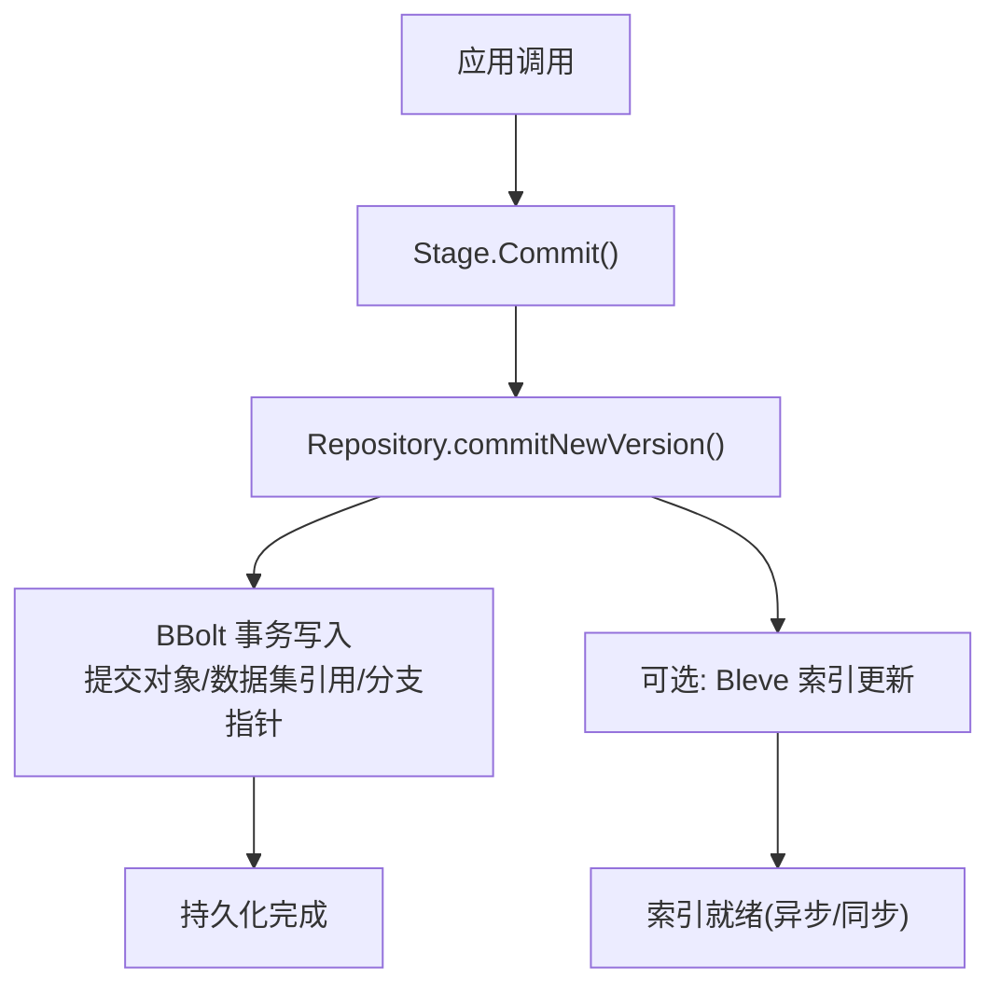
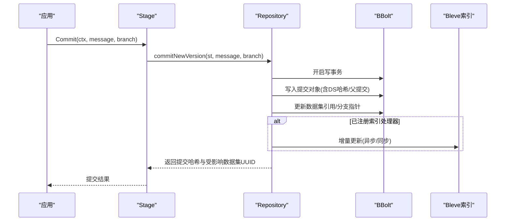
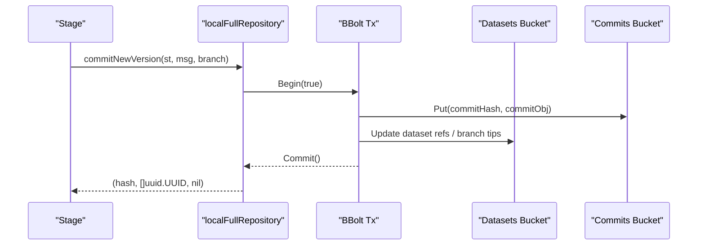
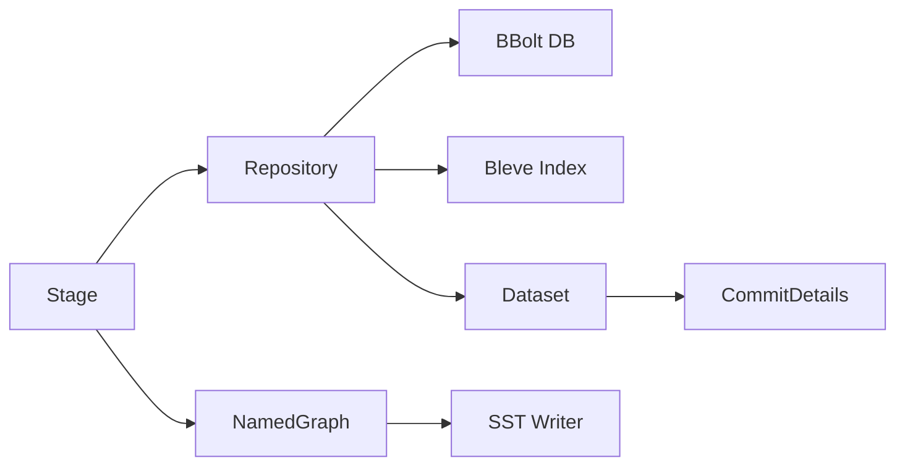

# 事务处理

<cite>
**本文引用的文件**
- [commit.go](file://sst/commit.go)
- [repointernalcommit.go](file://sst/repointernalcommit.go)
- [stage.go](file://sst/stage.go)
- [repository.go](file://sst/repository.go)
- [errrecovery.go](file://sst/errrecovery.go)
- [stagefs.go](file://sst/stagefs.go)
- [repocheckout.go](file://sst/repocheckout.go)
- [repolocalfull.go](file://sst/repolocalfull.go)
- [dataset.go](file://sst/dataset.go)
- [sstwriter.go](file://sst/sstwriter.go)
</cite>

## 目录
1. [简介](#简介)
2. [项目结构](#项目结构)
3. [核心组件](#核心组件)
4. [架构总览](#架构总览)
5. [详细组件分析](#详细组件分析)
6. [依赖关系分析](#依赖关系分析)
7. [性能考虑](#性能考虑)
8. [故障排查指南](#故障排查指南)
9. [结论](#结论)
10. [附录](#附录)

## 简介
本文件围绕工作区中的事务性操作与ACID特性，系统阐述提交（Commit）的完整流程、回滚策略与错误恢复机制、预提交条件检查（Pre-commit conditions）的配置与执行、并发访问控制与锁机制、事务隔离级别与性能调优建议，并结合异常处理与故障恢复的实际案例进行说明。该实现基于BBolt数据库与Bleve索引，结合Stage内存模型与Repository持久化层，提供版本化、可回溯的数据管理能力。

## 项目结构
SST仓库将“工作区”抽象为Stage，将“版本历史”抽象为Repository与Dataset，通过BBolt存储提交图、数据集引用与命名图版本，并通过Bleve构建可搜索索引。提交时，Stage变更被检测、生成新的命名图版本与数据集版本，并写入BBolt；同时可选择更新Bleve索引。

图示来源
- [stage.go:121-130](file://sst/stage.go#L121-L130)
- [repository.go:130-131](file://sst/repository.go#L130-L131)
- [repolocalfull.go:763-769](file://sst/repolocalfull.go#L763-L769)

章节来源
- [stage.go:121-130](file://sst/stage.go#L121-L130)
- [repository.go:130-131](file://sst/repository.go#L130-L131)
- [repolocalfull.go:763-769](file://sst/repolocalfull.go#L763-L769)

## 核心组件
- Stage：工作区内存表示，承载本地与引用命名图的修改，支持提交到关联仓库。
- Repository：持久化与版本管理接口，封装BBolt与Bleve，提供提交、检出、日志等能力。
- Dataset：数据集及其版本图（DAG），维护分支与叶提交引用。
- CommitDetails：提交元数据，包含作者、时间、消息、父提交、数据集版本与命名图版本映射。
- BBolt存储：以Bucket组织commits、datasets、dataset revisions、named graph revisions等。
- Bleve索引：可选的全文检索索引，可在提交后增量或重建。

章节来源
- [commit.go:18-29](file://sst/commit.go#L18-L29)
- [dataset.go:9-29](file://sst/dataset.go#L9-L29)
- [repository.go:34-49](file://sst/repository.go#L34-L49)

## 架构总览
提交流程由Stage发起，经Repository协调，最终在BBolt中创建不可变提交对象，并更新数据集与分支指针；同时可选择触发Bleve索引更新。

图示来源
- [stage.go:121-130](file://sst/stage.go#L121-L130)
- [repository.go:130-131](file://sst/repository.go#L130-L131)
- [repolocalfull.go:763-769](file://sst/repolocalfull.go#L763-L769)

## 详细组件分析

### 提交（Commit）流程与ACID保证
- 变更检测：Stage维护本地与引用命名图集合，提交前识别受影响的NamedGraph与Dataset。
- 版本创建：为每个受影响的NamedGraph创建新版本，并为Dataset创建新修订；提交对象记录数据集哈希与父提交链。
- 持久化：使用BBolt事务原子写入提交对象、数据集引用与分支指针；失败则整体回滚。
- ACID特性：
  - 原子性：BBolt事务确保多Bucket写入要么全部成功，要么全部回滚。
  - 一致性：提交对象与引用保持一致；分支指针指向最新提交。
  - 隔离性：BBolt读/写事务隔离；并发读不阻塞，写串行化。
  - 持久性：提交成功后数据落盘，崩溃恢复后可见。

章节来源
- [stage.go:121-130](file://sst/stage.go#L121-L130)
- [repolocalfull.go:763-769](file://sst/repolocalfull.go#L763-L769)
- [repolocalfull.go:220-230](file://sst/repolocalfull.go#L220-L230)

### 提交流程时序（代码级）

图示来源
- [stage.go:121-130](file://sst/stage.go#L121-L130)
- [repolocalfull.go:763-769](file://sst/repolocalfull.go#L763-L769)

### 回滚策略与错误恢复
- 事务内回滚：BBolt事务在错误时自动回滚，保证未提交状态不被部分写入。
- 预提交条件失败：若配置了preCommitCondition且校验失败，提交中止，不产生新提交。
- 崩溃恢复：BBolt具备崩溃恢复能力；提交完成后数据一致可见。
- 异常捕获：内部提供panic捕获与堆栈收集，便于定位问题。

章节来源
- [repointernalcommit.go:47-77](file://sst/repointernalcommit.go#L47-L77)
- [errrecovery.go:81-92](file://sst/errrecovery.go#L81-L92)
- [repolocalfull.go:763-769](file://sst/repolocalfull.go#L763-L769)

### 预提交条件检查（Pre-commit conditions）
- 配置点：Repository配置项preCommitCondition用于在提交前对Stage进行约束检查（如唯一性、配额等）。
- 执行时机：commitNewVersion之前调用，返回postCommitNotifier以便提交后通知。
- 典型用例：Bleve索引处理器注册时设置preCommitCondition，确保索引与数据一致。

章节来源
- [repository.go:218-231](file://sst/repository.go#L218-L231)
- [repolocalfull.go:313-324](file://sst/repolocalfull.go#L313-L324)
- [repolocalfull.go:406-416](file://sst/repolocalfull.go#L406-L416)

### 并发访问控制与锁机制
- 仓库级进入/离开：enter()/leave()用于序列化关键路径，避免并发冲突。
- BBolt事务隔离：读用View，写用Update，天然隔离。
- 并发祖先检测：比较提交祖先时使用goroutine与原子变量提前终止，提升性能。

章节来源
- [repolocalfull.go:244-257](file://sst/repolocalfull.go#L244-L257)
- [repolocalfull.go:763-769](file://sst/repolocalfull.go#L763-L769)
- [repointernalcommit.go:107-126](file://sst/repointernalcommit.go#L107-L126)

### 事务隔离级别
- 读隔离：BBolt View事务提供快照读，读取期间数据一致性。
- 写隔离：BBolt Update事务串行化，保证提交原子性与一致性。
- 无显式隔离级别参数：通过BBolt事务语义实现强一致隔离。

章节来源
- [repolocalfull.go:244-257](file://sst/repolocalfull.go#L244-L257)
- [repolocalfull.go:763-769](file://sst/repolocalfull.go#L763-L769)

### 提交后的索引更新
- 增量更新：通过bleveIndexUpdater在提交后异步或同步更新索引。
- 重建索引：RebuildBleveIndex关闭旧索引、删除目录并重建，适用于索引损坏或不兼容场景。

章节来源
- [repolocalfull.go:438-458](file://sst/repolocalfull.go#L438-L458)
- [repolocalfull.go:345-426](file://sst/repolocalfull.go#L345-L426)

### 检出与合并（Checkout & Merge）
- CheckoutCommit：根据提交哈希加载对应版本的Stage，合并多个数据集的命名图版本。
- MoveAndMerge：在不同Stage间移动与合并命名图，支持三向合并与父提交查找。

章节来源
- [repocheckout.go:10-44](file://sst/repocheckout.go#L10-L44)
- [stage.go:132-163](file://sst/stage.go#L132-L163)

### 数据持久化与格式
- SST文件格式：命名图内容以SST二进制格式写入，包含头、字典与内容三部分，支持导入与引用图。
- 阶段文件系统：stageFS将命名图版本以哈希键值存储在BBolt中，提供类文件系统访问。

章节来源
- [sstwriter.go:67-82](file://sst/sstwriter.go#L67-L82)
- [sstwriter.go:141-217](file://sst/sstwriter.go#L141-L217)
- [stagefs.go:23-39](file://sst/stagefs.go#L23-L39)
- [stagefs.go:156-168](file://sst/stagefs.go#L156-L168)

## 依赖关系分析

图示来源
- [stage.go:121-130](file://sst/stage.go#L121-L130)
- [repository.go:34-49](file://sst/repository.go#L34-L49)
- [sstwriter.go:67-82](file://sst/sstwriter.go#L67-L82)

章节来源
- [stage.go:121-130](file://sst/stage.go#L121-L130)
- [repository.go:34-49](file://sst/repository.go#L34-L49)
- [sstwriter.go:67-82](file://sst/sstwriter.go#L67-L82)

## 性能考虑
- 祖先检测并行化：使用goroutine与原子变量提前终止，减少遍历开销。
- 索引更新解耦：通过bleveIndexUpdater异步更新，降低提交延迟。
- 批量更新：preCommitCondition中可使用批处理缓存，减少重复计算。
- 读写分离：读路径使用View事务，避免阻塞写路径。
- 合理选择仓库类型：如需高性能只写无历史，可使用LocalFlatRepository（无事务与历史）。

章节来源
- [repointernalcommit.go:107-126](file://sst/repointernalcommit.go#L107-L126)
- [repolocalfull.go:345-426](file://sst/repolocalfull.go#L345-L426)
- [repository.go:630-633](file://sst/repository.go#L630-L633)

## 故障排查指南
- 常见错误
  - 提交未找到：ErrCommitNotFound，检查提交哈希是否正确。
  - 预提交条件失败：ErrPreCommitConditionFailed，检查约束逻辑与数据一致性。
  - 阶段无效或删除：ErrStageDeletedOrInvalid，确认Stage生命周期。
  - 外部图已存在/重名：errReferencedGraphAlreadyExists/errNamedGraphAlreadyExists，检查IRI唯一性。
- 崩溃恢复
  - BBolt具备崩溃恢复能力，重启后可正常读取最近一致状态。
  - 若索引损坏，调用RebuildBleveIndex重建。
- 调试技巧
  - 启用GOTRACEBACK收集堆栈，定位panic位置。
  - 使用Log接口查看提交与分支变更日志。

章节来源
- [stage.go:21-31](file://sst/stage.go#L21-L31)
- [commit.go:11-13](file://sst/commit.go#L11-L13)
- [errrecovery.go:81-92](file://sst/errrecovery.go#L81-L92)
- [repolocalfull.go:438-458](file://sst/repolocalfull.go#L438-L458)

## 结论
SST通过Stage与Repository的分层设计，结合BBolt事务与Bleve索引，提供了强一致、可回溯的事务性数据管理。提交流程涵盖变更检测、版本创建与持久化，支持预提交条件检查与并发安全控制。通过合理的性能优化与故障恢复策略，可满足大规模知识图谱的版本化管理需求。

## 附录
- 术语
  - 命名图（NamedGraph）：RDF图中的具名子图。
  - 数据集（Dataset）：默认命名图与其直接/间接导入的命名图集合。
  - 提交（Commit）：一次原子化的版本化变更。
  - 分支（Branch）：数据集的命名引用，指向特定提交。
- 参考路径
  - 提交数据结构：[commit.go:18-29](file://sst/commit.go#L18-L29)
  - 提交祖先比较：[repointernalcommit.go:47-143](file://sst/repointernalcommit.go#L47-L143)
  - 预提交条件：[repository.go:218-231](file://sst/repository.go#L218-L231)
  - 索引重建：[repolocalfull.go:438-458](file://sst/repolocalfull.go#L438-L458)