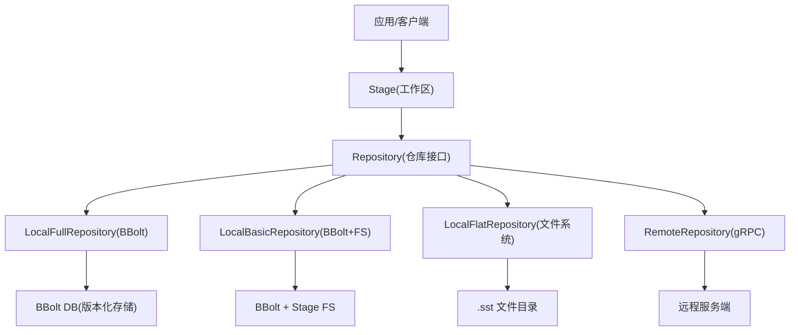
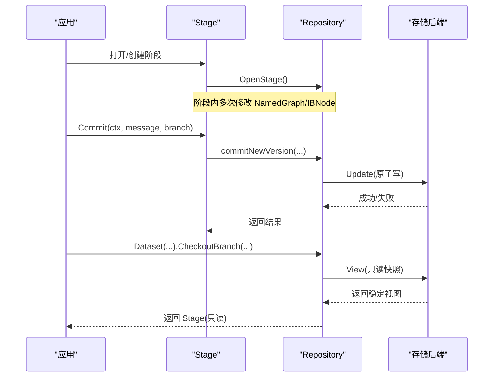
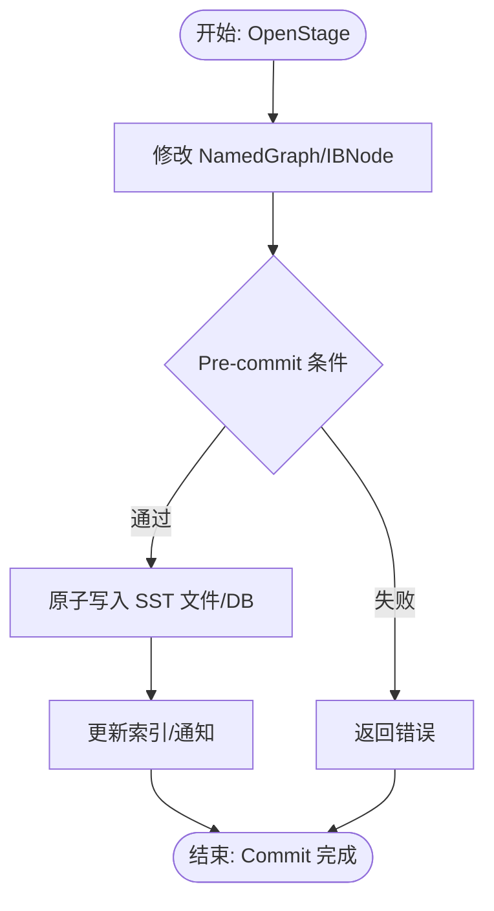
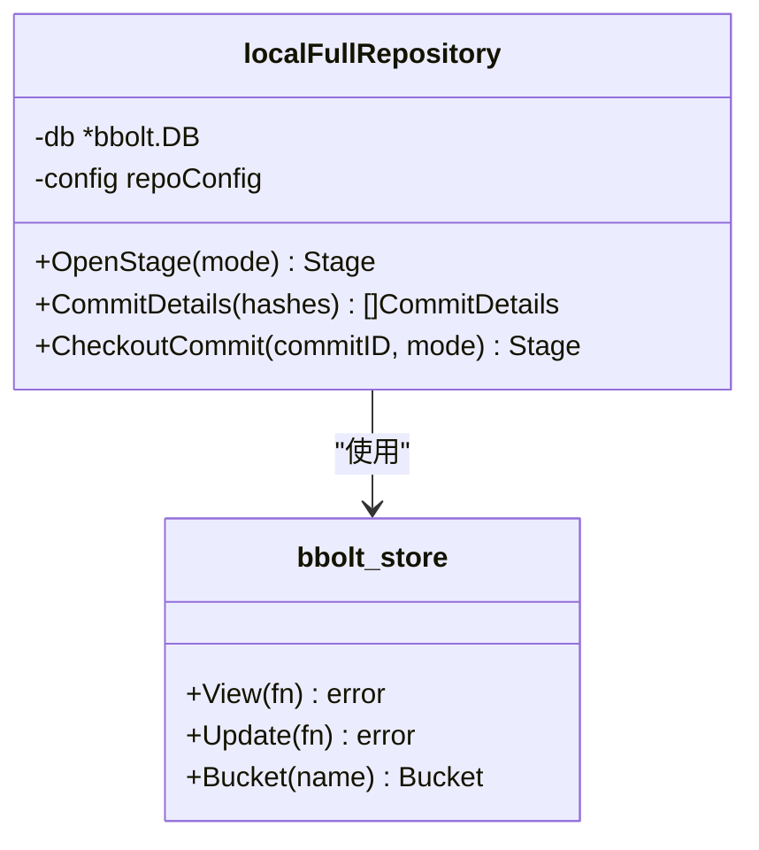
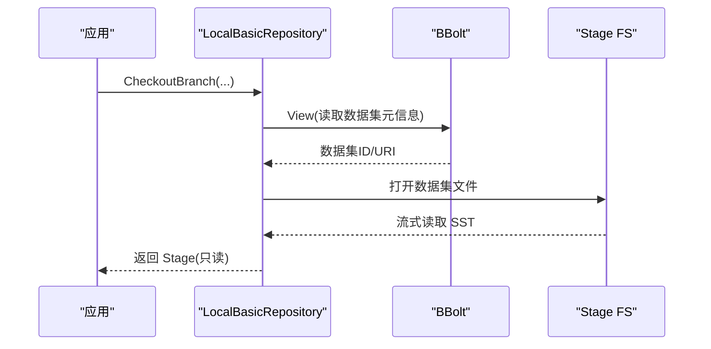
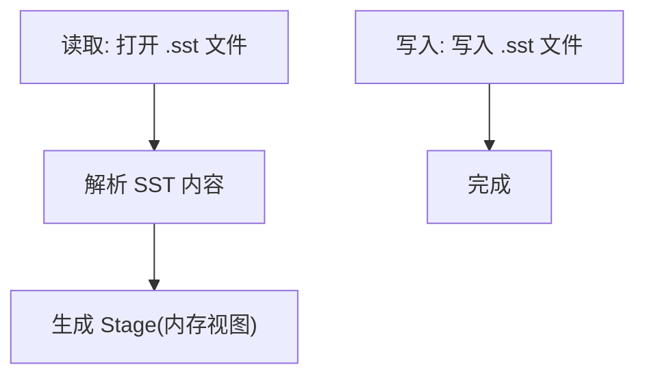
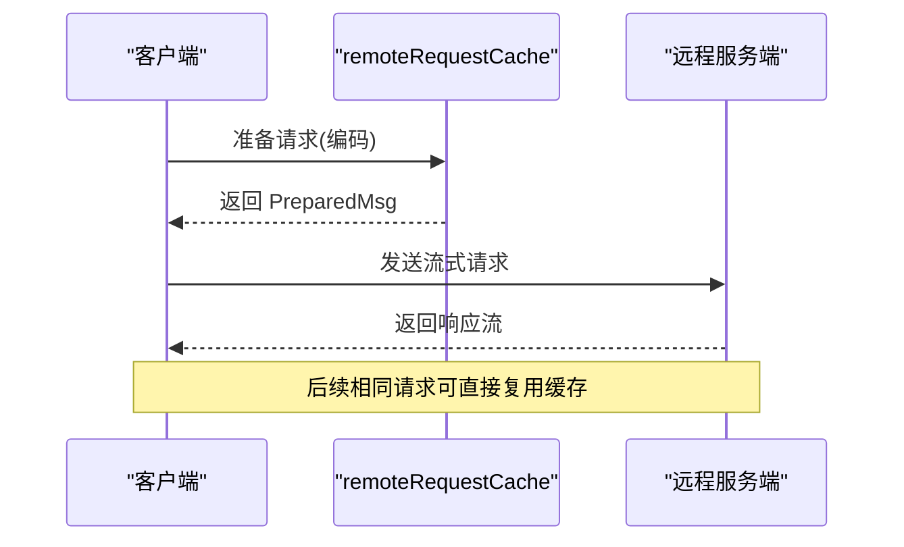
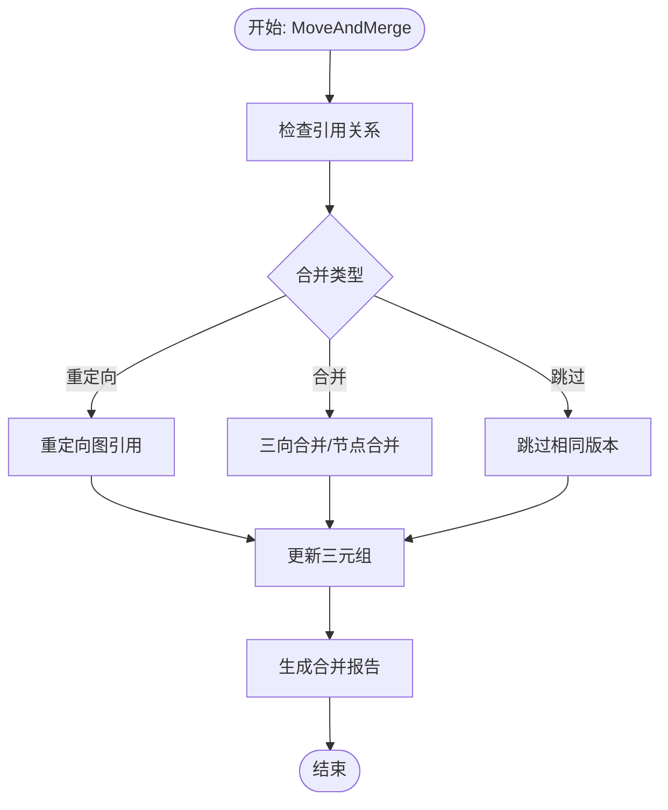
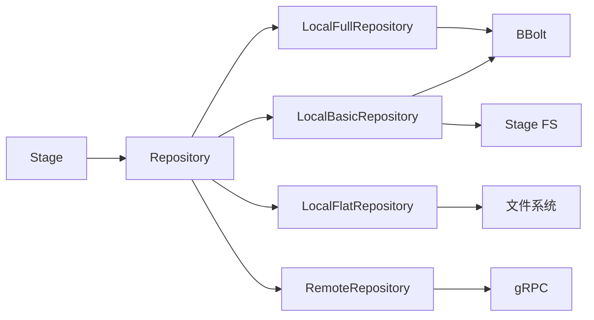

# 事务隔离

<cite>
**本文引用的文件**
- [stage.go](file://sst/stage.go)
- [repolocalfull.go](file://sst/repolocalfull.go)
- [repolocalbasic.go](file://sst/repolocalbasic.go)
- [repolocalflat.go](file://sst/repolocalflat.go)
- [bbolt_structure.go](file://sst/bbolt_structure.go)
- [repointernalcommit.go](file://sst/repointernalcommit.go)
- [stagefs.go](file://sst/stagefs.go)
- [repocacherequest.go](file://sst/repocacherequest.go)
</cite>

## 目录
1. [简介](#简介)
2. [项目结构](#项目结构)
3. [核心组件](#核心组件)
4. [架构总览](#架构总览)
5. [详细组件分析](#详细组件分析)
6. [依赖关系分析](#依赖关系分析)
7. [性能考虑](#性能考虑)
8. [故障排查指南](#故障排查指南)
9. [结论](#结论)
10. [附录](#附录)

## 简介
本文件围绕 SST 工作区的事务隔离与 ACID 特性展开，重点说明：
- 不同存储后端（本地 BBolt、本地扁平文件、远程）的隔离实现差异
- 读未提交、读已提交、可重复读等隔离级别的支持情况
- 事务边界定义与生命周期管理
- 脏读、不可重复读、幻读的避免机制
- 事务性能调优与配置建议
- 隔离级别选择指导与实际应用场景分析

SST 通过“阶段（Stage）+ 仓库（Repository）”模型组织数据操作：在内存中构建变更集，提交时原子写入持久化层；读取路径通过只读视图或快照保证一致性。

## 项目结构
SST 的核心由以下模块构成：
- 阶段（Stage）：表示一次工作单元内的图与三元组集合，支持创建、修改、合并、提交
- 仓库（Repository）：提供数据集访问、分支/标签引用、提交历史、索引等能力
- 存储层：BBolt 键值数据库（完整版本库）、文件系统（扁平 SST 文件）、远程 gRPC 服务
- 日志与元数据：提交对象、数据集版本、命名图版本、仓库日志等

图表来源
- [repolocalfull.go:220-257](file://sst/repolocalfull.go#L220-L257)
- [repolocalbasic.go:34-65](file://sst/repolocalbasic.go#L34-L65)
- [repolocalflat.go:28-61](file://sst/repolocalflat.go#L28-L61)
- [bbolt_structure.go:81-147](file://sst/bbolt_structure.go#L81-L147)

章节来源
- [repolocalfull.go:220-257](file://sst/repolocalfull.go#L220-L257)
- [repolocalbasic.go:34-65](file://sst/repolocalbasic.go#L34-L65)
- [repolocalflat.go:28-61](file://sst/repolocalflat.go#L28-L61)
- [bbolt_structure.go:81-147](file://sst/bbolt_structure.go#L81-L147)

## 核心组件
- Stage 接口与实现：封装 NamedGraph 与 IBNode 的内存视图，提供 Commit、MoveAndMerge、LinkToRepository、Close 等方法
- Repository 接口族：LocalFull、LocalBasic、LocalFlat、Remote 分别实现不同的持久化策略
- BBolt 存储布局：Commit、DatasetRevisions、NamedGraphRevisions、Datasets、Log 等桶结构
- 提交比较与祖先关系：用于三向合并、冲突检测、共同祖先查找
- 远程请求缓存：对 gRPC 流式请求进行预编码缓存，减少网络开销

章节来源
- [stage.go:53-234](file://sst/stage.go#L53-L234)
- [bbolt_structure.go:81-147](file://sst/bbolt_structure.go#L81-L147)
- [repointernalcommit.go:47-144](file://sst/repointernalcommit.go#L47-L144)
- [repocacherequest.go:30-52](file://sst/repocacherequest.go#L30-L52)

## 架构总览
SST 的事务模型以“阶段”为边界，提交时原子落盘；读取通过只读视图或快照隔离。不同后端隔离能力如下：
- LocalFull（BBolt）：基于 BBolt 的 MVCC 视图，提供强一致的可重复读；提交使用 Update 事务，读取使用 View 事务
- LocalBasic（BBolt+FS）：基础版本，部分高级功能（如提交历史、分支）不支持；读取仍通过 BBolt View 与 Stage FS 提供一致性
- LocalFlat（文件系统）：无版本控制，直接读写 .sst 文件；不提供跨版本一致性
- Remote（gRPC）：通过服务端协调，客户端侧有请求缓存；一致性取决于服务端实现

图表来源
- [repolocalfull.go:244-257](file://sst/repolocalfull.go#L244-L257)
- [repolocalbasic.go:444-472](file://sst/repolocalbasic.go#L444-L472)
- [repolocalflat.go:301-322](file://sst/repolocalflat.go#L301-L322)

## 详细组件分析

### 阶段（Stage）与事务边界
- 事务边界：从 OpenStage 到 Commit 的生命周期为一个事务单元；Commit 内部执行 pre-commit 条件检查、写入 SST 文件、更新索引、触发 post-commit 通知
- 生命周期管理：Close 释放资源；MoveAndMerge 在同一事务内完成多图的移动与合并；LinkToRepository 将阶段绑定到仓库并统一分支
- 错误处理：pre-commit 失败返回特定错误；并发修改通过底层存储的错误类型上报

图表来源
- [stage.go:121-177](file://sst/stage.go#L121-L177)
- [repolocalbasic.go:616-653](file://sst/repolocalbasic.go#L616-L653)
- [repolocalfull.go:259-341](file://sst/repolocalfull.go#L259-L341)

章节来源
- [stage.go:53-234](file://sst/stage.go#L53-L234)
- [repolocalbasic.go:616-653](file://sst/repolocalbasic.go#L616-L653)
- [repolocalfull.go:259-341](file://sst/repolocalfull.go#L259-L341)

### 本地 BBolt 仓库（LocalFull）的隔离实现
- 只读隔离：所有读取通过 db.View 开启只读事务，获得一致的快照视图
- 写隔离：提交通过 db.Update 原子写入，结合 BBolt 的 MVCC 保证并发读不阻塞写、写不干扰读
- 版本化结构：Commits、DatasetRevisions、NamedGraphRevisions、Datasets 桶维护版本链与引用
- 提交比较：compareCommits/isCommitAncestor 用于三向合并与冲突检测，确保合并过程的一致性

图表来源
- [repolocalfull.go:220-257](file://sst/repolocalfull.go#L220-L257)
- [bbolt_structure.go:81-147](file://sst/bbolt_structure.go#L81-L147)
- [repointernalcommit.go:47-144](file://sst/repointernalcommit.go#L47-L144)

章节来源
- [repolocalfull.go:220-257](file://sst/repolocalfull.go#L220-L257)
- [bbolt_structure.go:81-147](file://sst/bbolt_structure.go#L81-L147)
- [repointernalcommit.go:47-144](file://sst/repointernalcommit.go#L47-L144)

### 本地基本仓库（LocalBasic）的隔离实现
- 读取：通过 db.View 获取稳定视图，再结合 Stage FS 读取 SST 文件内容
- 写入：commitNewVersion 调用 update 原子写入 SST 文件，并触发索引更新与通知
- 限制：部分高级功能（如 CommitDetails、分支操作）不支持

图表来源
- [repolocalbasic.go:444-472](file://sst/repolocalbasic.go#L444-L472)
- [stagefs.go:48-96](file://sst/stagefs.go#L48-L96)

章节来源
- [repolocalbasic.go:444-472](file://sst/repolocalbasic.go#L444-L472)
- [stagefs.go:48-96](file://sst/stagefs.go#L48-L96)

### 本地扁平仓库（LocalFlat）的隔离实现
- 无版本控制：直接读写 .sst 文件，不提供跨版本一致性
- 读取：打开对应文件并解析 SST 内容
- 写入：commitNewVersion 将当前 Stage 写入目录，无原子性保障（文件系统级）

图表来源
- [repolocalflat.go:211-235](file://sst/repolocalflat.go#L211-L235)
- [repolocalflat.go:301-322](file://sst/repolocalflat.go#L301-L322)

章节来源
- [repolocalflat.go:211-235](file://sst/repolocalflat.go#L211-L235)
- [repolocalflat.go:301-322](file://sst/repolocalflat.go#L301-L322)

### 远程仓库（Remote）的隔离实现
- 客户端缓存：remoteRequestCache 对 gRPC PreparedMsg 进行缓存，减少重复序列化与网络开销
- 一致性：取决于服务端实现；客户端通过缓存提升性能，但不改变服务端提供的隔离语义
- 典型流程：查询数据集、列出提交、获取提交详情等通过流式 RPC 完成

图表来源
- [repocacherequest.go:30-52](file://sst/repocacherequest.go#L30-L52)
- [repocacherequest.go:138-147](file://sst/repocacherequest.go#L138-L147)

章节来源
- [repocacherequest.go:30-52](file://sst/repocacherequest.go#L30-L52)
- [repocacherequest.go:138-147](file://sst/repocacherequest.go#L138-L147)

### 隔离级别支持与问题避免
- 读未提交（RU）：SST 未暴露 RU 级别；读取均通过只读视图或快照，不会读到未提交数据
- 读已提交（RC）：LocalFull/LocalBasic 的 View 事务提供 RC 语义；LocalFlat 无版本控制，RC 语义不适用
- 可重复读（RR）：LocalFull/LocalBasic 的 View 事务提供 RR 语义；同一事务内多次读取保持一致
- 串行化（SI）：BBolt 的 MVCC 与事务边界近似 SI；但 SST 未显式暴露 SI 级别
- 脏读避免：通过 View 事务与只读快照，不会读到未提交数据
- 不可重复读避免：View 事务提供快照一致性，同事务内多次读取一致
- 幻读避免：版本化结构与提交历史使范围查询基于快照；合并逻辑通过共同祖先与三向合并避免幻读

章节来源
- [repolocalfull.go:220-257](file://sst/repolocalfull.go#L220-L257)
- [repolocalbasic.go:444-472](file://sst/repolocalbasic.go#L444-L472)
- [repolocalflat.go:211-235](file://sst/repolocalflat.go#L211-L235)
- [repointernalcommit.go:47-144](file://sst/repointernalcommit.go#L47-L144)

### 提交与合并流程
- 提交：commitNewVersion 执行 pre-commit 条件检查、写入 SST 文件、更新索引、触发通知
- 合并：MoveAndMerge 根据引用关系与共同祖先执行三向合并，记录动作报告
- 冲突处理：通过 compareCommits/isCommitAncestor 判断祖先关系，决定保留、替换或合并

图表来源
- [stage.go:468-800](file://sst/stage.go#L468-L800)
- [repointernalcommit.go:47-144](file://sst/repointernalcommit.go#L47-L144)

章节来源
- [stage.go:468-800](file://sst/stage.go#L468-L800)
- [repointernalcommit.go:47-144](file://sst/repointernalcommit.go#L47-L144)

## 依赖关系分析
- Stage 依赖 Repository 接口，具体实现决定隔离与持久化策略
- LocalFull 依赖 BBolt 提供 MVCC 与事务；LocalBasic 依赖 BBolt + Stage FS；LocalFlat 依赖文件系统
- 远程仓库依赖 gRPC 协议与客户端缓存
- 提交比较与祖先关系依赖 BBolt 的 Commits 桶结构

图表来源
- [repolocalfull.go:220-257](file://sst/repolocalfull.go#L220-L257)
- [repolocalbasic.go:34-65](file://sst/repolocalbasic.go#L34-L65)
- [repolocalflat.go:28-61](file://sst/repolocalflat.go#L28-L61)
- [stagefs.go:23-46](file://sst/stagefs.go#L23-L46)

章节来源
- [repolocalfull.go:220-257](file://sst/repolocalfull.go#L220-L257)
- [repolocalbasic.go:34-65](file://sst/repolocalbasic.go#L34-L65)
- [repolocalflat.go:28-61](file://sst/repolocalflat.go#L28-L61)
- [stagefs.go:23-46](file://sst/stagefs.go#L23-L46)

## 性能考虑
- 使用 LocalFull 以获得最佳隔离与性能：BBolt 的 MVCC 与批量写入适合高并发场景
- 合理设置预提交条件：避免不必要的索引重建与同步
- 远程场景启用请求缓存：减少重复序列化与网络开销
- 合并优化：利用共同祖先与三向合并减少冗余计算
- 索引重建：在必要时重建 Bleve 索引，避免频繁全量重建

章节来源
- [repolocalfull.go:259-341](file://sst/repolocalfull.go#L259-L341)
- [repolocalbasic.go:67-145](file://sst/repolocalbasic.go#L67-L145)
- [repocacherequest.go:30-52](file://sst/repocacherequest.go#L30-L52)

## 故障排查指南
- 预提交条件失败：检查约束逻辑与数据一致性
- 并发修改错误：确认是否存在竞争写；调整事务粒度
- 提交未找到：验证提交哈希与版本链完整性
- 远程连接失败：检查认证与网络配置；查看缓存是否命中

章节来源
- [bbolt_structure.go:53-59](file://sst/bbolt_structure.go#L53-L59)
- [repolocalbasic.go:616-653](file://sst/repolocalbasic.go#L616-L653)
- [repolocalfull.go:595-719](file://sst/repolocalfull.go#L595-L719)

## 结论
SST 通过 Stage 与 Repository 的协作实现了清晰的事务边界与一致的隔离语义。LocalFull 基于 BBolt 提供强一致的可重复读与近似串行化隔离；LocalBasic 提供基础一致性；LocalFlat 无版本控制；Remote 依赖服务端实现。建议在需要强一致性的场景使用 LocalFull，并结合预提交条件与索引优化提升性能。

## 附录
- 隔离级别选择指导：
  - 读多写少且需强一致：LocalFull + 可重复读
  - 简单场景无需版本控制：LocalFlat
  - 分布式环境：Remote + 服务端一致性保障
- 实际应用场景：
  - 知识图谱版本管理：LocalFull
  - 离线数据处理：LocalFlat
  - 多端协作：Remote