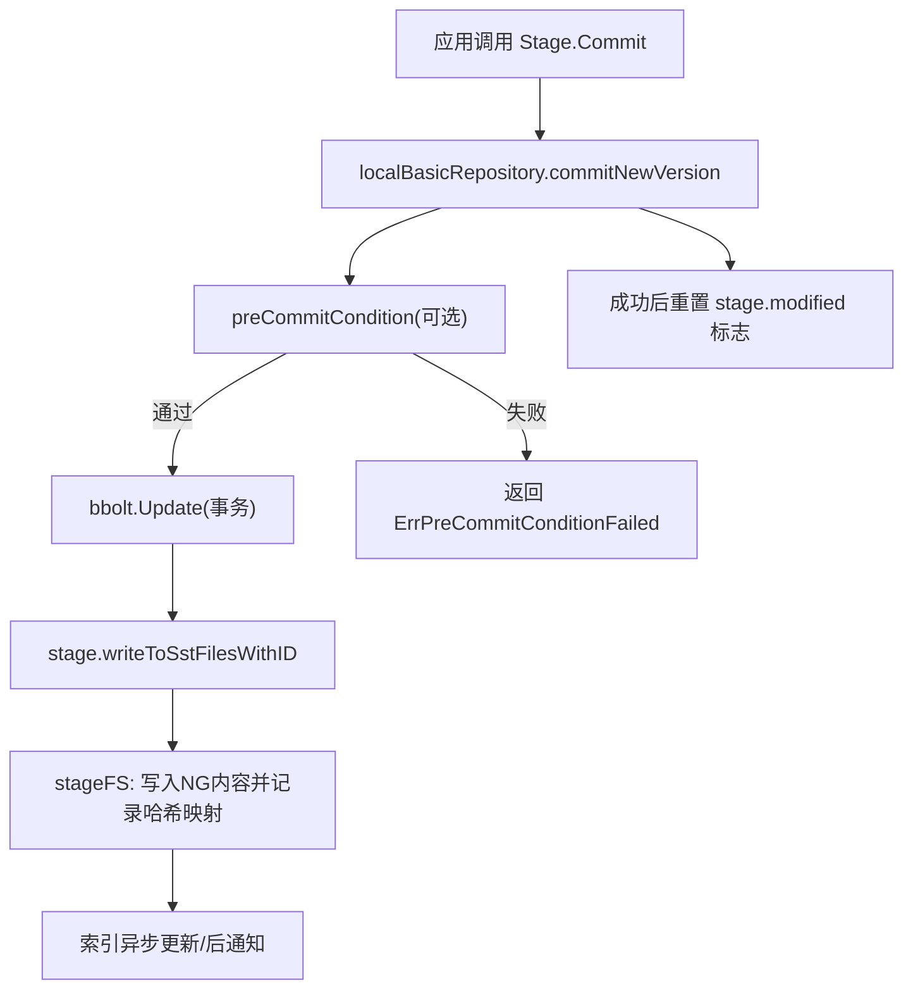
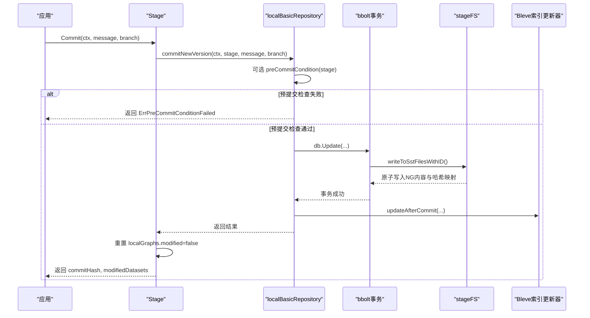
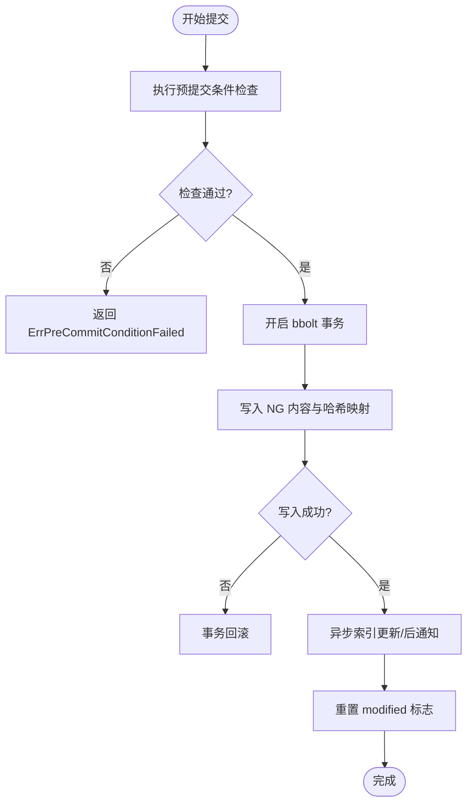
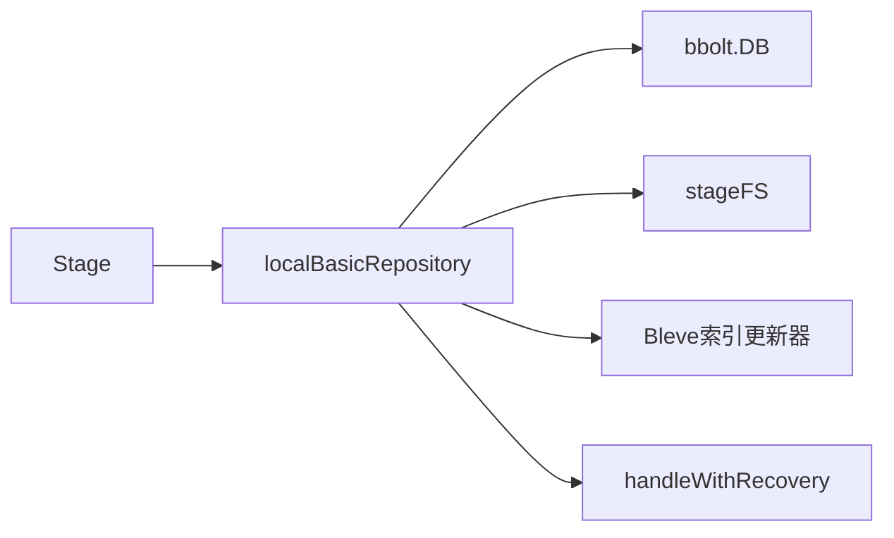

# 回滚与恢复

<cite>
**本文引用的文件**
- [errrecovery.go](file://sst/errrecovery.go)
- [stage.go](file://sst/stage.go)
- [stagefs.go](file://sst/stagefs.go)
- [stagefscommon.go](file://sst/stagefscommon.go)
- [repolocalbasic.go](file://sst/repolocalbasic.go)
- [repolocalfull.go](file://sst/repolocalfull.go)
- [reporemoteapp.go](file://sst/reporemoteapp.go)
- [commit.go](file://sst/commit.go)
</cite>

## 目录
1. [简介](#简介)
2. [项目结构](#项目结构)
3. [核心组件](#核心组件)
4. [架构总览](#架构总览)
5. [详细组件分析](#详细组件分析)
6. [依赖关系分析](#依赖关系分析)
7. [性能考虑](#性能考虑)
8. [故障排查指南](#故障排查指南)
9. [结论](#结论)
10. [附录](#附录)

## 简介
本文件围绕 SST 的回滚与恢复机制，系统性说明事务失败时的自动回滚策略、状态一致性保证、错误恢复原理（部分失败与完全失败的清理）、预提交条件检查失败的处理流程与用户提示、数据完整性校验在恢复中的作用、内存状态与持久化状态的一致性维护，以及常见错误场景的恢复方案与最佳实践，并给出故障诊断与调试技巧的实际案例。

## 项目结构
围绕回滚与恢复的关键代码分布在以下模块：
- 阶段与提交：Stage 接口与 Commit 实现，负责将内存中的图变更写入仓库并提交。
- 本地仓库实现：localBasicRepository 提供基于 bbolt 的事务性更新与索引更新协调。
- 文件系统抽象：stageFS 将 NamedGraph 版本以“哈希寻址”的方式持久化到 bbolt bucket，支持原子落盘与去重。
- 预提交约束：通过 preCommitCondition 钩子在提交前对增量索引进行构建与校验，失败则阻止提交。
- 恢复与异常捕获：handleWithRecovery 统一捕获 panic 并转换为错误，便于上层恢复。

图表来源
- [repolocalbasic.go:616-653](file://sst/repolocalbasic.go#L616-L653)
- [stage.go:1381-1401](file://sst/stage.go#L1381-L1401)
- [stagefs.go:156-168](file://sst/stagefs.go#L156-L168)

章节来源
- [repolocalbasic.go:616-653](file://sst/repolocalbasic.go#L616-L653)
- [stage.go:1381-1401](file://sst/stage.go#L1381-L1401)
- [stagefs.go:156-168](file://sst/stagefs.go#L156-L168)

## 核心组件
- 阶段（Stage）：封装内存中的 NamedGraph 集合与修改标记，提供 Commit、MoveAndMerge、LinkToRepository 等能力。
- 本地仓库（localBasicRepository）：封装 bbolt 数据库访问，提供 view/update 事务边界，并在 commitNewVersion 中串联预提交检查、持久化、索引更新与后通知。
- 文件系统抽象（stageFS）：将每个 NamedGraph 的内容以 SHA256 为键去重存储，并通过映射表将 UUID 指向最新哈希，确保读取一致性与原子落盘。
- 预提交约束（stagePreCommitConstraints）：在提交前构建增量索引并执行约束检查，若失败则中止提交，避免不一致状态入库。
- 恢复工具（handleWithRecovery）：统一捕获 panic，包装为可恢复的错误对象，附带堆栈信息以便诊断。

章节来源
- [stage.go:53-234](file://sst/stage.go#L53-L234)
- [repolocalbasic.go:459-472](file://sst/repolocalbasic.go#L459-L472)
- [stagefs.go:23-168](file://sst/stagefs.go#L23-L168)
- [reporemoteapp.go:99-110](file://sst/reporemoteapp.go#L99-L110)
- [errrecovery.go:81-92](file://sst/errrecovery.go#L81-L92)

## 架构总览
下图展示了从调用 Commit 到最终落库与索引更新的完整流程，以及关键的回滚点与一致性保障。

图表来源
- [stage.go:1381-1401](file://sst/stage.go#L1381-L1401)
- [repolocalbasic.go:616-653](file://sst/repolocalbasic.go#L616-L653)
- [stagefs.go:156-168](file://sst/stagefs.go#L156-L168)

## 详细组件分析

### 提交与回滚策略
- 事务边界：所有写操作通过 bbolt.Update 包裹，任何中间步骤失败都会触发事务回滚，保证持久化层原子性。
- 预提交检查：在事务外先执行 preCommitCondition，若失败直接返回 ErrPreCommitConditionFailed，不进入事务，避免脏写。
- 成功后状态复位：提交成功后才将 Stage 中各 NamedGraph 的 modified 标志置回 false，防止误认为已提交。
- 部分失败处理：由于事务粒度覆盖整个 write 过程，任何子步骤失败均会整体回滚；索引更新在后置异步流程中进行，不影响主事务一致性。

图表来源
- [repolocalbasic.go:616-653](file://sst/repolocalbasic.go#L616-L653)
- [stage.go:1381-1401](file://sst/stage.go#L1381-L1401)

章节来源
- [repolocalbasic.go:616-653](file://sst/repolocalbasic.go#L616-L653)
- [stage.go:1381-1401](file://sst/stage.go#L1381-L1401)

### 预提交条件检查与用户提示
- 检查时机：在 commitNewVersion 中，先于事务执行 preCommitCondition，用于构建增量索引并执行约束校验。
- 失败处理：一旦失败，立即返回 ErrPreCommitConditionFailed，上层可据此向用户提示“提交被拒绝：预提交条件未满足”，并建议修正数据或配置。
- 典型场景：索引字段缺失、必填约束不满足、业务规则校验失败等。

章节来源
- [repolocalbasic.go:616-653](file://sst/repolocalbasic.go#L616-L653)
- [reporemoteapp.go:99-110](file://sst/reporemoteapp.go#L99-L110)

### 数据完整性检查与验证
- 哈希去重：stageFS 在 Close 时计算内容 SHA256，并以哈希为键存储内容，同时建立 UUID→哈希映射，确保同一内容只存一份且引用一致。
- 读取一致性：Open/ReadDir 通过 UUID 查找当前哈希，再按哈希读取内容，保证读路径与写路径一致。
- 错误语义：当哈希不存在或文件缺失时返回明确的错误类型，便于上层区分“未找到”和“损坏”。

章节来源
- [stagefs.go:48-96](file://sst/stagefs.go#L48-L96)
- [stagefs.go:156-168](file://sst/stagefs.go#L156-L168)
- [stagefscommon.go:16-23](file://sst/stagefscommon.go#L16-L23)

### 内存状态与持久化状态的一致性
- 内存模型：Stage 维护 localGraphs 与 referencedGraphs，并通过 flags.modified 标记变更。
- 一致性保证：
  - 仅在提交成功后重置 modified 标志，避免中途失败导致状态漂移。
  - 持久化采用事务+哈希去重，确保落库内容自洽。
  - 索引更新在提交后进行，属于最终一致，不影响主数据一致性。
- 跨仓库移动合并：MoveAndMerge 过程中根据是否跨仓库设置 modified 标志，确保后续提交能正确识别变更范围。

章节来源
- [stage.go:53-234](file://sst/stage.go#L53-L234)
- [stage.go:468-800](file://sst/stage.go#L468-L800)
- [repolocalbasic.go:616-653](file://sst/repolocalbasic.go#L616-L653)

### 异常捕获与恢复
- handleWithRecovery：在 goroutine 或流式处理中捕获 panic，将其包装为 recoveredError，包含堆栈信息，便于定位问题。
- 使用场景：网络流接收、后台任务等可能崩溃的路径，确保不会静默失败。

章节来源
- [errrecovery.go:15-56](file://sst/errrecovery.go#L15-L56)
- [errrecovery.go:81-92](file://sst/errrecovery.go#L81-L92)

## 依赖关系分析
- Stage 依赖 Repository 提供的 commitNewVersion 能力。
- localBasicRepository 依赖 bbolt 提供事务，依赖 stageFS 实现 NG 内容的持久化。
- 预提交约束依赖 Bleve 索引构建与校验逻辑。
- 异常恢复工具被多处并发/流式处理调用，提升系统健壮性。

图表来源
- [repolocalbasic.go:459-472](file://sst/repolocalbasic.go#L459-L472)
- [stagefs.go:23-168](file://sst/stagefs.go#L23-L168)
- [reporemoteapp.go:99-110](file://sst/reporemoteapp.go#L99-L110)
- [errrecovery.go:81-92](file://sst/errrecovery.go#L81-L92)

章节来源
- [repolocalbasic.go:459-472](file://sst/repolocalbasic.go#L459-L472)
- [stagefs.go:23-168](file://sst/stagefs.go#L23-L168)
- [reporemoteapp.go:99-110](file://sst/reporemoteapp.go#L99-L110)
- [errrecovery.go:81-92](file://sst/errrecovery.go#L81-L92)

## 性能考虑
- 事务粒度：将 NG 写入与哈希映射更新置于同一事务，减少锁竞争与不一致窗口。
- 索引更新：采用异步更新器，避免阻塞提交主路径。
- 哈希去重：相同内容仅存储一次，降低存储与 IO 压力。
- 预提交检查：在事务外执行，失败快速返回，减少无效 IO。

[本节为通用指导，无需特定文件来源]

## 故障排查指南
- 预提交条件失败
  - 现象：提交返回 ErrPreCommitConditionFailed。
  - 排查：检查索引构建日志与约束校验规则，确认数据是否符合预期。
  - 恢复：修正数据或调整约束后重试提交。
- 事务内写入失败
  - 现象：提交过程中报错，未产生新提交。
  - 排查：查看底层 bbolt 错误与 stageFS 写入错误，确认磁盘空间与权限。
  - 恢复：修复环境问题后重试。
- 哈希映射不一致
  - 现象：读取时报 NamedGraphRevision not found。
  - 排查：检查 stageFS 的 UUID→哈希映射与内容桶是否一致。
  - 恢复：重建映射或重新写入对应 NG 内容。
- 并发/流式处理崩溃
  - 现象：goroutine 或流式接收出现 panic。
  - 排查：使用 recoveredError 的堆栈信息定位问题。
  - 恢复：修复代码缺陷后重启服务或重试。

章节来源
- [repolocalbasic.go:616-653](file://sst/repolocalbasic.go#L616-L653)
- [stagefs.go:48-96](file://sst/stagefs.go#L48-L96)
- [stagefscommon.go:16-23](file://sst/stagefscommon.go#L16-L23)
- [errrecovery.go:15-56](file://sst/errrecovery.go#L15-L56)

## 结论
SST 通过“预提交检查 + 事务落库 + 哈希去重 + 异步索引更新”的组合，实现了高可靠的数据提交与恢复机制。预提交失败快速阻断，避免脏写；事务失败自动回滚，保证持久化一致性；哈希去重确保内容自洽；异步索引更新维持最终一致。配合统一的异常捕获与明确错误语义，系统在部分失败与完全失败场景下均能提供清晰的恢复路径与诊断线索。

[本节为总结，无需特定文件来源]

## 附录
- 常见错误码与含义
  - ErrPreCommitConditionFailed：预提交条件未满足，需修正数据或配置。
  - ErrStageNotLinkToRepository：Stage 未链接到仓库，无法提交。
  - errNamedGraphRevisionNotFound：按哈希读取 NG 内容失败，需检查映射与内容桶。
  - ErrDatasetHasBeenDeleted：数据集已被删除，需重新创建或选择有效版本。

章节来源
- [stage.go:21-31](file://sst/stage.go#L21-L31)
- [stagefscommon.go:16-23](file://sst/stagefscommon.go#L16-L23)
- [commit.go:11-16](file://sst/commit.go#L11-L16)