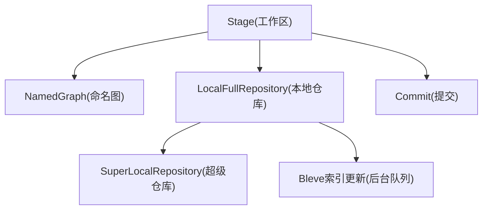
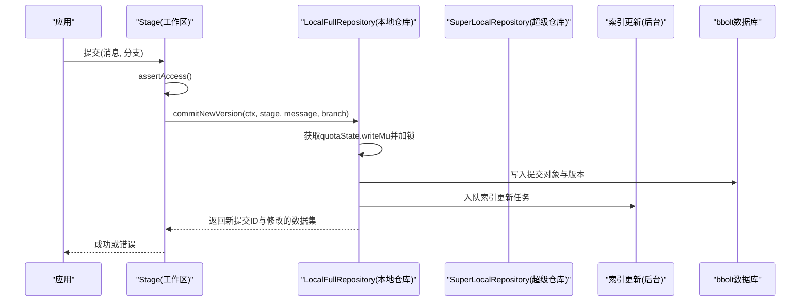
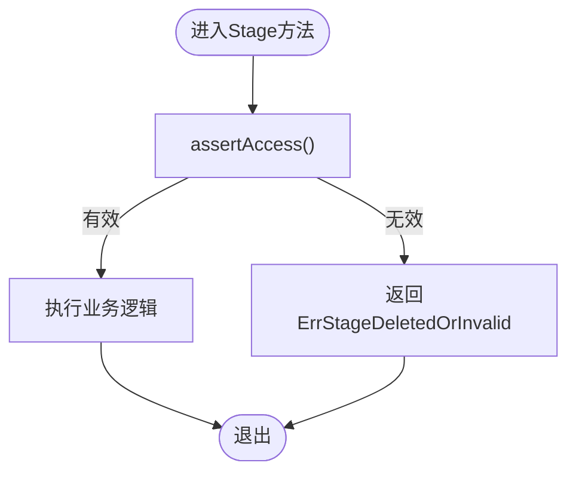
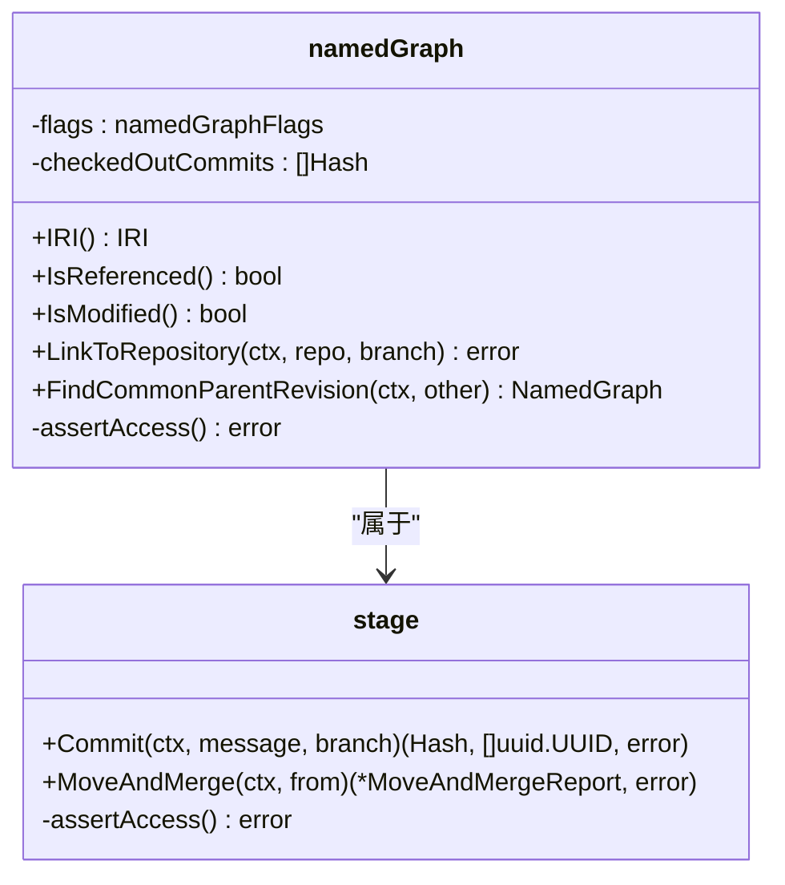
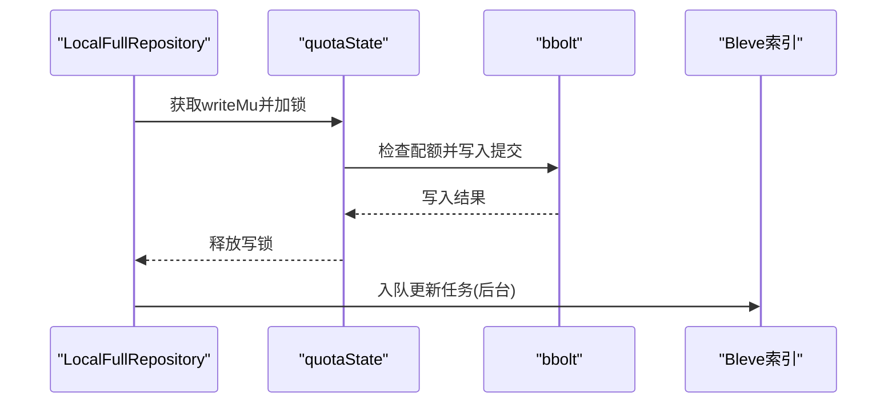
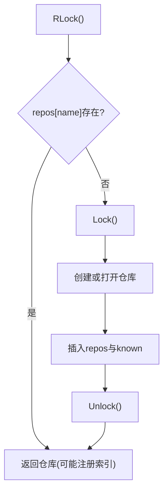
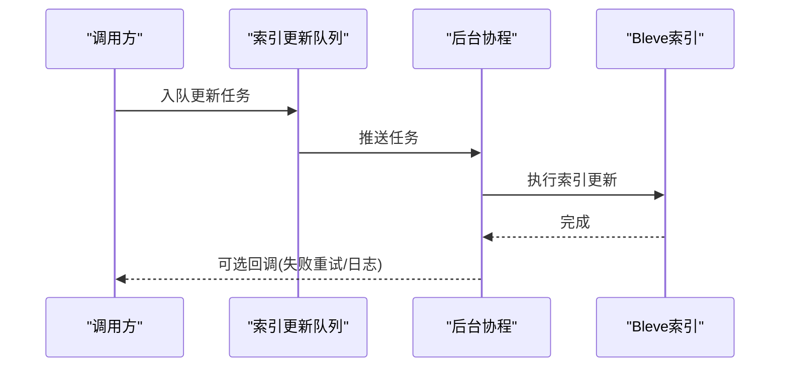
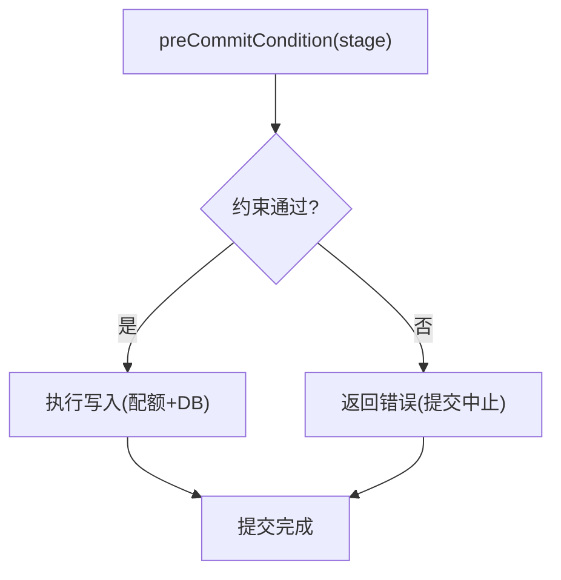
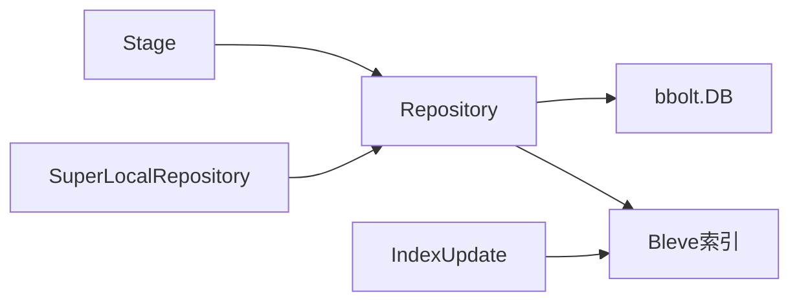

# 并发控制

<cite>
**本文引用的文件**
- [stage.go](file://sst/stage.go)
- [namedgraph.go](file://sst/namedgraph.go)
- [repolocalfull.go](file://sst/repolocalfull.go)
- [superlocalrepository.go](file://sst/superlocalrepository.go)
- [indexupdate.go](file://sst/indexupdate.go)
- [commit.go](file://sst/commit.go)
</cite>

## 目录
1. [简介](#简介)
2. [项目结构](#项目结构)
3. [核心组件](#核心组件)
4. [架构总览](#架构总览)
5. [详细组件分析](#详细组件分析)
6. [依赖关系分析](#依赖关系分析)
7. [性能考虑](#性能考虑)
8. [故障排查指南](#故障排查指南)
9. [结论](#结论)
10. [附录](#附录)

## 简介
本文件聚焦于SST核心库中的并发控制机制，围绕以下目标展开：
- 工作区（Stage）级别的锁机制与访问控制策略
- 多阶段（Stage）并发操作的安全性与隔离级别
- 命名图（NamedGraph）级别的并发控制与读写保护
- 跨仓库操作的并发安全与数据一致性保证
- 预提交条件检查在并发环境下的执行顺序与冲突解决
- 并发性能优化建议与最佳实践
- 常见并发问题及解决方案的实际案例

## 项目结构
与并发控制直接相关的核心代码位于 sst 包中，关键文件包括：
- Stage 接口与实现：定义工作区生命周期、提交、合并等并发敏感操作
- NamedGraph：命名图的内存模型与变更标记
- LocalFullRepository：本地仓库的提交路径、配额与索引更新
- SuperLocalRepository：超级仓库对多个仓库的并发管理
- IndexUpdate：后台索引更新的并发队列
- Commit：提交元数据结构

图表来源
- [stage.go:53-234](file://sst/stage.go#L53-L234)
- [namedgraph.go:42-108](file://sst/namedgraph.go#L42-L108)
- [repolocalfull.go:220-257](file://sst/repolocalfull.go#L220-L257)
- [superlocalrepository.go:90-99](file://sst/superlocalrepository.go#L90-L99)
- [indexupdate.go:78-92](file://sst/indexupdate.go#L78-L92)
- [commit.go:18-29](file://sst/commit.go#L18-L29)

章节来源
- [stage.go:53-234](file://sst/stage.go#L53-L234)
- [namedgraph.go:42-108](file://sst/namedgraph.go#L42-L108)
- [repolocalfull.go:220-257](file://sst/repolocalfull.go#L220-L257)
- [superlocalrepository.go:90-99](file://sst/superlocalrepository.go#L90-L99)
- [indexupdate.go:78-92](file://sst/indexupdate.go#L78-L92)
- [commit.go:18-29](file://sst/commit.go#L18-L29)

## 核心组件
- 工作区（Stage）
  - 负责管理一组命名图（本地与引用），提供创建、查询、提交、移动合并等操作
  - 通过 assertAccess 进行有效性校验，避免使用已失效的工作区
- 命名图（NamedGraph）
  - 维护节点集合与三元组存储，包含修改标记（modified）、引用状态（isReferenced）等
  - 提供 LinkToRepository、FindCommonParentRevision 等与仓库历史相关的能力
- 本地仓库（LocalFullRepository）
  - 封装 bbolt 数据库访问、配额状态、Bleve 索引注册与更新
  - 提供 OpenStage、RegisterIndexHandler、buildBleveIndex 等方法
- 超级仓库（SuperLocalRepository）
  - 管理多个仓库实例，维护打开的仓库映射与配额配置
  - 使用读写锁保护仓库列表与已知仓库集合
- 索引更新（IndexUpdate）
  - 将 Bleve I/O 操作排队到专用后台协程，避免阻塞主流程
- 提交（Commit）
  - 描述一次提交的元信息，包括父提交、数据集版本、命名图版本等

章节来源
- [stage.go:53-234](file://sst/stage.go#L53-L234)
- [namedgraph.go:42-108](file://sst/namedgraph.go#L42-L108)
- [repolocalfull.go:220-257](file://sst/repolocalfull.go#L220-L257)
- [superlocalrepository.go:90-99](file://sst/superlocalrepository.go#L90-L99)
- [indexupdate.go:78-92](file://sst/indexupdate.go#L78-L92)
- [commit.go:18-29](file://sst/commit.go#L18-L29)

## 架构总览
下图展示了从应用调用到提交落盘的并发控制关键点：
- 工作区在提交前进行访问有效性检查
- 仓库层串行化配额检查与写入，确保原子性
- 索引更新走后台队列，降低阻塞
- 超级仓库以读写锁保护仓库表

图表来源
- [stage.go:1381-1400](file://sst/stage.go#L1381-L1400)
- [repolocalfull.go:210-257](file://sst/repolocalfull.go#L210-L257)
- [indexupdate.go:78-92](file://sst/indexupdate.go#L78-L92)

## 详细组件分析

### 工作区（Stage）并发控制
- 访问控制
  - 所有公开方法在进入时调用 assertAccess，若工作区无效则立即返回错误，防止对已关闭或无效对象的并发访问
- 提交流程
  - Commit 先校验工作区有效性，再委托仓库执行提交；成功后重置各命名图的 modified 标志
- 移动合并（MoveAndMerge）
  - 对源与目标工作区均进行访问检查；根据是否跨仓库设置 modified 标志，并在必要时更新三元组索引
- 隔离级别
  - 每个 Stage 持有独立的本地与引用命名图映射，天然隔离不同工作区的内存视图
  - 与仓库交互时通过仓库层的锁与事务语义保证一致性

图表来源
- [stage.go:1318-1323](file://sst/stage.go#L1318-L1323)
- [stage.go:1381-1400](file://sst/stage.go#L1381-L1400)
- [stage.go:468-494](file://sst/stage.go#L468-L494)

章节来源
- [stage.go:1318-1323](file://sst/stage.go#L1318-L1323)
- [stage.go:1381-1400](file://sst/stage.go#L1381-L1400)
- [stage.go:468-494](file://sst/stage.go#L468-L494)

### 命名图（NamedGraph）并发控制
- 访问控制
  - 内部方法通过 assertAccess 校验所属 Stage 是否有效，避免对已失效命名图的访问
- 修改标记
  - 命名图维护 flags.modified，用于标识自上次提交后是否被修改；在提交成功后由 Stage 统一复位
- 引用与链接
  - LinkToRepository 会检查是否为引用状态、是否已删除、是否已有历史元数据，防止重复链接与覆盖
- 三向合并支持
  - FindCommonParentRevision 基于仓库历史查找共同祖先，为 MoveAndMerge 提供合并基础

图表来源
- [namedgraph.go:42-108](file://sst/namedgraph.go#L42-L108)
- [namedgraph.go:415-503](file://sst/namedgraph.go#L415-L503)
- [namedgraph.go:572-622](file://sst/namedgraph.go#L572-L622)
- [stage.go:1381-1400](file://sst/stage.go#L1381-L1400)

章节来源
- [namedgraph.go:415-503](file://sst/namedgraph.go#L415-L503)
- [namedgraph.go:572-622](file://sst/namedgraph.go#L572-L622)
- [stage.go:1381-1400](file://sst/stage.go#L1381-L1400)

### 本地仓库（LocalFullRepository）并发控制
- 配额与写入串行化
  - quotaState 内嵌 writeMu（sync.Mutex），用于串行化配额检查与写入，确保 DocumentSet/Commit 的原子性
- 索引注册与更新
  - RegisterIndexHandler 可设置 preCommitCondition，结合后台索引更新器，将索引构建与增量更新解耦
- 构建索引
  - buildBleveIndex 负责清理旧索引、创建新索引并持久化 deriveInfo，保证索引一致性与健康度

图表来源
- [repolocalfull.go:210-257](file://sst/repolocalfull.go#L210-L257)
- [repolocalfull.go:259-341](file://sst/repolocalfull.go#L259-L341)
- [repolocalfull.go:345-399](file://sst/repolocalfull.go#L345-L399)

章节来源
- [repolocalfull.go:210-257](file://sst/repolocalfull.go#L210-L257)
- [repolocalfull.go:259-341](file://sst/repolocalfull.go#L259-L341)
- [repolocalfull.go:345-399](file://sst/repolocalfull.go#L345-L399)

### 超级仓库（SuperLocalRepository）并发控制
- 仓库表保护
  - repos 与 known 映射受 mu（sync.RWMutex）保护，读多写少场景下提升并发性能
- 仓库获取与创建
  - Get 在读取时使用读锁，必要时升级为写锁插入新仓库；Create 全程持写锁
- 配额加载与保存
  - loadQuotas 与 saveQuotasLocked 配合，确保配额配置的并发安全

图表来源
- [superlocalrepository.go:90-99](file://sst/superlocalrepository.go#L90-L99)
- [superlocalrepository.go:233-281](file://sst/superlocalrepository.go#L233-L281)
- [superlocalrepository.go:283-289](file://sst/superlocalrepository.go#L283-L289)

章节来源
- [superlocalrepository.go:233-281](file://sst/superlocalrepository.go#L233-L281)
- [superlocalrepository.go:283-289](file://sst/superlocalrepository.go#L283-L289)

### 索引更新（IndexUpdate）并发控制
- 后台队列
  - 将 Bleve I/O 操作排队到专用后台协程，避免阻塞主线程
- 停止信号
  - 使用 stop 通道协调后台协程的生命周期

图表来源
- [indexupdate.go:78-92](file://sst/indexupdate.go#L78-L92)
- [indexupdate.go:125-125](file://sst/indexupdate.go#L125-L125)

章节来源
- [indexupdate.go:78-92](file://sst/indexupdate.go#L78-L92)
- [indexupdate.go:125-125](file://sst/indexupdate.go#L125-L125)

### 预提交条件检查（Pre-commit Condition）
- 注册时机
  - 在 RegisterIndexHandler 中设置 preCommitCondition，用于在提交前执行约束检查（如唯一性）
- 执行顺序
  - 提交流程中，仓库层在执行实际写入前调用预提交条件；通过后继续写入，否则中止提交
- 冲突解决
  - 若预提交条件失败，返回错误；上层可据此重试或提示用户修正

图表来源
- [repolocalfull.go:310-323](file://sst/repolocalfull.go#L310-L323)
- [stage.go:1381-1400](file://sst/stage.go#L1381-L1400)

章节来源
- [repolocalfull.go:310-323](file://sst/repolocalfull.go#L310-L323)
- [stage.go:1381-1400](file://sst/stage.go#L1381-L1400)

## 依赖关系分析
- Stage 依赖 Repository 接口进行提交与历史查询
- NamedGraph 依赖 Stage 的生命周期与访问控制
- LocalFullRepository 依赖 bbolt 数据库与 Bleve 索引
- SuperLocalRepository 依赖多个 Repository 实例与配额配置
- 索引更新模块独立于主提交路径，通过队列异步执行

图表来源
- [stage.go:53-234](file://sst/stage.go#L53-L234)
- [repolocalfull.go:220-257](file://sst/repolocalfull.go#L220-L257)
- [superlocalrepository.go:90-99](file://sst/superlocalrepository.go#L90-L99)
- [indexupdate.go:78-92](file://sst/indexupdate.go#L78-L92)

章节来源
- [stage.go:53-234](file://sst/stage.go#L53-L234)
- [repolocalfull.go:220-257](file://sst/repolocalfull.go#L220-L257)
- [superlocalrepository.go:90-99](file://sst/superlocalrepository.go#L90-L99)
- [indexupdate.go:78-92](file://sst/indexupdate.go#L78-L92)

## 性能考虑
- 减少锁竞争
  - 使用读写锁（RWMutex）保护读多写少的结构（如仓库表）
  - 将耗时 I/O（索引更新）移至后台队列，避免阻塞主路径
- 批处理与去重
  - 在预提交条件中使用批量更新缓存（如 sync.Map）减少重复计算
- 合理粒度
  - 将配额检查与写入串行化，但保持其他读操作并发
- 内存与索引平衡
  - 根据 TriplexMode 调整内存占用与遍历性能

[本节为通用指导，不直接分析具体文件]

## 故障排查指南
- 工作区无效
  - 现象：调用 Stage 方法返回 ErrStageDeletedOrInvalid
  - 排查：确认未对已 Close 的 Stage 进行操作；检查 MoveAndMerge 后源 Stage 是否仍被使用
- 命名图无效
  - 现象：NamedGraph 方法返回 ErrNamedGraphInvalid
  - 排查：确认所属 Stage 有效；避免对已删除或引用状态的非法操作
- 提交失败
  - 现象：Commit 返回错误
  - 排查：检查预提交条件是否通过；查看配额是否超限；确认仓库连接正常
- 索引不一致
  - 现象：搜索或导出结果异常
  - 排查：触发重建索引；检查后台队列是否有未完成任务

章节来源
- [stage.go:1318-1323](file://sst/stage.go#L1318-L1323)
- [namedgraph.go:1477-1482](file://sst/namedgraph.go#L1477-L1482)
- [repolocalfull.go:310-341](file://sst/repolocalfull.go#L310-L341)

## 结论
SST 通过工作区级访问控制、仓库级串行化写入、命名图修改标记、超级仓库读写锁以及后台索引队列，构建了稳健的并发控制体系。该设计在保证一致性的同时，兼顾了性能与可扩展性。建议在应用中遵循以下原则：
- 严格管理 Stage 生命周期，避免使用已失效对象
- 利用预提交条件进行业务约束检查
- 将耗时 I/O 放入后台队列，减少主路径阻塞
- 在高并发场景下合理使用读写锁与批处理

[本节为总结，不直接分析具体文件]

## 附录
- 术语
  - 工作区（Stage）：内存中的 RDF 图集合，支持提交与合并
  - 命名图（NamedGraph）：RDF 图的内存表示，包含节点与三元组
  - 本地仓库（LocalFullRepository）：基于 bbolt 的本地仓库实现
  - 超级仓库（SuperLocalRepository）：管理多个仓库的容器
  - 预提交条件（Pre-commit Condition）：提交前的约束检查钩子

[本节为概念说明，不直接分析具体文件]