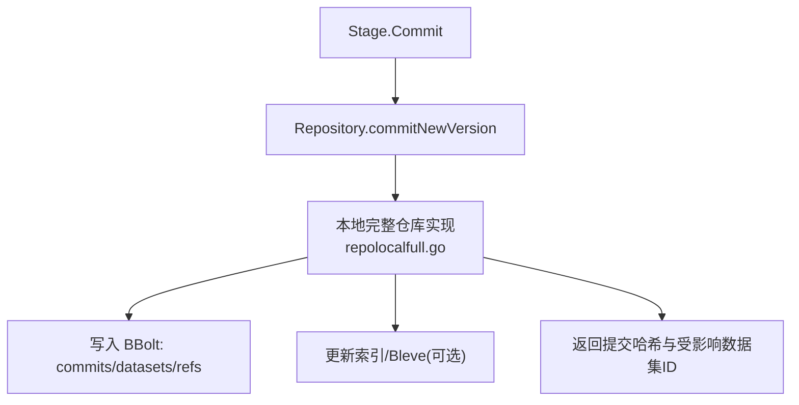
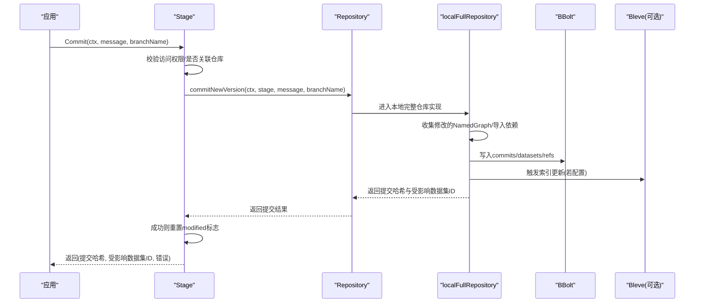
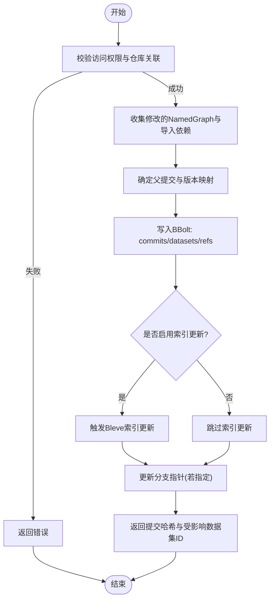
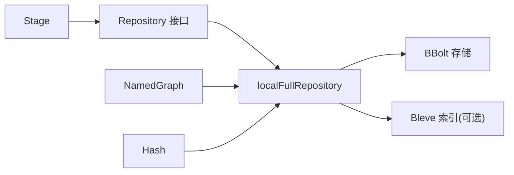

# 提交操作

<cite>
**本文引用的文件**
- [commit.go](file://sst/commit.go)
- [hash.go](file://sst/hash.go)
- [stage.go](file://sst/stage.go)
- [repository.go](file://sst/repository.go)
- [repolocalfull.go](file://sst/repolocalfull.go)
- [namedgraph.go](file://sst/namedgraph.go)
- [repointernalcommit.go](file://sst/repointernalcommit.go)
</cite>

## 目录
1. [简介](#简介)
2. [项目结构](#项目结构)
3. [核心组件](#核心组件)
4. [架构总览](#架构总览)
5. [详细组件分析](#详细组件分析)
6. [依赖关系分析](#依赖关系分析)
7. [性能考量](#性能考量)
8. [故障排查指南](#故障排查指南)
9. [结论](#结论)
10. [附录：使用示例与最佳实践](#附录使用示例与最佳实践)

## 简介
本文件聚焦于 SST 仓库的“提交（Commit）”操作，系统性说明从 Stage 到 Repository 的完整提交流程，包括变更检测、版本创建、数据持久化、分支更新、预提交条件检查、错误处理与回滚策略。同时解释提交消息（message）和分支名称（branchName）参数的作用与处理逻辑，阐述提交哈希值的生成机制与唯一性保证，并说明在提交过程中创建的 NamedGraphRevision 与 DatasetRevisions 的创建规则。最后提供不同场景下的实际调用路径与注意事项。

## 项目结构
围绕提交操作的关键代码分布在以下模块：
- Stage 层：对外暴露 Commit(ctx, message, branchName)，负责前置校验与委托 Repository 完成真正提交。
- Repository 接口与实现：定义 commitNewVersion 内部方法，封装提交的核心流程；本地完整仓库实现位于 repolocalfull.go。
- 命名图与数据集模型：NamedGraph 维护检出元数据（checkedOutCommits/NGRevisions/DSRevisions），用于构建父提交链与版本关系。
- 哈希与版本标识：Hash 类型基于 SHA-256，Base58 编码输出固定长度字符串，作为提交、数据集版本、命名图版本的唯一标识。
- 提交关系比较与祖先判定：repointernalcommit.go 提供 compareCommits/isCommitAncestor 等工具，支撑多数据集合并与冲突检测。

图表来源
- [stage.go:1381-1401](file://sst/stage.go#L1381-L1401)
- [repository.go:130-131](file://sst/repository.go#L130-L131)
- [repolocalfull.go:1-200](file://sst/repolocalfull.go#L1-L200)

章节来源
- [stage.go:1381-1401](file://sst/stage.go#L1381-L1401)
- [repository.go:130-131](file://sst/repository.go#L130-L131)

## 核心组件
- Stage.Commit：入口方法，进行访问权限校验、是否关联仓库校验，然后调用 Repository.commitNewVersion 执行提交。成功后将 Stage 内所有本地 NamedGraph 的 modified 标志复位。
- Repository.commitNewVersion：由具体仓库实现（如 localFullRepository）完成变更收集、父提交确定、版本对象创建、持久化与分支指针更新。
- Hash：SHA-256 字节数组，Base58 定长字符串表示，用于提交、数据集版本、命名图版本的全局唯一标识。
- NamedGraph 检出元数据：checkedOutCommits/checkedOutNGRevisions/checkedOutDSRevisions 用于记录当前工作图的父提交与版本信息，确保提交时能正确建立版本链。
- 提交关系工具：compareCommits/isCommitAncestor 等用于跨数据集/分支的祖先关系判断与合并策略支持。

章节来源
- [stage.go:1381-1401](file://sst/stage.go#L1381-L1401)
- [repository.go:130-131](file://sst/repository.go#L130-L131)
- [hash.go:51-132](file://sst/hash.go#L51-L132)
- [namedgraph.go:75-107](file://sst/namedgraph.go#L75-L107)
- [repointernalcommit.go:47-144](file://sst/repointernalcommit.go#L47-L144)

## 架构总览
提交操作的端到端序列如下：

图表来源
- [stage.go:1381-1401](file://sst/stage.go#L1381-L1401)
- [repository.go:130-131](file://sst/repository.go#L130-L131)
- [repolocalfull.go:1-200](file://sst/repolocalfull.go#L1-L200)

## 详细组件分析

### 提交入口与参数处理（Stage.Commit）
- 参数
  - message：提交消息，用于审计与日志记录。空消息在高层调用处可能被拒绝（例如 MCP 层会校验非空）。
  - branchName：目标分支名。为空时不更新任何分支指针；非空时为每个受影响的数据集将该分支指向新提交。
- 流程要点
  - 权限与状态校验：未关联仓库或不可写直接返回错误。
  - 委托 Repository.commitNewVersion 完成核心逻辑。
  - 成功后将 Stage 中所有本地 NamedGraph 的 modified 标志置为 false，避免重复提交。

章节来源
- [stage.go:1381-1401](file://sst/stage.go#L1381-L1401)
- [mcp/cmd/session.go:1177-1214](file://mcp/cmd/session.go#L1177-L1214)

### 变更检测与父提交确定
- 变更来源
  - 遍历 Stage 中的本地 NamedGraph，标记 modified=true 的图将被纳入本次提交。
  - 考虑导入关系：若被导入的 NamedGraph 发生变化，其上游导入者对应的 Dataset 也需要产生新版本。
- 父提交链
  - 对于每个受影响的 Dataset，根据当前检出的 checkedOutCommits/NGRevisions/DSRevisions 确定父提交。
  - 若无历史（首次提交或新分支），则无父提交；否则以当前分支尖端或检出点作为父提交。
- 多数据集一致性
  - 通过 compareCommits/isCommitAncestor 等工具函数，在多数据集/分支间判断祖先关系，确保提交树一致。

章节来源
- [stage.go:1566-1579](file://sst/stage.go#L1566-L1579)
- [namedgraph.go:75-107](file://sst/namedgraph.go#L75-L107)
- [repointernalcommit.go:47-144](file://sst/repointernalcommit.go#L47-L144)

### 版本创建与数据持久化（Repository.commitNewVersion）
- 主要职责
  - 计算并提交新的提交哈希（Hash），该哈希由提交内容派生，具备强唯一性与不可变性。
  - 为每个受影响的 NamedGraph 创建 NamedGraphRevision，并为每个受影响的 Dataset 创建 DatasetRevision。
  - 将提交元数据（作者、时间、消息、父提交、数据集/命名图版本映射）写入 BBolt 的 commits 桶。
  - 更新 datasets 桶中的引用（分支指针 refBranchPrefix、叶子提交 refLeafPrefix）。
  - 可选地触发 Bleve 索引更新，使查询可立即生效。
- 分支更新
  - 当 branchName 非空时，对每个受影响的数据集将其分支指针指向新提交；若分支不存在则新建。
- 原子性与事务
  - 使用 BBolt 事务批量写入，失败时整体回滚，保证一致性。

章节来源
- [repository.go:130-131](file://sst/repository.go#L130-L131)
- [repolocalfull.go:1-200](file://sst/repolocalfull.go#L1-L200)

### 提交哈希的生成与唯一性保证
- 哈希类型
  - Hash 为 32 字节 SHA-256 值，Base58 编码后固定长度为 44 字符，便于人类可读与排序。
- 唯一性
  - 提交哈希由提交内容（包含父提交、数据集/命名图版本映射、作者、时间戳、消息等）经哈希函数计算得到，任何内容变化都会导致哈希变化。
  - Base58 前缀填充确保短串比较与排序的一致性。
- 用途
  - 作为提交、数据集版本、命名图版本的全局唯一标识，贯穿日志、分支指针、版本回溯等。

章节来源
- [hash.go:51-132](file://sst/hash.go#L51-L132)

### NamedGraphRevision 与 DatasetRevisions 的创建规则
- NamedGraphRevision
  - 每次提交中，每个被修改的 NamedGraph 都会产生一个新的 NamedGraphRevision 哈希，记录其内容快照。
  - 若某 NamedGraph 被删除，对应 Dataset 的版本仍会记录，但 NamedGraphRevision 字段可能置为空（HashNil），并在后续访问时返回相应错误。
- DatasetRevisions
  - 每个受影响的 Dataset 会产生新的 DatasetRevision，包含其默认 NamedGraph 与其他导入 NamedGraph 的版本映射。
  - 若导入链中任一子图发生变化，上层 Dataset 也会产生新版本，以保证一致性。
- 版本映射
  - 提交元数据中包含 DatasetRevisions 与 NamedGraphRevisions 的映射，供查询与回溯使用。

章节来源
- [commit.go:18-29](file://sst/commit.go#L18-L29)
- [namedgraph.go:281-294](file://sst/namedgraph.go#L281-L294)

### 预提交条件检查（Pre-commit conditions）与错误处理
- 预提交钩子
  - Repository 配置项 preCommitCondition 允许在提交前执行自定义检查（如配额、约束验证）。
  - 若预提交条件失败，提交将被中止并返回错误。
- 常见错误
  - 空提交消息：在高层调用处可能被拒绝。
  - 未关联仓库：Stage 未链接到 Repository 时无法提交。
  - 预提交失败：返回 ErrPreCommitConditionFailed。
  - 其他 I/O 或网络错误：由底层存储或远程仓库返回。
- 错误传播
  - 错误沿调用栈向上传播，调用方需据此决定重试、提示用户或终止流程。

章节来源
- [repository.go:217-231](file://sst/repository.go#L217-L231)
- [stage.go:21-31](file://sst/stage.go#L21-L31)

### 提交失败的回滚策略与异常恢复
- 事务回滚
  - 本地完整仓库实现使用 BBolt 事务进行批量写入；任何步骤失败均触发回滚，确保数据库一致性。
- 分支指针保护
  - 分支指针仅在提交成功后更新；若中间步骤失败，不会留下不一致的引用。
- 内存状态清理
  - 提交成功后才重置 Stage 中 NamedGraph 的 modified 标志；失败时保持原状，便于重试。
- 恢复建议
  - 捕获错误后检查是否为预提交失败、权限不足或存储错误；必要时调整输入或重试。

章节来源
- [repolocalfull.go:1-200](file://sst/repolocalfull.go#L1-L200)
- [stage.go:1381-1401](file://sst/stage.go#L1381-L1401)

### 复杂逻辑流程图（提交主流程）

图表来源
- [stage.go:1381-1401](file://sst/stage.go#L1381-L1401)
- [repolocalfull.go:1-200](file://sst/repolocalfull.go#L1-L200)

## 依赖关系分析
- Stage 依赖 Repository 接口，解耦了提交的具体实现。
- Repository 接口由多种实现提供（本地基础、本地完整、远程等），其中本地完整仓库承担完整的版本历史与分支管理。
- NamedGraph 与 Dataset 通过检出元数据与版本映射耦合，确保提交时能正确构建版本链。
- Hash 类型贯穿整个系统，作为不可变标识符。
- 预提交条件与索引更新通过 Repository 配置注入，增强扩展性。

图表来源
- [repository.go:50-179](file://sst/repository.go#L50-L179)
- [repolocalfull.go:1-200](file://sst/repolocalfull.go#L1-L200)
- [hash.go:51-132](file://sst/hash.go#L51-L132)

章节来源
- [repository.go:50-179](file://sst/repository.go#L50-L179)
- [repolocalfull.go:1-200](file://sst/repolocalfull.go#L1-L200)

## 性能考量
- 并发祖先判定：compareCommits 中使用 goroutine 并行判断祖先关系，提升多数据集比较效率。
- 事务批处理：BBolt 事务减少磁盘同步次数，提高写入吞吐。
- 索引更新解耦：bleveIndexUpdater 将索引维护与数据存储分离，避免阻塞主提交路径。
- 内存优化：仅对修改的 NamedGraph 进行提交，减少不必要的数据复制与序列化。

章节来源
- [repointernalcommit.go:107-126](file://sst/repointernalcommit.go#L107-L126)
- [repository.go:225-231](file://sst/repository.go#L225-L231)

## 故障排查指南
- 常见错误
  - 空提交消息：在高层调用处被拒绝，需确保 message 非空。
  - 未关联仓库：Stage 未链接到 Repository，需先 LinkToRepository。
  - 预提交失败：检查 preCommitCondition 的实现与返回值。
  - 分支不存在：首次提交到新分支时，分支指针会被创建；若后续操作失败，检查事务完整性。
- 定位建议
  - 查看返回的错误类型与上下文，优先确认权限与仓库关联。
  - 检查 BBolt 事务是否成功提交，必要时回滚并重试。
  - 若启用索引更新，确认 Bleve 初始化与写入是否正常。

章节来源
- [stage.go:21-31](file://sst/stage.go#L21-L31)
- [repository.go:217-231](file://sst/repository.go#L217-L231)

## 结论
SST 的提交操作通过 Stage 与 Repository 的分层设计，实现了清晰的职责划分与可扩展性。提交流程涵盖变更检测、父提交确定、版本对象创建、持久化与分支更新，并通过 Hash 保证版本唯一性。预提交条件与事务回滚提供了健壮的错误处理与一致性保障。合理配置预提交条件与索引更新策略，可在保证一致性的同时提升性能。

## 附录：使用示例与最佳实践
- 基本提交
  - 调用 Stage.Commit(ctx, message, branchName)，确保 Stage 已关联仓库且具备写权限。
  - 若 branchName 为空，仅创建提交而不更新分支指针；非空时将更新对应数据集的分支。
- 新分支提交
  - 首次提交到新分支时，分支指针将被创建；后续提交将继续推进该分支。
- 无历史提交
  - 对于无历史的新数据集或新分支，提交将无父提交；后续提交将基于此构建版本链。
- 删除 NamedGraph
  - 删除操作会在 Dataset 版本中体现，但 NamedGraphRevision 字段可能为空；访问删除后的图将返回相应错误。
- 预提交条件
  - 在 Repository 配置中注册 preCommitCondition，实现业务约束（如配额、格式校验）。
- 索引更新
  - 如需即时查询能力，确保 RegisterIndexHandler 已配置并启用 bleveIndexUpdater。

章节来源
- [stage.go:1381-1401](file://sst/stage.go#L1381-L1401)
- [repository.go:217-231](file://sst/repository.go#L217-L231)
- [namedgraph.go:281-294](file://sst/namedgraph.go#L281-L294)