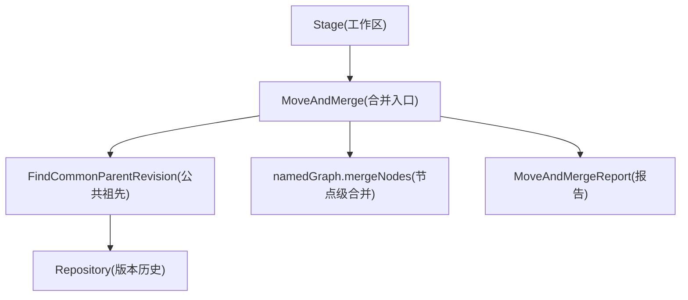
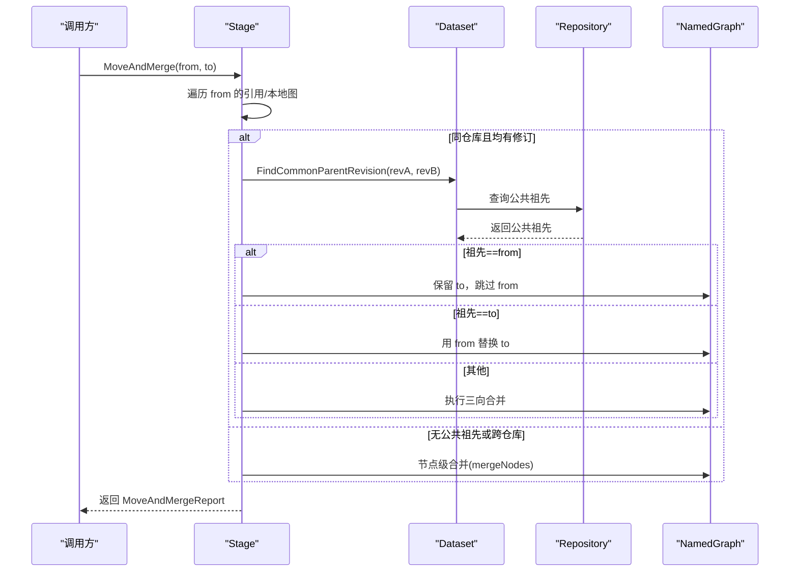
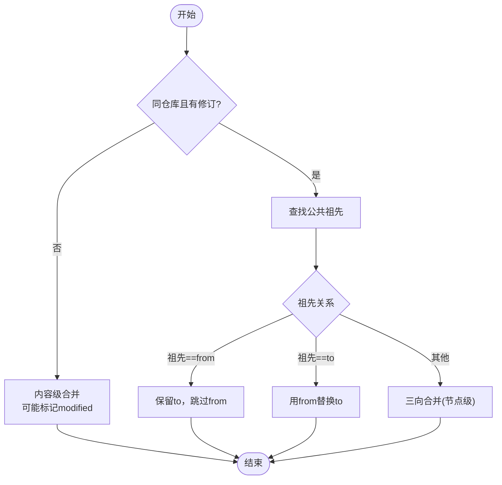
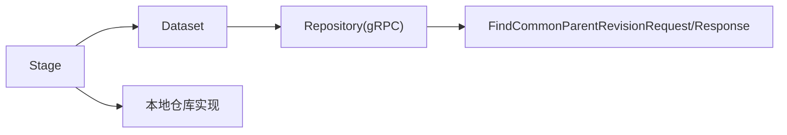

# 冲突解决

<cite>
**本文引用的文件**
- [stage.go](file://sst/stage.go)
- [dataset.go](file://sst/dataset.go)
- [repository.pb.go](file://bboltproto/repository.pb.go)
- [repolocalfull.go](file://sst/repolocalfull.go)
- [indexupdate.go](file://sst/indexupdate.go)
- [remoteRepository_test.go](file://sst_test/remoteRepository_test.go)
- [syncfrom_test.go](file://sst_test/syncfrom_test.go)
- [alignhistory_test.go](file://sst_test/alignhistory_test.go)
</cite>

## 目录
1. [简介](#简介)
2. [项目结构](#项目结构)
3. [核心组件](#核心组件)
4. [架构总览](#架构总览)
5. [详细组件分析](#详细组件分析)
6. [依赖关系分析](#依赖关系分析)
7. [性能考量](#性能考量)
8. [故障排查指南](#故障排查指南)
9. [结论](#结论)
10. [附录](#附录)

## 简介
本文件聚焦 SST 系统中的“冲突检测与解决”机制，围绕 MoveAndMerge 流程展开，说明：
- 冲突检测的触发条件与类型（数据修改、结构变更、跨仓库合并等）
- 自动冲突解决算法的工作原理（基于版本历史的智能合并策略）
- 手动冲突解决的方法与最佳实践
- 冲突报告 MoveAndMergeReport 的格式与分析方法
- 常见冲突场景的处理示例
- 冲突预防策略与性能优化建议

## 项目结构
SST 的冲突处理主要位于 Stage 层（内存工作区）与 Dataset/Repository 层（版本历史与持久化）。关键路径包括：
- Stage.MoveAndMerge：负责将源阶段（from）的图迁移并合并到目标阶段（to），并在必要时进行三向合并或替换。
- Dataset.FindCommonParentRevision：在仓库中查找两个修订的公共祖先，用于三向合并决策。
- Repository/本地实现：提供分支、提交、同步等能力，支撑冲突检测与合并。

图表来源
- [stage.go:468-874](file://sst/stage.go#L468-L874)
- [dataset.go:84-93](file://sst/dataset.go#L84-L93)

章节来源
- [stage.go:468-874](file://sst/stage.go#L468-L874)
- [dataset.go:84-93](file://sst/dataset.go#L84-L93)

## 核心组件
- Stage 接口与实现：管理本地与引用图，提供 MoveAndMerge、Commit、AlignHistory 等方法。
- MoveAndMergeReport：记录每次合并的动作、统计、时间、是否跨仓库等信息。
- Dataset 接口：提供 FindCommonParentRevision 以支持三向合并。
- Repository 协议与 gRPC 消息：定义 FindCommonParentRevisionRequest/Response 等。

章节来源
- [stage.go:346-433](file://sst/stage.go#L346-L433)
- [dataset.go:84-93](file://sst/dataset.go#L84-L93)
- [repository.pb.go:841-914](file://bboltproto/repository.pb.go#L841-L914)

## 架构总览
SST 的冲突解决采用“基于版本历史的智能合并”策略：
- 当两个 NamedGraph 存在不同修订时，系统尝试在仓库中查找公共祖先。
- 若一方是另一方的祖先，则直接选择较新的修订；否则执行三向合并。
- 若无公共祖先或不在同一仓库，则退化为内容级合并（节点与三元组合并）。
- 跨仓库移动时，会标记为已修改，确保后续提交能正确反映变更。

图表来源
- [stage.go:468-874](file://sst/stage.go#L468-L874)
- [dataset.go:84-93](file://sst/dataset.go#L84-L93)
- [repository.pb.go:841-914](file://bboltproto/repository.pb.go#L841-L914)

## 详细组件分析

### 冲突检测触发条件与类型
- 触发条件
  - 同名 NamedGraph 在 to 与 from 同时存在且修订不同。
  - 跨仓库移动（to.repo != from.repo）导致需标记 modified。
  - 同仓库但无公共祖先，需要回退到内容级合并。
- 冲突类型
  - 数据修改冲突：同一节点的三元组被双方修改。
  - 结构变更冲突：节点增删、导入关系变化、引用/本地图转换。
  - 分支/提交拓扑冲突：一方为另一方祖先时的覆盖策略。

章节来源
- [stage.go:468-874](file://sst/stage.go#L468-L874)
- [stage.go:1060-1178](file://sst/stage.go#L1060-L1178)

### 自动冲突解决算法（基于版本历史的智能合并）
- 步骤
  1) 判断是否同仓库且都有修订；若是，调用 FindCommonParentRevision 获取公共祖先。
  2) 根据公共祖先与两端修订的关系决定：
     - 祖先 == from：保留 to，跳过 from。
     - 祖先 == to：用 from 替换 to。
     - 其他：执行三向合并（当前实现通过 mergeNodes 完成节点级合并）。
  3) 若无公共祖先或跨仓库：执行内容级合并，必要时标记 modified。
- 关键点
  - 跨仓库移动时，会将 moved/merged 的本地图标记为 modified，保证后续 Commit 生效。
  - 对引用图与本地图的相互转换，会更新 directImports/isImportedBy 引用关系。

图表来源
- [stage.go:468-874](file://sst/stage.go#L468-L874)
- [dataset.go:84-93](file://sst/dataset.go#L84-L93)

章节来源
- [stage.go:468-874](file://sst/stage.go#L468-L874)
- [dataset.go:84-93](file://sst/dataset.go#L84-L93)

### 手动冲突解决方法与最佳实践
- 使用 AlignHistory：将外部读取（如 RDF 解析）生成的 Stage 与仓库中的检出元数据对齐，便于在同一仓库内提交。
- 分步合并：先合并引用图，再合并本地图，逐步缩小冲突范围。
- 审查 MoveAndMergeReport：依据 actions 与 stats 定位具体冲突点，必要时回滚并重试。
- 分支策略：在特性分支上合并，确认无误后再合并至主干，减少主干冲突概率。

章节来源
- [stage.go:876-943](file://sst/stage.go#L876-L943)
- [stage.go:376-433](file://sst/stage.go#L376-L433)

### 冲突报告（MoveAndMergeReport）格式与分析
- 字段
  - actions：每个动作的记录（类型、图ID、描述、结果、时间戳）
  - between_repos：是否跨仓库
  - stage_from / stage_to：来源与目标阶段标识
  - start_time / end_time / duration：耗时信息
  - stats：各类动作计数
  - warnings：警告信息
- 分析方法
  - 关注 Action 类型：merge_graph、redirect_graph、change_to_local、mark_modified、update_triples、skip_same_revision、three_way_merge、other
  - 结合 stats 快速评估合并规模与热点
  - 通过 GraphID/BaseIRI 定位具体图，结合 description/result 理解行为

章节来源
- [stage.go:376-433](file://sst/stage.go#L376-L433)

### 常见冲突场景与处理示例
- 数据修改冲突
  - 现象：同一节点的三元组被双方修改。
  - 自动处理：若可找到公共祖先，按祖先关系选择或三向合并；否则节点级合并去重。
  - 参考：[stage.go:1060-1178](file://sst/stage.go#L1060-L1178)
- 结构变更冲突
  - 现象：引用图与本地图转换、导入关系变化。
  - 自动处理：转换类型并更新 directImports/isImportedBy；必要时标记 modified。
  - 参考：[stage.go:572-653](file://sst/stage.go#L572-L653)
- 跨仓库合并
  - 现象：to 与 from 属于不同仓库。
  - 自动处理：标记 modified，确保后续提交包含变更。
  - 参考：[stage.go:491-493](file://sst/stage.go#L491-L493), [stage.go:627-640](file://sst/stage.go#L627-L640)
- 分支/提交拓扑冲突
  - 现象：一方为另一方祖先。
  - 自动处理：保留较新修订或替换。
  - 参考：[stage.go:685-753](file://sst/stage.go#L685-L753)

章节来源
- [stage.go:468-874](file://sst/stage.go#L468-L874)
- [stage.go:1060-1178](file://sst/stage.go#L1060-L1178)

## 依赖关系分析
- Stage 依赖 Dataset 的 FindCommonParentRevision 以进行三向合并决策。
- Repository 通过 gRPC 消息暴露 FindCommonParentRevision 能力。
- 本地仓库实现对数据集引用合并与冲突提示有辅助作用。

图表来源
- [dataset.go:84-93](file://sst/dataset.go#L84-L93)
- [repository.pb.go:841-914](file://bboltproto/repository.pb.go#L841-L914)
- [repolocalfull.go:86-124](file://sst/repolocalfull.go#L86-L124)

章节来源
- [dataset.go:84-93](file://sst/dataset.go#L84-L93)
- [repository.pb.go:841-914](file://bboltproto/repository.pb.go#L841-L914)
- [repolocalfull.go:86-124](file://sst/repolocalfull.go#L86-L124)

## 性能考量
- 优先利用公共祖先判定，避免不必要的三向合并。
- 批量更新三元组索引（updateNgTriples）以减少重复计算。
- 跨仓库合并时仅对必要图标记 modified，降低提交开销。
- 使用 MoveAndMergeReport 的 stats 监控合并热点，优化高频冲突图的结构设计。

## 故障排查指南
- 常见问题
  - 找不到公共祖先：检查两修订是否属于同一 Dataset 且存在于同一仓库。
  - 跨仓库合并未生效：确认 marked modified 逻辑是否触发，以及后续 Commit 是否正确。
  - 唯一约束冲突：在写入时出现唯一性约束违反，需检查主键/标识符冲突。
- 定位方法
  - 查看 MoveAndMergeReport.actions 与 stats，定位失败或异常动作。
  - 检查仓库日志与错误信息，例如唯一约束冲突的错误消息。
  - 使用 AlignHistory 对齐外部 Stage 的检出元数据，确保一致性。

章节来源
- [indexupdate.go:568](file://sst/indexupdate.go#L568)
- [stage.go:376-433](file://sst/stage.go#L376-L433)
- [stage.go:876-943](file://sst/stage.go#L876-L943)

## 结论
SST 的冲突解决以“版本历史驱动的智能合并”为核心，通过公共祖先判定与节点级合并相结合，既保证了合并的正确性，又兼顾了性能与可观测性。MoveAndMergeReport 提供了细粒度的审计能力，便于人工介入与问题定位。配合合理的分支策略与 AlignHistory 使用，可有效降低冲突频率并提升协作效率。

## 附录
- 测试用例参考
  - 多仓库 MoveAndMerge 流程验证：[remoteRepository_test.go:196-249](file://sst_test/remoteRepository_test.go#L196-L249)
  - 同步后分支与提交数验证：[syncfrom_test.go:1180-1215](file://sst_test/syncfrom_test.go#L1180-L1215)
  - 外部删除传播与空图行为：[alignhistory_test.go:783-813](file://sst_test/alignhistory_test.go#L783-L813)