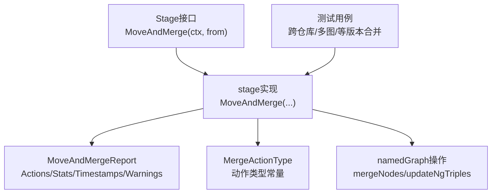
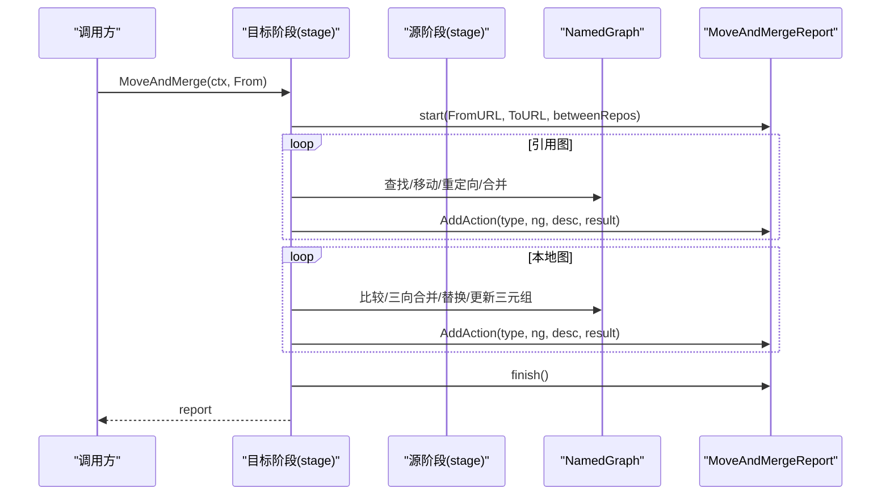
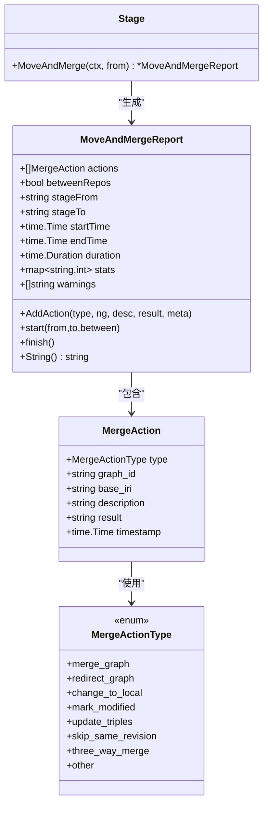

# 合并报告

<cite>
**本文引用的文件**
- [stage.go](file://sst/stage.go)
- [moveandmerge_two_repos_test.go](file://sst_test/moveandmerge_two_repos_test.go)
- [remoteRepositoryMultipleCommits_test.go](file://sst_test/remoteRepositoryMultipleCommits_test.go)
</cite>

## 目录
1. [简介](#简介)
2. [项目结构](#项目结构)
3. [核心组件](#核心组件)
4. [架构总览](#架构总览)
5. [详细组件分析](#详细组件分析)
6. [依赖关系分析](#依赖关系分析)
7. [性能考量](#性能考量)
8. [故障排查指南](#故障排查指南)
9. [结论](#结论)
10. [附录](#附录)

## 简介
本文件围绕 MoveAndMergeReport 的设计与使用进行系统化说明，覆盖以下方面：
- MoveAndMergeReport 的数据结构与字段含义（时间戳、统计数据、警告信息等）
- MergeActionType 各动作类型的语义与统计意义
- 合并流程中的关键决策点与数据流
- 报告的解析、分析与可视化方法
- 基于报告的诊断与性能分析方法
- 最佳实践与监控集成建议

## 项目结构
与合并报告直接相关的代码集中在 sst 包的 stage.go 中，测试用例在 sst_test 下提供了丰富的使用示例。

图表来源
- [stage.go:132-152](file://sst/stage.go#L132-L152)
- [stage.go:348-433](file://sst/stage.go#L348-L433)
- [moveandmerge_two_repos_test.go:118-158](file://sst_test/moveandmerge_two_repos_test.go#L118-L158)

章节来源
- [stage.go:132-152](file://sst/stage.go#L132-L152)
- [stage.go:348-433](file://sst/stage.go#L348-L433)
- [moveandmerge_two_repos_test.go:118-158](file://sst_test/moveandmerge_two_repos_test.go#L118-L158)

## 核心组件
- MoveAndMergeReport：记录一次 MoveAndMerge 操作的完整审计信息，包括动作列表、统计、起止时间与耗时、跨仓库标记、警告等。
- MergeAction：单次动作的明细，包含动作类型、目标图标识、描述、结果、时间戳等。
- MergeActionType：定义合并过程中可能发生的动作类型，用于分类统计与问题定位。

章节来源
- [stage.go:348-433](file://sst/stage.go#L348-L433)

## 架构总览
MoveAndMerge 的核心流程由 Stage.MoveAndMerge 驱动，内部遍历源阶段的引用图和本地图，按策略将源图移动到或合并到目标阶段，并在每一步通过 MoveAndMergeReport.AddAction 记录动作。

图表来源
- [stage.go:468-800](file://sst/stage.go#L468-L800)
- [stage.go:388-433](file://sst/stage.go#L388-L433)

## 详细组件分析

### MoveAndMergeReport 结构与设计
- Actions：逐条记录每次具体动作，便于回溯与审计。
- BetweenRepos：是否跨仓库合并，影响修改标记与后续提交行为。
- StageFrom/StageTo：参与合并的两个阶段标识（仓库URL或临时阶段）。
- StartTime/EndTime/Duration：合并开始与结束时间以及耗时，用于性能分析。
- Stats：按动作类型计数的统计映射，便于快速概览。
- Warnings：收集过程中的告警信息，便于问题定位。

该结构提供 AddAction(start/finish/String) 等方法，自动维护时间戳、统计计数，并支持 JSON 序列化输出。

章节来源
- [stage.go:374-433](file://sst/stage.go#L374-L433)

### MergeActionType 动作类型与语义
- merge_graph：执行图的节点合并（引用图到引用图、引用图到本地图、本地图到本地图等）。
- redirect_graph：将图从源阶段重定向到目标阶段（更新其三元组索引）。
- change_to_local：将目标阶段的引用图转为本地图以承载合并结果。
- mark_modified：跨仓库移动或合并时标记图为已修改，确保提交能正确反映变更。
- update_triples：在重定向或相等版本情况下更新三元组索引。
- skip_same_revision：当存在共同祖先且一方为另一方祖先时，跳过或保留相应版本。
- three_way_merge：在三向合并场景下的合并动作（当前逻辑分支中体现为本地到本地的合并路径）。
- other：其他自定义或兜底动作。

这些类型在统计中聚合，可快速识别合并过程中的主要操作分布。

章节来源
- [stage.go:348-361](file://sst/stage.go#L348-L361)

### 合并流程关键决策与数据流
- 引用图处理：若目标阶段不存在对应引用图，则尝试将其重定向到目标阶段；若目标已有同名本地图，则将引用图内容合并到本地图。
- 本地图处理：
  - 若目标阶段不存在该本地图，则重定向到目标阶段，跨仓库时标记为已修改。
  - 若目标阶段存在同名本地图：
    - 若两者版本相同，仅更新三元组索引；跨仓库时标记为已修改。
    - 若版本不同且同仓库，尝试寻找共同祖先：
      - 若 from 是 to 的祖先，保留 to 并更新三元组。
      - 若 to 是 from 的祖先，用 from 替换 to 并更新所有三元组。
      - 否则执行本地到本地的合并。
    - 若版本不同但跨仓库，直接执行本地到本地合并。

上述决策均在 MoveAndMerge 中完成，并通过 AddAction 记录每一步动作。

章节来源
- [stage.go:498-800](file://sst/stage.go#L498-L800)

### 报告的使用与解析示例
- 基本用法：调用 MoveAndMerge 后获取 report，打印或序列化为 JSON 进行分析。
- 统计读取：通过 report.Stats 获取各动作类型的数量，评估合并复杂度。
- 动作明细：遍历 report.Actions 查看每个动作的类型、目标图、描述与结果，定位异常。
- 时间分析：利用 Start/End/Duration 计算耗时，结合 Stats 分析瓶颈。
- 跨仓库判断：report.BetweenRepos 为 true 时，关注 mark_modified 动作与提交后的修改状态。

章节来源
- [moveandmerge_two_repos_test.go:118-158](file://sst_test/moveandmerge_two_repos_test.go#L118-L158)
- [moveandmerge_two_repos_test.go:247-275](file://sst_test/moveandmerge_two_repos_test.go#L247-L275)
- [moveandmerge_two_repos_test.go:347-390](file://sst_test/moveandmerge_two_repos_test.go#L347-L390)
- [moveandmerge_two_repos_test.go:484-521](file://sst_test/moveandmerge_two_repos_test.go#L484-L521)
- [moveandmerge_two_repos_test.go:594-624](file://sst_test/moveandmerge_two_repos_test.go#L594-L624)
- [remoteRepositoryMultipleCommits_test.go:160-175](file://sst_test/remoteRepositoryMultipleCommits_test.go#L160-L175)

## 依赖关系分析
- Stage.MoveAndMerge 依赖 namedGraph 的合并与三元组更新能力。
- MoveAndMergeReport 依赖 time.Time 与 JSON 编码，提供结构化输出。
- 测试用例验证了跨仓库、多图、等版本等多种场景的正确性。

图表来源
- [stage.go:132-152](file://sst/stage.go#L132-L152)
- [stage.go:348-433](file://sst/stage.go#L348-L433)

章节来源
- [stage.go:132-152](file://sst/stage.go#L132-L152)
- [stage.go:348-433](file://sst/stage.go#L348-L433)

## 性能考量
- 耗时分析：通过 Duration 字段评估整体合并耗时；结合 Actions 的时间戳分析热点步骤。
- 动作分布：Stats 中 merge_graph 与 update_triples 占比高通常意味着大量三元组更新，需关注内存与I/O压力。
- 跨仓库合并：BetweenRepos 为真时，mark_modified 动作增多，提交成本上升，应分批合并以减少单次提交负载。
- 三向合并：当存在共同祖先时，避免不必要的合并，优先采用 skip_same_revision 或替换策略以降低开销。

[本节为通用指导，不直接分析具体文件]

## 故障排查指南
- 常见错误：跨仓库合并时若未正确处理 BetweenRepos，可能导致数据集查找失败或提交异常。测试用例覆盖了此类边界情况。
- 定位方法：
  - 检查 report.Warnings 是否有告警。
  - 遍历 report.Actions，筛选 Result 非 success 的动作。
  - 根据 BaseIRI 与 GraphID 定位具体图，检查其 IsModified 与 Info 信息。
- 典型场景：
  - 跨仓库重定向：确认 redirect_graph 与 mark_modified 同时出现。
  - 等版本合并：确认 update_triples 与可能的 mark_modified（跨仓库）。
  - 多图合并：确认每个图都有对应的动作记录。

章节来源
- [moveandmerge_two_repos_test.go:118-158](file://sst_test/moveandmerge_two_repos_test.go#L118-L158)
- [moveandmerge_two_repos_test.go:347-390](file://sst_test/moveandmerge_two_repos_test.go#L347-L390)
- [moveandmerge_two_repos_test.go:594-624](file://sst_test/moveandmerge_two_repos_test.go#L594-L624)

## 结论
MoveAndMergeReport 提供了对合并过程的细粒度审计与统计能力，结合 MergeActionType 的分类，能够高效定位问题、评估性能并优化合并策略。通过合理解析与可视化报告，可在复杂的多仓库、多图场景中保障数据一致性与系统稳定性。

[本节为总结，不直接分析具体文件]

## 附录

### 报告字段与作用说明
- Actions：逐条动作明细，便于回溯与问题定位。
- BetweenRepos：跨仓库标志，影响修改标记与提交行为。
- StageFrom/StageTo：参与合并的阶段标识。
- StartTime/EndTime/Duration：时间维度指标，用于性能分析。
- Stats：按动作类型统计，快速概览合并复杂度。
- Warnings：告警信息集合，辅助问题诊断。

章节来源
- [stage.go:374-433](file://sst/stage.go#L348-L433)

### 可视化展示技巧
- 饼图：展示 Stats 中各动作类型的占比，识别主要操作。
- 时序图：基于 Actions 的 Timestamp 绘制时间线，观察耗时热点。
- 热力图：按 BaseIRI 聚合动作次数，定位频繁变更的图。
- 趋势图：多次合并的 Duration 变化，评估性能退化。

[本节为概念性内容，不直接分析具体文件]

### 解析与处理示例（路径指引）
- 基本打印与JSON序列化：参考测试中对 report 的直接打印与断言。
- 统计读取与过滤：参考测试中对 report.Stats 的断言。
- 动作明细分析：参考测试中对 report.Actions 的遍历与条件断言。

章节来源
- [moveandmerge_two_repos_test.go:118-158](file://sst_test/moveandmerge_two_repos_test.go#L118-L158)
- [moveandmerge_two_repos_test.go:247-275](file://sst_test/moveandmerge_two_repos_test.go#L247-L275)
- [moveandmerge_two_repos_test.go:347-390](file://sst_test/moveandmerge_two_repos_test.go#L347-L390)
- [moveandmerge_two_repos_test.go:484-521](file://sst_test/moveandmerge_two_repos_test.go#L484-L521)
- [moveandmerge_two_repos_test.go:594-624](file://sst_test/moveandmerge_two_repos_test.go#L594-L624)
- [remoteRepositoryMultipleCommits_test.go:160-175](file://sst_test/remoteRepositoryMultipleCommits_test.go#L160-L175)

### 最佳实践
- 合并前校验：确保源与目标的命名空间与版本兼容，减少不必要的合并。
- 分批合并：大图或多图场景下分批执行，降低单次合并的内存与I/O压力。
- 监控集成：将 report.String() 输出到日志系统，结合 Stats 与 Duration 建立告警规则。
- 提交策略：跨仓库合并后及时提交，避免长时间持有大量修改状态。

[本节为通用指导，不直接分析具体文件]