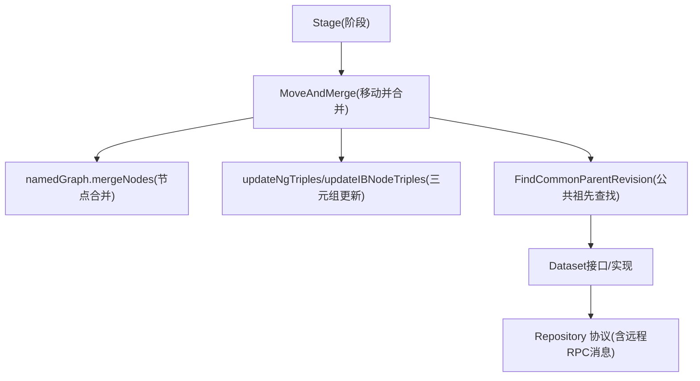
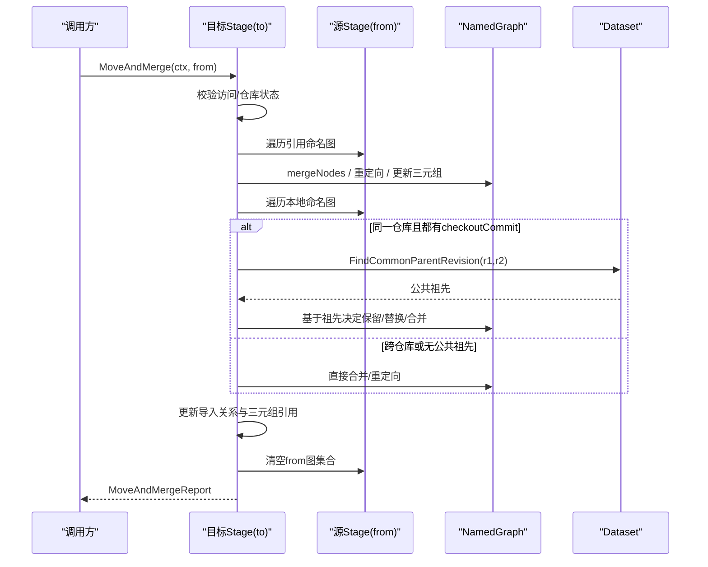
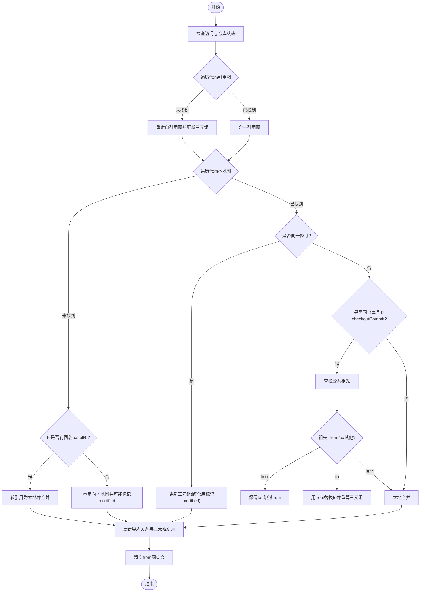
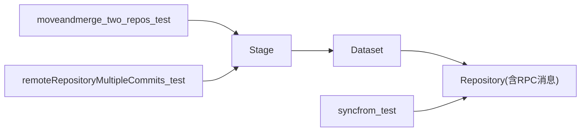

# 合并操作

<cite>
**本文引用的文件**
- [stage.go](file://sst/stage.go)
- [dataset.go](file://sst/dataset.go)
- [repository.pb.go](file://bboltproto/repository.pb.go)
- [moveandmerge_two_repos_test.go](file://sst_test/moveandmerge_two_repos_test.go)
- [remoteRepositoryMultipleCommits_test.go](file://sst_test/remoteRepositoryMultipleCommits_test.go)
- [syncfrom_test.go](file://sst_test/syncfrom_test.go)
</cite>

## 目录
1. [简介](#简介)
2. [项目结构](#项目结构)
3. [核心组件](#核心组件)
4. [架构总览](#架构总览)
5. [详细组件分析](#详细组件分析)
6. [依赖关系分析](#依赖关系分析)
7. [性能考量](#性能考量)
8. [故障排查指南](#故障排查指南)
9. [结论](#结论)
10. [附录](#附录)

## 简介
本文件围绕 SST 仓库中的“合并操作”进行深入说明，重点解释 MoveAndMerge 方法的工作原理、合并策略、本地命名图与引用命名图的不同处理逻辑、冲突检测与自动解决机制、三向合并的实现与应用场景、跨仓库合并的特殊处理与数据同步机制，以及如何分析与解读 MoveAndMergeReport。文档同时提供复杂合并场景的处理示例与最佳实践建议。

## 项目结构
与合并相关的核心实现集中在 Stage 层（内存工作区）与 Dataset 层（版本历史与公共祖先查找），并通过协议定义支持远程能力。测试用例覆盖了跨仓库合并、多提交合并、以及同步等典型场景。

图表来源
- [stage.go:468-873](file://sst/stage.go#L468-L873)
- [dataset.go:83-93](file://sst/dataset.go#L83-L93)
- [repository.pb.go:5997-6030](file://bboltproto/repository.pb.go#L5997-L6030)

章节来源
- [stage.go:468-873](file://sst/stage.go#L468-L873)
- [dataset.go:83-93](file://sst/dataset.go#L83-L93)
- [repository.pb.go:5997-6030](file://bboltproto/repository.pb.go#L5997-L6030)

## 核心组件
- Stage 接口与实现：负责在内存中管理多个 NamedGraph（本地与引用），并提供 MoveAndMerge、AlignHistory、LinkToRepository 等方法。
- MoveAndMergeReport：记录合并过程中的动作、统计、警告、耗时等信息，便于审计与排障。
- namedGraph.mergeNodes：执行 IBNode 级别的合并与三元组去重、更新。
- updateNgTriples/updateIBNodeTriples/findIBNode：在合并后统一更新三元组中的资源引用，确保一致性。
- FindCommonParentRevision：在 Dataset 层面查找两个提交的公共祖先，用于三向合并决策。

章节来源
- [stage.go:74-152](file://sst/stage.go#L74-L152)
- [stage.go:348-433](file://sst/stage.go#L348-L433)
- [stage.go:1060-1178](file://sst/stage.go#L1060-L1178)
- [stage.go:945-1058](file://sst/stage.go#L945-L1058)
- [dataset.go:83-93](file://sst/dataset.go#L83-L93)

## 架构总览
MoveAndMerge 的整体流程如下：
- 校验访问权限与阶段有效性。
- 识别是否跨仓库合并（to.repo 与 from.repo 不同）。
- 先处理 from 的引用命名图，再处理 from 的本地命名图。
- 对同名或同 ID 的命名图进行合并或重定向；必要时标记修改。
- 更新导入关系与三元组引用。
- 清空 from 阶段的图集合，返回报告。

图表来源
- [stage.go:468-873](file://sst/stage.go#L468-L873)
- [dataset.go:83-93](file://sst/dataset.go#L83-L93)

## 详细组件分析

### MoveAndMerge 方法与合并策略
- 入口与上下文
  - 校验 to/from 的访问权限与有效性。
  - 计算 betweenTwoRepositories：当 to.repo 与 from.repo 均存在且不相同时为真。
  - 初始化报告并开始计时。
- 引用命名图合并路径
  - 若 to 的 referencedGraphs 不存在该 baseIRI：
    - 若 to 的 localGraphs 中存在对应 ID，则合并到本地图（ref→local）。
    - 否则将 from 的引用图重定向到 to，并更新其三元组引用。
  - 若 to 的 referencedGraphs 已存在，则合并 IBNode 与三元组（ref→ref）。
- 本地命名图合并路径
  - 若 to 的 localGraphs 不存在该 ID：
    - 若 to 的 referencedGraphs 中存在相同 baseIRI，则将其转为本地图并合并（ref→local）。
    - 否则将 from 的本地图重定向到 to，并在跨仓库时标记 modified。
  - 若 to 的 localGraphs 已存在：
    - 若两者相等（同一修订），仅更新三元组；跨仓库时标记 modified。
    - 若不等且在同一仓库且均有 checkoutCommit：
      - 通过 Dataset.FindCommonParentRevision 查找公共祖先：
        - 若公共祖先是 from 的修订：保留 to，跳过 from。
        - 若公共祖先是 to 的修订：用 from 替换 to，并重算所有三元组。
        - 否则执行本地合并（mergeNodes）。
    - 其他情况（跨仓库或无共同祖先）：直接合并。
- 后续处理
  - 更新 all loaded graphs 的 directImports/isImportedBy 指向。
  - 清空 from 的 localGraphs/referencedGraphs。
  - 返回报告。

图表来源
- [stage.go:468-873](file://sst/stage.go#L468-L873)

章节来源
- [stage.go:468-873](file://sst/stage.go#L468-L873)

### 本地命名图与引用命名图的不同合并逻辑
- 引用命名图（Referenced）
  - 以 baseIRI 为键，适合跨阶段共享只读内容。
  - 合并时优先保持引用语义，仅在必要时重定向到目标阶段。
  - 重定向后需更新其包含的所有三元组引用，保证一致性。
- 本地命名图（Local）
  - 以 ID 为键，可编辑、可提交。
  - 合并时考虑是否转换为本地（当目标已有同名引用图）、是否替换、是否仅更新三元组。
  - 跨仓库合并会显式标记 modified，以便后续提交能正确反映变更。

章节来源
- [stage.go:498-570](file://sst/stage.go#L498-L570)
- [stage.go:572-813](file://sst/stage.go#L572-L813)

### 冲突检测与自动解决机制
- 冲突检测
  - 当两个本地命名图具有相同 ID 但不同修订时，进入分支判断。
  - 若处于同一仓库且均有 checkoutCommit，则通过公共祖先判定冲突类型。
- 自动解决策略
  - 若公共祖先等于 from：保留 to，跳过 from（from 被 to 覆盖）。
  - 若公共祖先等于 to：用 from 替换 to（from 覆盖 to），并重算三元组。
  - 否则执行合并（mergeNodes），将 from 的三元组增量并入 to，去重后得到最终结果。
- 三元级别冲突
  - mergeNodes 在添加三元组前会检查是否已存在，避免重复。
  - 对于 IBNode、字面量、字面量集合分别进行存在性判断。

章节来源
- [stage.go:684-813](file://sst/stage.go#L684-L813)
- [stage.go:1060-1178](file://sst/stage.go#L1060-L1178)

### 三向合并（Three-way merge）的实现原理与应用场景
- 实现原理
  - 通过 Dataset.FindCommonParentRevision 在仓库历史中查找两个提交的最近公共祖先。
  - 根据公共祖先与两个修订的关系，决定保留、替换或合并。
- 应用场景
  - 同一仓库内不同分支/提交对同一命名图的并发修改。
  - 需要最小化合并成本并保留双方非冲突变更的场景。
- 限制
  - 当前代码在跨仓库合并时不尝试查找公共祖先（因为不在同一仓库历史中），直接走合并/重定向路径。

章节来源
- [dataset.go:83-93](file://sst/dataset.go#L83-L93)
- [stage.go:684-753](file://sst/stage.go#L684-L753)

### 跨仓库合并的特殊处理与数据同步机制
- 特殊处理
  - 跨仓库合并时，不会尝试在目标仓库查找源仓库的 dataset（避免找不到而报错）。
  - 对重定向或合并后的本地图，显式标记 modified，确保后续提交能持久化变更。
  - 重定向后统一更新三元组中的资源引用，保证跨仓库引用的一致性。
- 数据同步
  - 仓库级同步通过 SyncFrom 完成（与 MoveAndMerge 不同，SyncFrom 用于仓库间元数据/桶数据的复制）。
  - 测试覆盖了跨仓库 MoveAndMerge 的正确性与报告字段（BetweenRepos=true）。

章节来源
- [stage.go:481-493](file://sst/stage.go#L481-L493)
- [stage.go:611-653](file://sst/stage.go#L611-L653)
- [moveandmerge_two_repos_test.go:19-182](file://sst_test/moveandmerge_two_repos_test.go#L19-L182)
- [syncfrom_test.go:43-82](file://sst_test/syncfrom_test.go#L43-L82)

### MoveAndMergeReport 的分析与解读
- 关键字段
  - BetweenRepos：是否为跨仓库合并。
  - StageFrom/StageTo：源/目标阶段标识。
  - StartTime/EndTime/Duration：耗时信息。
  - Actions：具体动作列表（类型、描述、结果、时间戳）。
  - Stats：各类动作计数。
  - Warnings：警告信息。
- 常见动作类型
  - merge_graph：合并图（ref→ref、ref→local、local→local）。
  - redirect_graph：重定向图（引用或本地）。
  - change_to_local：将引用图转为本地图。
  - mark_modified：标记修改（常用于跨仓库合并）。
  - update_triples：更新三元组引用。
  - skip_same_revision：跳过相同修订。
  - three_way_merge：三向合并（预留类型）。
- 使用建议
  - 通过 Stats 快速评估合并规模与热点。
  - 通过 Actions 定位具体图与操作细节，辅助排障。
  - 关注 BetweenRepos 与 mark_modified，确认跨仓库合并是否生效。

章节来源
- [stage.go:348-433](file://sst/stage.go#L348-L433)
- [moveandmerge_two_repos_test.go:122-158](file://sst_test/moveandmerge_two_repos_test.go#L122-L158)

### 复杂合并场景示例与最佳实践
- 示例一：跨仓库合并同一 IRI 的命名图
  - 场景：两个仓库各自有相同 IRI 的命名图，分别提交过不同内容。
  - 行为：MoveAndMerge 将源图重定向/合并到目标阶段，并标记 modified；报告 BetweenRepos=true。
  - 验证：合并后可见来自两仓库的节点并存，提交后目标仓库获得合并结果。
- 示例二：同一仓库多提交合并
  - 场景：同一命名图在不同分支/提交上并行修改。
  - 行为：通过公共祖先判定冲突类型，自动选择保留/替换/合并。
  - 验证：提交后父提交数增加，体现合并历史。
- 最佳实践
  - 尽量保持小粒度提交，减少冲突范围。
  - 跨仓库合并前先梳理引用关系，避免循环导入。
  - 合并后及时 Commit，确保三元组引用一致。
  - 利用 MoveAndMergeReport 审计合并过程，发现异常动作。

章节来源
- [moveandmerge_two_repos_test.go:19-182](file://sst_test/moveandmerge_two_repos_test.go#L19-L182)
- [remoteRepositoryMultipleCommits_test.go:143-175](file://sst_test/remoteRepositoryMultipleCommits_test.go#L143-L175)

## 依赖关系分析
- Stage 依赖 Dataset 的 FindCommonParentRevision 进行三向合并决策。
- Repository 协议通过 protobuf 暴露远程能力（如 FindCommonParentRevisionResponse）。
- 测试用例覆盖跨仓库合并、多提交合并、同步等关键路径。

图表来源
- [dataset.go:83-93](file://sst/dataset.go#L83-L93)
- [repository.pb.go:5997-6030](file://bboltproto/repository.pb.go#L5997-L6030)
- [moveandmerge_two_repos_test.go:19-182](file://sst_test/moveandmerge_two_repos_test.go#L19-L182)
- [remoteRepositoryMultipleCommits_test.go:143-175](file://sst_test/remoteRepositoryMultipleCommits_test.go#L143-L175)
- [syncfrom_test.go:43-82](file://sst_test/syncfrom_test.go#L43-L82)

章节来源
- [dataset.go:83-93](file://sst/dataset.go#L83-L93)
- [repository.pb.go:5997-6030](file://bboltproto/repository.pb.go#L5997-L6030)
- [moveandmerge_two_repos_test.go:19-182](file://sst_test/moveandmerge_two_repos_test.go#L19-L182)
- [remoteRepositoryMultipleCommits_test.go:143-175](file://sst_test/remoteRepositoryMultipleCommits_test.go#L143-L175)
- [syncfrom_test.go:43-82](file://sst_test/syncfrom_test.go#L43-L82)

## 性能考量
- 合并复杂度
  - mergeNodes 遍历 from 的所有 IBNode 及其三元组，最坏情况下 O(N+M)，N 为 from 的三元组数量，M 为 to 的去重检查开销。
  - 三元组去重通过 CheckTriple 实现，避免重复写入。
- 三元组引用更新
  - updateNgTriples/updateIBNodeTriples 在重定向或合并后统一更新引用，保证一致性，但会增加一次遍历成本。
- 三向合并
  - FindCommonParentRevision 需要遍历提交历史，复杂度与历史长度相关；建议在频繁合并场景中控制分支深度。
- 跨仓库合并
  - 避免不必要的远程查询（如不在同仓库时不尝试查找公共祖先），降低网络开销。

[本节为通用性能讨论，不直接分析具体文件]

## 故障排查指南
- 常见问题
  - 跨仓库合并时报错“找不到数据集”：应确保跨仓库路径不尝试在目标仓库查找源仓库的 dataset（代码已保护）。
  - 合并后三元组引用不一致：检查是否在重定向后调用了 updateNgTriples/updateIBNodeTriples。
  - 提交后未反映变更：跨仓库合并需标记 modified，否则提交可能忽略变更。
- 诊断步骤
  - 查看 MoveAndMergeReport 的 Actions 与 Stats，确认实际执行了哪些操作。
  - 检查 BetweenRepos 与 mark_modified 动作，确认跨仓库合并是否正确标记。
  - 对复杂场景，逐步缩小范围，先合并单一命名图，再扩展至多图。

章节来源
- [stage.go:468-873](file://sst/stage.go#L468-L873)
- [moveandmerge_two_repos_test.go:114-158](file://sst_test/moveandmerge_two_repos_test.go#L114-L158)

## 结论
MoveAndMerge 提供了强大的命名图合并能力，既能处理同一仓库内的三向合并，也能安全地跨仓库合并。通过引用/本地图的分治策略、三元组级别的去重与引用更新、以及详细的合并报告，系统在保证一致性的同时兼顾了易用性与可观测性。实践中建议结合报告进行审计，遵循小粒度提交与清晰的引用管理，以获得更稳定的合并体验。

[本节为总结性内容，不直接分析具体文件]

## 附录
- 术语
  - 命名图（NamedGraph）：一组三元组的集合，具有唯一标识。
  - 本地命名图（Local）：可编辑、可提交的命名图。
  - 引用命名图（Referenced）：以 baseIRI 标识的只读共享图。
  - 三元组（Triple）：RDF 的基本单元，由主体、谓词、客体组成。
  - IBNode：内部节点表示，承载三元组与类型信息。
  - 三向合并（Three-way merge）：基于公共祖先的合并策略。
- 参考
  - 跨仓库合并测试用例展示了报告字段与合并结果验证。
  - 多提交合并测试用例展示了公共祖先查找与合并历史构建。

[本节为补充说明，不直接分析具体文件]