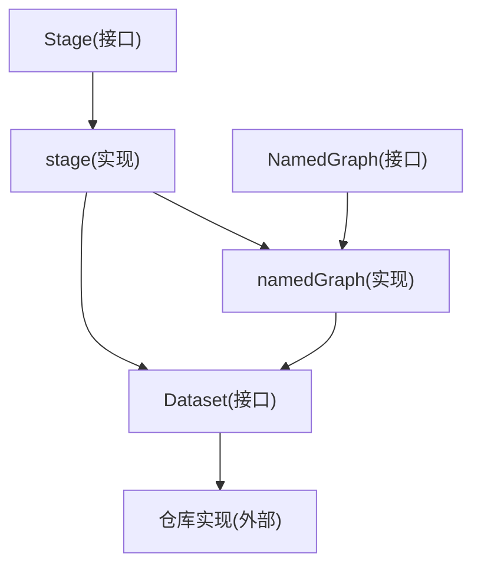
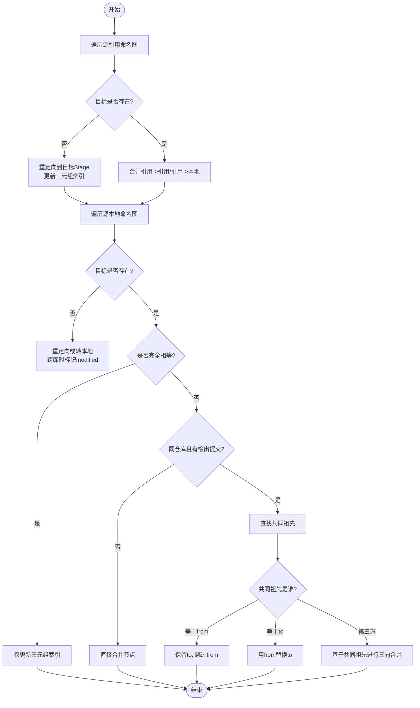
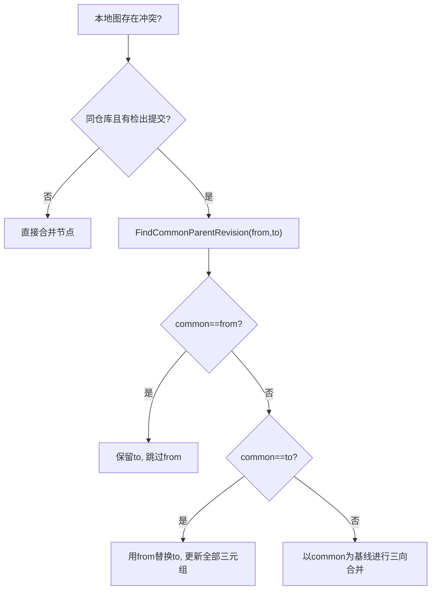
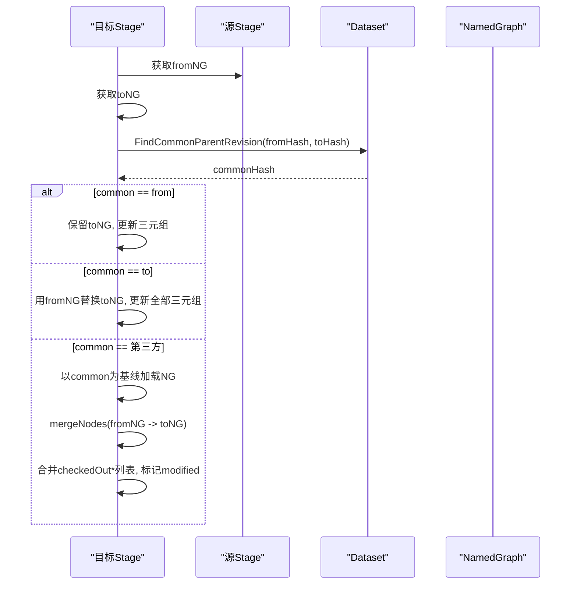
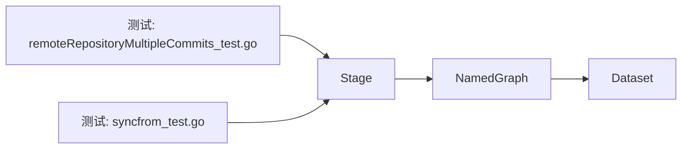

# 合并策略

<cite>
**本文引用的文件**
- [stage.go](file://sst/stage.go)
- [namedgraph.go](file://sst/namedgraph.go)
- [dataset.go](file://sst/dataset.go)
- [remoteRepositoryMultipleCommits_test.go](file://sst_test/remoteRepositoryMultipleCommits_test.go)
- [syncfrom_test.go](file://sst_test/syncfrom_test.go)
</cite>

## 目录
1. [简介](#简介)
2. [项目结构](#项目结构)
3. [核心组件](#核心组件)
4. [架构总览](#架构总览)
5. [详细组件分析](#详细组件分析)
6. [依赖关系分析](#依赖关系分析)
7. [性能考量](#性能考量)
8. [故障排查指南](#故障排查指南)
9. [结论](#结论)

## 简介
本文聚焦于 MoveAndMerge 方法的合并策略，系统阐述本地命名图与引用命名图的不同处理逻辑、三向合并的实现原理与应用场景、冲突检测机制与自动解决策略，并给出不同合并场景下的决策树（源/目标命名图均存在时的处理、父版本关系判断、最终合并操作选择），辅以流程图和代码片段路径指引。

## 项目结构
围绕合并的核心实现位于 sst 包：
- Stage 接口与 stage 实现负责图级别的移动与合并流程编排
- NamedGraph 接口与 namedGraph 实现提供节点级合并、相等性比较、共同祖先查找等能力
- Dataset 接口定义 FindCommonParentRevision，用于定位两个修订的共同祖先，支撑三向合并

图表来源
- [stage.go:132-152](file://sst/stage.go#L132-L152)
- [namedgraph.go:255-265](file://sst/namedgraph.go#L255-L265)
- [dataset.go:84-93](file://sst/dataset.go#L84-L93)

章节来源
- [stage.go:132-152](file://sst/stage.go#L132-L152)
- [namedgraph.go:255-265](file://sst/namedgraph.go#L255-L265)
- [dataset.go:84-93](file://sst/dataset.go#L84-L93)

## 核心组件
- Stage.MoveAndMerge：将源 Stage 的本地/引用命名图移动到目标 Stage 并执行合并；维护报告、更新三元组索引、清理源 Stage。
- namedGraph.mergeNodes：按节点粒度合并三元组，去重、更新引用、标记修改、累积父提交元数据。
- namedGraph.FindCommonParentRevision / Dataset.FindCommonParentRevision：在仓库历史中查找共同祖先，返回“自身/对方/第三方”三者之一，支撑三向合并。
- MoveAndMergeReport：记录每一步动作类型、描述、结果、时间戳与统计信息，便于审计与调试。

章节来源
- [stage.go:348-409](file://sst/stage.go#L348-L409)
- [stage.go:468-873](file://sst/stage.go#L468-L873)
- [stage.go:1060-1178](file://sst/stage.go#L1060-L1178)
- [namedgraph.go:572-622](file://sst/namedgraph.go#L572-L622)
- [dataset.go:84-93](file://sst/dataset.go#L84-L93)

## 架构总览
MoveAndMerge 的整体流程如下：
- 先处理引用命名图：若目标不存在则重定向到目标 Stage；若目标为本地图则合并节点；若目标为引用图则合并节点。
- 再处理本地命名图：若目标不存在则重定向或转为本地图；若目标存在且相同则仅更新三元组；若不同则进入父版本关系判断与三向合并分支。
- 最后更新导入关系、清空源 Stage，并返回报告。

图表来源
- [stage.go:498-570](file://sst/stage.go#L498-L570)
- [stage.go:572-813](file://sst/stage.go#L572-L813)
- [stage.go:816-873](file://sst/stage.go#L816-L873)

## 详细组件分析

### MoveAndMerge 主流程与决策树
- 引用命名图处理
  - 目标无该引用图：重定向到目标 Stage，并更新三元组索引
  - 目标有本地同名图：合并引用图节点到本地图
  - 目标有引用同名图：合并引用图节点
- 本地命名图处理
  - 目标无该本地图：
    - 若目标有引用同名图：将引用图转为本地图，并合并 from 节点
    - 否则：重定向 toStage，跨库时设置 modified=true，并更新三元组索引
  - 目标有本地同名图：
    - 若两图完全相等：仅更新三元组索引；跨库时标记 modified
    - 若不等：
      - 若同仓库且都有检出提交：调用 FindCommonParentRevision 确定父版本关系
        - 共同祖先 == from：保留 to，跳过 from
        - 共同祖先 == to：用 from 替换 to，并全局更新三元组索引
        - 共同祖先为第三方：执行三向合并（合并节点）
      - 否则：直接合并节点

图表来源
- [stage.go:684-813](file://sst/stage.go#L684-L813)
- [namedgraph.go:572-622](file://sst/namedgraph.go#L572-L622)

章节来源
- [stage.go:498-813](file://sst/stage.go#L498-L813)
- [namedgraph.go:572-622](file://sst/namedgraph.go#L572-L622)

### 三向合并的实现原理与应用场景
- 原理
  - 通过 FindCommonParentRevision 在仓库历史中查找共同祖先，返回三者之一：from、to 或第三方。
  - 当共同祖先为第三方时，以该祖先为基线，分别计算 from 与 to 相对于祖先的差异，并将差异合并到目标图中。当前实现通过 mergeNodes 将 from 的节点与三元组并入 to，同时维护 checkedOutCommits/NGRevisions/DSRevisions 以记录多父历史。
- 应用场景
  - 同一仓库内两条分支对同一命名图并行修改后需要合并
  - 从不同阶段/读取器生成的图与已有仓库图合并，需保持历史可追溯
  - 跨库移动与合并时，尽量利用仓库历史进行智能合并，减少人工冲突

图表来源
- [stage.go:684-813](file://sst/stage.go#L684-L813)
- [namedgraph.go:572-622](file://sst/namedgraph.go#L572-L622)
- [dataset.go:84-93](file://sst/dataset.go#L84-L93)

章节来源
- [stage.go:684-813](file://sst/stage.go#L684-L813)
- [namedgraph.go:572-622](file://sst/namedgraph.go#L572-L622)
- [dataset.go:84-93](file://sst/dataset.go#L84-L93)

### 冲突检测机制与自动解决策略
- 冲突检测
  - 当两图不相等且具备共同祖先时，视为潜在冲突点，进入父版本关系判断与三向合并分支
  - 若无法找到共同祖先（例如不同仓库或无共享历史），退化为简单合并（直接合并节点）
- 自动解决策略
  - 父版本包含关系：若 from 是 to 的祖先，保留 to；若 to 是 from 的祖先，用 from 替换 to
  - 无冲突或可自动合并：mergeNodes 会去重添加三元组，避免重复；更新三元组索引保证一致性
  - 跨库移动：必要时标记 modified，确保后续提交能正确生成新修订

章节来源
- [stage.go:684-813](file://sst/stage.go#L684-L813)
- [stage.go:1060-1178](file://sst/stage.go#L1060-L1178)

### 本地命名图与引用命名图的不同处理逻辑
- 引用命名图
  - 主要用于承载被其他图引用的 IBNode，通常不可直接修改
  - 合并时优先尝试重定向到目标 Stage，或在目标存在时合并节点
  - 不触发复杂的历史合并逻辑（除非后续转为本地图）
- 本地命名图
  - 可直接编辑、提交，参与完整的历史与合并流程
  - 支持相等性比较、父版本关系判断、三向合并、三元组索引更新

章节来源
- [stage.go:498-570](file://sst/stage.go#L498-L570)
- [stage.go:572-813](file://sst/stage.go#L572-L813)

### 关键算法与数据结构
- mergeNodes
  - 遍历 from 的所有 IBNode，若目标不存在则复制节点与三元组；若存在则合并三元组并去重
  - 更新三元组中的 IBNode 引用，使其指向目标 Stage 中的对应节点
  - 合并 checkedOut* 列表，标记 modified
- updateNgTriples / updateIBNodeTriples / findIBNode
  - 在重定向或合并后，统一更新三元组中的谓词与对象引用，保证一致性
- FindCommonParentRevision
  - 在仓库历史中沿父提交回溯，定位共同祖先，返回三者之一，驱动三向合并

章节来源
- [stage.go:945-1058](file://sst/stage.go#L945-L1058)
- [stage.go:1060-1178](file://sst/stage.go#L1060-L1178)
- [namedgraph.go:572-622](file://sst/namedgraph.go#L572-L622)

## 依赖关系分析
- Stage 依赖 NamedGraph 完成节点级合并与历史元数据管理
- NamedGraph 依赖 Dataset 查找共同祖先，从而决定合并策略
- 测试用例验证了 MoveAndMerge 在多提交、跨库、同步等场景下的行为

图表来源
- [stage.go:132-152](file://sst/stage.go#L132-L152)
- [namedgraph.go:255-265](file://sst/namedgraph.go#L255-L265)
- [dataset.go:84-93](file://sst/dataset.go#L84-L93)
- [remoteRepositoryMultipleCommits_test.go:143-175](file://sst_test/remoteRepositoryMultipleCommits_test.go#L143-L175)
- [syncfrom_test.go:1180-1246](file://sst_test/syncfrom_test.go#L1180-L1246)

章节来源
- [stage.go:132-152](file://sst/stage.go#L132-L152)
- [namedgraph.go:255-265](file://sst/namedgraph.go#L255-L265)
- [dataset.go:84-93](file://sst/dataset.go#L84-L93)
- [remoteRepositoryMultipleCommits_test.go:143-175](file://sst_test/remoteRepositoryMultipleCommits_test.go#L143-L175)
- [syncfrom_test.go:1180-1246](file://sst_test/syncfrom_test.go#L1180-L1246)

## 性能考量
- 合并复杂度主要受命名图规模与三元组数量影响
- mergeNodes 会遍历所有 IBNode 与三元组，建议在大规模图合并前评估内存与时间开销
- 三向合并仅在具备共同祖先时启用，可减少不必要的差异计算
- 更新三元组索引（updateNgTriples/findIBNode）在重定向/合并后批量执行，避免多次重建

[本节为通用指导，不直接分析具体文件]

## 故障排查指南
- 常见错误
  - 阶段无效或删除：assertAccess 失败
  - 阶段未链接到仓库：Commit 时报错
  - 命名图已链接或引用图不可链接：LinkToRepository 校验失败
- 诊断建议
  - 使用 MoveAndMergeReport 查看每步动作类型与结果，定位问题环节
  - 检查是否同仓库、是否有检出提交，以确认能否进入三向合并分支
  - 核对导入关系是否正确更新，避免循环或悬挂引用

章节来源
- [stage.go:1318-1323](file://sst/stage.go#L1318-L1323)
- [stage.go:1381-1401](file://sst/stage.go#L1381-L1401)
- [namedgraph.go:435-503](file://sst/namedgraph.go#L435-L503)

## 结论
MoveAndMerge 提供了完善的命名图移动与合并策略：
- 区分本地与引用命名图的处理路径
- 基于共同祖先的三向合并，支持自动解决父子包含关系与三方合并
- 通过三元组索引更新与导入关系维护，保证合并后的一致性
- 借助报告与日志，便于审计与排障

在实际使用中，建议：
- 尽量在同一仓库内进行合并，以便充分利用历史与三向合并能力
- 对大规模图合并进行性能评估，必要时分批处理
- 结合 MoveAndMergeReport 与测试用例，验证合并结果符合预期

[本节为总结性内容，不直接分析具体文件]