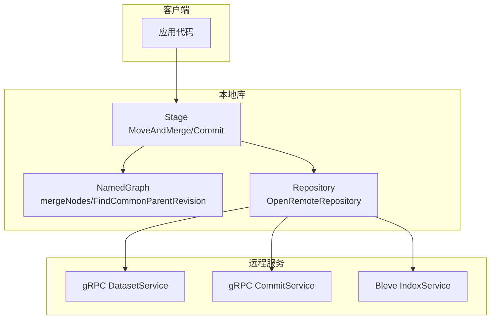
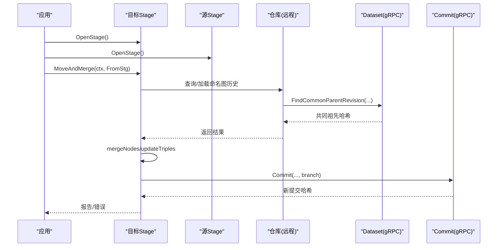
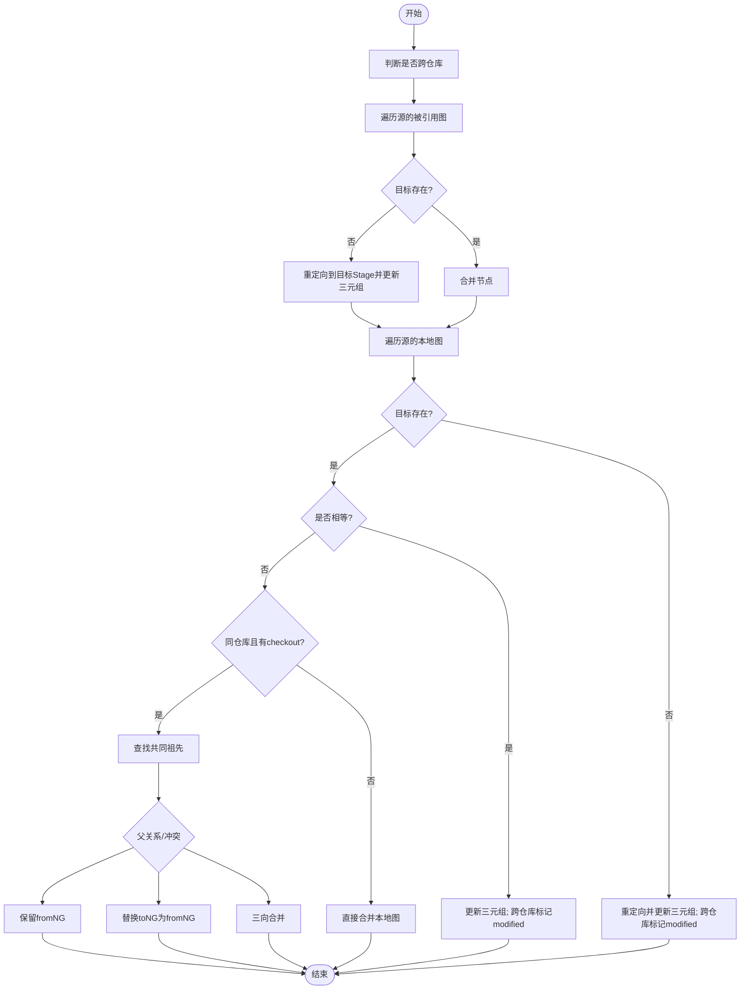
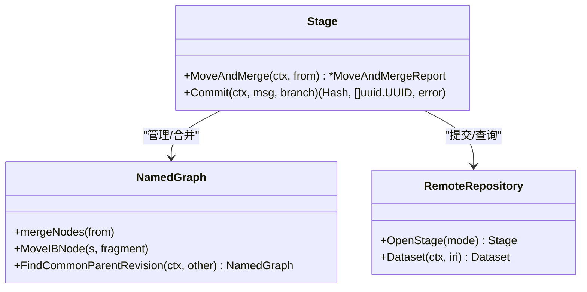
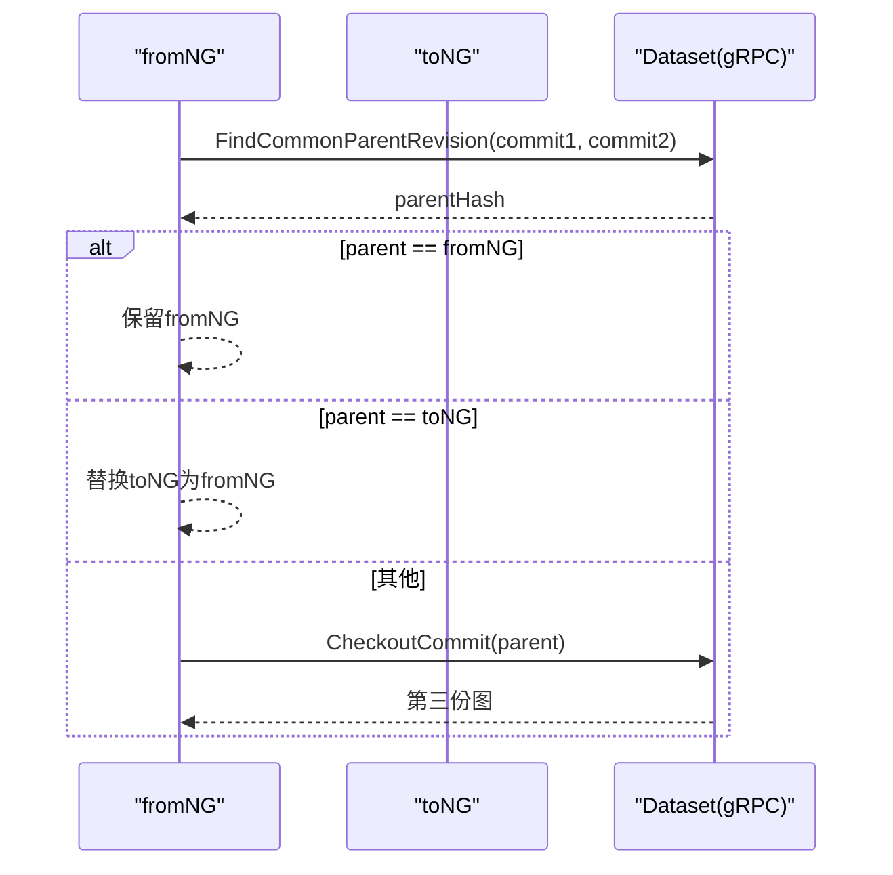
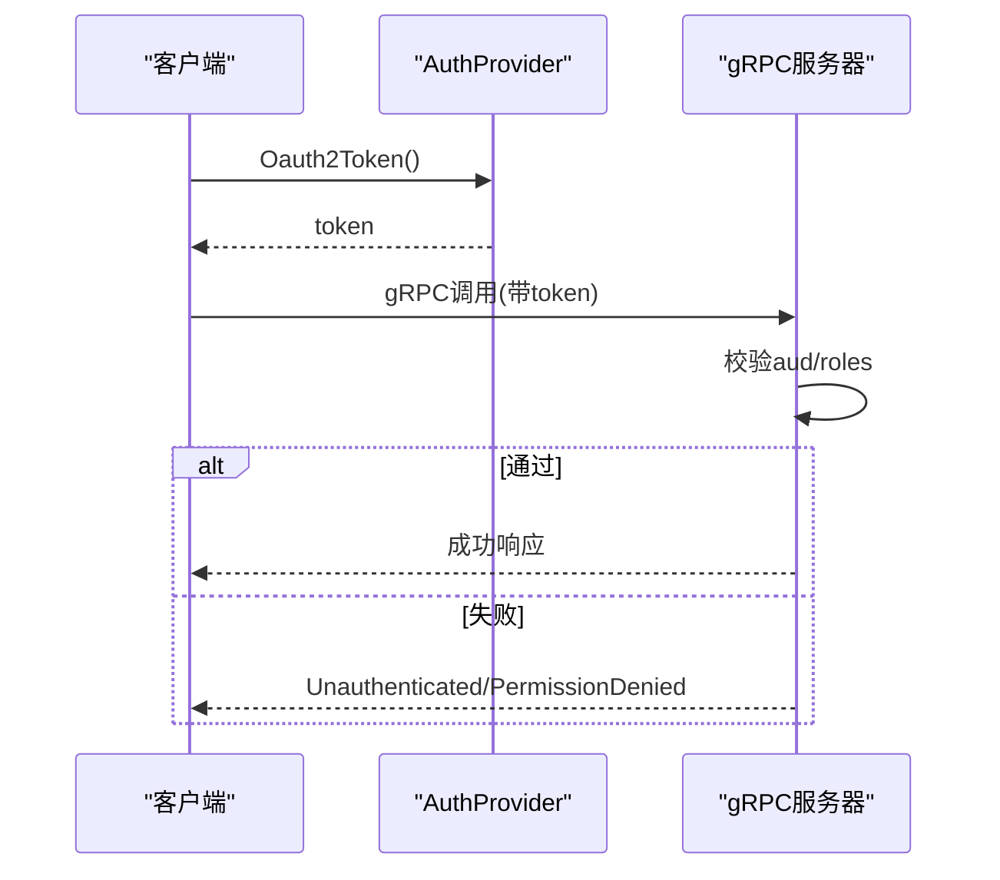
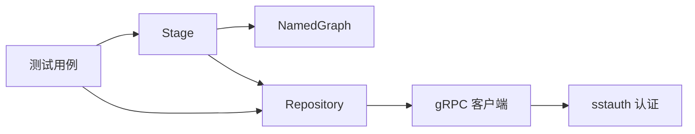

# 跨仓库合并

<cite>
**本文引用的文件**
- [stage.go](file://sst/stage.go)
- [namedgraph.go](file://sst/namedgraph.go)
- [reporemote.go](file://sst/reporemote.go)
- [repository.go](file://sst/repository.go)
- [superremoterepository.go](file://sst/superremoterepository.go)
- [authoids.go](file://sstauth/authoids.go)
- [ACCESS_RIGHTS.md](file://sstauth/ACCESS_RIGHTS.md)
- [syncfrom_test.go](file://sst_test/syncfrom_test.go)
- [remoteRepositoryMultipleCommits_test.go](file://sst_test/remoteRepositoryMultipleCommits_test.go)
- [remoteRepository_test.go](file://sst_test/remoteRepository_test.go)
</cite>

## 目录
1. [简介](#简介)
2. [项目结构](#项目结构)
3. [核心组件](#核心组件)
4. [架构总览](#架构总览)
5. [详细组件分析](#详细组件分析)
6. [依赖关系分析](#依赖关系分析)
7. [性能考量](#性能考量)
8. [故障排查指南](#故障排查指南)
9. [结论](#结论)
10. [附录](#附录)

## 简介
本文件系统性阐述跨仓库合并（Cross-repository Merge）的实现与最佳实践，覆盖以下主题：
- 跨仓库合并的特殊处理逻辑与数据同步机制
- 在不同仓库间移动和合并命名图（Named Graph）的流程
- 权限检查与安全考虑（认证、鉴权、配额）
- 性能优化策略与批量处理方法
- 报告生成与错误处理机制
- 实际应用场景与最佳实践
- 网络故障处理与重试机制实现细节

## 项目结构
跨仓库合并的核心位于 sst 包中，围绕 Stage、NamedGraph、Repository 等抽象展开；远程仓库通过 gRPC 客户端访问远端服务；权限由 sstauth 提供。测试用例在 sst_test 中验证跨仓库合并行为。

图表来源
- [stage.go:132-152](file://sst/stage.go#L132-L152)
- [namedgraph.go:255-265](file://sst/namedgraph.go#L255-L265)
- [reporemote.go:264-285](file://sst/reporemote.go#L264-L285)

章节来源
- [stage.go:132-152](file://sst/stage.go#L132-L152)
- [reporemote.go:264-285](file://sst/reporemote.go#L264-L285)

## 核心组件
- Stage：内存中的工作区，支持创建、引用、合并命名图，以及提交到仓库。跨仓库合并入口为 MoveAndMerge。
- NamedGraph：RDF 命名图的内存表示，支持节点移动、导入关系、差异比较、共同祖先查找等。
- Repository：仓库接口，本地或远程实现。远程实现通过 gRPC 调用远端服务。
- 权限模块（sstauth）：提供上下文中的认证提供者、RBAC 拦截器、按仓库的权限校验。

章节来源
- [stage.go:53-177](file://sst/stage.go#L53-L177)
- [namedgraph.go:42-117](file://sst/namedgraph.go#L42-L117)
- [reporemote.go:88-139](file://sst/reporemote.go#L88-L139)
- [authoids.go:338-373](file://sstauth/authoids.go#L338-L373)

## 架构总览
跨仓库合并的关键路径：
- 客户端打开两个仓库（可能均为远程），分别获取 Stage
- 调用目标 Stage.MoveAndMerge(源 Stage)，执行跨仓库的数据迁移与合并
- 合并过程中根据命名图是否存在、是否同仓库、是否有共同祖先等分支决策
- 最终可提交变更，产生新的提交与数据集版本

图表来源
- [stage.go:468-874](file://sst/stage.go#L468-L874)
- [namedgraph.go:572-622](file://sst/namedgraph.go#L572-L622)
- [reporemote.go:679-703](file://sst/reporemote.go#L679-L703)

## 详细组件分析

### 跨仓库合并流程（Stage.MoveAndMerge）
- 判定是否跨仓库：当目标与源均关联仓库且不同仓库时，标记 betweenTwoRepositories=true
- 先处理“被引用”的命名图：若目标不存在则重定向到目标 Stage；若存在则合并节点
- 再处理“本地”命名图：
  - 若目标不存在：重定向并更新三元组；跨仓库时标记 modified=true
  - 若目标存在：
    - 若两者相同：仅更新三元组；跨仓库时标记 modified=true
    - 否则尝试三向合并：在同仓库且均有 checkout commit 时，查找共同祖先，决定保留 fromNG、替换 toNG 或进行内容合并
- 更新导入关系（directImports/isImportedBy）
- 清空源 Stage 的本地与被引用图集合
- 返回报告对象，包含动作明细、统计、警告、耗时等

图表来源
- [stage.go:468-874](file://sst/stage.go#L468-L874)

章节来源
- [stage.go:468-874](file://sst/stage.go#L468-L874)

### 命名图合并与节点移动（NamedGraph.mergeNodes / MoveIBNode）
- mergeNodes：将源图的所有 IBNode 移动到目标图，若目标已存在则合并三元组；更新导入关系；追加 checkedOutCommits/NGRevisions/DSRevisions；标记 modified
- MoveIBNode：在权限校验通过后，确保两图属于同一 Stage，然后移动节点并更新三元组引用

图表来源
- [stage.go:1060-1178](file://sst/stage.go#L1060-L1178)
- [namedgraph.go:1450-1487](file://sst/namedgraph.go#L1450-L1487)
- [reporemote.go:126-139](file://sst/reporemote.go#L126-L139)

章节来源
- [stage.go:1060-1178](file://sst/stage.go#L1060-L1178)
- [namedgraph.go:1450-1487](file://sst/namedgraph.go#L1450-L1487)

### 共同祖先查找与三向合并（FindCommonParentRevision）
- 要求两图在同一仓库且都有 checkout commit
- 通过仓库的 Dataset 接口调用远端服务查找共同祖先
- 若共同祖先是 fromNG 或 toNG，则选择对应图；否则从共同祖先检出第三份图用于三向合并

图表来源
- [namedgraph.go:572-622](file://sst/namedgraph.go#L572-L622)
- [reporemote.go:679-703](file://sst/reporemote.go#L679-L703)

章节来源
- [namedgraph.go:572-622](file://sst/namedgraph.go#L572-L622)
- [reporemote.go:679-703](file://sst/reporemote.go#L679-L703)

### 权限检查与安全考虑
- 客户端在上下文中注入认证提供者，所有 gRPC 调用自动携带 OAuth2 token
- 服务端通过拦截器校验 token 的 aud 与角色，支持单仓库与超级仓库模式
- 流式 RPC 在首个消息后再次校验 per-repo 的 audience 与角色
- 配额限制：创建仓库或提交时若超出配额会返回相应错误

图表来源
- [repository.go:286-308](file://sst/repository.go#L286-L308)
- [authoids.go:338-373](file://sstauth/authoids.go#L338-L373)
- [ACCESS_RIGHTS.md:52-101](file://sstauth/ACCESS_RIGHTS.md#L52-L101)
- [superremoterepository.go:74-90](file://sst/superremoterepository.go#L74-L90)

章节来源
- [repository.go:286-308](file://sst/repository.go#L286-L308)
- [authoids.go:338-373](file://sstauth/authoids.go#L338-L373)
- [ACCESS_RIGHTS.md:52-101](file://sstauth/ACCESS_RIGHTS.md#L52-L101)
- [superremoterepository.go:74-90](file://sst/superremoterepository.go#L74-L90)

### 报告生成与错误处理
- MoveAndMerge 返回 MoveAndMergeReport，记录每个动作类型、目标图、描述、结果、时间戳、统计、警告、起止时间与耗时
- 常见动作包括：合并图、重定向图、转为本地、标记修改、更新三元组、跳过相同版本、三向合并等
- 错误处理：
  - 阶段无效、仓库不匹配、未找到图等
  - 远端 gRPC 错误码映射（如 NotFound、Unknown 等）
  - 配额超限错误包装

章节来源
- [stage.go:346-433](file://sst/stage.go#L346-L433)
- [stage.go:468-874](file://sst/stage.go#L468-L874)
- [reporemote.go:517-527](file://sst/reporemote.go#L517-L527)
- [superremoterepository.go:82-86](file://sst/superremoterepository.go#L82-L86)

### 性能优化与批量处理
- 批量化查询提交详情：GetCommitDetailsBatch 减少往返次数
- 分页枚举数据集：ListDatasets 使用 PageToken 分页
- 请求缓存：对重复的 GetDataset 请求进行缓存以减少网络开销
- 并发控制：仓库状态控制（enter/leave）与 WaitGroup 保证关闭安全
- 索引搜索：远程 Bleve 搜索通过流式 gRPC 传输

章节来源
- [reporemote.go:546-637](file://sst/reporemote.go#L546-L637)
- [reporemote.go:296-347](file://sst/reporemote.go#L296-L347)
- [reporemote.go:470-536](file://sst/reporemote.go#L470-L536)
- [reporemote.go:109-124](file://sst/reporemote.go#L109-L124)
- [reporemote.go:146-207](file://sst/reporemote.go#L146-L207)

### 网络故障处理与重试机制
- 当前实现中未发现显式的指数退避重试逻辑；错误通过 gRPC status 返回
- 建议上层调用者基于 context 超时/取消与业务重试策略封装
- 连接生命周期：Close 等待进行中操作完成后关闭连接，避免竞态

章节来源
- [reporemote.go:655-670](file://sst/reporemote.go#L655-L670)
- [reporemote.go:517-527](file://sst/reporemote.go#L517-L527)

## 依赖关系分析
- Stage 依赖 NamedGraph 进行图级合并与元数据维护
- Stage 通过 Repository 接口与远端交互（Dataset/Commit/Bleve）
- 权限由 sstauth 提供，并在 gRPC 调用链中贯穿
- 测试覆盖跨仓库合并、多提交、导入依赖、分支同步等场景

图表来源
- [stage.go:53-177](file://sst/stage.go#L53-L177)
- [reporemote.go:88-139](file://sst/reporemote.go#L88-L139)
- [authoids.go:338-373](file://sstauth/authoids.go#L338-L373)

章节来源
- [stage.go:53-177](file://sst/stage.go#L53-L177)
- [reporemote.go:88-139](file://sst/reporemote.go#L88-L139)
- [authoids.go:338-373](file://sstauth/authoids.go#L338-L373)

## 性能考量
- 合并阶段尽量复用已有节点与三元组，避免重复拷贝
- 跨仓库时仅在必要时标记 modified，减少不必要的提交
- 使用批处理和分页降低网络开销
- 合理设置 context 超时，避免长耗时阻塞
- 对于大规模合并，建议分批调用 MoveAndMerge，结合报告监控进度

[本节为通用指导，无需特定文件来源]

## 故障排查指南
- 常见问题
  - 阶段无效或已删除：检查 Stage.IsValid() 与 Close 调用
  - 仓库不匹配：LinkToRepository 前确认 Stage 未绑定到其他仓库
  - 命名图未找到：核对 IRI 与 UUID 转换
  - 远端错误：查看 gRPC status code 与 message
  - 配额超限：检查 SuperRepository 配额设置
- 定位方法
  - 使用 MoveAndMergeReport 的动作列表与统计定位问题
  - 启用日志输出，关注关键步骤（重定向、合并、更新三元组）
  - 通过测试用例复现最小场景

章节来源
- [stage.go:1318-1323](file://sst/stage.go#L1318-L1323)
- [stage.go:885-905](file://sst/stage.go#L885-L905)
- [reporemote.go:517-527](file://sst/reporemote.go#L517-L527)
- [superremoterepository.go:82-86](file://sst/superremoterepository.go#L82-L86)

## 结论
跨仓库合并通过 Stage.MoveAndMerge 统一编排，结合 NamedGraph 的节点合并与共同祖先查找，实现了灵活而稳健的数据同步。权限体系保障安全，批处理与分页提升性能，报告机制便于观测与排障。建议在大规模场景中采用分批次合并与重试策略，并结合配额与权限配置进行治理。

[本节为总结，无需特定文件来源]

## 附录

### 实际应用场景与最佳实践示例
- 场景一：将多个特性仓库的数据合并到主仓库
  - 依次对每个特性仓库执行 MoveAndMerge，最后提交一次
  - 使用报告统计合并动作，观察导入依赖变化
- 场景二：跨团队共享基础模型
  - 将基础模型作为被引用图，多个业务仓库引用并增量合并
  - 利用共同祖先查找避免重复合并
- 场景三：远程仓库间的镜像同步
  - 使用 SyncFrom 或多次 MoveAndMerge 保持目标仓库与源一致
  - 注意分支过滤与数据集范围控制

章节来源
- [remoteRepository_test.go:196-249](file://sst_test/remoteRepository_test.go#L196-L249)
- [remoteRepositoryMultipleCommits_test.go:2287-2298](file://sst_test/remoteRepositoryMultipleCommits_test.go#L2287-L2298)
- [syncfrom_test.go:423-447](file://sst_test/syncfrom_test.go#L423-L447)

### 网络故障处理与重试机制实现细节
- 当前库层未内置重试；建议在调用方实现：
  - 基于 context 的超时与取消
  - 指数退避重试（针对临时性网络错误）
  - 幂等性保护（合并操作需保证可重复执行）
- 关闭连接时使用 WaitGroup 等待进行中操作完成，避免资源泄漏

章节来源
- [reporemote.go:655-670](file://sst/reporemote.go#L655-L670)
- [reporemote.go:517-527](file://sst/reporemote.go#L517-L527)