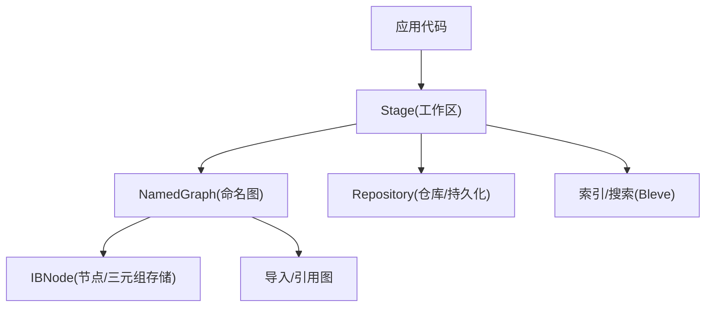
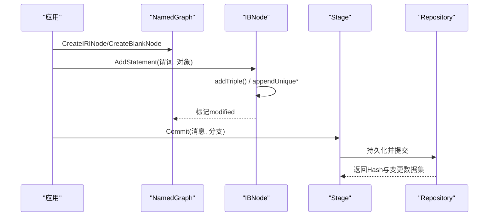
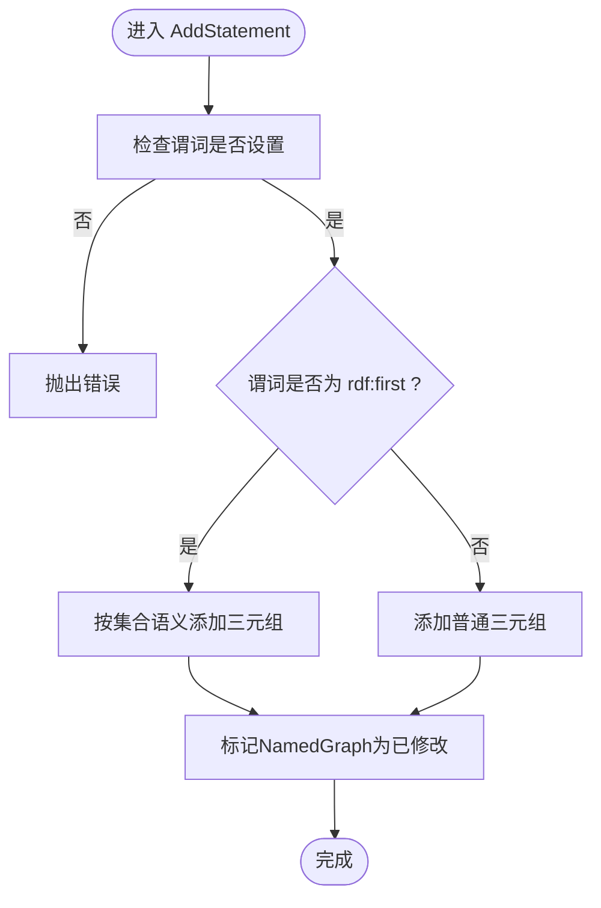
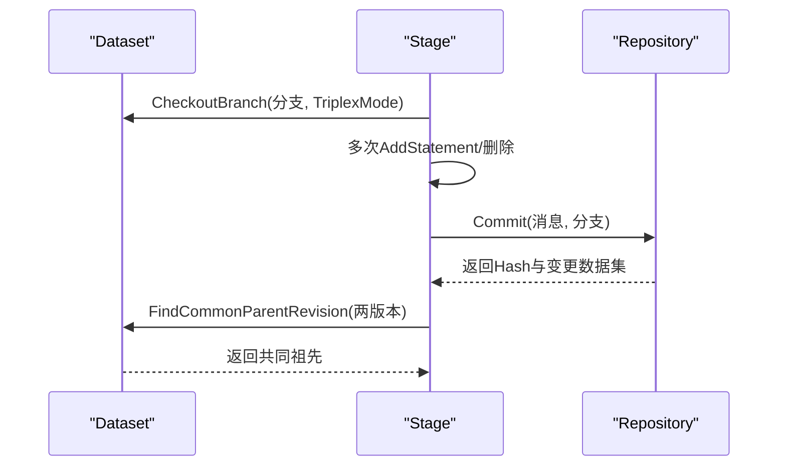
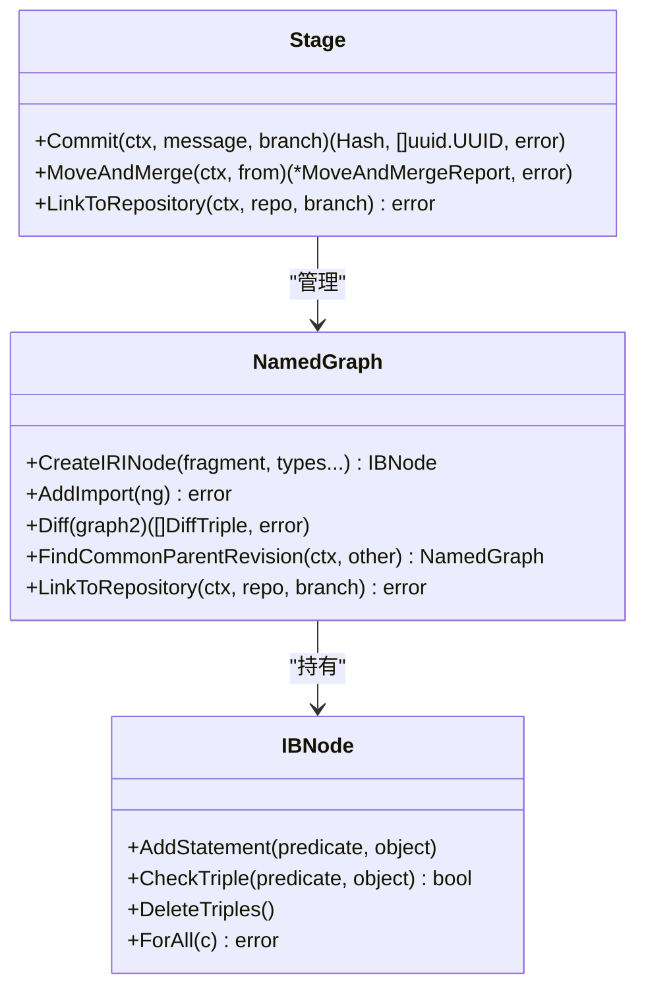

# 三元组操作

<cite>
**本文引用的文件**
- [ibnode.go](file://sst/ibnode.go)
- [namedgraph.go](file://sst/namedgraph.go)
- [stage.go](file://sst/stage.go)
- [types.go](file://sst/types.go)
- [rdfreaderstage.go](file://sst/rdfreaderstage.go)
- [repolocalflat_test.go](file://sst/repolocalflat_test.go)
- [remoteRepositoryMultipleCommits_test.go](file://sst_test/remoteRepositoryMultipleCommits_test.go)
- [searchInContext_test.go](file://sst_test/searchInContext_test.go)
- [errrecovery.go](file://sst/errrecovery.go)
</cite>

## 目录
1. [简介](#简介)
2. [项目结构](#项目结构)
3. [核心组件](#核心组件)
4. [架构总览](#架构总览)
5. [详细组件分析](#详细组件分析)
6. [依赖关系分析](#依赖关系分析)
7. [性能考量](#性能考量)
8. [故障排查指南](#故障排查指南)
9. [结论](#结论)
10. [附录](#附录)

## 简介
本文件面向SST（Semantic Storage Technology）中的RDF三元组操作，系统性说明三元组的添加、修改、删除与查询方法；解释AddStatement的用法与主题/谓词/对象设置；介绍批量操作与事务性提交；阐述条件查询与过滤能力；说明版本控制与历史追踪机制；提供复杂查询场景的代码路径示例；并给出性能优化建议与最佳实践。

## 项目结构
围绕三元组操作的核心代码位于sst包中：
- ibnode.go：IBNode接口与实现，包含三元组的增删改查、集合处理、遍历等。
- namedgraph.go：命名图管理、导入/导出、差异比较、共同祖先查找、仓库关联等。
- stage.go：工作区Stage，负责多图的合并、提交、链接仓库、三元组模式配置等。
- types.go：内置类型与词汇常量（如rdf:type、rdfs:label等）。
- rdfreaderstage.go：从Turtle/Trig等格式读取时构建三元组与集合的处理逻辑。
- 测试用例：覆盖提交、分支、搜索、差异等场景，体现版本控制与查询能力。

图表来源
- [stage.go:33-51](file://sst/stage.go#L33-L51)
- [namedgraph.go:42-107](file://sst/namedgraph.go#L42-L107)
- [ibnode.go:634-660](file://sst/ibnode.go#L634-L660)

章节来源
- [stage.go:33-51](file://sst/stage.go#L33-L51)
- [namedgraph.go:42-107](file://sst/namedgraph.go#L42-L107)
- [ibnode.go:634-660](file://sst/ibnode.go#L634-L660)

## 核心组件
- IBNode：表示IRI或空白节点，承载三元组（主体、谓词、对象），提供AddStatement、CheckTriple、DeleteTriples、ForAll等API。
- NamedGraph：内存中的命名图，维护三元组存储、导入关系、版本元数据（checkedOutCommits等），支持Diff、FindCommonParentRevision、LinkToRepository等。
- Stage：工作区，聚合多个NamedGraph，提供MoveAndMerge、Commit、LinkToRepository、RdfWrite等操作，并定义TriplexMode以控制内部三元组索引策略。
- 类型与词汇：内置rdf、rdfs、xsd等常用词汇常量，便于声明类型与属性。

章节来源
- [ibnode.go:698-908](file://sst/ibnode.go#L698-L908)
- [namedgraph.go:110-357](file://sst/namedgraph.go#L110-L357)
- [stage.go:64-234](file://sst/stage.go#L64-L234)
- [types.go:209-227](file://sst/types.go#L209-L227)

## 架构总览
三元组在SST中以“三元组”为单位进行存储与索引。每个RDF三元组可生成1到3个内部triplex（主体、谓词、对象方向），由TriplexMode决定。默认模式同时维护三种方向的triplex，以支持正向与反向遍历的高效查询。

图表来源
- [ibnode.go:2083-2102](file://sst/ibnode.go#L2083-L2102)
- [stage.go:121-130](file://sst/stage.go#L121-L130)
- [namedgraph.go:415-503](file://sst/namedgraph.go#L415-L503)

章节来源
- [stage.go:33-51](file://sst/stage.go#L33-L51)
- [ibnode.go:2083-2102](file://sst/ibnode.go#L2083-L2102)
- [namedgraph.go:415-503](file://sst/namedgraph.go#L415-L503)

## 详细组件分析

### 三元组添加：AddStatement
- 作用：为当前IBNode（作为主体）添加一条三元组，谓词与对象由参数指定。
- 行为要点：
  - 校验谓词是否设置，未设置将触发错误。
  - 特殊处理rdf:first用于RDF集合构造。
  - 内部调用addTriple或appendUnique系列函数，确保唯一性与索引更新。
  - 自动标记所属NamedGraph为已修改，以便后续提交。
- 使用建议：
  - 先创建主体节点（CreateIRINode/CreateBlankNode），再调用AddStatement添加谓词与对象。
  - 对于集合，可使用CreateCollection并通过AddStatement添加。

图表来源
- [ibnode.go:2083-2102](file://sst/ibnode.go#L2083-L2102)
- [ibnode.go:669-706](file://sst/ibnode.go#L669-L706)

章节来源
- [ibnode.go:2083-2102](file://sst/ibnode.go#L2083-L2102)
- [ibnode.go:669-706](file://sst/ibnode.go#L669-L706)

### 三元组查询：CheckTriple与遍历
- CheckTriple：判断是否存在给定谓词与对象的三元组（主体为当前IBNode）。
- ForAll/GetObjects/DumpTriples：遍历或获取三元组，支持多种对象类型（IBNode、Literal、TermCollection、LiteralCollection）。
- 使用建议：
  - 若需精确匹配，优先使用CheckTriple。
  - 需要枚举所有三元组时使用ForAll或GetObjects。
  - 调试时可调用DumpTriples输出字符串形式。

章节来源
- [ibnode.go:2118-2142](file://sst/ibnode.go#L2118-L2142)
- [ibnode.go:954-996](file://sst/ibnode.go#L954-L996)

### 三元组删除：DeleteTriples与条件删除
- DeleteTriples：删除当前IBNode的所有主体三元组，并清理相关反向与谓词索引。
- ForDelete：按回调条件选择性删除三元组。
- 使用建议：
  - 批量删除首选DeleteTriples。
  - 细粒度删除使用ForDelete，根据谓词或对象条件筛选。

章节来源
- [ibnode.go:1960-1986](file://sst/ibnode.go#L1960-L1986)

### 三元组批量操作与集合
- 集合构造：通过CreateCollection创建TermCollection，并使用AddStatement将其作为对象添加到主体。
- 读取与写入：RdfRead/SstRead可将外部格式解析为三元组与集合；RdfWrite/SstWrite可导出。
- 批量写入：建议在单个Stage中对多个NamedGraph进行批量AddStatement后统一Commit，减少网络与IO开销。

章节来源
- [namedgraph.go:211-214](file://sst/namedgraph.go#L211-L214)
- [rdfreaderstage.go:384-421](file://sst/rdfreaderstage.go#L384-L421)

### 条件查询与过滤
- 内存级过滤：利用ForAll/GetObjects结合谓词与对象类型进行条件筛选。
- 索引级搜索：通过Bleve索引在上下文中执行布尔、正则、排序等复杂查询，支持分页与字段选择。
- 使用建议：
  - 简单条件可在内存中过滤。
  - 大规模数据建议使用SearchInContext进行高效检索。

章节来源
- [searchInContext_test.go:549-563](file://sst_test/searchInContext_test.go#L549-L563)
- [searchInContext_test.go:1166-1194](file://sst_test/searchInContext_test.go#L1166-L1194)

### 版本控制与历史追踪
- 提交与分支：Stage.Commit将修改持久化为提交，并可设置分支名；Dataset支持分支管理与检出。
- 共同祖先：FindCommonParentRevision用于三路合并与差异计算。
- 仓库关联：LinkToRepository将NamedGraph与仓库及分支绑定，使后续提交继承历史。
- 使用建议：
  - 对跨仓库移动/合并，注意修改标志与提交历史对齐。
  - 使用CheckoutBranch/CheckoutCommit加载特定版本进行只读或二次编辑。

图表来源
- [stage.go:121-130](file://sst/stage.go#L121-L130)
- [namedgraph.go:572-622](file://sst/namedgraph.go#L572-L622)
- [remoteRepositoryMultipleCommits_test.go:264-314](file://sst_test/remoteRepositoryMultipleCommits_test.go#L264-L314)

章节来源
- [stage.go:121-130](file://sst/stage.go#L121-L130)
- [namedgraph.go:572-622](file://sst/namedgraph.go#L572-L622)
- [remoteRepositoryMultipleCommits_test.go:264-314](file://sst_test/remoteRepositoryMultipleCommits_test.go#L264-L314)

### 复杂查询场景示例（代码路径）
- 多条件组合与分页：参考搜索请求构建与分页参数设置。
  - [searchInContext_test.go:549-563](file://sst_test/searchInContext_test.go#L549-L563)
- 排序与字段选择：在SearchRequestOptions中配置SortBy与Fields。
  - [searchInContext_test.go:565-580](file://sst_test/searchInContext_test.go#L565-L580)
- 本地与远程一致性验证：对比Local与Remote搜索结果的一致性。
  - [searchInContext_test.go:1166-1194](file://sst_test/searchInContext_test.go#L1166-L1194)
- 提交历史遍历：通过CommitDetailsByBranch/ByHash遍历父提交链。
  - [remoteRepositoryMultipleCommits_test.go:264-314](file://sst_test/remoteRepositoryMultipleCommits_test.go#L264-L314)

## 依赖关系分析
- IBNode依赖NamedGraph进行三元组存储与状态管理。
- Stage聚合多个NamedGraph，协调MoveAndMerge与Commit流程。
- Repository提供持久化与版本管理能力，Stage通过LinkToRepository与之关联。
- 测试用例展示了版本控制、搜索、差异等能力的集成使用。

图表来源
- [stage.go:64-234](file://sst/stage.go#L64-L234)
- [namedgraph.go:110-357](file://sst/namedgraph.go#L110-L357)
- [ibnode.go:698-908](file://sst/ibnode.go#L698-L908)

章节来源
- [stage.go:64-234](file://sst/stage.go#L64-L234)
- [namedgraph.go:110-357](file://sst/namedgraph.go#L110-L357)
- [ibnode.go:698-908](file://sst/ibnode.go#L698-L908)

## 性能考量
- TriplexMode选择：
  - 仅主体triplex最省内存，适合单向遍历。
  - 主体+对象triplex适合双向遍历。
  - 全部triplex适合复杂子属性与实例较多的场景（默认模式）。
- 批量操作：
  - 在单个Stage内集中AddStatement，最后统一Commit，减少网络与IO次数。
- 索引查询：
  - 大数据量下优先使用Bleve SearchInContext，避免全图扫描。
- 集合与重复三元组：
  - 使用AppendUnique系列函数避免重复插入，降低存储与索引开销。
- 内存与GC：
  - 及时关闭Stage与释放引用，避免长期持有大对象。

章节来源
- [stage.go:33-51](file://sst/stage.go#L33-L51)
- [ibnode.go:669-706](file://sst/ibnode.go#L669-L706)
- [searchInContext_test.go:549-563](file://sst_test/searchInContext_test.go#L549-L563)

## 故障排查指南
- 常见错误：
  - 谓词未设置：AddStatement会抛出错误，检查谓词是否正确传入。
  - 重复三元组：内部会检测并拒绝重复插入，必要时使用Alt方法或去重逻辑。
  - 节点无效或删除：操作前检查IsValid与IsReferenced状态。
- 恢复与日志：
  - 使用errrecovery中的handleWithRecovery捕获异常并转换为错误，便于上层处理。
  - 通过GlobalLogger.Debug打印关键三元组信息辅助定位问题。

章节来源
- [ibnode.go:47-60](file://sst/ibnode.go#L47-L60)
- [errrecovery.go:81-92](file://sst/errrecovery.go#L81-L92)

## 结论
SST在三元组操作上提供了完善的API与高性能的内部存储结构。通过IBNode的增删改查、Stage的批量提交与版本控制、以及Bleve索引的条件查询，可满足从轻量到复杂的RDF数据处理需求。遵循本文的最佳实践与性能建议，可显著提升开发与运行效率。

## 附录
- 常用词汇常量：rdf:type、rdfs:label、rdfs:comment、xsd:string等，便于类型与描述声明。
- 示例与测试：
  - 提交与分支：[repolocalflat_test.go:183-232](file://sst/repolocalflat_test.go#L183-L232)
  - 版本历史与共同祖先：[remoteRepositoryMultipleCommits_test.go:264-314](file://sst_test/remoteRepositoryMultipleCommits_test.go#L264-L314)
  - 搜索与排序：[searchInContext_test.go:549-563](file://sst_test/searchInContext_test.go#L549-L563)