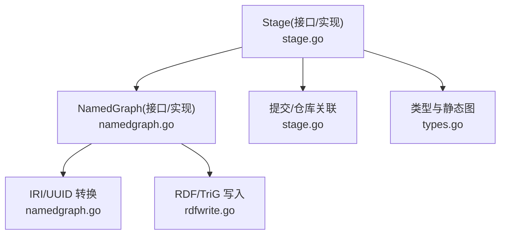
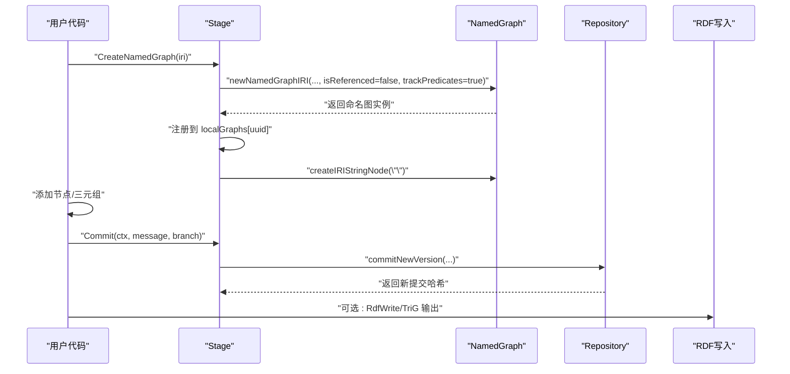
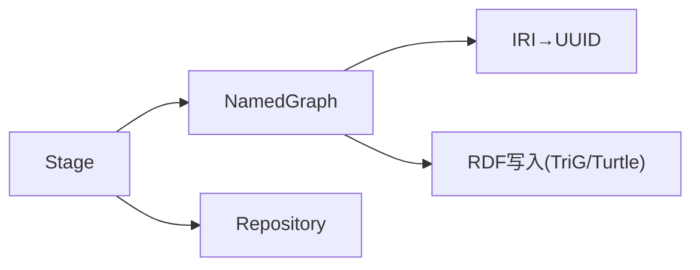

# 命名图创建

<cite>
**本文引用的文件**
- [stage.go](file://sst/stage.go)
- [namedgraph.go](file://sst/namedgraph.go)
- [types.go](file://sst/types.go)
- [rdfwrite.go](file://sst/rdfwrite.go)
- [namedgraph_test.go](file://sst_test/namedgraph_test.go)
- [ephemeralStageBasic_test.go](file://sst_test/ephemeralStageBasic_test.go)
</cite>

## 目录
1. [简介](#简介)
2. [项目结构](#项目结构)
3. [核心组件](#核心组件)
4. [架构总览](#架构总览)
5. [详细组件分析](#详细组件分析)
6. [依赖关系分析](#依赖关系分析)
7. [性能考虑](#性能考虑)
8. [故障排查指南](#故障排查指南)
9. [结论](#结论)
10. [附录：完整示例与最佳实践](#附录完整示例与最佳实践)

## 简介
本文件面向需要在 SST 中通过 Stage 接口创建“命名图（NamedGraph）”的开发者，系统说明以下要点：
- 如何通过 Stage 接口创建新的命名图，包括 CreateNamedGraph 的使用方式。
- 本地命名图与引用命名图的区别、适用场景与选择策略。
- 命名图的 IRI 生成机制（UUID 与自定义 IRI）。
- 命名图的初始状态与标志位设置。
- 创建命名图的完整流程、错误处理与最佳实践。
- 命名图的生命周期管理与资源清理。

## 项目结构
围绕命名图创建的关键代码集中在 sst 包内：
- Stage 接口与实现位于 stage.go，提供 CreateNamedGraph、ReferencedGraphs、Commit 等能力。
- NamedGraph 接口与实现位于 namedgraph.go，定义命名图的数据结构与行为。
- 类型与静态图定义在 types.go。
- 导出序列化逻辑在 rdfwrite.go。
- 测试用例覆盖多种创建与提交场景，便于理解用法与边界条件。

图表来源
- [stage.go:74-234](file://sst/stage.go#L74-L234)
- [namedgraph.go:110-409](file://sst/namedgraph.go#L110-L409)
- [namedgraph.go:729-782](file://sst/namedgraph.go#L729-L782)
- [rdfwrite.go:1023-1051](file://sst/rdfwrite.go#L1023-L1051)
- [types.go:9-30](file://sst/types.go#L9-L30)

章节来源
- [stage.go:74-234](file://sst/stage.go#L74-L234)
- [namedgraph.go:110-409](file://sst/namedgraph.go#L110-L409)

## 核心组件
- Stage：内存中的工作区，管理本地命名图与引用命名图，支持提交到仓库。
- NamedGraph：命名图实体，包含节点、三元组、导入关系、检出元数据等。
- IRI/UUID 转换：将 IRI 映射为内部 UUID，用于唯一标识命名图。
- 标志位：isReferenced、trackPredicates、modified 等控制命名图行为与提交语义。

章节来源
- [stage.go:53-71](file://sst/stage.go#L53-L71)
- [namedgraph.go:59-107](file://sst/namedgraph.go#L59-L107)
- [namedgraph.go:729-782](file://sst/namedgraph.go#L729-L782)

## 架构总览
下图展示从调用 Stage.CreateNamedGraph 到创建并注册命名图的核心流程，以及后续提交与导出的关键路径。

图表来源
- [stage.go:1219-1234](file://sst/stage.go#L1219-L1234)
- [namedgraph.go:741-782](file://sst/namedgraph.go#L741-L782)
- [stage.go:1381-1399](file://sst/stage.go#L1381-L1399)
- [rdfwrite.go:1023-1051](file://sst/rdfwrite.go#L1023-L1051)

## 详细组件分析

### 通过 Stage 创建命名图：CreateNamedGraph
- 方法签名与作用：
  - 在 Stage 上创建一个新的本地命名图，名称由传入的 IRI 决定。
  - 该命名图在创建时处于本地状态（非引用），且默认跟踪谓词三元组。
- 内部流程：
  - 调用 newNamedGraphIRI 构造命名图，生成 baseIRI 与内部 id（UUID）。
  - 将命名图加入 Stage 的 localGraphs 索引。
  - 初始化命名图的根节点（空片段字符串节点）。
- 重复性约束：
  - 若同一 Stage 已存在相同 IRI 的命名图，会触发重复错误（panic）。

章节来源
- [stage.go:1219-1234](file://sst/stage.go#L1219-L1234)
- [namedgraph.go:741-782](file://sst/namedgraph.go#L741-L782)

### 关于 CreateNamedGraphByIRI
- 在当前代码库中未找到名为 CreateNamedGraphByIRI 的方法定义或实现。
- 若需按 IRI 创建命名图，请使用 Stage.CreateNamedGraph(IRI)。
- 相关测试覆盖了使用普通 IRI 与 urn:uuid 形式的 IRI 进行创建的行为与冲突检测。

章节来源
- [namedgraph_test.go:424-459](file://sst_test/namedgraph_test.go#L424-L459)

### 本地命名图 vs 引用命名图
- 本地命名图（Local NamedGraph）：
  - 可通过 Stage.CreateNamedGraph 创建，处于可编辑、可提交的状态。
  - 每个节点必须至少有一个主体三元组才能有效写入 RDF。
- 引用命名图（Referenced NamedGraph）：
  - 通常由 Stage.referencedGraphByURI 按需创建，仅用于承载被其他命名图引用的节点。
  - 不能直接修改、提交或写出；当没有内容时可被清理。
- 选择策略：
  - 需要编辑并提交数据的图：使用本地命名图。
  - 仅作为跨图引用的共享节点容器：使用引用命名图，避免重复存储与不必要的提交。

章节来源
- [stage.go:1336-1358](file://sst/stage.go#L1336-L1358)
- [namedgraph.go:110-117](file://sst/namedgraph.go#L110-L117)

### IRI 生成机制（UUID 与自定义 IRI）
- 规则：
  - 如果 IRI 是 urn:uuid:... 形式，则解析其中的 UUID 作为内部 id。
  - 否则，基于 IRI 字符串计算确定性 UUID（SHA1 + NameSpaceURL），保证相同 IRI 映射到相同 UUID。
- 作用：
  - 统一内部标识，便于索引、比较与持久化。
  - 支持人类可读的自定义 IRI 与机器生成的 UUID IRI 并存。

章节来源
- [namedgraph.go:729-739](file://sst/namedgraph.go#L729-L739)
- [namedgraph.go:741-758](file://sst/namedgraph.go#L741-L758)

### 初始状态与标志位
- 创建时的标志位：
  - isReferenced：本地图为 false，引用图为 true。
  - trackPredicates：本地图默认为 true，以支持谓词方向遍历。
  - modified：本地图默认为 true，表示需要参与提交；引用图为 false。
- 提交后：
  - 成功提交会将本地图的 modified 重置为 false。

章节来源
- [namedgraph.go:760-780](file://sst/namedgraph.go#L760-L780)
- [stage.go:1381-1399](file://sst/stage.go#L1381-L1399)

### 生命周期管理与资源清理
- 创建：
  - Stage.CreateNamedGraph 创建本地命名图并注册到 Stage。
- 使用：
  - 通过 NamedGraph 接口创建节点、添加三元组、管理导入关系。
- 提交：
  - Stage.Commit 将变更持久化到仓库，更新父提交与版本信息。
- 清理：
  - 对不再需要的命名图可使用 Empty() 清空内容或 Delete() 删除（受导入与引用约束）。
  - 对引用命名图，若无内容会被自动移除。
- 关闭：
  - Stage.Close 释放内存，使 Stage 失效，避免悬挂引用。

章节来源
- [namedgraph.go:277-294](file://sst/namedgraph.go#L277-L294)
- [stage.go:1280-1288](file://sst/stage.go#L1280-L1288)
- [stage.go:174-177](file://sst/stage.go#L174-L177)

### 导出与序列化（TriG/Turtle）
- TriG：
  - Stage.RdfWrite 支持多命名图一次性导出为 TriG，每个命名图以图块形式输出。
- Turtle：
  - 单个命名图可使用 NamedGraph.RdfWrite 输出为 Turtle。
- 注意：
  - 命名图根节点会自动添加 owl:Ontology 类型声明。

章节来源
- [rdfwrite.go:1023-1051](file://sst/rdfwrite.go#L1023-L1051)
- [namedgraph.go:191-195](file://sst/namedgraph.go#L191-L195)

## 依赖关系分析
- Stage 依赖 NamedGraph 进行数据建模与操作。
- NamedGraph 依赖 IRI/UUID 转换以生成稳定标识。
- 提交过程依赖 Repository 接口完成持久化与版本管理。
- 导出功能依赖 RDF 写入器，支持 TriG/Turtle 格式。

图表来源
- [stage.go:74-234](file://sst/stage.go#L74-L234)
- [namedgraph.go:110-409](file://sst/namedgraph.go#L110-L409)
- [namedgraph.go:729-782](file://sst/namedgraph.go#L729-L782)
- [rdfwrite.go:1023-1051](file://sst/rdfwrite.go#L1023-L1051)

章节来源
- [stage.go:74-234](file://sst/stage.go#L74-L234)
- [namedgraph.go:110-409](file://sst/namedgraph.go#L110-L409)

## 性能考虑
- 三元组模式：
  - 默认使用全部三种三元组（主体、谓词、对象），适合复杂子属性与个体遍历，但内存占用更高。
- 命名图数量与大小：
  - 大量小图会增加索引与迭代开销；建议合并相关图或合理划分数据集。
- 提交频率：
  - 频繁提交会带来额外开销；建议在批量变更后统一提交。
- 导出格式：
  - TriG 适合多图导出；Turtle 适合单图导出，注意只写首个命名图的限制。

[本节为通用指导，不直接分析具体文件]

## 故障排查指南
- 重复创建错误：
  - 在同一 Stage 中重复创建相同 IRI 的命名图会触发 panic。
  - 解决：确保 IRI 唯一，或在创建前检查是否已存在。
- 未链接仓库提交失败：
  - 在临时 Stage（未链接仓库）上提交会返回“未链接仓库”错误。
  - 解决：先 LinkToRepository 或通过 MoveAndMerge 将数据迁移到已链接 Stage。
- 引用图不可链接/删除：
  - 引用命名图不能直接链接到仓库，也不能删除（除非满足条件）。
  - 解决：转换为本地图后再操作，或调整导入/引用关系。
- 无主体三元组的图无法写出：
  - 每个命名图应至少包含一个主体三元组，否则导出可能不符合预期。
  - 解决：为命名图添加必要的主体三元组（如类型声明）。

章节来源
- [stage.go:1219-1234](file://sst/stage.go#L1219-L1234)
- [stage.go:1381-1399](file://sst/stage.go#L1381-L1399)
- [namedgraph.go:110-117](file://sst/namedgraph.go#L110-L117)
- [namedgraph.go:277-294](file://sst/namedgraph.go#L277-L294)

## 结论
- 使用 Stage.CreateNamedGraph 创建本地命名图是最常用方式；当前代码库未提供 CreateNamedGraphByIRI。
- 本地图与引用图各有用途：前者用于编辑与提交，后者用于共享引用。
- IRI 到 UUID 的映射保证了唯一性与稳定性，支持自定义 IRI 与 UUID IRI。
- 正确设置标志位与生命周期管理，有助于高效、安全地维护命名图。
- 结合测试用例与导出能力，可在不同场景下灵活使用命名图。

[本节为总结，不直接分析具体文件]

## 附录：完整示例与最佳实践

### 示例一：创建本地命名图并添加数据
- 步骤：
  - 打开 Stage。
  - 使用 CreateNamedGraph(IRI) 创建命名图。
  - 创建节点并添加三元组。
  - 如需持久化，链接仓库并提交。
- 参考路径：
  - [stage.go:1219-1234](file://sst/stage.go#L1219-L1234)
  - [namedgraph.go:741-782](file://sst/namedgraph.go#L741-L782)
  - [ephemeralStageBasic_test.go:491-517](file://sst_test/ephemeralStageBasic_test.go#L491-L517)

### 示例二：使用自定义 IRI 与 UUID IRI
- 使用普通 IRI（如 http://...#）或 urn:uuid:... 均可创建命名图。
- 重复 IRI 会触发冲突。
- 参考路径：
  - [namedgraph_test.go:424-459](file://sst_test/namedgraph_test.go#L424-L459)

### 示例三：引用命名图的创建与清理
- 通过 referencedGraphByURI 获取或创建引用图。
- 无内容的引用图会被自动清理。
- 参考路径：
  - [stage.go:1336-1358](file://sst/stage.go#L1336-L1358)
  - [stage.go:1280-1288](file://sst/stage.go#L1280-L1288)

### 示例四：导出命名图为 TriG/Turtle
- 多图导出使用 Stage.RdfWrite（TriG）。
- 单图导出使用 NamedGraph.RdfWrite（Turtle）。
- 参考路径：
  - [rdfwrite.go:1023-1051](file://sst/rdfwrite.go#L1023-L1051)
  - [namedgraph.go:191-195](file://sst/namedgraph.go#L191-L195)

### 最佳实践清单
- 始终确保 IRI 唯一，避免重复创建。
- 优先使用本地命名图进行编辑与提交；引用图仅用于共享引用。
- 为命名图添加必要的主体三元组，确保可导出。
- 批量变更后统一提交，减少提交开销。
- 及时清理无用引用图，避免内存浪费。
- 在临时 Stage 中不要直接提交，应先链接仓库或迁移数据。

[本节为实践指导，不直接分析具体文件]