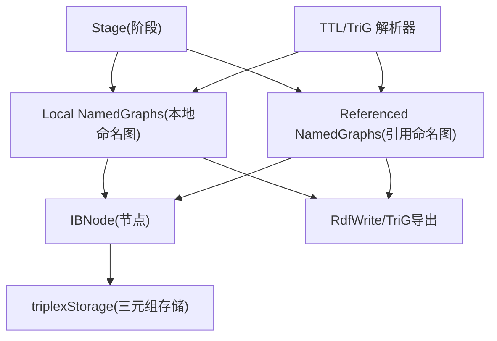
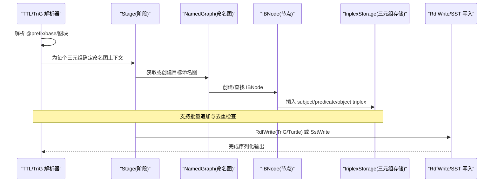
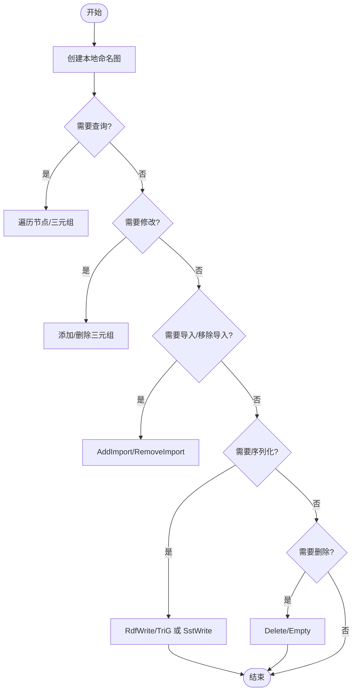
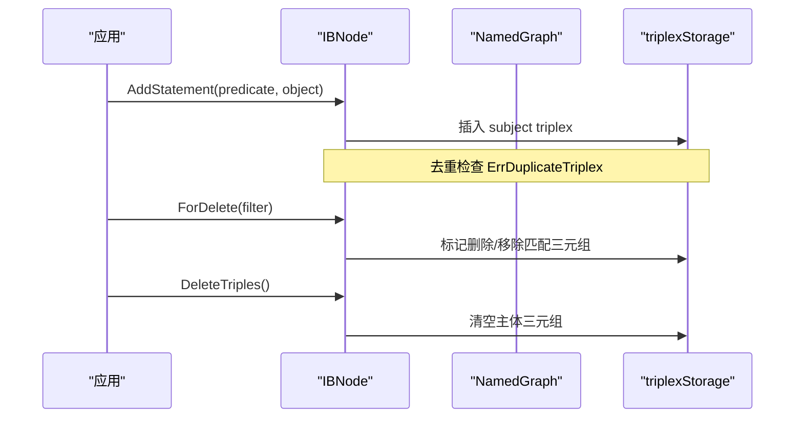
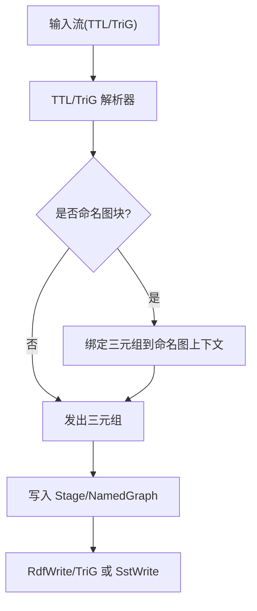
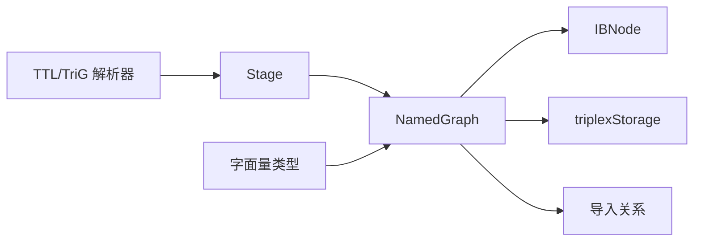

# 命名图管理

<cite>
**本文引用的文件**
- [namedgraph.go](file://sst/namedgraph.go)
- [ibnode.go](file://sst/ibnode.go)
- [literals.go](file://sst/literals.go)
- [rdftrig.go](file://sst/rdftrig.go)
- [rdfttl.go](file://sst/rdfttl.go)
- [rdf.go](file://sst/rdf.go)
- [stage.go](file://sst/stage.go)
- [types.go](file://sst/types.go)
</cite>

## 目录
1. [简介](#简介)
2. [项目结构](#项目结构)
3. [核心组件](#核心组件)
4. [架构总览](#架构总览)
5. [详细组件分析](#详细组件分析)
6. [依赖关系分析](#依赖关系分析)
7. [性能考虑](#性能考虑)
8. [故障排查指南](#故障排查指南)
9. [结论](#结论)
10. [附录](#附录)

## 简介
本文件面向“命名图（NamedGraph）”的创建、查询、删除与三元组操作，系统阐述本地命名图与引用命名图的区别与适用场景；说明 IBNode 节点管理与字面量处理；覆盖序列化支持（TTL、TriG 等格式读写）；提供遍历与查询的最佳实践，并给出复杂数据结构处理示例与性能优化建议。内容基于 SST 核心库中 sst 包的实现进行归纳与可视化说明。

## 项目结构
围绕命名图的核心代码集中在 sst 包内：
- 命名图模型与生命周期：namedgraph.go
- 节点与三元组存储：ibnode.go
- 字面量类型与转换：literals.go、rdf.go
- 序列化解析器（TTL/TriG）：rdfttl.go、rdftrig.go
- 阶段（Stage）与命名图集合管理：stage.go
- 内置词汇与静态图：types.go



图表来源
- [stage.go:53-100](file://sst/stage.go#L53-L100)
- [namedgraph.go:42-108](file://sst/namedgraph.go#L42-L108)
- [ibnode.go:634-660](file://sst/ibnode.go#L634-L660)
- [rdftrig.go:21-33](file://sst/rdftrig.go#L21-L33)
- [rdfttl.go:13-40](file://sst/rdfttl.go#L13-L40)

章节来源
- [stage.go:53-100](file://sst/stage.go#L53-L100)
- [namedgraph.go:42-108](file://sst/namedgraph.go#L42-L108)

## 核心组件
- 命名图接口与实现：定义命名图的创建、导入、差异比较、提交关联、序列化、删除等操作，以及状态（本地/引用/已删除）。
- 节点模型：IBNode 表示 IRI 或空白节点，维护其三元组索引（subject/predicate/object triplex），支持添加、删除、遍历、批量移动与合并。
- 字面量：多种 XSD/RDF 字面量类型及语言标签，统一通过 Literal 接口参与三元组对象。
- 序列化：TTL 与 TriG 流式解析，支持命名图块上下文；输出时支持多命名图导出。
- 阶段（Stage）：管理本地与引用命名图集合，提供创建、查询、遍历、提交、迁移合并、写入等功能。

章节来源
- [namedgraph.go:110-409](file://sst/namedgraph.go#L110-L409)
- [ibnode.go:698-800](file://sst/ibnode.go#L698-L800)
- [literals.go:12-442](file://sst/literals.go#L12-L442)
- [rdftrig.go:9-33](file://sst/rdftrig.go#L9-L33)
- [rdfttl.go:57-99](file://sst/rdfttl.go#L57-L99)
- [stage.go:74-234](file://sst/stage.go#L74-L234)

## 架构总览
下图展示从读取到写入的端到端流程，包括命名图上下文在 TriG 中的传递、三元组在内存中的组织、以及最终写回 SST 或 RDF 的过程。



图表来源
- [rdftrig.go:35-84](file://sst/rdftrig.go#L35-L84)
- [rdfttl.go:57-99](file://sst/rdfttl.go#L57-L99)
- [namedgraph.go:191-196](file://sst/namedgraph.go#L191-L196)
- [ibnode.go:773-796](file://sst/ibnode.go#L773-L796)

## 详细组件分析

### 命名图的生命周期与操作
- 创建：通过 Stage.CreateNamedGraph 创建本地命名图，内部初始化 baseIRI、ID、节点映射与三元组存储，并隐式创建代表整个命名图的根节点。
- 查询：Stage.NamedGraph/NamedGraphs/ReferencedGraph/ReferencedGraphs 提供按 IRI 或集合访问；NamedGraph.ForAllIBNodes/ForIRINodes/ForBlankNodes 用于遍历。
- 删除：NamedGraph.Delete 尝试删除未被其他命名图引用的图；若仍被引用则转为引用状态；否则完全移除并提交新修订。
- 清空：Empty 仅清理未引用的节点，保持图有效。
- 导入：AddImport/RemoveImport/DirectImports 管理 owl:imports 关系，避免循环导入。
- 提交关联：LinkToRepository 将命名图与仓库分支关联，记录 checkout 元数据以支持后续提交历史延续。
- 差异与合并：Diff 计算两个命名图差异（含导入变更）；FindCommonParentRevision 用于三路合并定位共同祖先。



图表来源
- [stage.go:74-100](file://sst/stage.go#L74-L100)
- [namedgraph.go:117-350](file://sst/namedgraph.go#L117-L350)
- [namedgraph.go:415-503](file://sst/namedgraph.go#L415-L503)

章节来源
- [stage.go:74-100](file://sst/stage.go#L74-L100)
- [namedgraph.go:117-350](file://sst/namedgraph.go#L117-L350)
- [namedgraph.go:415-503](file://sst/namedgraph.go#L415-L503)

### 本地命名图与引用命名图
- 本地命名图：由 Stage.CreateNamedGraph 创建，处于可编辑状态，包含至少一个主体三元组时可正常写出。
- 引用命名图：仅包含无主体三元组的 IBNode，通常被其他命名图通过三元组引用；不可直接修改、提交或写出；当所有外部引用消失后可被清理。
- 使用场景：
  - 本地命名图：应用主数据、频繁增删改查的业务图。
  - 引用命名图：共享的只读资源（如本体、词典、公共类定义），通过三元组在其他图中被消费。

章节来源
- [namedgraph.go:110-145](file://sst/namedgraph.go#L110-L145)
- [stage.go:53-100](file://sst/stage.go#L53-L100)

### 三元组操作方法（添加、修改、删除、批量）
- 添加：IBNode.AddStatement/AddStatementAlt 向当前节点作为主体的三元组中添加谓词-对象对；后者容忍重复并返回错误。
- 修改：通过删除旧三元组再添加新三元组实现；或使用 ForDelete 条件删除后重建。
- 删除：IBNode.DeleteTriples 删除该节点的所有主体三元组；IBNode.Delete 删除节点及其所有相关三元组。
- 批量：利用 Stage.MoveAndMerge 在不同 Stage 间迁移与合并命名图；IBNode 层面可通过 ForAll/ForDelete 批量处理。



图表来源
- [ibnode.go:773-796](file://sst/ibnode.go#L773-L796)
- [ibnode.go:330-341](file://sst/ibnode.go#L330-L341)

章节来源
- [ibnode.go:773-796](file://sst/ibnode.go#L773-L796)
- [ibnode.go:330-341](file://sst/ibnode.go#L330-L341)

### IBNode 节点管理与字面量处理
- 节点类型：IBNode 可为 IRI 节点或空白节点；内部通过 ibNodeString/ibNodeUuid 区分；三元组以 triplex 形式存储在所属 NamedGraph 的 triplexStorage 中。
- 字面量：支持 xsd:string、整数、浮点、布尔、日期时间、语言标签字符串等；通过 literals.go 中的类型实现 Literal 接口，统一参与三元组对象。
- 类型体系：types.go 定义了常用字面量类型的 IBNode 常量（如 xsd:string、xsd:int、rdf:langString 等），便于快速构建三元组。

```mermaid
classDiagram
class IBNode {
+TypeOf() IBNode
+IRI() IRI
+Fragment() string
+ID() uuid.UUID
+TripleCount() int
+OwningGraph() NamedGraph
+ForAll(callback) error
+GetObjects(predicate) []Term
+AddStatement(p,o)
+AddStatementAlt(p,o) error
+CheckTriple(p,o) bool
+Delete()
+ForDelete(callback)
+DeleteTriples()
}
class Literal {
<<interface>>
+DataType() IBNode
+apiValue() interface{}
}
class String
class Int
class Double
class Boolean
class LangString
class TypedString
IBNode --> Literal : "对象可为字面量"
String ..|> Literal
Int ..|> Literal
Double ..|> Literal
Boolean ..|> Literal
LangString ..|> Literal
TypedString ..|> Literal
```

图表来源
- [ibnode.go:698-800](file://sst/ibnode.go#L698-L800)
- [literals.go:12-442](file://sst/literals.go#L12-L442)
- [types.go:63-207](file://sst/types.go#L63-L207)

章节来源
- [ibnode.go:698-800](file://sst/ibnode.go#L698-L800)
- [literals.go:12-442](file://sst/literals.go#L12-L442)
- [types.go:63-207](file://sst/types.go#L63-L207)

### 序列化支持（TTL、TriG、SST）
- TTL 解析：rdfttl.go 提供流式解析，支持前缀、基址、列表/集合、字面量类型与语言标签。
- TriG 解析：rdftrig.go 扩展 TTL 解析器，识别命名图块 { ... }，维护 graphStack 将三元组绑定到对应命名图上下文。
- 输出：NamedGraph.RdfWrite 支持 Turtle；Stage.RdfWrite 支持 TriG 一次性导出多个命名图；SST 内部格式通过 SstWrite 持久化。



图表来源
- [rdfttl.go:57-99](file://sst/rdfttl.go#L57-L99)
- [rdftrig.go:35-84](file://sst/rdftrig.go#L35-L84)
- [namedgraph.go:191-196](file://sst/namedgraph.go#L191-L196)
- [stage.go:219-223](file://sst/stage.go#L219-L223)

章节来源
- [rdfttl.go:57-99](file://sst/rdfttl.go#L57-L99)
- [rdftrig.go:35-84](file://sst/rdftrig.go#L35-L84)
- [namedgraph.go:191-196](file://sst/namedgraph.go#L191-L196)
- [stage.go:219-223](file://sst/stage.go#L219-L223)

### 命名图遍历与查询最佳实践
- 遍历：优先使用 ForAllIBNodes/ForIRINodes/ForBlankNodes 进行安全遍历，遇到回调错误立即终止。
- 查询：通过 GetIRINodeByFragment/GetBlankNodeByID 精确获取节点；结合 TripleCount/GetTriple 进行三元组级检索。
- 批量处理：使用 ForDelete 过滤删除；MoveAndMerge 跨 Stage 合并时注意保留导入关系与版本信息。
- 性能：合理选择 TriplexMode（默认包含 subject/predicate/object 三类索引）；避免不必要的重复添加（使用 AddStatementAlt 容错）。

章节来源
- [namedgraph.go:157-189](file://sst/namedgraph.go#L157-L189)
- [ibnode.go:736-772](file://sst/ibnode.go#L736-L772)
- [stage.go:33-51](file://sst/stage.go#L33-L51)

### 复杂数据结构处理示例
- 列表与集合：TTL/TriG 解析器支持 [...] 与 (...) 语法，内部转换为 rdf:first/rdf:rest 链或 TermCollection；应用层可使用 CreateCollection 构造。
- 多层嵌套：解析器通过 ctxStack 维护上下文栈，确保嵌套结构正确还原；应用层应避免过深嵌套以提升性能。
- 字面量类型：使用 literals.go 提供的类型（如 Integer、Double、Boolean、LangString、TypedString）构建带类型或语言标签的字面量。

章节来源
- [rdfttl.go:189-229](file://sst/rdfttl.go#L189-L229)
- [rdfttl.go:384-429](file://sst/rdfttl.go#L384-L429)
- [literals.go:246-335](file://sst/literals.go#L246-L335)

## 依赖关系分析
- Stage 依赖 NamedGraph 集合（本地与引用），并通过 namedGraph 管理三元组存储与节点。
- NamedGraph 依赖 IBNode 与 triplexStorage，维护导入关系与版本元数据。
- 序列化模块（TTL/TriG）依赖解析器与命名图上下文，将三元组写入 Stage/NamedGraph。
- 字面量类型统一实现 Literal 接口，供三元组对象使用。



图表来源
- [stage.go:53-100](file://sst/stage.go#L53-L100)
- [namedgraph.go:42-108](file://sst/namedgraph.go#L42-L108)
- [rdftrig.go:21-33](file://sst/rdftrig.go#L21-L33)
- [literals.go:12-442](file://sst/literals.go#L12-L442)

章节来源
- [stage.go:53-100](file://sst/stage.go#L53-L100)
- [namedgraph.go:42-108](file://sst/namedgraph.go#L42-L108)
- [rdftrig.go:21-33](file://sst/rdftrig.go#L21-L33)
- [literals.go:12-442](file://sst/literals.go#L12-L442)

## 性能考虑
- 三元组模式：默认模式包含 subject/predicate/object 三类索引，适合双向遍历但内存占用更高；可根据需求权衡。
- 批量操作：优先使用 MoveAndMerge 进行跨 Stage 合并，减少逐条插入开销；使用 ForDelete 批量过滤删除。
- 去重与校验：AddStatementAlt 避免重复三元组导致的异常；解析器在插入前进行去重检查。
- 序列化：TriG 一次导出多个命名图，减少 I/O 次数；TTL 流式解析降低内存峰值。

[本节为通用指导，不直接分析具体文件]

## 故障排查指南
- 常见错误：
  - 命名图不存在：ErrNamedGraphNotFound
  - 重复片段：ErrDuplicatedFragment
  - 已删除或无效：ErrNamedGraphAlreadyDeleted / ErrNodeDeletedOrInvalid
  - 重复三元组：ErrDuplicateTriplex
  - 导入循环：ErrNamedGraphImportCycle
  - 阶段仓库不匹配：ErrStagesRepositoryMismatch
- 排查步骤：
  - 确认命名图是否已被删除或处于引用状态。
  - 检查导入关系是否存在循环。
  - 验证三元组是否重复或谓词/对象缺失。
  - 查看 Stage 是否链接到正确的 Repository。

章节来源
- [namedgraph.go:20-40](file://sst/namedgraph.go#L20-L40)
- [ibnode.go:47-60](file://sst/ibnode.go#L47-L60)
- [stage.go:21-31](file://sst/stage.go#L21-L31)

## 结论
SST 的命名图管理提供了完整的生命周期支持与高效的三元组操作能力。通过本地与引用命名图的分离，既满足灵活的数据建模，又保证共享资源的只读一致性。配合 TTL/TriG 解析与 SST 内部格式，实现了从输入到输出的完整闭环。遵循最佳实践与性能建议，可在大规模数据场景下获得稳定与高效的表现。

[本节为总结性内容，不直接分析具体文件]

## 附录
- 术语表：
  - 命名图（NamedGraph）：一组三元组的逻辑集合，具有唯一标识。
  - 本地命名图：可编辑的命名图，包含主体三元组。
  - 引用命名图：仅被其他图引用的只读命名图。
  - IBNode：IRI 或空白节点，承载三元组关系。
  - 字面量（Literal）：带类型或语言标签的值。
  - Triplex：三元组在内存中的三种索引形式（subject/predicate/object）。

[本节为概念性内容，不直接分析具体文件]