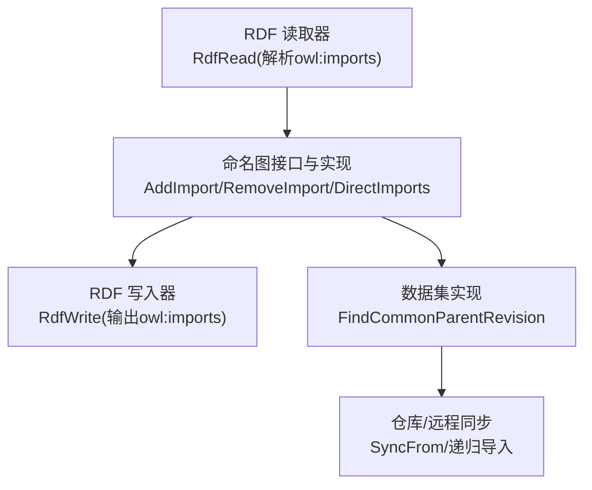
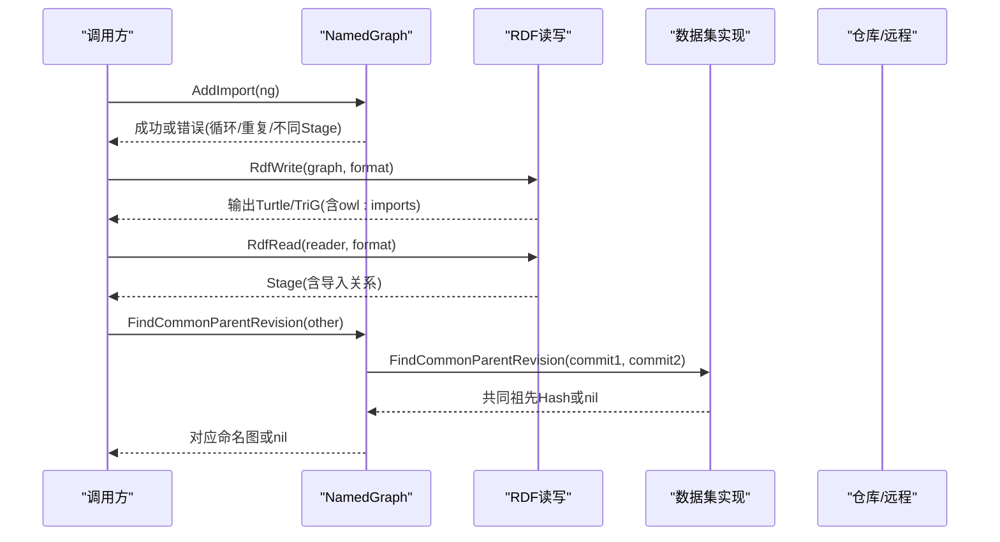
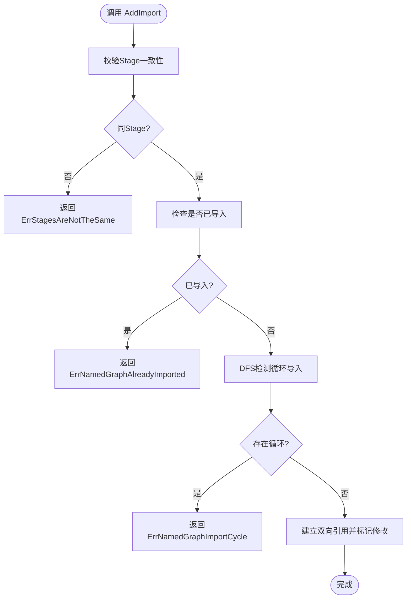
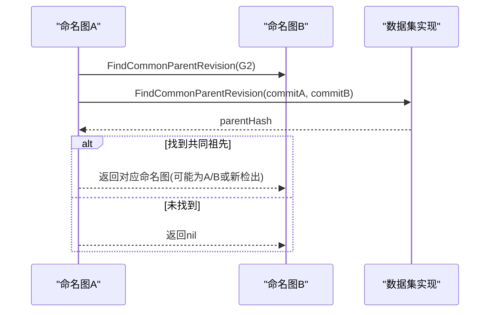
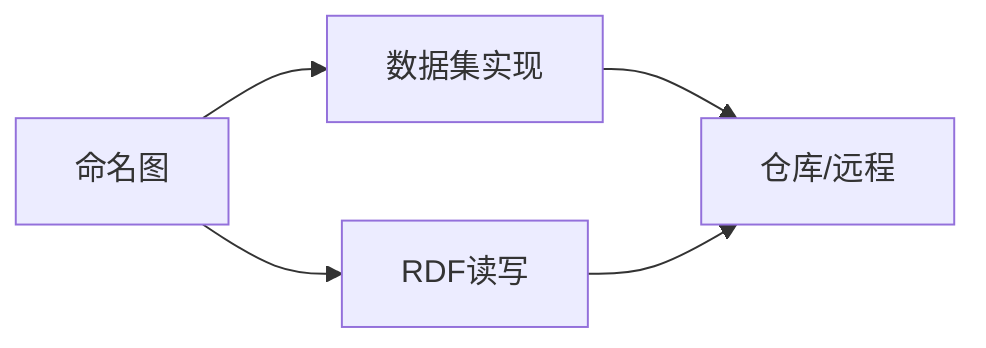

# 导入导出

<cite>
**本文引用的文件**
- [namedgraph.go](file://sst/namedgraph.go)
- [rdfwrite.go](file://sst/rdfwrite.go)
- [rdfreader.go](file://sst/rdfreader.go)
- [repolocalbasic.go](file://sst/repolocalbasic.go)
- [repolocalflat.go](file://sst/repolocalflat.go)
- [sstreaddiff.go](file://sst/sstreaddiff.go)
- [reporemote.go](file://sst/reporemote.go)
- [alignhistory_test.go](file://sst_test/alignhistory_test.go)
- [rdftrig_test.go](file://sst_test/rdftrig_test.go)
- [checkout_revision_test.go](file://sst_test/checkout_revision_test.go)
</cite>

## 目录
1. [简介](#简介)
2. [项目结构](#项目结构)
3. [核心组件](#核心组件)
4. [架构总览](#架构总览)
5. [详细组件分析](#详细组件分析)
6. [依赖关系分析](#依赖关系分析)
7. [性能考虑](#性能考虑)
8. [故障排查指南](#故障排查指南)
9. [结论](#结论)
10. [附录：复杂场景示例与最佳实践](#附录：复杂场景示例与最佳实践)

## 简介
本文件聚焦于命名图（NamedGraph）的导入导出能力，围绕以下目标展开：
- AddImport 与 RemoveImport 的使用方式及命名图之间的依赖管理
- 循环导入检测与冲突解决机制
- DirectImports 方法获取直接导入的命名图列表
- FindCommonParentRevision 在三向合并与差异比较中的作用
- 导入链的管理与验证过程
- 复杂导入场景的代码示例（多层导入、冲突处理）
- 导入导出的性能考量与最佳实践

## 项目结构
与导入导出相关的核心代码主要分布在 sst 包中：
- 命名图接口与实现：AddImport/RemoveImport/DirectImports/FindCommonParentRevision/Diff 等
- RDF 读写：RdfRead/RdfWrite 负责序列化/反序列化 owl:imports 关系
- 仓库层：FindCommonParentRevision 在本地数据集实现中查找共同祖先提交
- 测试用例：覆盖多层导入、往返序列化、检出历史对齐等

图表来源
- [namedgraph.go:222-265](file://sst/namedgraph.go#L222-L265)
- [rdfwrite.go:400-432](file://sst/rdfwrite.go#L400-L432)
- [rdfreader.go:118-232](file://sst/rdfreader.go#L118-L232)
- [repolocalbasic.go:480-520](file://sst/repolocalbasic.go#L480-L520)
- [repolocalflat.go:172-210](file://sst/repolocalflat.go#L172-L210)
- [reporemote.go:914-937](file://sst/reporemote.go#L914-L937)

章节来源
- [namedgraph.go:222-265](file://sst/namedgraph.go#L222-L265)
- [rdfwrite.go:400-432](file://sst/rdfwrite.go#L400-L432)
- [rdfreader.go:118-232](file://sst/rdfreader.go#L118-L232)

## 核心组件
- NamedGraph 接口定义了导入导出相关的关键方法：
  - AddImport/RemoveImport：添加/移除直接导入关系
  - DirectImports：返回直接导入的命名图集合
  - Diff：比较两个命名图的差异，包含导入级别的变化
  - FindCommonParentRevision：用于三向合并/差异比较的共同祖先查找
- RDF 读写：
  - RdfWrite：将命名图及其导入关系序列化为 RDF/Turtle/TriG，使用 owl:imports 表达导入
  - RdfRead：从 RDF/Turtle/TriG 读取数据并重建导入关系
- 数据集实现：
  - FindCommonParentRevision：在本地数据集上查找两个提交的共同祖先，支持三向合并

章节来源
- [namedgraph.go:222-265](file://sst/namedgraph.go#L222-L265)
- [rdfwrite.go:400-432](file://sst/rdfwrite.go#L400-L432)
- [rdfreader.go:118-232](file://sst/rdfreader.go#L118-L232)
- [repolocalbasic.go:480-520](file://sst/repolocalbasic.go#L480-L520)
- [repolocalflat.go:172-210](file://sst/repolocalflat.go#L172-L210)

## 架构总览
下图展示了导入导出在系统内的交互流程：调用方通过 NamedGraph 接口进行导入关系的增删；RDF 读写负责持久化与恢复导入关系；数据集实现提供共同祖先查找以支持三向合并。

图表来源
- [namedgraph.go:572-622](file://sst/namedgraph.go#L572-L622)
- [rdfwrite.go:400-432](file://sst/rdfwrite.go#L400-L432)
- [rdfreader.go:118-232](file://sst/rdfreader.go#L118-L232)
- [repolocalbasic.go:480-520](file://sst/repolocalbasic.go#L480-L520)
- [repolocalflat.go:172-210](file://sst/repolocalflat.go#L172-L210)

## 详细组件分析

### AddImport 与 RemoveImport：依赖管理与冲突处理
- AddImport：
  - 校验两个命名图是否属于同一 Stage
  - 检查是否已存在相同导入（避免重复）
  - 检测循环导入（DFS 遍历被导入者的导入链）
  - 建立双向引用（导入者与被导入者），标记修改状态
- RemoveImport：
  - 校验 Stage 一致性
  - 检查是否存在该导入关系
  - 删除双向引用，标记修改状态

图表来源
- [namedgraph.go:1370-1387](file://sst/namedgraph.go#L1370-L1387)
- [namedgraph.go:1389-1410](file://sst/namedgraph.go#L1389-L1410)

章节来源
- [namedgraph.go:1370-1387](file://sst/namedgraph.go#L1370-L1387)
- [namedgraph.go:1389-1410](file://sst/namedgraph.go#L1389-L1410)

### DirectImports：获取直接导入的命名图列表
- 返回当前命名图直接导入的所有命名图
- 常用于导出时生成 owl:imports 列表，或在 UI/工具中展示依赖关系

章节来源
- [namedgraph.go:1412-1421](file://sst/namedgraph.go#L1412-L1421)

### FindCommonParentRevision：三向合并与差异比较
- 作用：在两个同名命名图的不同版本之间查找共同祖先提交，以便进行三向合并或差异计算
- 行为：
  - 要求两个命名图具有相同的 IRI，且处于同一仓库的不同 Stage
  - 委托数据集实现查找共同祖先 Hash
  - 若找到共同祖先，则返回对应的命名图（可能是其中一个版本或一个新的检出版本）
  - 若无共同祖先，返回 nil

图表来源
- [namedgraph.go:572-622](file://sst/namedgraph.go#L572-L622)
- [repolocalbasic.go:480-520](file://sst/repolocalbasic.go#L480-L520)
- [repolocalflat.go:172-210](file://sst/repolocalflat.go#L172-L210)

章节来源
- [namedgraph.go:572-622](file://sst/namedgraph.go#L572-L622)
- [repolocalbasic.go:480-520](file://sst/repolocalbasic.go#L480-L520)
- [repolocalflat.go:172-210](file://sst/repolocalflat.go#L172-L210)

### 导入链的管理与验证
- 导入链由 directImports 映射维护，支持直接导入与间接导入（allImports）
- 验证包括：
  - Stage 一致性
  - 重复导入检测
  - 循环导入检测（DFS）
  - 删除时的有效性检查（确保未被其他图引用）
- 在 RDF 读写过程中，导入关系会被持久化与恢复：
  - 写入时：根据 DirectImports 输出 owl:imports
  - 读取时：解析 owl:imports 并重建导入关系

章节来源
- [namedgraph.go:1423-1448](file://sst/namedgraph.go#L1423-L1448)
- [rdfwrite.go:508-534](file://sst/rdfwrite.go#L508-L534)
- [rdfreader.go:234-309](file://sst/rdfreader.go#L234-L309)

### 导入导出流程（RDF 序列化/反序列化）
- 写入：
  - 对命名图节点输出 owl:Ontology 类型
  - 对每个直接导入输出 owl:imports
  - 支持 Turtle 与 TriG 格式
- 读取：
  - 解析 owl:imports，重建导入关系
  - 对于 TriG 格式，支持多命名图块

章节来源
- [rdfwrite.go:400-432](file://sst/rdfwrite.go#L400-L432)
- [rdfwrite.go:508-534](file://sst/rdfwrite.go#L508-L534)
- [rdfreader.go:118-232](file://sst/rdfreader.go#L118-L232)
- [rdfreader.go:234-309](file://sst/rdfreader.go#L234-L309)

## 依赖关系分析
- 命名图与 RDF 读写模块紧密耦合：导入关系通过 owl:imports 表达，读写时需保持一致性
- 数据集实现提供共同祖先查找，支撑三向合并与差异比较
- 远程仓库支持递归导入加载与同步，保证导入链完整性

图表来源
- [namedgraph.go:222-265](file://sst/namedgraph.go#L222-L265)
- [rdfwrite.go:400-432](file://sst/rdfwrite.go#L400-L432)
- [rdfreader.go:118-232](file://sst/rdfreader.go#L118-L232)
- [reporemote.go:914-937](file://sst/reporemote.go#L914-L937)

章节来源
- [namedgraph.go:222-265](file://sst/namedgraph.go#L222-L265)
- [rdfwrite.go:400-432](file://sst/rdfwrite.go#L400-L432)
- [rdfreader.go:118-232](file://sst/rdfreader.go#L118-L232)
- [reporemote.go:914-937](file://sst/reporemote.go#L914-L937)

## 性能考虑
- 导入链遍历：
  - allImports 使用 DFS 遍历直接导入，注意避免重复访问（visited 集合）
  - 大规模导入链下，建议分批处理或限制深度
- 序列化/反序列化：
  - RdfWrite 对命名图排序以保证稳定输出，减少不必要的差异
  - RdfRead 解析 owl:imports 时按需构建导入关系，避免一次性加载全部依赖
- 内存与并发：
  - 大图中三元组数量较多时，注意流式写入与读取以减少内存占用
  - 远程同步时，递归导入可能导致大量网络请求，需控制并发与重试策略

[本节为通用指导，不直接分析具体文件]

## 故障排查指南
常见错误与处理：
- ErrStagesAreNotTheSame：尝试在不同 Stage 的命名图间建立导入关系
  - 解决：确保在同一 Stage 内操作
- ErrNamedGraphAlreadyImported：重复导入同一命名图
  - 解决：先检查 DirectImports 再添加
- ErrNamedGraphImportCycle：导入会导致循环依赖
  - 解决：调整导入拓扑，打破环
- ErrNamedGraphNotImported：移除不存在的导入
  - 解决：确认导入关系存在后再移除
- 无共同祖先：FindCommonParentRevision 返回 nil
  - 解决：确认两个命名图具有相同 IRI 且来自同一仓库

章节来源
- [namedgraph.go:25-39](file://sst/namedgraph.go#L25-L39)
- [namedgraph.go:1353-1387](file://sst/namedgraph.go#L1353-L1387)
- [namedgraph.go:572-622](file://sst/namedgraph.go#L572-L622)

## 结论
SST 的导入导出功能通过 NamedGraph 接口提供了强大的依赖管理能力，结合 RDF 读写与数据集实现的共同祖先查找，支持复杂的三向合并与差异比较。通过严格的循环检测与冲突处理，确保了导入链的一致性与可维护性。在实际使用中，应关注导入链规模、序列化性能与远程同步效率，遵循最佳实践以获得稳定高效的体验。

[本节为总结，不直接分析具体文件]

## 附录：复杂场景示例与最佳实践

### 多层导入与往返序列化
- 创建多个命名图并建立多层导入关系
- 使用 RdfWrite 输出到 TriG 文件，再通过 RdfRead 读回，验证导入关系保持

参考测试路径
- [rdftrig_test.go:758-811](file://sst_test/rdftrig_test.go#L758-L811)

### 冲突处理与历史对齐
- 在外部修改导入图后，重新读入并进行历史对齐，确保导入图的状态与主图一致
- 验证导入图在 Stage2 中被转换为本地图，并保留检出元数据

参考测试路径
- [alignhistory_test.go:696-766](file://sst_test/alignhistory_test.go#L696-L766)

### 检出修订与导入关系验证
- 检出特定修订后，验证导入关系是否正确加载
- 确保 DirectImports 返回预期的导入图数量

参考测试路径
- [checkout_revision_test.go:316-336](file://sst_test/checkout_revision_test.go#L316-L336)

### 最佳实践
- 设计导入拓扑时避免循环依赖，必要时引入中间层解耦
- 批量导入时优先使用 TriG 格式，减少多次序列化开销
- 远程同步时合理设置并发与超时，避免导入链过长导致性能问题
- 定期审计导入关系，清理无用或废弃的导入

[本节为概念性内容，不直接分析具体文件]