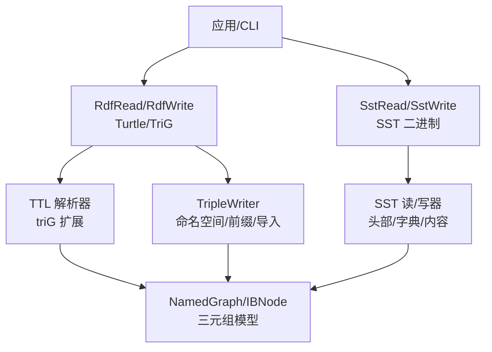
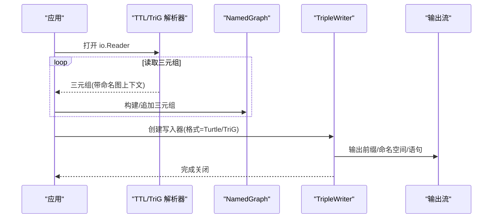
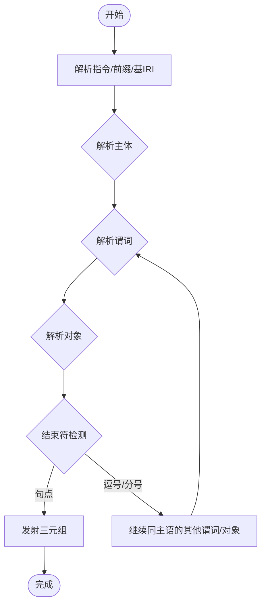
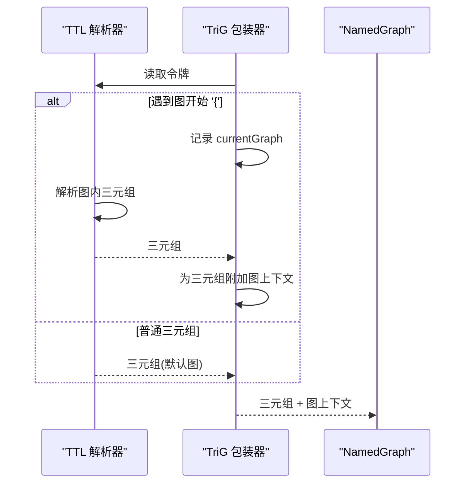
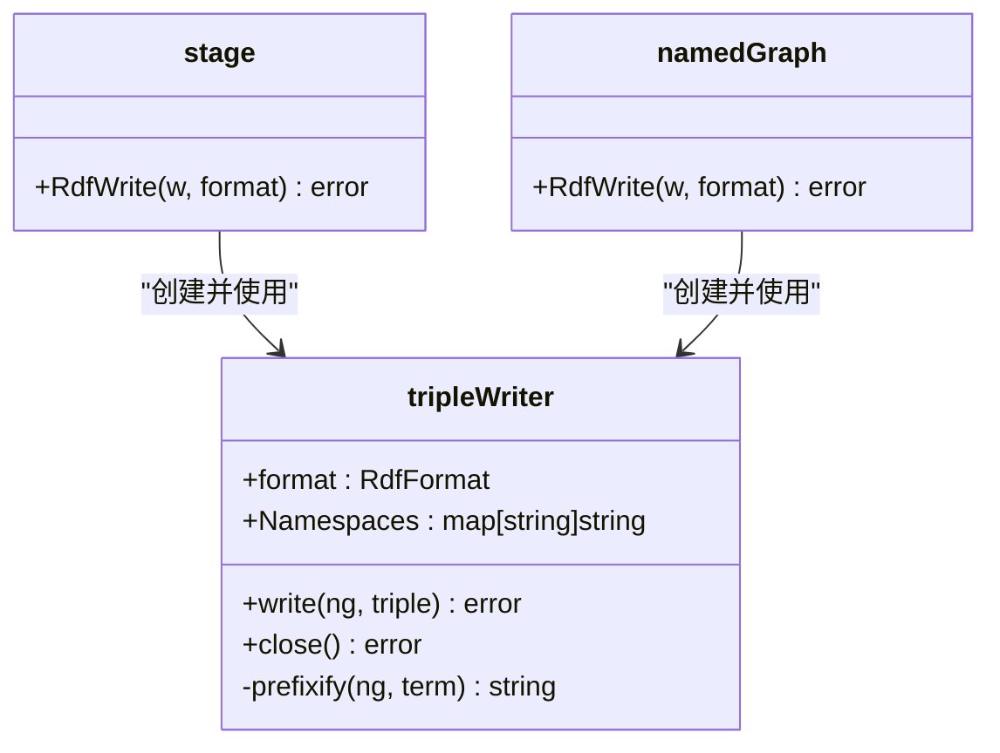
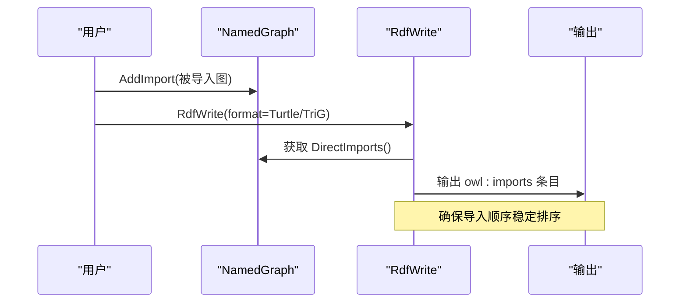
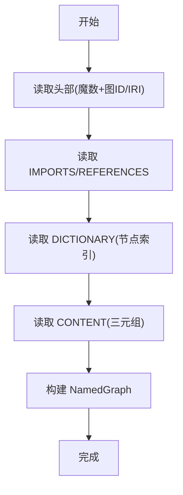
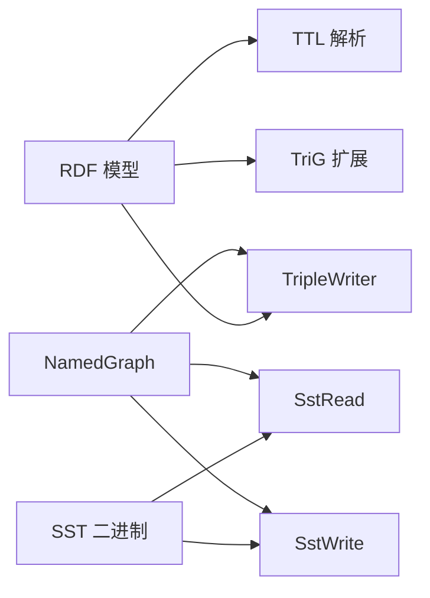

# 序列化支持

<cite>
**本文引用的文件**
- [rdf.go](file://sst/rdf.go)
- [rdfttl.go](file://sst/rdfttl.go)
- [rdftrig.go](file://sst/rdftrig.go)
- [rdfwrite.go](file://sst/rdfwrite.go)
- [sstfile.go](file://sst/sstfile.go)
- [sstreader.go](file://sst/sstreader.go)
- [namedgraph.go](file://sst/namedgraph.go)
- [types.go](file://sst/types.go)
- [ibnode.go](file://sst/ibnode.go)
- [helloworldreadttl.go](file://examples/helloworldreadttl/helloworldreadttl.go)
</cite>

## 目录
1. [简介](#简介)
2. [项目结构](#项目结构)
3. [核心组件](#核心组件)
4. [架构总览](#架构总览)
5. [详细组件分析](#详细组件分析)
6. [依赖关系分析](#依赖关系分析)
7. [性能与内存优化建议](#性能与内存优化建议)
8. [故障排查指南](#故障排查指南)
9. [结论](#结论)
10. [附录：格式转换示例路径](#附录格式转换示例路径)

## 简介
本文件系统性说明 SST 核心库的序列化支持，覆盖以下要点：
- RDF 格式读写：Turtle（.ttl）与 TriG（多命名图）的解析与生成。
- RdfWrite 方法的配置选项与输出格式控制（前缀、命名空间、导入声明等）。
- SST 二进制格式的序列化和反序列化过程。
- 导入导出功能：owl:imports 的处理机制与数据完整性保证。
- 命名图的序列化/反序列化过程中的完整性保障。
- 不同格式转换的完整代码示例路径。
- 性能优化与内存使用建议。

## 项目结构
SST 将 RDF 与 SST 二进制两种序列化体系解耦：
- RDF 层：提供 Turtle/TriG 的流式读取与写入，封装三元组/四元组模型、数据类型、IRI/Literal 序列化。
- SST 层：定义紧凑的二进制文件格式，包含头部、导入/引用段、字典段、内容段，以及对应的读写器。
- 命名图与阶段：NamedGraph 承载三元组存储、导入关系、RDF/SST 读写入口；Stage 管理多个 NamedGraph 并提供批量写能力。

图表来源
- [rdf.go:102-117](file://sst/rdf.go#L102-L117)
- [rdfttl.go:13-40](file://sst/rdfttl.go#L13-L40)
- [rdftrig.go:9-33](file://sst/rdftrig.go#L9-L33)
- [rdfwrite.go:21-48](file://sst/rdfwrite.go#L21-L48)
- [sstreader.go:44-80](file://sst/sstreader.go#L44-L80)
- [sstfile.go:12-54](file://sst/sstfile.go#L12-L54)

章节来源
- [rdf.go:102-117](file://sst/rdf.go#L102-L117)
- [sstfile.go:12-54](file://sst/sstfile.go#L12-L54)

## 核心组件
- RDF 三元组/四元组与类型系统：IRI、Literal、Blank Node、集合等，统一序列化接口。
- TTL 解析器：流式状态机，支持前缀、基 IRI、列表/集合、语言标签、数据类型。
- TriG 扩展：在 TTL 基础上识别命名图块，维护当前图上下文，按图分发三元组。
- TripleWriter：Turtle/TriG 写入器，负责前缀/命名空间注册、语句压缩（谓词/对象列表）、导入声明输出。
- SST 二进制格式：紧凑编码，含头部、IMPORTS/REFERENCES、DICTIONARY、CONTENT 四段。
- NamedGraph/Stage：RDF/SST 读写入口，管理导入关系、排序节点、批量写。

章节来源
- [rdf.go:119-139](file://sst/rdf.go#L119-L139)
- [rdfttl.go:13-40](file://sst/rdfttl.go#L13-L40)
- [rdftrig.go:21-33](file://sst/rdftrig.go#L21-L33)
- [rdfwrite.go:21-48](file://sst/rdfwrite.go#L21-L48)
- [sstfile.go:12-54](file://sst/sstfile.go#L12-L54)
- [namedgraph.go:110-195](file://sst/namedgraph.go#L110-L195)

## 架构总览
下图展示从输入到输出的关键流程：RDF 读取 → 三元组模型 → 写入器 → 目标格式（Turtle/TriG），以及 SST 二进制读写。

图表来源
- [rdfttl.go:57-86](file://sst/rdfttl.go#L57-L86)
- [rdftrig.go:35-84](file://sst/rdftrig.go#L35-L84)
- [rdfwrite.go:400-432](file://sst/rdfwrite.go#L400-L432)

## 详细组件分析

### RDF 三元组与类型系统
- 术语抽象：IRI、Literal、Blank Node 实现统一的 rdfSerialize 接口，支持不同格式输出。
- 数据类型：内置 xsd 类型映射，支持字符串、布尔、数值、日期时间、字节等；语言标签字符串特殊处理。
- 三元组/四元组：提供 Serialize 方法用于调试或简单输出；实际写入由 TripleWriter 完成。

章节来源
- [rdf.go:119-139](file://sst/rdf.go#L119-L139)
- [rdf.go:294-355](file://sst/rdf.go#L294-L355)
- [rdf.go:482-515](file://sst/rdf.go#L482-L515)

### Turtle 解析器（TTL）
- 流式解析：基于状态机 parseStart/parseSubject/parsePredicate/parseObject/parseEnd，逐步产出三元组。
- 前缀与基 IRI：支持 @prefix 与 @base，相对 IRI 按 base 解析。
- 列表与集合：支持 [...] 与 (...) 语法，内部转换为 rdf:first/rdf:rest 链。
- 错误恢复：recover 捕获非运行时 panic，绑定为 error 返回。

图表来源
- [rdfttl.go:101-144](file://sst/rdfttl.go#L101-L144)
- [rdfttl.go:232-430](file://sst/rdfttl.go#L232-L430)
- [rdfttl.go:515-528](file://sst/rdfttl.go#L515-L528)

章节来源
- [rdfttl.go:13-40](file://sst/rdfttl.go#L13-L40)
- [rdfttl.go:57-86](file://sst/rdfttl.go#L57-L86)
- [rdfttl.go:101-144](file://sst/rdfttl.go#L101-L144)
- [rdfttl.go:232-430](file://sst/rdfttl.go#L232-L430)

### TriG 扩展（命名图）
- 在 TTL 基础上增加对命名图块 { ... } 的识别，维护 currentGraph 栈。
- 每个三元组附带其所属命名图上下文，供上层写入器按图组织输出。
- 支持图内前缀声明，保持局部作用域。

图表来源
- [rdftrig.go:35-84](file://sst/rdftrig.go#L35-L84)
- [rdftrig.go:139-254](file://sst/rdftrig.go#L139-L254)

章节来源
- [rdftrig.go:9-33](file://sst/rdftrig.go#L9-L33)
- [rdftrig.go:35-84](file://sst/rdftrig.go#L35-L84)
- [rdftrig.go:139-254](file://sst/rdftrig.go#L139-L254)

### Turtle/TriG 写入器（RdfWrite）
- 命名空间与前缀：自动注册 owl/rdf/rdfs/xsd/lci/sso 等常用词汇表前缀；按需生成 nsN 前缀并输出 @prefix。
- 语句压缩：同一主语的连续三元组合并为谓词/对象列表，减少冗余。
- 导入声明：对于 Turtle，会在图级输出 owl:imports；对于 TriG，按命名图块输出各图的导入关系。
- 集合与空白节点：支持内联集合与空白节点，或在必要时展开为 rdf:first/rest 链。

图表来源
- [rdfwrite.go:21-48](file://sst/rdfwrite.go#L21-L48)
- [rdfwrite.go:400-432](file://sst/rdfwrite.go#L400-L432)
- [rdfwrite.go:447-666](file://sst/rdfwrite.go#L447-L666)

章节来源
- [rdfwrite.go:21-48](file://sst/rdfwrite.go#L21-L48)
- [rdfwrite.go:400-432](file://sst/rdfwrite.go#L400-L432)
- [rdfwrite.go:447-666](file://sst/rdfwrite.go#L447-L666)
- [rdfwrite.go:227-306](file://sst/rdfwrite.go#L227-L306)

### 导入导出与 owl:imports
- 添加导入：通过 AddImport 建立命名图间的直接导入关系，避免循环导入。
- 导出行为：
  - Turtle：在当前图输出 owl:imports 指向被导入图的 IRI。
  - TriG：每个命名图块可包含 owl:imports，表示该图导入了其他图。
- 读取行为：
  - SST 读取时，从 IMPORTS 段重建导入关系。
  - RDF 读取时，若存在 owl:imports，会加载对应图作为引用图。

图表来源
- [namedgraph.go:222-235](file://sst/namedgraph.go#L222-L235)
- [rdfwrite.go:508-534](file://sst/rdfwrite.go#L508-L534)
- [rdfwrite.go:613-624](file://sst/rdfwrite.go#L613-L624)
- [sstreader.go:191-210](file://sst/sstreader.go#L191-L210)

章节来源
- [namedgraph.go:222-235](file://sst/namedgraph.go#L222-L235)
- [rdfwrite.go:508-534](file://sst/rdfwrite.go#L508-L534)
- [rdfwrite.go:613-624](file://sst/rdfwrite.go#L613-L624)
- [sstreader.go:191-210](file://sst/sstreader.go#L191-L210)

### SST 二进制格式与读写
- 文件结构：
  - 头部：魔数“SST-1.0”与图标识（可选 IRI 或 UUID）。
  - IMPORTS：导入图数量及 IRI 列表。
  - REFERENCES：引用图数量及 IRI 列表。
  - DICTIONARY：节点字典（IRI/Blank Node 及其引用计数）。
  - CONTENT：按节点顺序存储三元组（非字面量/字面量分别编码）。
- 读取流程：SstRead 依次读取头部、导入/引用、字典、内容，构建 NamedGraph。
- 写入流程：SstWrite 将 NamedGraph 的三元组与字典按规范编码输出。

图表来源
- [sstfile.go:12-54](file://sst/sstfile.go#L12-L54)
- [sstreader.go:44-80](file://sst/sstreader.go#L44-L80)
- [sstreader.go:191-210](file://sst/sstreader.go#L191-L210)

章节来源
- [sstfile.go:12-54](file://sst/sstfile.go#L12-L54)
- [sstreader.go:44-80](file://sst/sstreader.go#L44-L80)
- [sstreader.go:191-210](file://sst/sstreader.go#L191-L210)

### 命名图序列化/反序列化的数据完整性
- 排序与稳定性：
  - 写入前对命名图进行排序，确保输出顺序稳定。
  - 导入图列表排序，保证确定性。
- 完整性检查：
  - 读取 SST 时校验魔数、EOF 等，防止截断或损坏。
  - 解析 RDF 时严格模式（StrictHandler）可增强错误检测。
- 导入一致性：
  - 写入时根据 DirectImports 输出 owl:imports。
  - 读取时重建导入关系，保证图间依赖一致。

章节来源
- [rdfwrite.go:419-432](file://sst/rdfwrite.go#L419-L432)
- [rdfwrite.go:508-534](file://sst/rdfwrite.go#L508-L534)
- [sstreader.go:44-80](file://sst/sstreader.go#L44-L80)

## 依赖关系分析
- 组件耦合：
  - RDF 层依赖三元组/类型模型，独立于存储格式。
  - 写入器依赖命名空间映射与词汇表常量。
  - SST 读写器依赖节点字典与三元组存储布局。
- 外部依赖：
  - UUID、日志库、缓冲 IO 等。
- 潜在循环：
  - 导入关系需避免循环，API 已提供错误返回。

图表来源
- [rdf.go:102-117](file://sst/rdf.go#L102-L117)
- [rdfwrite.go:400-432](file://sst/rdfwrite.go#L400-L432)
- [sstreader.go:44-80](file://sst/sstreader.go#L44-L80)

章节来源
- [rdf.go:102-117](file://sst/rdf.go#L102-L117)
- [rdfwrite.go:400-432](file://sst/rdfwrite.go#L400-L432)
- [sstreader.go:44-80](file://sst/sstreader.go#L44-L80)

## 性能与内存优化建议
- 流式处理：
  - 使用 RdfRead 流式读取三元组，避免一次性加载大文档。
  - 使用 TripleWriter 流式写入，及时 flush 减少内存占用。
- 前缀与命名空间：
  - 预注册常用词汇表前缀，减少重复计算。
  - 合理设置 allowCollectionTerms，避免不必要的集合展开。
- 排序与去重：
  - 写入前对三元组排序以最大化谓词/对象列表压缩。
  - 利用写入器的去重逻辑减少冗余输出。
- SST 二进制优势：
  - 紧凑编码，适合大规模数据存储与传输。
  - 字典段复用节点，降低重复开销。
- 内存管理：
  - 及时关闭 writer 与 reader，释放缓冲。
  - 避免在回调中持有大量临时对象。

[本节为通用指导，不直接分析具体文件]

## 故障排查指南
- 常见错误：
  - 未注册的命名空间导致前缀生成失败。
  - 非法 IRI 或语言标签导致解析失败。
  - SST 文件头错误或 EOF 异常。
- 定位方法：
  - 启用日志（SetLogger/EnableDefaultLogger）查看解析与写入过程。
  - 使用 StrictHandler 提高 RDF 解析错误敏感度。
  - 检查导入关系是否形成环。

章节来源
- [rdfwrite.go:254-260](file://sst/rdfwrite.go#L254-L260)
- [rdfttl.go:515-528](file://sst/rdfttl.go#L515-L528)
- [sstreader.go:24-30](file://sst/sstreader.go#L24-L30)
- [sstfile.go:73-102](file://sst/sstfile.go#L73-L102)

## 结论
SST 核心库提供了完整的 RDF 与 SST 二进制序列化支持：
- 支持 Turtle 与 TriG 的流式读写，具备强大的命名空间与前缀管理能力。
- 通过 owl:imports 机制实现命名图间的导入导出，保证数据完整性。
- SST 二进制格式高效紧凑，适合大规模数据存储与版本管理。
- 提供丰富的 API 与示例，便于集成与扩展。

[本节为总结性内容，不直接分析具体文件]

## 附录：格式转换示例路径
- Turtle 读取示例：
  - [helloworldreadttl.go:34-105](file://examples/helloworldreadttl/helloworldreadttl.go#L34-L105)
- TTL 转 SST 示例（测试用例）：
  - [sstDiffTest_test.go:17-57](file://sst_test/sstDiffTest/sstDiffTest_test.go#L17-L57)
- TriG 多图写入与导入验证（测试用例）：
  - [rdftrig_test.go:739-977](file://sst_test/rdftrig_test.go#L739-L977)
- SST 读取示例（测试用例）：
  - [ephemeralStageBasic_test.go:771-782](file://sst_test/ephemeralStageBasic_test.go#L771-L782)

[本节列出示例路径，不直接分析具体文件]