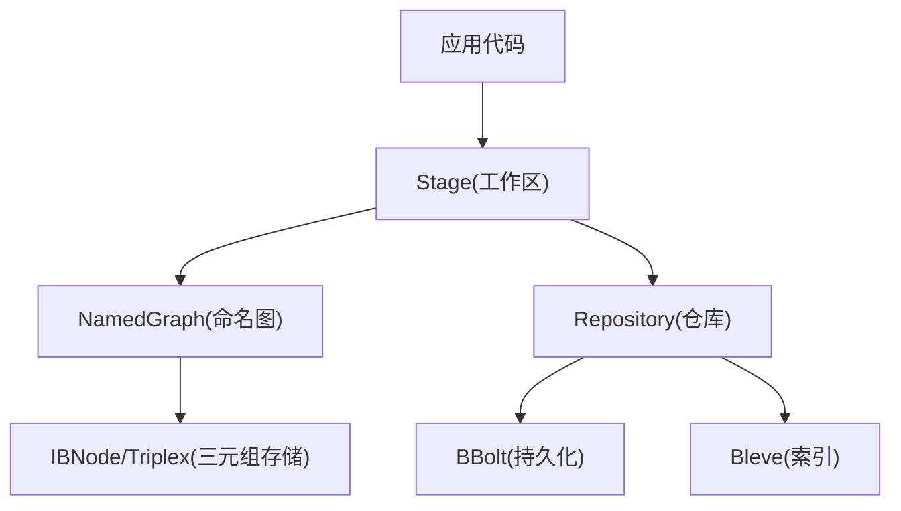
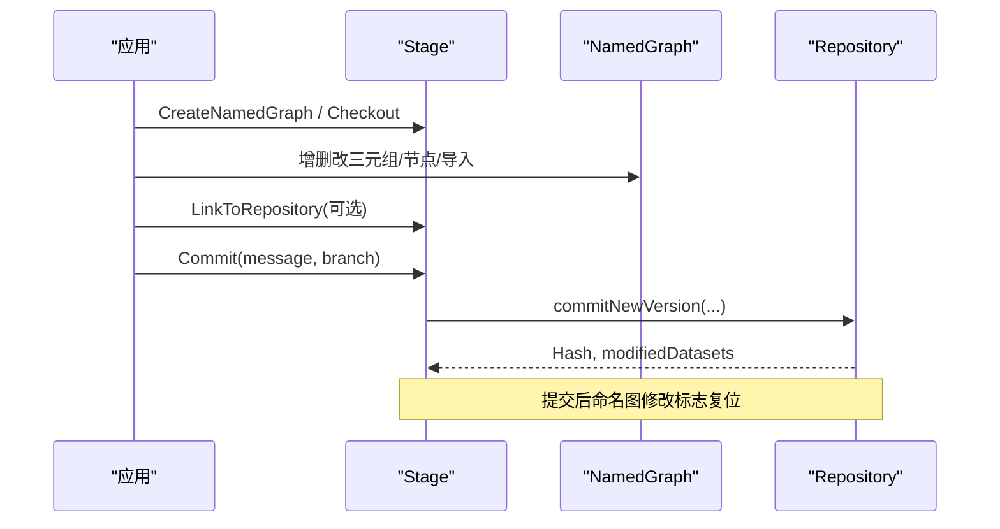
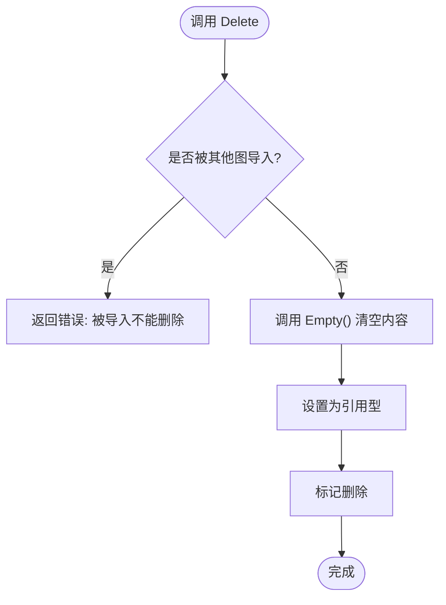
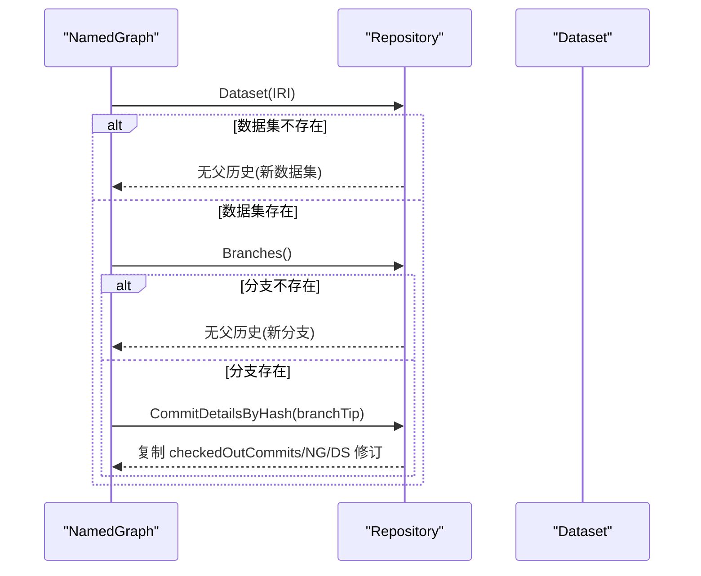
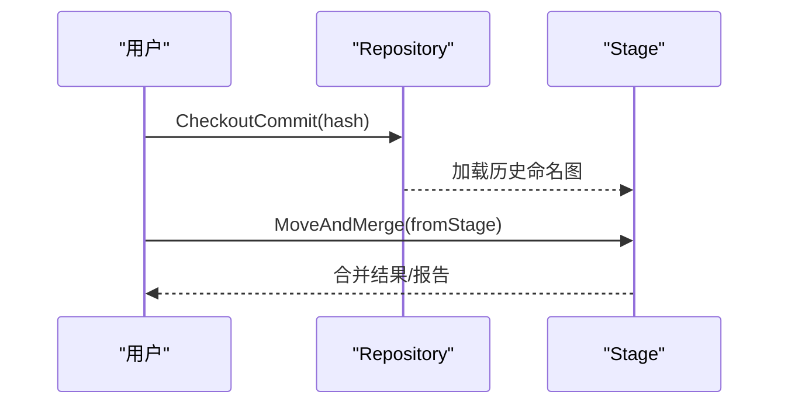
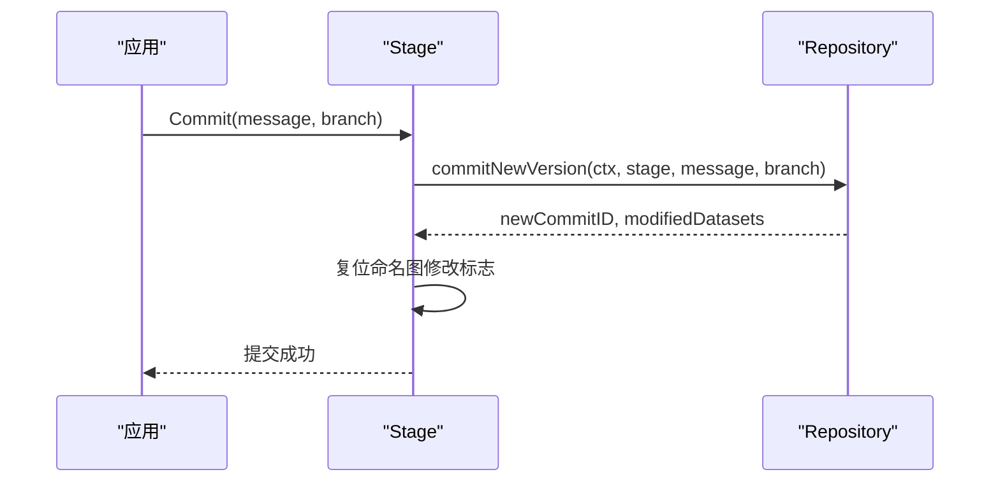
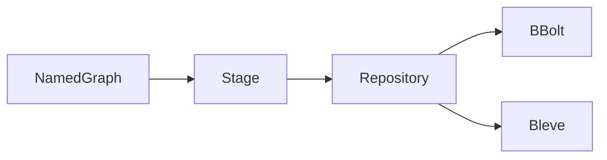

# 生命周期管理

<cite>
**本文引用的文件**
- [namedgraph.go](file://sst/namedgraph.go)
- [stage.go](file://sst/stage.go)
- [commit.go](file://sst/commit.go)
- [repository.go](file://sst/repository.go)
- [repolocalfull.go](file://examples/helloworldrepolocalfull/repolocalfull.go)
</cite>

## 目录
1. [简介](#简介)
2. [项目结构](#项目结构)
3. [核心组件](#核心组件)
4. [架构总览](#架构总览)
5. [详细组件分析](#详细组件分析)
6. [依赖关系分析](#依赖关系分析)
7. [性能考量](#性能考量)
8. [故障排查指南](#故障排查指南)
9. [结论](#结论)
10. [附录：完整生命周期示例与最佳实践](#附录完整生命周期示例与最佳实践)

## 简介
本文件系统性阐述命名图（NamedGraph）在 SST 中的全生命周期管理，包括创建、修改、提交、删除、状态检查、与仓库的关联和版本控制集成、撤销与回滚机制，以及资源清理与内存管理的最佳实践。文档面向不同技术背景的读者，提供从概念到代码级实现的逐步说明，并辅以图示帮助理解。

## 项目结构
SST 将“命名图”作为 RDF 数据在内存中的核心表示，并通过 Stage（工作区）进行编辑，最终通过 Repository（仓库）持久化并提交为带版本历史的 Dataset 与 NamedGraph 修订。关键文件职责如下：
- namedgraph.go：定义命名图的接口与实现，包含状态检查、内容操作、导入关系、差异比较、与仓库的关联等。
- stage.go：工作区抽象，负责创建/获取命名图、合并移动、提交到仓库、链接仓库、关闭释放资源等。
- commit.go：提交元数据结构 CommitDetails，用于描述一次提交的作者、时间、父提交、数据集与命名图修订映射。
- repository.go：仓库接口与本地/远程仓库实现，支持打开阶段、检出提交、索引、日志、同步等。
- examples/helloworldrepolocalfull/repolocalfull.go：演示创建仓库、创建命名图、添加三元组、提交、导出 TTL、检出验证的端到端流程。

图表来源
- [stage.go:121-177](file://sst/stage.go#L121-L177)
- [namedgraph.go:117-350](file://sst/namedgraph.go#L117-L350)
- [repository.go:34-179](file://sst/repository.go#L34-L179)

章节来源
- [stage.go:53-234](file://sst/stage.go#L53-L234)
- [namedgraph.go:42-108](file://sst/namedgraph.go#L42-L108)
- [repository.go:34-179](file://sst/repository.go#L34-L179)

## 核心组件
- 命名图（NamedGraph）：内存中的 RDF 命名图，维护节点（IRI/Blank Node）、三元组、导入关系、修改标志、检出历史等。
- 工作区（Stage）：承载一个或多个命名图的内存视图，支持创建、查询、合并、提交、链接仓库、关闭释放。
- 仓库（Repository）：持久化存储与版本控制，支持数据集（Dataset）与分支（Branch），记录提交历史与索引。
- 提交详情（CommitDetails）：描述一次提交的关键信息，包括父提交、数据集修订、命名图修订映射。

章节来源
- [namedgraph.go:117-350](file://sst/namedgraph.go#L117-L350)
- [stage.go:74-234](file://sst/stage.go#L74-L234)
- [commit.go:18-29](file://sst/commit.go#L18-L29)
- [repository.go:34-179](file://sst/repository.go#L34-L179)

## 架构总览
命名图的生命周期围绕“工作区编辑 + 仓库提交”展开：
- 创建：在工作区中创建命名图或从仓库检出已有命名图。
- 修改：增删改三元组、节点、导入关系。
- 提交：将工作区的变更持久化为提交，生成数据集与命名图修订。
- 删除：标记删除或清空内容，后续提交反映删除。
- 状态检查：IsValid、IsModified、IsEmpty、IsReferenced 等。
- 关联与版本控制：LinkToRepository 将命名图与仓库分支关联，支持多分支与历史回溯。
- 撤销与回滚：通过检出历史提交回到旧版本；MoveAndMerge 支持三向合并。

图表来源
- [stage.go:1381-1401](file://sst/stage.go#L1381-L1401)
- [repository.go:130-179](file://sst/repository.go#L130-L179)
- [namedgraph.go:415-503](file://sst/namedgraph.go#L415-L503)

## 详细组件分析

### 命名图的状态检查
- IsValid：判断命名图是否有效（所属 Stage 未失效）。
- IsModified：判断命名图是否被修改过（影响提交时是否生成新修订）。
- IsEmpty：判断命名图是否不包含任何三元组。
- IsReferenced：判断是否为“引用型”命名图（仅含无主体三元组的 IBNode，不可直接修改/提交）。

这些方法用于在生命周期各阶段做决策，例如：
- 提交前检查 IsModified，避免无变更提交。
- 删除前检查 IsReferenced，防止误删被其他图引用的图。
- 导出前检查 IsEmpty，确保可写性。

章节来源
- [namedgraph.go:129-145](file://sst/namedgraph.go#L129-L145)
- [namedgraph.go:1070-1072](file://sst/namedgraph.go#L1070-L1072)
- [namedgraph.go:1459-1465](file://sst/namedgraph.go#L1459-L1465)
- [namedgraph.go:1341-1347](file://sst/namedgraph.go#L1341-L1347)

### Empty 与 Delete 的区别与使用场景
- Empty：清空命名图内容，但保持命名图有效。适用于“重置内容但不删除图本身”的场景。内部会移除未被其他图引用的节点，并标记为已修改。
- Delete：尝试删除命名图。若图被其他图导入则报错；否则先清空内容，再转为“引用型”并标记删除，以便提交时记录删除语义。适用于“逻辑删除”且需保留历史记录的场景。

图表来源
- [namedgraph.go:1035-1064](file://sst/namedgraph.go#L1035-L1064)
- [namedgraph.go:1013-1033](file://sst/namedgraph.go#L1013-L1033)

章节来源
- [namedgraph.go:1013-1064](file://sst/namedgraph.go#L1013-L1064)

### 命名图与仓库的关联与版本控制集成
- LinkToRepository：将命名图与仓库及分支关联，准备后续提交以保留历史。若仓库中存在同名数据集与分支，则复制检出元数据（checkedOutCommits、NG/DS 修订）；否则为新数据集/分支创建无父历史。
- FindCommonParentRevision：在多分支/多提交场景下查找共同祖先，用于三向合并与差异计算。
- MoveAndMerge：跨工作区移动与合并命名图，自动处理导入关系、三元组更新、修改标志与历史记录对齐。

图表来源
- [namedgraph.go:415-503](file://sst/namedgraph.go#L415-L503)
- [repository.go:80-89](file://sst/repository.go#L80-L89)

章节来源
- [namedgraph.go:415-503](file://sst/namedgraph.go#L415-L503)
- [stage.go:876-943](file://sst/stage.go#L876-L943)
- [stage.go:468-874](file://sst/stage.go#L468-L874)

### 撤销与回滚机制
- 回滚：通过 Repository.CheckoutCommit 或 Dataset.CheckoutBranch 加载历史提交对应的 Stage 与命名图，从而“回到”某个版本。
- 撤销：在本地工作区对命名图进行修改后，可通过 MoveAndMerge 将另一分支或历史版本的命名图合并进来，实现选择性撤销或冲突解决。
- 删除的回滚：删除操作会在提交中记录删除语义；如需恢复，可从删除前的提交检出并重载该命名图。

图表来源
- [repository.go:86-89](file://sst/repository.go#L86-L89)
- [stage.go:468-874](file://sst/stage.go#L468-L874)

章节来源
- [repository.go:86-89](file://sst/repository.go#L86-L89)
- [stage.go:468-874](file://sst/stage.go#L468-L874)

### 提交流程与版本控制
- 提交：Stage.Commit 将当前工作区的所有命名图变更持久化到仓库，生成新的提交哈希与数据集修订。成功后复位命名图的修改标志。
- 提交详情：CommitDetails 包含提交哈希、作者、时间、消息、父提交映射、数据集与命名图修订映射，便于审计与展示。

图表来源
- [stage.go:1381-1401](file://sst/stage.go#L1381-L1401)
- [commit.go:18-29](file://sst/commit.go#L18-L29)

章节来源
- [stage.go:1381-1401](file://sst/stage.go#L1381-L1401)
- [commit.go:18-29](file://sst/commit.go#L18-L29)

## 依赖关系分析
- 命名图依赖 Stage 提供的上下文与工具（如词汇表解析、三元组追加、节点管理等）。
- Stage 依赖 Repository 进行持久化与版本控制。
- Repository 依赖 BBolt 与 Bleve 进行数据存储与索引。
- 提交详情由 Repository 生成，供上层应用展示与审计。

图表来源
- [stage.go:53-74](file://sst/stage.go#L53-L74)
- [repository.go:34-179](file://sst/repository.go#L34-L179)

章节来源
- [stage.go:53-74](file://sst/stage.go#L53-L74)
- [repository.go:34-179](file://sst/repository.go#L34-L179)

## 性能考量
- 三元组模式（TriplexMode）：默认模式同时维护主体、谓词、对象三元组，适合复杂遍历但占用更多内存；可根据应用需求权衡。
- 修改标志（modified）：仅在必要时计算与持久化修订，减少开销。
- 导入关系：大量导入会增加差异计算与提交成本，建议合理拆分命名图。
- 批量操作：尽量批量增删三元组，减少频繁 I/O。
- 索引重建：Bleve 索引重建为昂贵操作，应谨慎触发。

[本节为通用指导，不直接分析具体文件]

## 故障排查指南
常见错误与定位要点：
- 空分支名：LinkToRepository 或 Commit 时传入空分支名会报错。
- 重复导入：AddImport 检测到循环或重复导入会报错。
- 被导入的图删除：Delete 检测到被其他图导入会拒绝删除。
- 无效命名图：访问已失效 Stage 或命名图会返回无效错误。
- 仓库不匹配：Stage 已链接到不同仓库时无法再次链接。
- 提交失败：未链接仓库或底层存储异常导致提交失败。

章节来源
- [namedgraph.go:20-40](file://sst/namedgraph.go#L20-L40)
- [stage.go:21-31](file://sst/stage.go#L21-L31)
- [namedgraph.go:1370-1387](file://sst/namedgraph.go#L1370-L1387)
- [stage.go:1381-1401](file://sst/stage.go#L1381-L1401)

## 结论
命名图在 SST 中提供了强大的内存模型与版本控制能力。通过 Stage 的工作区管理与 Repository 的持久化提交，用户可以安全地创建、修改、提交、删除命名图，并利用导入关系、差异比较与合并机制实现复杂的协作与演进。遵循状态检查、资源清理与错误处理的最佳实践，可以显著提升系统的稳定性与可维护性。

[本节为总结，不直接分析具体文件]

## 附录：完整生命周期示例与最佳实践

### 完整生命周期步骤
- 创建仓库与工作区：Open/Create Local Repository，OpenStage。
- 创建命名图：CreateNamedGraph，创建节点与三元组。
- 关联仓库（可选）：LinkToRepository 绑定分支，准备历史提交。
- 提交：Commit 保存变更，获得提交哈希与数据集修订。
- 检出与验证：CheckoutBranch/Commit 加载历史，验证内容。
- 删除与清空：根据需求选择 Empty 或 Delete，并在提交中体现。
- 合并与回滚：MoveAndMerge 合并分支或历史版本，必要时检出旧提交。

章节来源
- [repolocalfull.go:41-94](file://examples/helloworldrepolocalfull/repolocalfull.go#L41-L94)
- [stage.go:1219-1234](file://sst/stage.go#L1219-L1234)
- [stage.go:1381-1401](file://sst/stage.go#L1381-L1401)
- [namedgraph.go:415-503](file://sst/namedgraph.go#L415-L503)

### 资源清理与内存管理最佳实践
- 及时 Close Stage：释放所有节点与三元组引用，避免内存泄漏。
- 避免持有已失效引用：Stage 失效后不应继续使用其命名图。
- 合理使用导入：避免过深的导入链，降低差异与提交成本。
- 批量写入：减少频繁 I/O，提高吞吐。
- 错误处理与重试：对网络与磁盘错误进行适当重试与降级。

章节来源
- [stage.go:1529-1557](file://sst/stage.go#L1529-L1557)
- [stage.go:1559-1564](file://sst/stage.go#L1559-L1564)