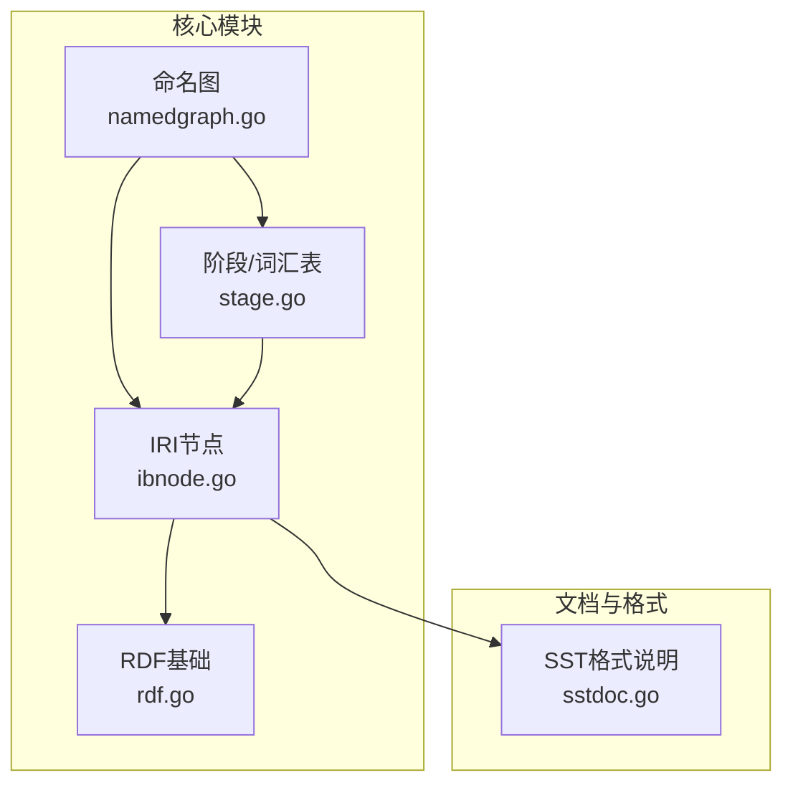
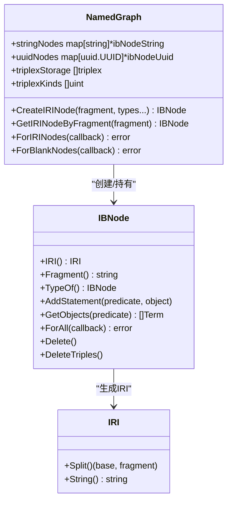
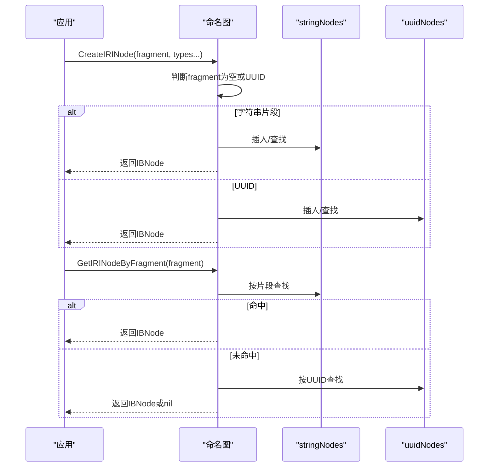
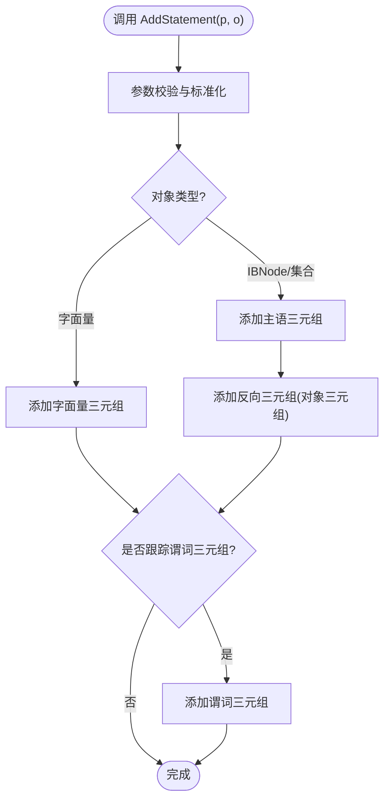
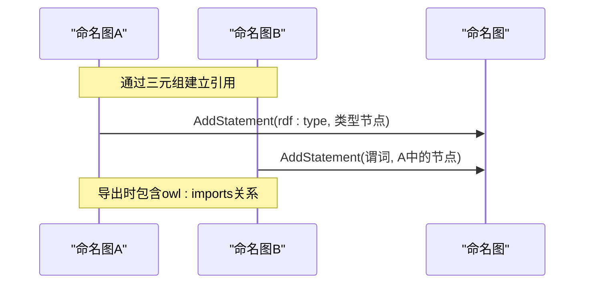
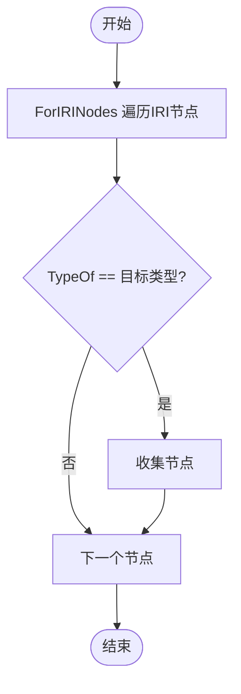
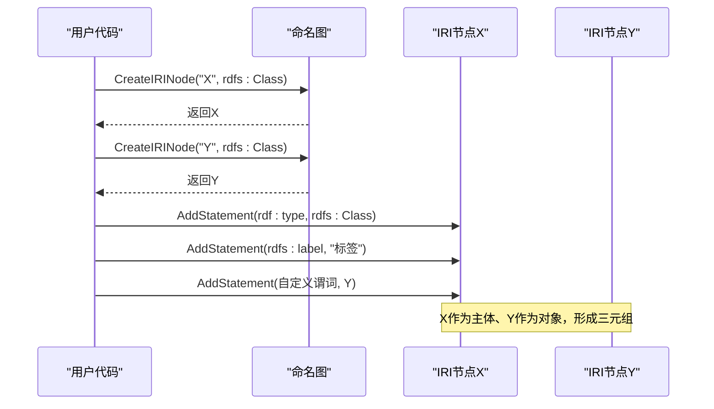
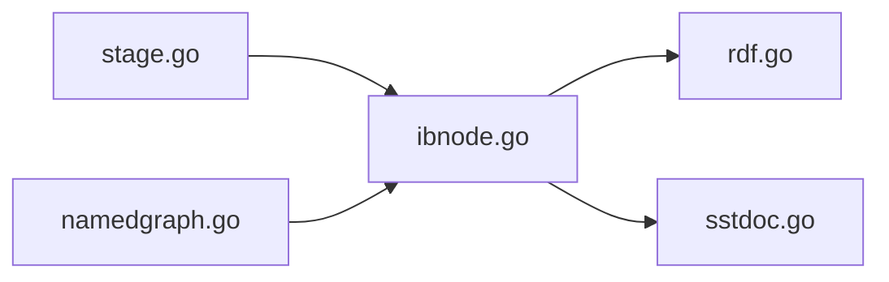

# IRI节点管理

<cite>
**本文引用的文件**
- [ibnode.go](file://sst/ibnode.go)
- [namedgraph.go](file://sst/namedgraph.go)
- [rdf.go](file://sst/rdf.go)
- [stage.go](file://sst/stage.go)
- [sstdoc.go](file://sst/sstdoc.go)
- [ibnode_test.go](file://sst/ibnode_test.go)
- [p21.go](file://step/p21/p21.go)
</cite>

## 目录
1. [简介](#简介)
2. [项目结构](#项目结构)
3. [核心组件](#核心组件)
4. [架构总览](#架构总览)
5. [详细组件分析](#详细组件分析)
6. [依赖关系分析](#依赖关系分析)
7. [性能与内存优化](#性能与内存优化)
8. [故障排查指南](#故障排查指南)
9. [结论](#结论)
10. [附录](#附录)

## 简介
本文件围绕IRI节点（IBNode）的创建、查询与管理展开，重点说明：
- 如何在命名图（NamedGraph）中创建和获取IRI节点
- GetIRINodeByFragment方法的使用方式与行为
- IRI节点与命名图的关系，以及跨命名图的共享与引用机制
- IRI节点的属性设置（类型声明、元数据添加等）
- 遍历与搜索能力（按片段查找、按类型过滤、按谓词检索对象等）
- IRI节点在RDF三元组中的使用示例（主体、谓词、对象）
- 性能优化与内存管理的最佳实践

## 项目结构
与IRI节点管理直接相关的核心代码位于sst包内：
- ibnode.go：定义IBNode接口与实现、三元组存储、遍历与增删改查
- namedgraph.go：命名图的生命周期、节点索引、创建与查询API
- rdf.go：IRI、字面量、序列化等基础概念
- stage.go：词汇表元素到IBNode的转换、命名图访问
- sstdoc.go：SST文件格式与三元组索引策略说明
- 测试与示例：ibnode_test.go、p21.go等展示用法

图表来源
- [namedgraph.go:59-107](file://sst/namedgraph.go#L59-L107)
- [ibnode.go:634-660](file://sst/ibnode.go#L634-L660)
- [rdf.go:176-233](file://sst/rdf.go#L176-L233)
- [stage.go:1468-1476](file://sst/stage.go#L1468-L1476)

章节来源
- [namedgraph.go:59-107](file://sst/namedgraph.go#L59-L107)
- [ibnode.go:634-660](file://sst/ibnode.go#L634-L660)
- [rdf.go:176-233](file://sst/rdf.go#L176-L233)
- [stage.go:1468-1476](file://sst/stage.go#L1468-L1476)

## 核心组件
- 命名图（NamedGraph）
  - 维护IRI节点与空白节点的索引（字符串片段映射与UUID映射）
  - 提供CreateIRINode、GetIRINodeByFragment、ForIRINodes、ForBlankNodes等API
  - 管理三元组存储（triplexStorage）与三元组种类标记（triplexKinds）
- IRI节点（IBNode）
  - 表示IRI或空白节点，关联其所属命名图与三元组范围
  - 支持类型声明（rdf:type）、属性读写（AddStatement/GetObjects/CheckTriple）
  - 支持遍历（ForAll）、删除（Delete/DeleteTriples）、片段/ID访问
- RDF基础
  - IRI、字面量、集合等术语类型与序列化
  - IRI拆分、校验与格式化

章节来源
- [namedgraph.go:117-357](file://sst/namedgraph.go#L117-L357)
- [ibnode.go:698-800](file://sst/ibnode.go#L698-L800)
- [rdf.go:176-233](file://sst/rdf.go#L176-L233)

## 架构总览
IRI节点以“命名图为上下文”组织。每个命名图维护两类节点索引：
- stringNodes：基于字符串片段的IRI节点
- uuidNodes：基于UUID的节点（可为IRI节点或空白节点）

三元组以紧凑数组形式存储在命名图中，并通过kind位标记区分“主语三元组”、“宾语三元组”、“谓词三元组”。IBNode通过triplexStart/triplexEnd指向其在命名图中的三元组区间。

图表来源
- [namedgraph.go:59-107](file://sst/namedgraph.go#L59-L107)
- [ibnode.go:634-660](file://sst/ibnode.go#L634-L660)
- [rdf.go:176-233](file://sst/rdf.go#L176-L233)

## 详细组件分析

### 命名图与IRI节点索引
- 节点创建
  - CreateIRINode：根据fragment是否为空或可解析为UUID决定创建字符串片段节点或UUID节点；并自动添加rdf:type三元组（若传入types）
  - CreateBlankNode：创建空白节点并可附加类型
- 节点查询
  - GetIRINodeByFragment：优先从stringNodes按片段查找；否则从uuidNodes按UUID查找；未找到返回nil
  - ForIRINodes/ForBlankNodes：遍历所有IRI节点或空白节点
- 统计与检查
  - IRINodeCount/BlankNodeCount/TermCollectionCount：计数
  - IsReferenced/IsEmpty/IsModified：状态检查

图表来源
- [namedgraph.go:1147-1182](file://sst/namedgraph.go#L1147-L1182)
- [namedgraph.go:1090-1100](file://sst/namedgraph.go#L1090-L1100)
- [namedgraph.go:1102-1145](file://sst/namedgraph.go#L1102-L1145)

章节来源
- [namedgraph.go:1147-1182](file://sst/namedgraph.go#L1147-L1182)
- [namedgraph.go:1090-1100](file://sst/namedgraph.go#L1090-L1100)
- [namedgraph.go:1102-1145](file://sst/namedgraph.go#L1102-L1145)

### IRI节点属性与三元组操作
- 类型声明与元数据
  - AddStatement：添加三元组（支持集合成员），内部会维护反向索引（对象三元组、可选谓词三元组）
  - CheckTriple：检查是否存在指定谓词与对象的三元组
  - TypeOf：获取主类型（由rdf:type决定）
- 遍历与查询
  - ForAll：统一遍历该节点作为主语、宾语、谓词的所有三元组
  - GetObjects：按谓词筛选并返回所有对象
  - GetTriple(index)：按索引获取三元组
- 删除
  - Delete：删除节点及其所有相关三元组
  - DeleteTriples：仅删除该节点的主语三元组

图表来源
- [ibnode.go:2083-2116](file://sst/ibnode.go#L2083-L2116)
- [ibnode.go:2178-2255](file://sst/ibnode.go#L2178-L2255)

章节来源
- [ibnode.go:2083-2116](file://sst/ibnode.go#L2083-L2116)
- [ibnode.go:2178-2255](file://sst/ibnode.go#L2178-L2255)

### 跨命名图共享与引用
- 同一Stage内的命名图可通过三元组相互引用IBNode。当移动或合并节点时，系统会更新相关三元组的引用并维护一致性。
- 命名图可导入其他命名图（owl:imports），导出时会保留import关系。
- 节点归属：IBNode始终属于某个命名图，IRI由“命名图基IRI + 片段/UUID”构成。

图表来源
- [namedgraph.go:222-235](file://sst/namedgraph.go#L222-L235)
- [ibnode.go:2178-2255](file://sst/ibnode.go#L2178-L2255)

章节来源
- [namedgraph.go:222-235](file://sst/namedgraph.go#L222-L235)
- [ibnode.go:2178-2255](file://sst/ibnode.go#L2178-L2255)

### 遍历与搜索
- 按片段查找：GetIRINodeByFragment
- 按类型过滤：先遍历ForIRINodes，再对每个节点调用TypeOf并与目标类型比较
- 按谓词检索对象：GetObjects(predicate)
- 全量遍历：ForAll（可区分前向、反向、谓词三元组）

图表来源
- [namedgraph.go:1102-1145](file://sst/namedgraph.go#L1102-L1145)
- [ibnode.go:1831-1869](file://sst/ibnode.go#L1831-L1869)

章节来源
- [namedgraph.go:1102-1145](file://sst/namedgraph.go#L1102-L1145)
- [ibnode.go:1831-1869](file://sst/ibnode.go#L1831-L1869)

### IRI节点在RDF三元组中的使用示例
- 作为主体（Subject）：节点拥有若干属性三元组（如rdf:type、rdfs:label等）
- 作为谓词（Predicate）：通过谓词三元组索引，便于反向查询
- 作为对象（Object）：被其他节点引用，形成图结构

图表来源
- [namedgraph.go:1147-1182](file://sst/namedgraph.go#L1147-L1182)
- [ibnode.go:2083-2116](file://sst/ibnode.go#L2083-L2116)

章节来源
- [namedgraph.go:1147-1182](file://sst/namedgraph.go#L1147-L1182)
- [ibnode.go:2083-2116](file://sst/ibnode.go#L2083-L2116)

## 依赖关系分析
- 命名图依赖IBNode进行三元组管理与节点索引
- IBNode依赖命名图以定位三元组存储与基IRI
- 词汇表元素通过stage转换为IBNode，用于谓词与对象
- SST格式将三元组与节点索引压缩存储，提升写入与读取效率

图表来源
- [stage.go:1468-1476](file://sst/stage.go#L1468-L1476)
- [sstdoc.go:253-274](file://sst/sstdoc.go#L253-L274)

章节来源
- [stage.go:1468-1476](file://sst/stage.go#L1468-L1476)
- [sstdoc.go:253-274](file://sst/sstdoc.go#L253-L274)

## 性能与内存优化
- 三元组存储与索引
  - triplexStorage与triplexKinds采用紧凑数组与位标记，减少指针开销
  - 可选谓词三元组跟踪（trackPredicates）可按需开启，避免不必要的反向索引开销
- 批量操作
  - addAll/addTriple内部批量处理，减少重复分配与校验
- 排序与写入
  - 写SST前对三元组排序，提高压缩与对比效率
- 内存管理建议
  - 尽量复用节点与谓词（通过GetIRINodeByFragment或词汇表元素）
  - 避免频繁创建临时节点，必要时使用CreateIRINode并缓存
  - 合理使用Delete/DeleteTriples释放不再使用的节点与三元组
  - 大图中优先使用ForIRINodes/ForBlankNodes进行流式遍历，避免一次性加载全部结果

章节来源
- [ibnode.go:2178-2255](file://sst/ibnode.go#L2178-L2255)
- [sstdoc.go:253-274](file://sst/sstdoc.go#L253-L274)
- [ibnode.go:1831-1869](file://sst/ibnode.go#L1831-L1869)

## 故障排查指南
- 常见错误
  - ErrDuplicatedFragment：重复片段或UUID冲突
  - ErrStagesAreNotTheSame：跨Stage操作三元组
  - ErrNodeDeletedOrInvalid：操作已删除或无效节点
  - ErrIndexOutOfRange：GetTriple索引越界
  - ErrTriplePredicateNotSet/ErrTripleObjectNotSet：添加三元组缺少必要字段
- 排查步骤
  - 确认节点有效性（IsValid）与所属Stage一致
  - 检查片段唯一性与命名图基IRI
  - 使用ForAll/GetObjects验证三元组存在性
  - 查看命名图Info/Dump输出定位问题

章节来源
- [namedgraph.go:20-40](file://sst/namedgraph.go#L20-L40)
- [ibnode.go:47-60](file://sst/ibnode.go#L47-L60)
- [ibnode.go:2042-2054](file://sst/ibnode.go#L2042-L2054)

## 结论
IRI节点管理以命名图为上下文，通过高效的三元组存储与索引机制，提供完整的创建、查询、遍历与修改能力。借助GetIRINodeByFragment、ForIRINodes、GetObjects等方法，可实现按片段、类型、谓词的灵活检索。结合SST格式的紧凑存储与可选谓词索引，可在大规模图中保持良好性能。遵循最佳实践（复用节点、按需开启索引、流式遍历）可进一步优化内存与CPU占用。

## 附录
- 常用API速查
  - 创建：CreateIRINode、CreateBlankNode
  - 查询：GetIRINodeByFragment、GetBlankNodeByID、ForIRINodes、ForBlankNodes
  - 属性：AddStatement、AddStatementAlt、CheckTriple、TypeOf
  - 遍历：ForAll、GetObjects、GetTriple
  - 删除：Delete、DeleteTriples、ForDelete
- 参考用例
  - 测试与示例展示了如何组合上述API构建图结构与执行查询

章节来源
- [ibnode.go:698-800](file://sst/ibnode.go#L698-L800)
- [namedgraph.go:117-357](file://sst/namedgraph.go#L117-L357)
- [ibnode_test.go:4225-4266](file://sst/ibnode_test.go#L4225-L4266)
- [p21.go:2199-2247](file://step/p21/p21.go#L2199-L2247)