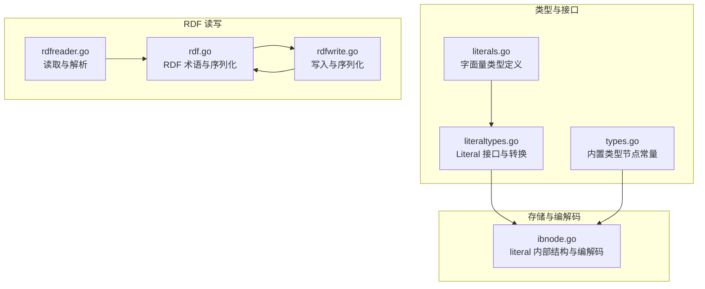
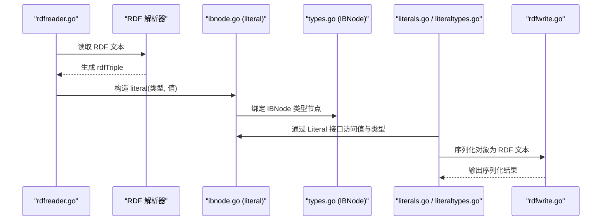
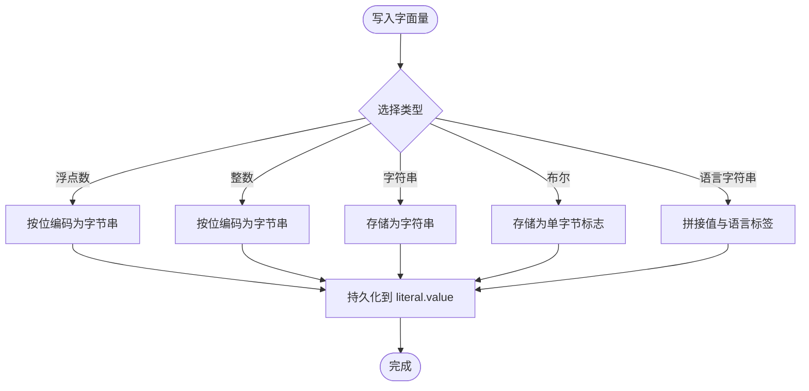
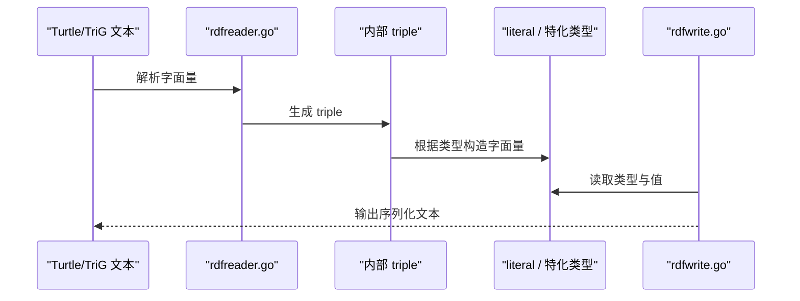
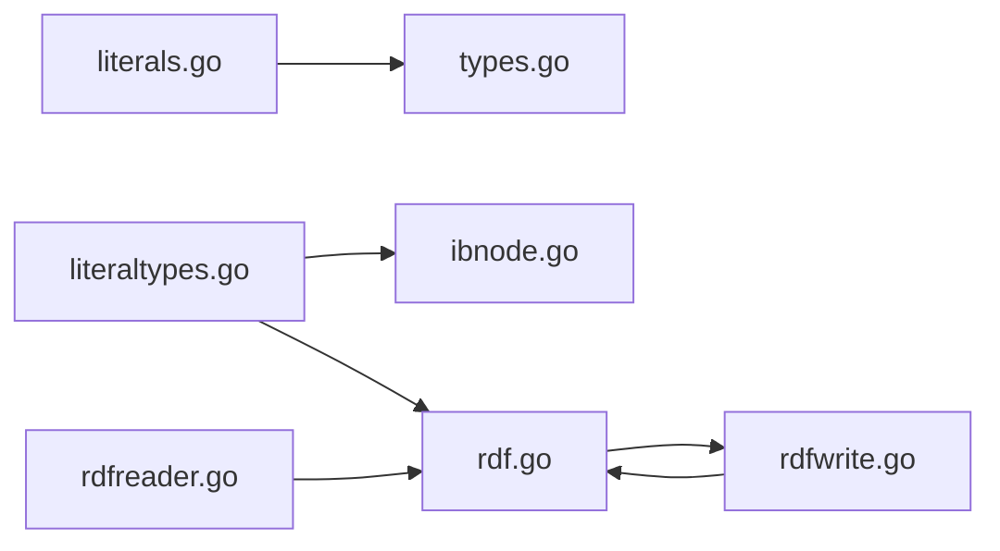

# 字面量类型系统

<cite>
**本文引用的文件**
- [literals.go](file://sst/literals.go)
- [literaltypes.go](file://sst/literaltypes.go)
- [types.go](file://sst/types.go)
- [rdf.go](file://sst/rdf.go)
- [ibnode.go](file://sst/ibnode.go)
- [rdfreader.go](file://sst/rdfreader.go)
- [rdfwrite.go](file://sst/rdfwrite.go)
- [rdfliterals_test.go](file://sst/rdfliterals_test.go)
</cite>

## 目录
1. [简介](#简介)
2. [项目结构](#项目结构)
3. [核心组件](#核心组件)
4. [架构总览](#架构总览)
5. [详细组件分析](#详细组件分析)
6. [依赖关系分析](#依赖关系分析)
7. [性能与内存管理](#性能与内存管理)
8. [故障排查指南](#故障排查指南)
9. [结论](#结论)
10. [附录：使用示例与最佳实践](#附录使用示例与最佳实践)

## 简介
本文件系统性说明 SST 的字面量类型系统，覆盖支持的 XSD/RDF 字面量类型、创建与转换、比较与序列化/反序列化、数据类型验证与格式化、自定义扩展机制、在 RDF 三元组中的处理流程、Go 原生类型映射、以及性能优化与内存管理策略。目标是帮助开发者正确、高效地使用字面量类型，并在需要时进行扩展。

## 项目结构
SST 的字面量类型系统主要分布在以下文件中：
- 类型定义与接口：literals.go、literaltypes.go、types.go
- 内部存储与编解码：ibnode.go（包含 literal 内部表示与字节编解码）
- RDF 读写与序列化：rdf.go、rdfreader.go、rdfwrite.go
- 测试用例：rdfliterals_test.go



图表来源
- [literals.go:12-442](file://sst/literals.go#L12-L442)
- [literaltypes.go:10-112](file://sst/literaltypes.go#L10-L112)
- [types.go:63-207](file://sst/types.go#L63-L207)
- [ibnode.go:1042-1239](file://sst/ibnode.go#L1042-L1239)
- [rdf.go:294-455](file://sst/rdf.go#L294-L455)
- [rdfreader.go:118-200](file://sst/rdfreader.go#L118-L200)
- [rdfwrite.go:21-121](file://sst/rdfwrite.go#L21-L121)

章节来源
- [literals.go:12-442](file://sst/literals.go#L12-L442)
- [literaltypes.go:10-112](file://sst/literaltypes.go#L10-L112)
- [types.go:63-207](file://sst/types.go#L63-L207)
- [ibnode.go:1042-1239](file://sst/ibnode.go#L1042-L1239)
- [rdf.go:294-455](file://sst/rdf.go#L294-L455)
- [rdfreader.go:118-200](file://sst/rdfreader.go#L118-L200)
- [rdfwrite.go:21-121](file://sst/rdfwrite.go#L21-L121)

## 核心组件
- Literal 接口：统一字面量的类型标识与值访问方式，提供 DataType() 和 apiValue()。
- 具体字面量类型：String、LangString、TypedString、Double、Float、Integer、Boolean、Byte、Short、Int、Long、UnsignedByte、UnsignedShort、UnsignedInt、UnsignedLong。
- 内置类型节点：types.go 中为每种字面量定义对应的 IBNode（如 xsd:string、xsd:int、rdf:langString 等）。
- 内部存储：ibnode.go 中的 literal 结构体以紧凑的字符串形式存储字面量值，并提供高效的字节编解码。
- RDF 读写：rdf.go 定义 RDF 术语与序列化；rdfreader.go 负责将 RDF 文本解析为 SST 内部结构；rdfwrite.go 负责将 SST 内部结构序列化为 RDF 文本。

章节来源
- [literaltypes.go:10-33](file://sst/literaltypes.go#L10-L33)
- [literals.go:12-442](file://sst/literals.go#L12-L442)
- [types.go:63-207](file://sst/types.go#L63-L207)
- [ibnode.go:1042-1110](file://sst/ibnode.go#L1042-L1110)
- [rdf.go:294-455](file://sst/rdf.go#L294-L455)
- [rdfreader.go:118-200](file://sst/rdfreader.go#L118-L200)
- [rdfwrite.go:21-121](file://sst/rdfwrite.go#L21-L121)

## 架构总览
SST 字面量类型系统的整体数据流如下：
- 输入：RDF 文本（Turtle/TriG）通过 rdfreader.go 解析为内部 triple 表示。
- 存储：字面量值以紧凑字符串存储在 ibnode.go 的 literal 结构中，并关联 types.go 定义的 IBNode 类型节点。
- 访问：通过 literaltypes.go 的 Literal 接口及其特化类型获取值与类型信息。
- 输出：通过 rdfwrite.go 将内部结构序列化为 RDF 文本。



图表来源
- [rdfreader.go:118-200](file://sst/rdfreader.go#L118-L200)
- [ibnode.go:1042-1110](file://sst/ibnode.go#L1042-L1110)
- [types.go:63-207](file://sst/types.go#L63-L207)
- [literals.go:12-442](file://sst/literals.go#L12-L442)
- [rdfwrite.go:21-121](file://sst/rdfwrite.go#L21-L121)

## 详细组件分析

### 字面量类型与接口
- Literal 接口：提供 DataType() 返回 IBNode，apiValue() 返回 Go 原生值或包装结构。
- 特化类型：
  - String：对应 xsd:string
  - LangString：对应 rdf:langString，包含 Val 与 LangTag
  - TypedString：携带显式类型 Node（支持 dateTime、dateTimeStamp 等）
  - 数值类型：Double、Float、Integer、Byte、Short、Int、Long、UnsignedByte、UnsignedShort、UnsignedInt、UnsignedLong
  - Boolean：对应 xsd:boolean

```mermaid
classDiagram
class Literal {
+DataType() IBNode
+apiValue() interface{}
}
class String
class LangString {
+Val string
+LangTag string
}
class TypedString {
+Val string
+Type Node
}
class Double
class Float
class Integer
class Boolean
class Byte
class Short
class Int
class Long
class UnsignedByte
class UnsignedShort
class UnsignedInt
class UnsignedLong
Literal <|.. String
Literal <|.. LangString
Literal <|.. TypedString
Literal <|.. Double
Literal <|.. Float
Literal <|.. Integer
Literal <|.. Boolean
Literal <|.. Byte
Literal <|.. Short
Literal <|.. Int
Literal <|.. Long
Literal <|.. UnsignedByte
Literal <|.. UnsignedShort
Literal <|.. UnsignedInt
Literal <|.. UnsignedLong
```

图表来源
- [literaltypes.go:10-33](file://sst/literaltypes.go#L10-L33)
- [literals.go:12-442](file://sst/literals.go#L12-L442)

章节来源
- [literaltypes.go:10-33](file://sst/literaltypes.go#L10-L33)
- [literals.go:12-442](file://sst/literals.go#L12-L442)

### 内置类型节点与类型映射
- types.go 定义了每种字面量类型的 IBNode，指向相应的 XSD/RDF 命名空间（如 xsd:string、xsd:int、rdf:langString）。
- 这些 IBNode 用于标识字面量的数据类型，并在序列化/反序列化时决定格式与行为。

章节来源
- [types.go:63-207](file://sst/types.go#L63-L207)

### 内部存储与编解码
- ibnode.go 中的 literal 结构体以字符串形式存储字面量值，并通过二进制大端序进行数值类型的编解码，避免频繁分配与拷贝。
- 语言标签字符串采用“值+最后两字节为语言标签”的紧凑布局，提升存储效率。
- 提供 float64FromBytes/float64Bytes、int64FromBytes/int64Bytes 等函数实现零拷贝或低开销转换。



图表来源
- [ibnode.go:1042-1239](file://sst/ibnode.go#L1042-L1239)

章节来源
- [ibnode.go:1042-1239](file://sst/ibnode.go#L1042-L1239)

### RDF 序列化与反序列化
- 反序列化：rdfreader.go 将 RDF 文本解析为内部 triple，并根据字面量类型构建对应的 literal 或特化类型。
- 序列化：rdfwrite.go 根据 IBNode 类型与格式（Turtle/TriG）输出合适的字面量表示，包括语言标签、类型标注等。
- 类型识别：rdf.go 中定义 xsd 与 rdf 内置类型常量，用于判断与格式化。



图表来源
- [rdfreader.go:118-200](file://sst/rdfreader.go#L118-L200)
- [rdf.go:294-455](file://sst/rdf.go#L294-L455)
- [rdfwrite.go:21-121](file://sst/rdfwrite.go#L21-L121)

章节来源
- [rdfreader.go:118-200](file://sst/rdfreader.go#L118-L200)
- [rdf.go:294-455](file://sst/rdf.go#L294-L455)
- [rdfwrite.go:21-121](file://sst/rdfwrite.go#L21-L121)

### 字面量比较与转换
- 比较：rdfTermsEqual 基于内部序列化形式比较术语，确保不同类型不会误判相等。
- 转换：literaltypes.go 的 literalToObject 将内部 literal 转换为特化类型；ibnode.go 的 literalValue 也提供类似功能。
- 字符串化：literaltypes.go 的 literalToString 将字面量转为可读字符串，用于调试或展示。

章节来源
- [rdf.go:555-571](file://sst/rdf.go#L555-L571)
- [literaltypes.go:35-112](file://sst/literaltypes.go#L35-L112)
- [ibnode.go:1072-1110](file://sst/ibnode.go#L1072-L1110)

### 自定义字面量类型的扩展机制
- 通过 TypedString 可承载任意显式类型 Node，支持 dateTime、dateTimeStamp 等扩展类型。
- 若需新增类型，可在 types.go 中添加新的 IBNode 常量，并在 literaltypes.go 与 ibnode.go 的转换逻辑中增加分支处理。
- 注意保持与 RDF 规范的一致性，确保序列化与解析行为符合预期。

章节来源
- [literals.go:283-335](file://sst/literals.go#L283-L335)
- [types.go:155-171](file://sst/types.go#L155-L171)
- [literaltypes.go:35-74](file://sst/literaltypes.go#L35-L74)
- [ibnode.go:1072-1110](file://sst/ibnode.go#L1072-L1110)

### 字面量与 Go 原生类型的映射
- String -> string
- LangString -> struct{Val string; LangTag string}
- Double -> float64
- Float -> float32
- Integer -> int64
- Boolean -> bool
- Byte -> int8
- Short -> int16
- Int -> int32
- Long -> int64
- UnsignedByte -> uint8
- UnsignedShort -> uint16
- UnsignedInt -> uint32
- UnsignedLong -> uint64
- TypedString -> struct{Val string; Type Node}

章节来源
- [literals.go:12-442](file://sst/literals.go#L12-L442)

## 依赖关系分析
- literals.go 依赖 types.go 提供的 IBNode 常量，用于标识字面量类型。
- literaltypes.go 依赖 ibnode.go 的内部 literal 结构，用于转换与字符串化。
- rdf.go 提供 RDF 术语与序列化逻辑，被 rdfreader.go 与 rdfwrite.go 使用。
- ibnode.go 是存储与编解码的核心，被其他模块广泛引用。



图表来源
- [literals.go:12-442](file://sst/literals.go#L12-L442)
- [literaltypes.go:10-112](file://sst/literaltypes.go#L10-L112)
- [rdf.go:294-455](file://sst/rdf.go#L294-L455)
- [rdfreader.go:118-200](file://sst/rdfreader.go#L118-L200)
- [rdfwrite.go:21-121](file://sst/rdfwrite.go#L21-L121)
- [ibnode.go:1042-1239](file://sst/ibnode.go#L1042-L1239)

章节来源
- [literals.go:12-442](file://sst/literals.go#L12-L442)
- [literaltypes.go:10-112](file://sst/literaltypes.go#L10-L112)
- [rdf.go:294-455](file://sst/rdf.go#L294-L455)
- [rdfreader.go:118-200](file://sst/rdfreader.go#L118-L200)
- [rdfwrite.go:21-121](file://sst/rdfwrite.go#L21-L121)
- [ibnode.go:1042-1239](file://sst/ibnode.go#L1042-L1239)

## 性能与内存管理
- 紧凑存储：数值类型使用二进制大端序直接编码为字符串，减少内存分配与拷贝。
- 语言标签优化：LangString 将语言标签合并到末尾两字节，降低额外结构开销。
- 零拷贝转换：float64FromBytes/float64Bytes 等函数利用 unsafe 指针进行高效转换。
- 建议：
  - 批量写入时使用 TripleWriter.writeAll 以减少重复计算。
  - 避免频繁创建临时字符串，优先使用现有字面量实例。
  - 对大型数据集，优先使用流式读写以降低峰值内存占用。

[本节为通用指导，不直接分析具体文件]

## 故障排查指南
- 常见错误：
  - 不支持的字面量类型：当遇到未实现的类型时，可能触发 panic 或返回错误。
  - 语言标签无效：rdfNewLangLiteral 会校验语言标签格式，非法标签将导致错误。
  - 解析失败：RdfRead 在严格模式下遇到格式错误会终止读取。
- 定位方法：
  - 检查字面量类型是否在 types.go 中定义。
  - 确认解析路径是否覆盖了目标类型（literaltypes.go、ibnode.go）。
  - 查看测试用例 rdfliterals_test.go 中的断言，对比期望行为。

章节来源
- [rdf.go:419-455](file://sst/rdf.go#L419-L455)
- [rdfreader.go:75-107](file://sst/rdfreader.go#L75-L107)
- [rdfliterals_test.go:13-120](file://sst/rdfliterals_test.go#L13-L120)

## 结论
SST 的字面量类型系统通过清晰的接口设计、紧凑的内部存储与高效的编解码机制，提供了对多种 XSD/RDF 字面量类型的完整支持。开发者可以基于 Literal 接口安全地创建、转换、比较与序列化字面量，并通过 TypedString 与新增 IBNode 扩展自定义类型。结合流式读写与内存优化策略，系统在高吞吐场景下仍保持良好性能。

[本节为总结性内容，不直接分析具体文件]

## 附录：使用示例与最佳实践
- 创建字面量：
  - 字符串：使用 String 类型，类型为 xsd:string。
  - 带语言标签的字符串：使用 LangString，类型为 rdf:langString。
  - 数值：根据范围选择 Double、Float、Integer、Byte、Short、Int、Long 或其无符号变体。
  - 布尔：使用 Boolean，类型为 xsd:boolean。
  - 日期时间：使用 TypedString，类型为 xsd:dateTime 或 xsd:dateTimeStamp。
- 转换与访问：
  - 通过 Literal.DataType() 获取类型节点，通过 apiValue() 获取 Go 值。
  - 使用 literaltypes.go 的 literalToObject 或 ibnode.go 的 literalValue 进行内部转换。
- 序列化与反序列化：
  - 使用 RdfRead 从 RDF 文本读取，自动构建字面量。
  - 使用 TripleWriter 将 SST 结构序列化为 RDF 文本。
- 最佳实践：
  - 优先使用内置类型，必要时通过 TypedString 扩展。
  - 在批量操作中复用字面量实例，减少分配。
  - 对语言标签进行严格校验，避免非法字符。
  - 使用流式读写处理大数据集，控制内存占用。

章节来源
- [literals.go:12-442](file://sst/literals.go#L12-L442)
- [literaltypes.go:35-112](file://sst/literaltypes.go#L35-L112)
- [rdfreader.go:118-200](file://sst/rdfreader.go#L118-L200)
- [rdfwrite.go:21-121](file://sst/rdfwrite.go#L21-L121)
- [rdfliterals_test.go:13-120](file://sst/rdfliterals_test.go#L13-L120)