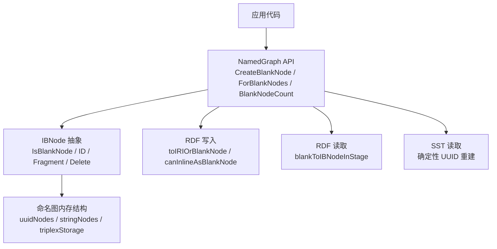
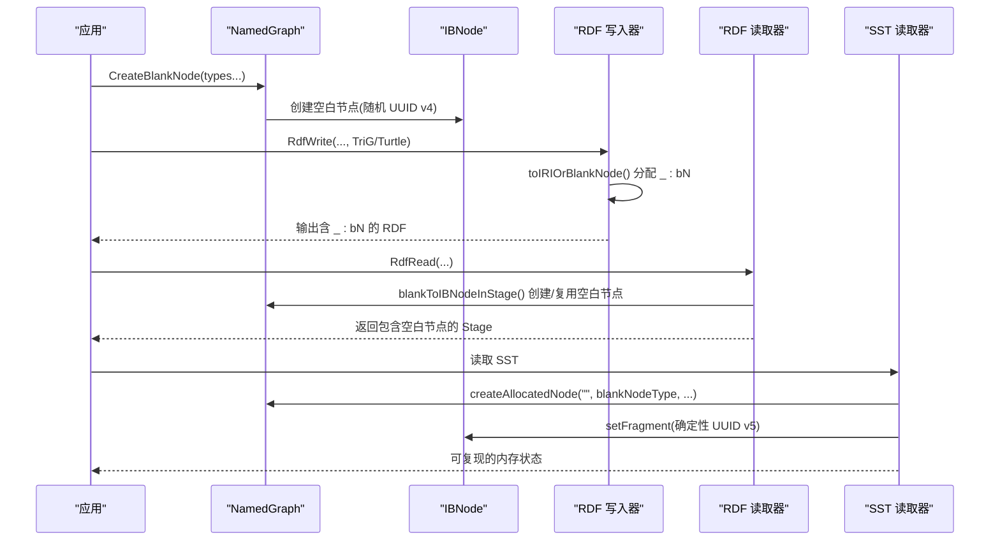
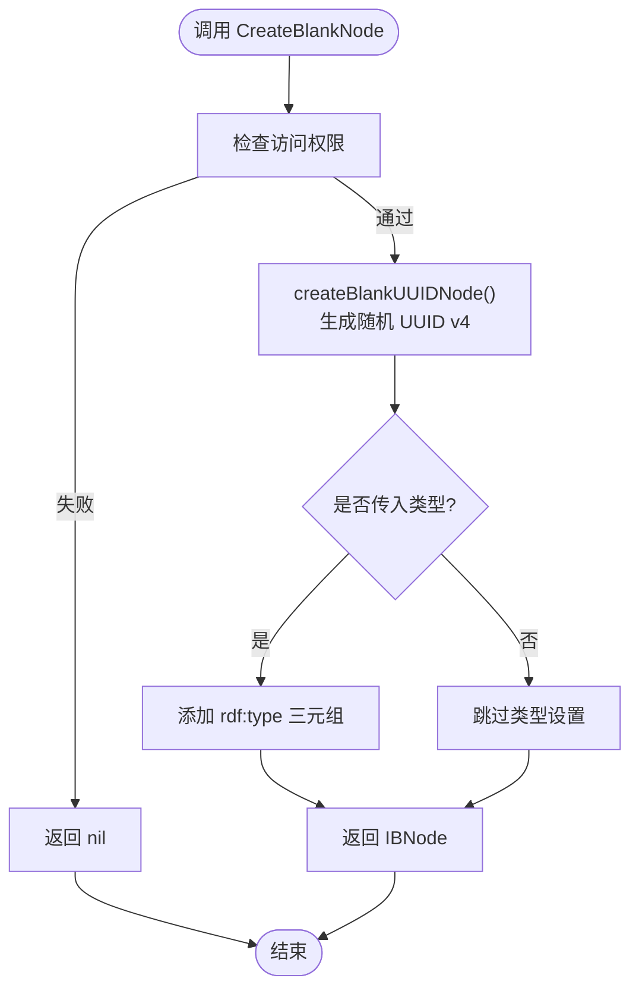
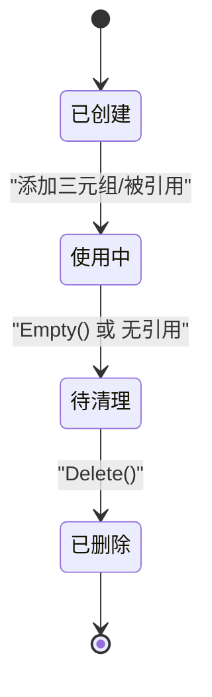
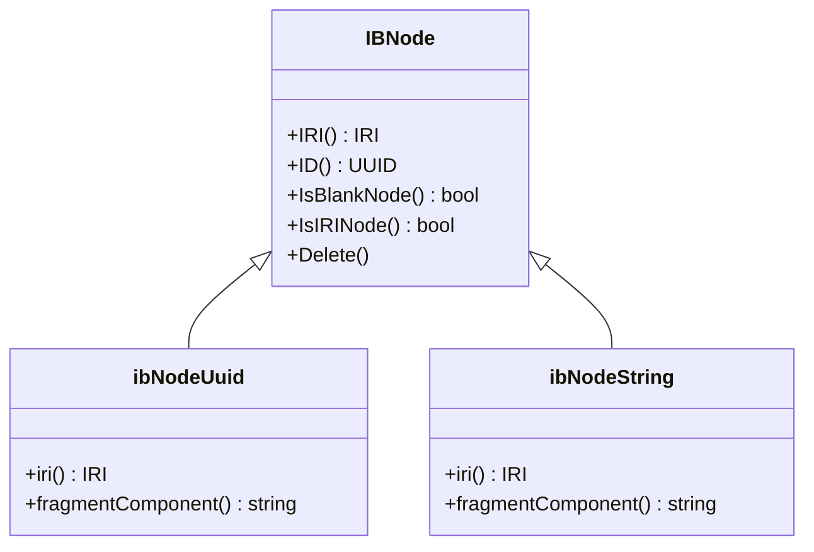
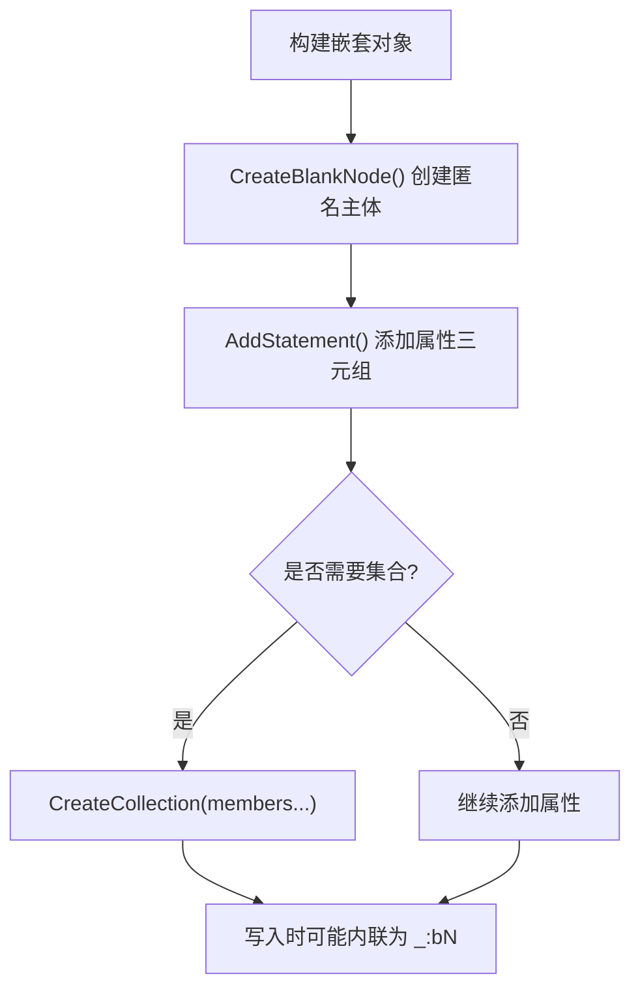
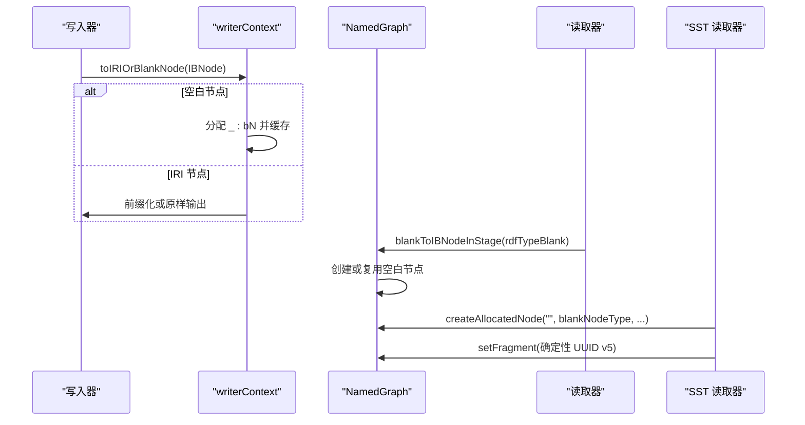
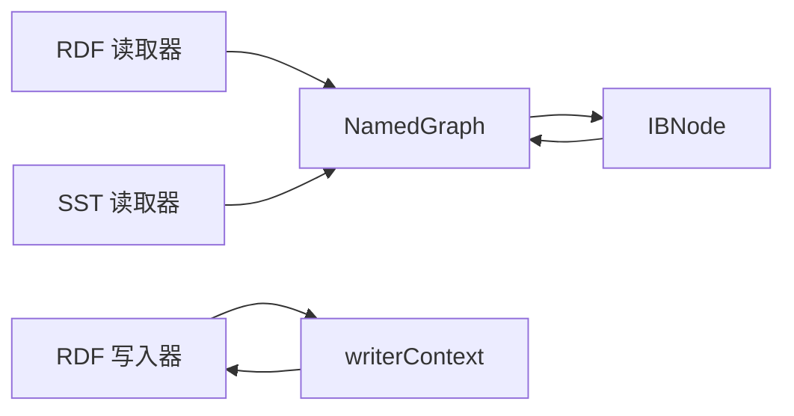

# 空白节点管理

<cite>
**本文引用的文件**
- [namedgraph.go](file://sst/namedgraph.go)
- [ibnode.go](file://sst/ibnode.go)
- [rdfwrite.go](file://sst/rdfwrite.go)
- [rdfreaderstage.go](file://sst/rdfreaderstage.go)
- [sstreader.go](file://sst/sstreader.go)
- [vocabulary.go](file://vocabularies/sh/vocabulary.go)
- [namedgraph_test.go](file://sst_test/namedgraph_test.go)
</cite>

## 目录
1. [简介](#简介)
2. [项目结构](#项目结构)
3. [核心组件](#核心组件)
4. [架构总览](#架构总览)
5. [详细组件分析](#详细组件分析)
6. [依赖关系分析](#依赖关系分析)
7. [性能考虑](#性能考虑)
8. [故障排查指南](#故障排查指南)
9. [结论](#结论)
10. [附录](#附录)

## 简介
本文件系统性说明 SST 中“空白节点”（Blank Node）的创建、管理与生命周期，覆盖以下主题：
- 空白节点的创建与管理：包括 CreateBlankNode 的参数与行为。
- 生命周期管理：自动清理与手动删除机制。
- 空白节点与 IRI 节点的区别及适用场景。
- 在复杂数据结构中的作用：嵌套对象与集合表示。
- 序列化与反序列化过程：Turtle/TriG 读写与 SST 内部存储。
- 实际应用示例：临时数据处理与中间结果存储。
- 性能考量与最佳实践。

## 项目结构
空白节点相关能力分布在以下模块：
- 命名图与节点管理：namedgraph.go、ibnode.go
- RDF 序列化：rdfwrite.go
- RDF 反序列化：rdfreaderstage.go
- SST 读取与重建：sstreader.go
- 词汇表类型支持：vocabularies/sh/vocabulary.go
- 测试用例：sst_test/namedgraph_test.go

图表来源
- [namedgraph.go:1184-1313](file://sst/namedgraph.go#L1184-L1313)
- [ibnode.go:1620-1819](file://sst/ibnode.go#L1620-L1819)
- [rdfwrite.go:870-944](file://sst/rdfwrite.go#L870-L944)
- [rdfreaderstage.go:244-279](file://sst/rdfreaderstage.go#L244-L279)
- [sstreader.go:227-265](file://sst/sstreader.go#L227-L265)

章节来源
- [namedgraph.go:1184-1313](file://sst/namedgraph.go#L1184-L1313)
- [ibnode.go:1620-1819](file://sst/ibnode.go#L1620-L1819)
- [rdfwrite.go:870-944](file://sst/rdfwrite.go#L870-L944)
- [rdfreaderstage.go:244-279](file://sst/rdfreaderstage.go#L244-L279)
- [sstreader.go:227-265](file://sst/sstreader.go#L227-L265)

## 核心组件
- NamedGraph：提供空白节点的创建、遍历与计数等能力。
- IBNode：统一表示 IRI 节点与空白节点，提供类型判断、标识获取、三元组操作与删除。
- RDF 写入器：将空白节点映射为文档内唯一标签，支持内联优化。
- RDF 读取器：将外部空白节点映射到内存中的空白节点实例。
- SST 读取器：从 SST 文件恢复空白节点并赋予确定性 UUID，保证多次读取一致性。

章节来源
- [namedgraph.go:1184-1313](file://sst/namedgraph.go#L1184-L1313)
- [ibnode.go:698-800](file://sst/ibnode.go#L698-L800)
- [rdfwrite.go:870-944](file://sst/rdfwrite.go#L870-L944)
- [rdfreaderstage.go:244-279](file://sst/rdfreaderstage.go#L244-L279)
- [sstreader.go:227-265](file://sst/sstreader.go#L227-L265)

## 架构总览
空白节点在 SST 中以“UUID + 类型位”的方式存在，不持久化其 UUID；序列化时生成文档级唯一标签；反序列化时根据上下文重建或复用。

图表来源
- [namedgraph.go:1184-1215](file://sst/namedgraph.go#L1184-L1215)
- [rdfwrite.go:870-944](file://sst/rdfwrite.go#L870-L944)
- [rdfreaderstage.go:244-279](file://sst/rdfreaderstage.go#L244-L279)
- [sstreader.go:227-265](file://sst/sstreader.go#L227-L265)

## 详细组件分析

### 空白节点的创建与管理
- 创建接口：NamedGraph.CreateBlankNode(types ...Term)
  - 参数 types：可选的类型三元组，用于为空白节点设置 rdf:type。
  - 返回值：一个未关联任何三元组的空白节点 IBNode。
- 内部实现：
  - 使用随机 UUID v4 作为空白节点标识，并注册到命名图的 uuidNodes 表中。
  - 若传入类型，则自动添加 rdf:type 三元组。
- 查询与遍历：
  - BlankNodeCount()：统计空白节点数量。
  - ForBlankNodes(c)：遍历所有空白节点。
  - GetBlankNodeByID(id)：按 UUID 查找空白节点。

图表来源
- [namedgraph.go:1184-1215](file://sst/namedgraph.go#L1184-L1215)

章节来源
- [namedgraph.go:1184-1215](file://sst/namedgraph.go#L1184-L1215)
- [namedgraph.go:1239-1313](file://sst/namedgraph.go#L1239-L1313)

### 生命周期管理：自动清理与手动删除
- 自动清理：
  - NamedGraph.Empty()：移除未被其他命名图引用的节点，使空白节点在无引用时被清理。
  - 当 NamedGraph 被标记为已删除时，会先执行 Empty，再进入引用态并记录删除标志。
- 手动删除：
  - IBNode.Delete()：删除节点及其所有三元组，节点变为无效。
  - IBNode.ForDelete(c)：按条件批量删除三元组。
  - IBNode.DeleteTriples()：删除该节点的所有主语三元组。
- 验证：
  - 测试用例显示：创建空白节点后调用 Empty，空白节点计数归零。

图表来源
- [namedgraph.go:1038-1068](file://sst/namedgraph.go#L1038-L1068)
- [ibnode.go:785-796](file://sst/ibnode.go#L785-L796)
- [namedgraph_test.go:42-50](file://sst_test/namedgraph_test.go#L42-L50)

章节来源
- [namedgraph.go:1038-1068](file://sst/namedgraph.go#L1038-L1068)
- [ibnode.go:785-796](file://sst/ibnode.go#L785-L796)
- [namedgraph_test.go:42-50](file://sst_test/namedgraph_test.go#L42-L50)

### 空白节点与 IRI 节点的区别与适用场景
- 区别：
  - IRI 节点具有全局可识别的 IRI，可通过 IRI() 获取；空白节点没有 IRI，调用 IRI() 会触发错误。
  - 空白节点通过 ID() 获取 UUID，且不能直接作为跨文档的全局标识。
  - 空白节点在序列化时会被转换为文档内唯一标签（如 _:b0），而 IRI 节点保持原样或前缀化。
- 适用场景：
  - 空白节点适合局部作用域内的临时资源、中间结果、匿名对象。
  - IRI 节点适合需要跨文档、跨版本稳定标识的资源。

图表来源
- [ibnode.go:1620-1704](file://sst/ibnode.go#L1620-L1704)
- [ibnode.go:1785-1791](file://sst/ibnode.go#L1785-L1791)

章节来源
- [ibnode.go:1620-1704](file://sst/ibnode.go#L1620-L1704)
- [ibnode.go:1785-1791](file://sst/ibnode.go#L1785-L1791)

### 在复杂数据结构构建中的作用
- 嵌套对象：
  - 空白节点可用于表达匿名对象，例如描述某个实体的属性集合。
  - 写入时可内联为单三元组的空白节点以提升可读性。
- 集合表示：
  - TermCollection 以空白节点形式组织成员，空集合等价于 rdf:nil。
  - 读取时会将符合 rdf:first/rdf:rest 模式的空白节点链重构为 TermCollection。

图表来源
- [namedgraph.go:1315-1339](file://sst/namedgraph.go#L1315-L1339)
- [rdfwrite.go:901-944](file://sst/rdfwrite.go#L901-L944)
- [rdfreaderstage.go:283-422](file://sst/rdfreaderstage.go#L283-L422)

章节来源
- [namedgraph.go:1315-1339](file://sst/namedgraph.go#L1315-L1339)
- [rdfwrite.go:901-944](file://sst/rdfwrite.go#L901-L944)
- [rdfreaderstage.go:283-422](file://sst/rdfreaderstage.go#L283-L422)

### 序列化与反序列化过程
- 序列化（RDF 写入）：
  - toIRIOrBlankNode：遇到空白节点时分配文档内唯一标签 _:bN，并在 writerContext 中缓存以避免重复。
  - canInlineAsBlankNode：对仅被单一位置使用的空白节点进行内联优化。
- 反序列化（RDF 读取）：
  - blankToIBNodeInStage：将输入中的空白节点标签解析为内存中的空白节点，优先复用已有实例。
- SST 读取：
  - sstreader.go：SST 不持久化空白节点 UUID；读取时基于图 ID 与索引生成确定性 UUID v5，确保多次读取一致。

图表来源
- [rdfwrite.go:870-944](file://sst/rdfwrite.go#L870-L944)
- [rdfreaderstage.go:244-279](file://sst/rdfreaderstage.go#L244-L279)
- [sstreader.go:227-265](file://sst/sstreader.go#L227-L265)

章节来源
- [rdfwrite.go:870-944](file://sst/rdfwrite.go#L870-L944)
- [rdfreaderstage.go:244-279](file://sst/rdfreaderstage.go#L244-L279)
- [sstreader.go:227-265](file://sst/sstreader.go#L227-L265)

### 实际应用示例
- 临时数据处理：
  - 使用空白节点构造中间对象，完成计算后再合并到正式 IRI 节点。
- 中间结果存储：
  - 在批处理管道中，用空白节点暂存中间三元组，最终导出为 TTL/TriG 或提交到仓库。
- 参考测试：
  - namedgraph_test.go 展示了创建空白节点、清空后计数归零的行为。

章节来源
- [namedgraph_test.go:42-50](file://sst_test/namedgraph_test.go#L42-L50)

## 依赖关系分析
- 命名图依赖 IBNode 抽象来统一管理 IRI 与空白节点。
- 写入器依赖 writerContext 维护空白节点标签映射，避免冲突。
- 读取器依赖命名图创建空白节点，并通过上下文缓存复用。
- SST 读取器依赖命名图的 allocate/create 方法重建空白节点。

图表来源
- [namedgraph.go:1184-1313](file://sst/namedgraph.go#L1184-L1313)
- [rdfwrite.go:870-944](file://sst/rdfwrite.go#L870-L944)
- [rdfreaderstage.go:244-279](file://sst/rdfreaderstage.go#L244-L279)
- [sstreader.go:227-265](file://sst/sstreader.go#L227-L265)

章节来源
- [namedgraph.go:1184-1313](file://sst/namedgraph.go#L1184-L1313)
- [rdfwrite.go:870-944](file://sst/rdfwrite.go#L870-L944)
- [rdfreaderstage.go:244-279](file://sst/rdfreaderstage.go#L244-L279)
- [sstreader.go:227-265](file://sst/sstreader.go#L227-L265)

## 性能考虑
- 空白节点标签分配：
  - 写入时使用 map 缓存空白节点到标签的映射，避免重复分配，降低字符串拼接开销。
- 内联优化：
  - canInlineAsBlankNode 对仅单次使用的空白节点进行内联，减少文档体积。
- 确定性重建：
  - SST 读取时为空白节点生成确定性 UUID v5，便于调试与 diff 对齐，但会增加少量哈希计算。
- 内存占用：
  - 空白节点存储在 uuidNodes 表中，频繁创建大量空白节点需注意内存增长；建议及时 Empty 或 Delete。

[本节为通用指导，无需具体文件引用]

## 故障排查指南
- 常见错误与定位：
  - 对空白节点调用 IRI()：会触发错误，应改用 ID()。
  - 重复片段：创建 IRI 或空白节点时若出现重复 fragment/id，会返回错误或 panic。
  - 节点无效：删除后的节点调用任何方法都会报错。
- 排查步骤：
  - 确认节点类型：使用 IsBlankNode()/IsIRINode() 判断。
  - 检查引用：使用 ForAll/ForBlankNodes 查看三元组使用情况。
  - 清理策略：必要时调用 Empty/Delete 释放资源。

章节来源
- [ibnode.go:1620-1704](file://sst/ibnode.go#L1620-L1704)
- [ibnode.go:1785-1819](file://sst/ibnode.go#L1785-L1819)
- [namedgraph.go:1038-1068](file://sst/namedgraph.go#L1038-L1068)

## 结论
SST 的空白节点管理围绕“运行时随机 UUID + 序列化文档标签 + SST 确定性重建”的设计展开，兼顾了灵活性与可重现性。通过 CreateBlankNode、Empty/Delete、RDF 读写与 SST 读取的配合，开发者可以高效地构建和管理复杂数据结构，同时遵循最佳实践控制性能与内存占用。

[本节为总结，无需具体文件引用]

## 附录
- 词汇表支持：SHACL 中定义了 BlankNode 与 BlankNodeOrIRI 等类型，便于在约束中使用空白节点语义。

章节来源
- [vocabulary.go:103-173](file://vocabularies/sh/vocabulary.go#L103-L173)