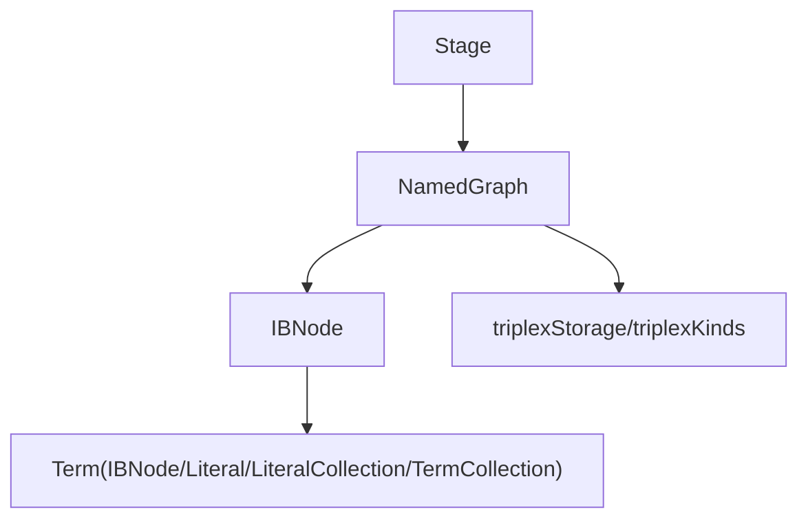
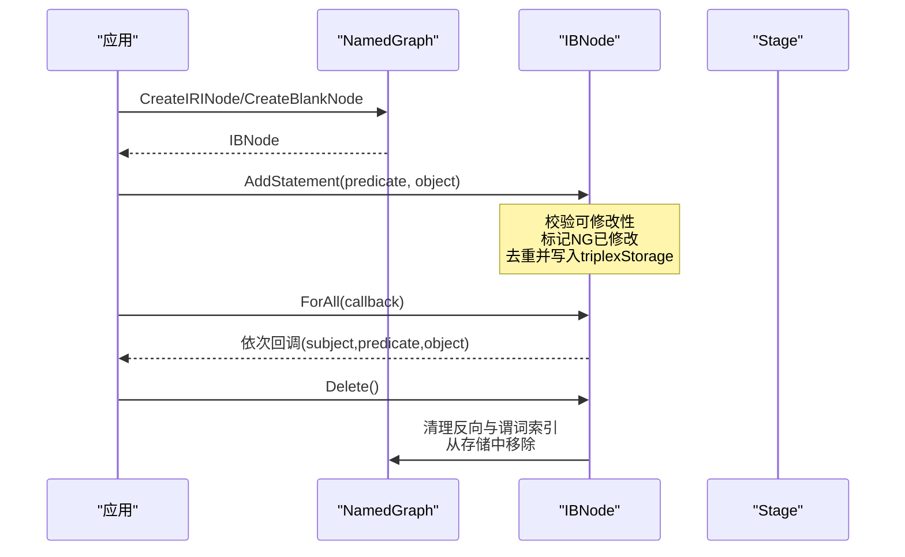
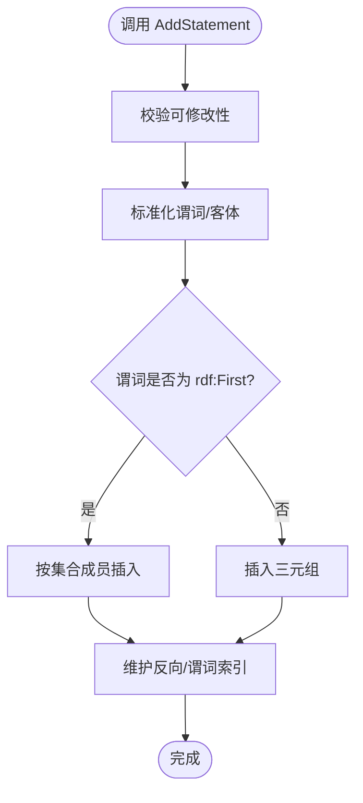
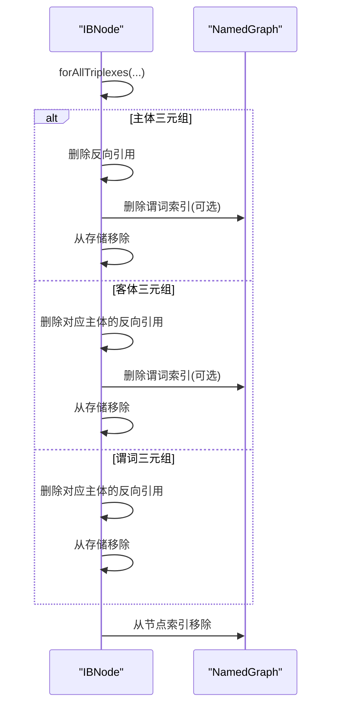
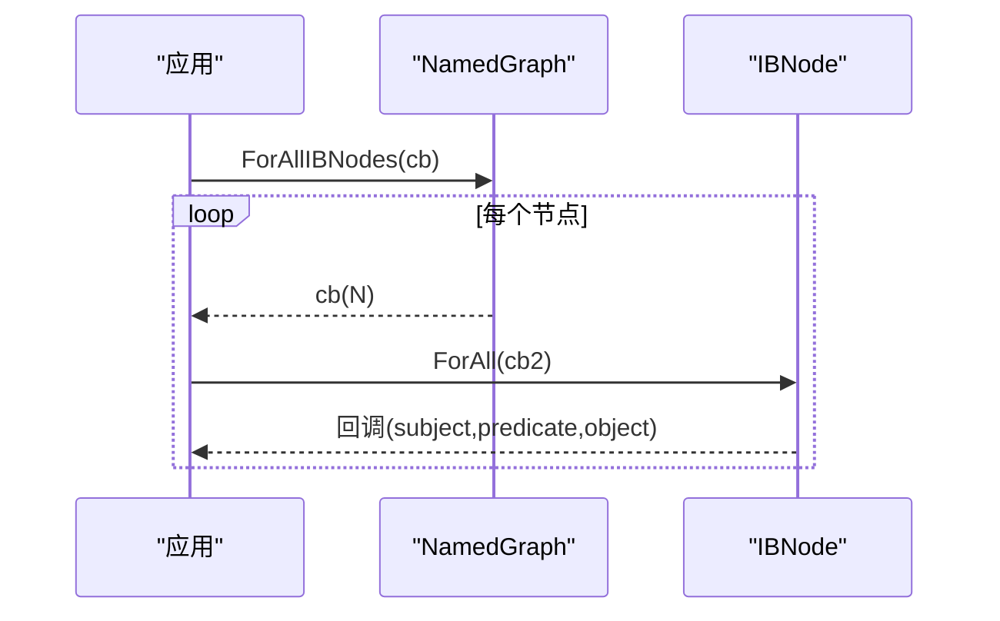
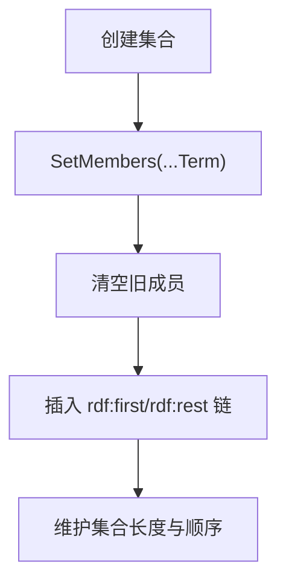
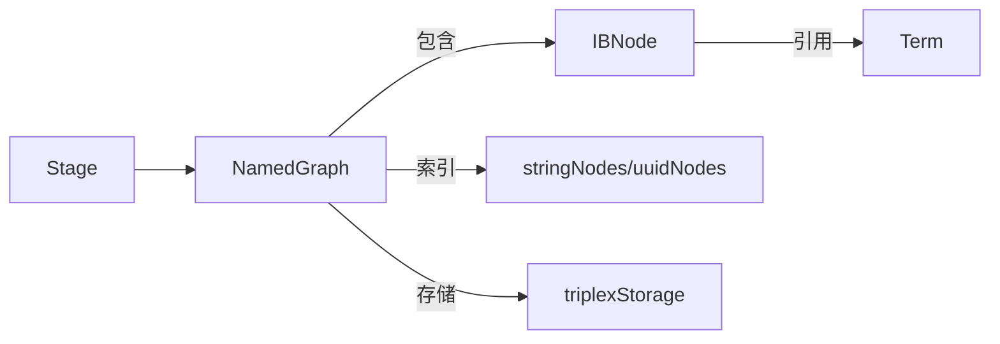

# 节点操作接口

<cite>
**本文引用的文件**
- [ibnode.go](file://sst/ibnode.go)
- [namedgraph.go](file://sst/namedgraph.go)
- [types.go](file://sst/types.go)
- [stage.go](file://sst/stage.go)
</cite>

## 目录
1. [简介](#简介)
2. [项目结构](#项目结构)
3. [核心组件](#核心组件)
4. [架构总览](#架构总览)
5. [详细组件分析](#详细组件分析)
6. [依赖关系分析](#依赖关系分析)
7. [性能考虑](#性能考虑)
8. [故障排查指南](#故障排查指南)
9. [结论](#结论)
10. [附录：示例与最佳实践](#附录示例与最佳实践)

## 简介
本文件面向使用 SST 的开发者，系统化说明 IBNode 接口的操作方法、属性增删改查、遍历与搜索、关系管理与引用机制、并发安全与事务性语义，以及复杂操作的实现要点、性能优化与错误处理策略。文档以源码为依据，提供代码级图示与路径定位，便于快速定位实现细节。

## 项目结构
SST 将 RDF 图抽象为 NamedGraph，并在其中管理 IBNode（IRI 或空白节点）及其三元组。IBNode 是核心数据单元，提供对三元组的读写、遍历、删除等操作；NamedGraph 提供批量遍历、导入导出、比较、版本关联等能力；Stage 作为命名图的容器与生命周期管理单元。



图表来源
- [namedgraph.go:59-107](file://sst/namedgraph.go#L59-L107)
- [ibnode.go:634-660](file://sst/ibnode.go#L634-L660)

章节来源
- [namedgraph.go:59-107](file://sst/namedgraph.go#L59-L107)
- [ibnode.go:634-660](file://sst/ibnode.go#L634-L660)

## 核心组件
- IBNode：表示 IRI 或空白节点，承载类型信息（rdf:type）及所有与其相关的三元组（作为主体、谓词或客体）。
- Term：三元组客体，可为 IBNode、Literal、LiteralCollection、TermCollection。
- LiteralCollection：同类型的字面量集合，用于高效存储与迭代。
- TermCollection：RDF 集合（rdf:first/rdf:rest），由空白节点实现，支持成员插入、查询与删除。
- NamedGraph：内存中的命名图，维护节点索引、三元组存储、导入关系、版本元数据等。
- Stage：命名图的生命周期与访问控制上下文。

章节来源
- [ibnode.go:698-908](file://sst/ibnode.go#L698-L908)
- [ibnode.go:1027-1039](file://sst/ibnode.go#L1027-L1039)
- [ibnode.go:1217-1244](file://sst/ibnode.go#L1217-L1244)
- [ibnode.go:1347-1381](file://sst/ibnode.go#L1347-L1381)
- [namedgraph.go:110-183](file://sst/namedgraph.go#L110-L183)

## 架构总览
下图展示 IBNode 与 NamedGraph 在添加、遍历、删除时的交互流程。



图表来源
- [ibnode.go:2083-2116](file://sst/ibnode.go#L2083-L2116)
- [ibnode.go:1831-1869](file://sst/ibnode.go#L1831-L1869)
- [ibnode.go:2257-2310](file://sst/ibnode.go#L2257-L2310)
- [namedgraph.go:200-220](file://sst/namedgraph.go#L200-L220)

## 详细组件分析

### IBNode 接口与方法
IBNode 提供以下关键能力：
- 标识与类型
  - TypeOf(): 获取主类型（rdf:type）
  - IRI()/Fragment()/ID()/PrefixedFragment()
  - IsIRINode()/IsBlankNode()/IsUuidFragment()/IsValid()/IsReferenced()
- 三元组访问
  - TripleCount()/GetTriple(index)/GetObjects(predicate)
  - CheckTriple(predicate, object)
- 三元组变更
  - AddStatement/AddStatementAlt/DeleteTriples/ForDelete
  - Delete()
- 遍历与导出
  - ForAll(callback)
  - DumpTriples()
- 集合与类型系统
  - AsCollection()/InVocabulary()/Is(e)/IsKind(e)
  - sort.Interface 方法（Len/Less/Swap）

章节来源
- [ibnode.go:702-908](file://sst/ibnode.go#L702-L908)
- [ibnode.go:1603-1704](file://sst/ibnode.go#L1603-L1704)
- [ibnode.go:1772-1838](file://sst/ibnode.go#L1772-L1838)
- [ibnode.go:2011-2040](file://sst/ibnode.go#L2011-L2040)
- [ibnode.go:2042-2081](file://sst/ibnode.go#L2042-L2081)
- [ibnode.go:2083-2116](file://sst/ibnode.go#L2083-L2116)
- [ibnode.go:2118-2142](file://sst/ibnode.go#L2118-L2142)
- [ibnode.go:2257-2310](file://sst/ibnode.go#L2257-L2310)

#### 类图（IBNode 相关）
```mermaid
classDiagram
class IBNode {
+TypeOf() IBNode
+IRI() IRI
+Fragment() string
+ID() uuid.UUID
+PrefixedFragment() string
+TripleCount() int
+OwningGraph() NamedGraph
+ForAll(callback) error
+GetObjects(Node) []Term
+GetTriple(int) (IBNode, IBNode, Term)
+AddStatement(Node, Term)
+AddStatementAlt(Node, Term) error
+CheckTriple(Node, Term) bool
+Delete()
+ForDelete(func) void
+DeleteTriples() void
+AsCollection() (TermCollection, bool)
+DumpTriples() [][3]string
+Equal(IBNode) bool
+InVocabulary() ElementInformer
+Is(Elementer) bool
+IsKind(ElementInformer) bool
+IsValid() bool
+IsReferenced() bool
+IsIRINode() bool
+IsBlankNode() bool
}
class Term {
<<interface>>
+TermKind() TermKind
}
class LiteralCollection {
<<interface>>
+ForMembers(func)
+MemberCount() int
+Member(int) Literal
+Values() []interface{}
+DataType() IBNode
}
class TermCollection {
<<interface>>
+ForMembers(func)
+Members() []Term
+MemberCount() int
+Member(int) Term
+SetMembers(...Term)
+ID() uuid.UUID
}
IBNode --> Term : "客体"
Term <|.. LiteralCollection
Term <|.. TermCollection
```

图表来源
- [ibnode.go:698-908](file://sst/ibnode.go#L698-L908)
- [ibnode.go:1027-1039](file://sst/ibnode.go#L1027-L1039)
- [ibnode.go:1217-1244](file://sst/ibnode.go#L1217-L1244)
- [ibnode.go:1347-1381](file://sst/ibnode.go#L1347-L1381)

### 三元组添加与更新（AddStatement/AddStatementAlt）
- AddStatement：向当前 IBNode（作为主体）添加一条三元组。内部会：
  - 校验可修改性（非只读、非预定义图节点）
  - 转换谓词与客体为内部 ibNode/Term
  - 若谓词为 rdf:First，则按集合成员方式插入
  - 去重检查后写入 triplexStorage，并维护反向与谓词索引（如启用）
- AddStatementAlt：与 AddStatement 行为一致，但返回错误而非 panic（适合批量容错场景）



图表来源
- [ibnode.go:2083-2116](file://sst/ibnode.go#L2083-L2116)
- [ibnode.go:2174-2255](file://sst/ibnode.go#L2174-L2255)

章节来源
- [ibnode.go:2083-2116](file://sst/ibnode.go#L2083-L2116)
- [ibnode.go:2174-2255](file://sst/ibnode.go#L2174-L2255)

### 三元组删除（Delete/ForDelete/DeleteTriples）
- Delete：删除该 IBNode 及其所有相关三元组（包括作为主体、客体、谓词的三元组），并清理反向与谓词索引。
- ForDelete：条件删除当前 IBNode 的所有前向三元组（主体为该节点），根据回调决定是否删除。
- DeleteTriples：仅删除该 IBNode 作为主体的三元组（保留集合成员的特殊处理）。



图表来源
- [ibnode.go:2257-2310](file://sst/ibnode.go#L2257-L2310)
- [ibnode.go:1920-1958](file://sst/ibnode.go#L1920-L1958)
- [ibnode.go:1960-1986](file://sst/ibnode.go#L1960-L1986)

章节来源
- [ibnode.go:1920-1958](file://sst/ibnode.go#L1920-L1958)
- [ibnode.go:1960-1986](file://sst/ibnode.go#L1960-L1986)
- [ibnode.go:2257-2310](file://sst/ibnode.go#L2257-L2310)

### 遍历与搜索（ForAll/ForAllIBNodes/ForIRINodes/ForBlankNodes/ForTermCollection）
- IBNode.ForAll：遍历与该节点相关的所有三元组（主体、客体、谓词），回调中可终止遍历。
- NamedGraph.ForAllIBNodes/ForIRINodes/ForBlankNodes/ForTermCollection：遍历图中所有节点或特定类型节点，支持错误中断。
- ForUndefinedIBNodes：查找无主体三元组的“未定义”节点（常用于清理）。



图表来源
- [ibnode.go:1831-1869](file://sst/ibnode.go#L1831-L1869)
- [namedgraph.go:157-183](file://sst/namedgraph.go#L157-L183)
- [stage.go:1494-1514](file://sst/stage.go#L1494-L1514)

章节来源
- [ibnode.go:1831-1869](file://sst/ibnode.go#L1831-L1869)
- [namedgraph.go:157-183](file://sst/namedgraph.go#L157-L183)
- [stage.go:1494-1514](file://sst/stage.go#L1494-L1514)

### 集合操作（TermCollection/LiteralCollection）
- TermCollection：基于空白节点的 RDF 集合，支持 SetMembers/Members/Member/MemberCount/ForMembers。
- LiteralCollection：同类型字面量集合，支持 ForMembers/Member/MemberCount/Values/DataType。



图表来源
- [ibnode.go:1347-1381](file://sst/ibnode.go#L1347-L1381)
- [ibnode.go:1442-1507](file://sst/ibnode.go#L1442-L1507)
- [ibnode.go:1217-1244](file://sst/ibnode.go#L1217-L1244)
- [ibnode.go:1262-1323](file://sst/ibnode.go#L1262-L1323)

章节来源
- [ibnode.go:1347-1381](file://sst/ibnode.go#L1347-L1381)
- [ibnode.go:1442-1507](file://sst/ibnode.go#L1442-L1507)
- [ibnode.go:1217-1244](file://sst/ibnode.go#L1217-L1244)
- [ibnode.go:1262-1323](file://sst/ibnode.go#L1262-L1323)

### 节点属性与类型声明
- 类型声明：通过 AddStatement(rdf:type, typeNode) 设置主类型；可通过 TypeOf() 读取。
- 属性值设置：通过 AddStatement(predicate, object) 设置任意属性。
- 属性查询：GetObjects(predicate) 获取某属性的所有客体；GetTriple(index) 按索引获取三元组；CheckTriple(predicate, object) 判断是否存在。

章节来源
- [ibnode.go:702-783](file://sst/ibnode.go#L702-L783)
- [ibnode.go:2011-2040](file://sst/ibnode.go#L2011-L2040)
- [ibnode.go:2042-2081](file://sst/ibnode.go#L2042-L2081)
- [ibnode.go:2118-2142](file://sst/ibnode.go#L2118-L2142)

### 关系管理与引用机制
- 反向引用：当添加主体三元组时，自动在客体 IBNode 上记录反向三元组，以便删除时能清理引用。
- 谓词索引：若启用 trackPredicates，则在谓词节点上维护谓词三元组索引，加速按谓词的反向查询。
- 命名图导入：NamedGraph 支持 AddImport/RemoveImport/DirectImports，导出时体现 owl:imports。

章节来源
- [ibnode.go:2174-2255](file://sst/ibnode.go#L2174-L2255)
- [namedgraph.go:222-235](file://sst/namedgraph.go#L222-L235)

### 并发安全与事务性
- 并发安全：IBNode/NamedGraph 未提供显式锁；建议在应用层保证同一 NamedGraph 的并发写串行化。
- 事务性：Stage 提交（Commit）将变更持久化；在提交前，NamedGraph 处于可回滚状态。MoveAndMerge 等跨图操作在提交边界内原子生效。
- 访问控制：部分方法会进行权限校验（如 LinkToRepository），失败时返回错误。

章节来源
- [namedgraph.go:415-503](file://sst/namedgraph.go#L415-L503)
- [namedgraph.go:267-294](file://sst/namedgraph.go#L267-L294)

## 依赖关系分析
IBNode 与 NamedGraph 紧密耦合：
- IBNode 通过 ng 指针持有所属 NamedGraph，并通过 triplexStart/triplexEnd 指向共享的 triplexStorage。
- NamedGraph 维护 stringNodes/uuidNodes 索引，以及 directImports/isImportedBy 关系。
- Stage 提供访问控制与生命周期管理。



图表来源
- [namedgraph.go:59-107](file://sst/namedgraph.go#L59-L107)
- [ibnode.go:634-660](file://sst/ibnode.go#L634-L660)

章节来源
- [namedgraph.go:59-107](file://sst/namedgraph.go#L59-L107)
- [ibnode.go:634-660](file://sst/ibnode.go#L634-L660)

## 性能考虑
- 批量添加：优先使用 AddStatementAlt 配合外部去重逻辑，避免重复插入导致的异常与开销。
- 集合操作：使用 SetMembers 一次性替换成员，减少多次插入的索引维护成本。
- 谓词索引：仅在需要频繁按谓词反向查询时启用 trackPredicates，否则增加写入开销。
- 遍历优化：ForAll/ForAllIBNodes 回调中尽早 return 错误以提前终止遍历。
- 内存布局：triplexStorage 连续存储，按区间访问，减少随机访问开销。

[本节为通用建议，不直接分析具体文件]

## 故障排查指南
常见错误与处理：
- ErrNodeNotModifiable：尝试修改只读或预定义图节点。应确保在本地可写 NamedGraph 上操作。
- ErrNodeDeletedOrInvalid：操作已删除或无效节点。应在操作前检查 IsValid()。
- ErrStagesAreNotTheSame：跨 Stage 的三元组连接不被允许。需在同一 Stage 内操作或通过 MoveIBNode 迁移。
- ErrDuplicateTriplex：重复三元组。可使用 AddStatementAlt 捕获并跳过。
- ErrIndexOutOfRange：GetTriple 索引越界。应先获取 TripleCount() 并校验。
- ErrCannotSetCollectionMemberPredicate：非集合上下文误用 rdf:First。请通过 SetMembers 或集合 API 操作。

章节来源
- [ibnode.go:47-60](file://sst/ibnode.go#L47-L60)
- [ibnode.go:1803-1819](file://sst/ibnode.go#L1803-L1819)
- [ibnode.go:2174-2255](file://sst/ibnode.go#L2174-L2255)
- [ibnode.go:2042-2081](file://sst/ibnode.go#L2042-L2081)

## 结论
IBNode 提供了完整的 RDF 节点操作能力，涵盖三元组的增删改查、遍历与搜索、集合操作、类型系统与关系管理。结合 NamedGraph 的批量遍历与导入导出能力，以及 Stage 的事务性与访问控制，可满足复杂知识图谱的构建与维护需求。实际使用中应注意并发安全、性能优化与错误处理策略，确保稳定高效的图操作。

[本节为总结，不直接分析具体文件]

## 附录：示例与最佳实践
- 批量操作
  - 使用 AddStatementAlt 收集错误，统一处理重复项。
  - 使用 SetMembers 批量设置集合成员。
- 条件查询
  - 使用 ForAll 遍历三元组，在回调中过滤谓词与客体。
  - 使用 GetObjects(predicate) 快速获取某属性的所有客体。
- 复杂节点操作
  - 先创建节点并设置类型（rdf:type），再添加属性。
  - 使用 ForDelete 条件删除三元组，注意反向与谓词索引的清理。
- 性能优化
  - 合理启用谓词索引，权衡读写性能。
  - 利用 ForAll/ForAllIBNodes 的早期终止特性。
- 错误处理
  - 针对 ErrStagesAreNotTheSame，确保跨图操作前先迁移节点。
  - 针对 ErrDuplicateTriplex，采用 AddStatementAlt 并忽略重复。

[本节为实践指导，不直接分析具体文件]