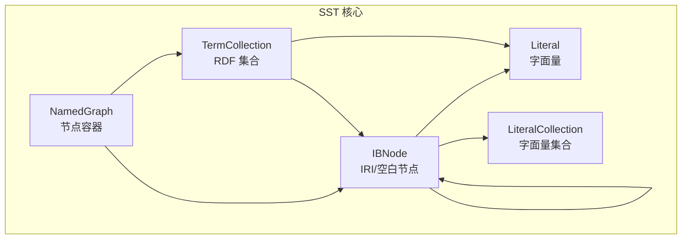
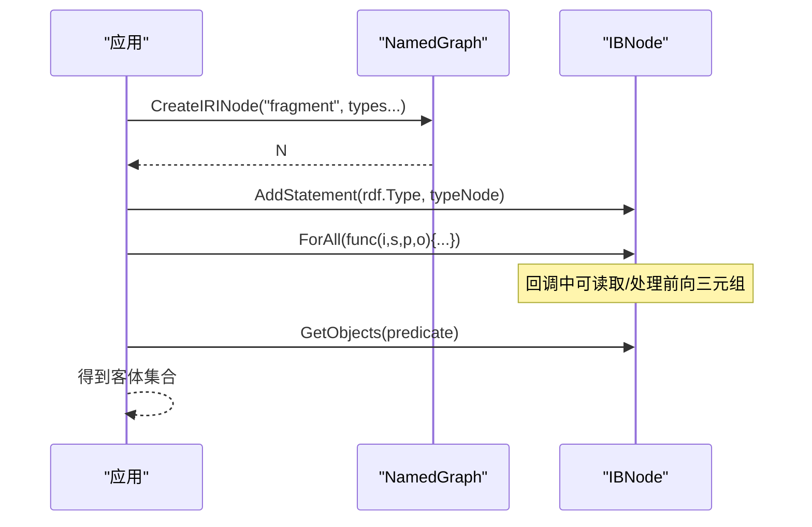
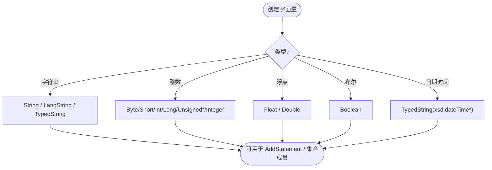
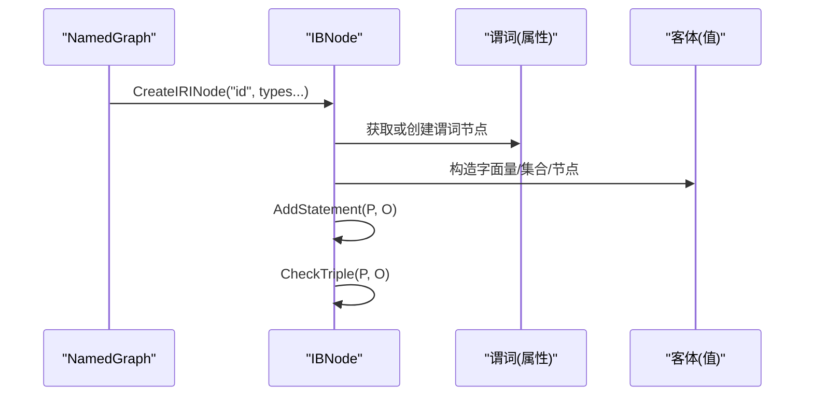
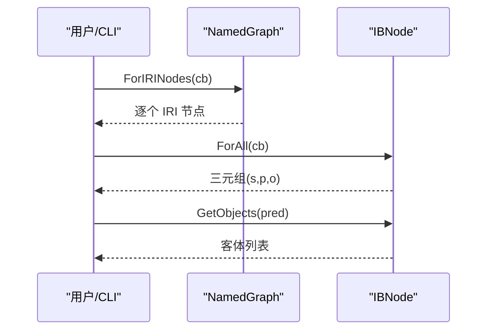
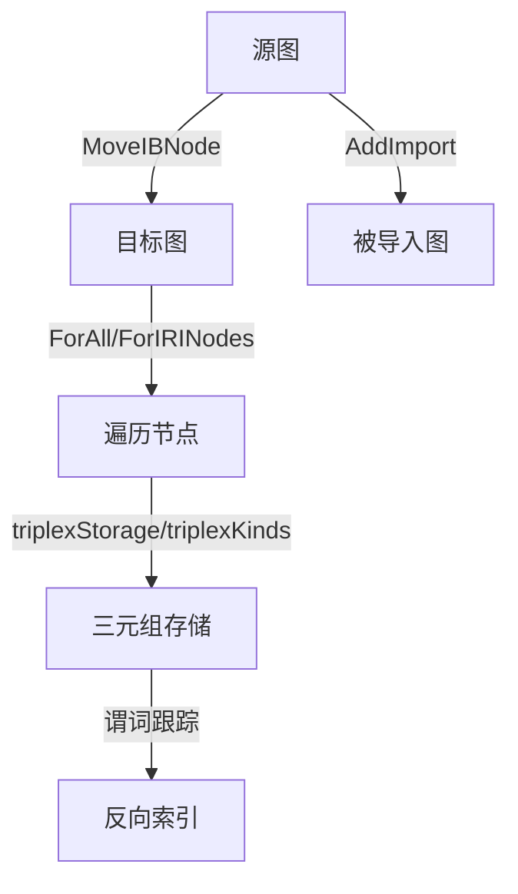
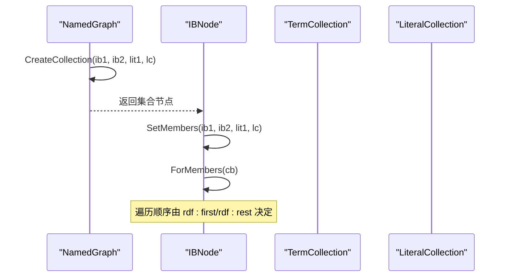
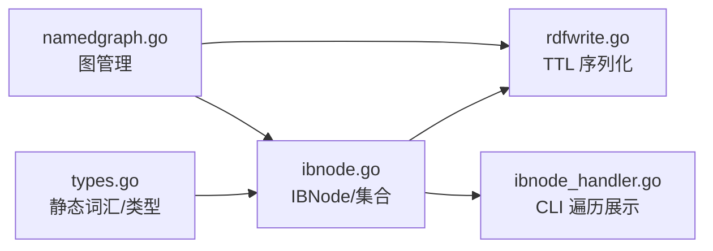

# 节点管理

<cite>
**本文引用的文件**
- [ibnode.go](file://sst/ibnode.go)
- [literals.go](file://sst/literals.go)
- [literaltypes.go](file://sst/literaltypes.go)
- [types.go](file://sst/types.go)
- [namedgraph.go](file://sst/namedgraph.go)
- [rdfwrite.go](file://sst/rdfwrite.go)
- [ibnode_handler.go](file://cli/cmd/interactive/ibnode_handler.go)
</cite>

## 目录
1. [简介](#简介)
2. [项目结构](#项目结构)
3. [核心组件](#核心组件)
4. [架构总览](#架构总览)
5. [详细组件分析](#详细组件分析)
6. [依赖关系分析](#依赖关系分析)
7. [性能考虑](#性能考虑)
8. [故障排查指南](#故障排查指南)
9. [结论](#结论)
10. [附录](#附录)

## 简介
本文件系统性说明 SST 中的节点管理机制，覆盖 IBNode 接口的实现与使用、IRI 节点与空白节点的创建/查询/管理、字面量类型系统（字符串、数字、日期等）、节点属性操作（添加类型、设置属性值）、遍历与搜索（ForAllIBNodes、ForIRINodes 等）、节点间关系管理与引用机制、复杂数据结构构建（嵌套对象与集合），以及性能优化与内存管理的最佳实践。

## 项目结构
围绕节点管理的关键代码集中在 sst 包：
- ibnode.go：定义 IBNode/Term/Literal 接口及底层 ibNode、literal、literalCollection、TermCollection 等实现；提供三元组存储、集合操作、遍历与序列化支持。
- namedgraph.go：NamedGraph 接口与实现，负责节点生命周期管理、图级遍历、导入/导出、移动与合并等。
- literals.go / literaltypes.go：字面量类型封装与转换（String、Integer、Double、Boolean、LangString、TypedString 等）。
- types.go：内置词汇表与静态资源类型（如 rdf:type、xsd:string 等）的常量定义。
- rdfwrite.go：将节点与三元组序列化为 RDF/Turtle 的写入逻辑。
- cli/cmd/interactive/ibnode_handler.go：交互式 CLI 中对 IBNode 的遍历与展示示例。



图表来源
- [namedgraph.go:110-200](file://sst/namedgraph.go#L110-L200)
- [ibnode.go:698-908](file://sst/ibnode.go#L698-L908)
- [ibnode.go:1217-1381](file://sst/ibnode.go#L1217-L1381)

章节来源
- [namedgraph.go:110-200](file://sst/namedgraph.go#L110-L200)
- [ibnode.go:698-908](file://sst/ibnode.go#L698-L908)

## 核心组件
- IBNode：表示 IRI 或空白节点，承载三元组的主体/谓词/客体角色，提供类型获取、属性读写、删除、遍历、比较、序列化等方法。
- Term：三元组客体的统一抽象，包括 IBNode、Literal、TermCollection、LiteralCollection。
- Literal：字面量抽象，支持 xsd:string、xsd:int、xsd:double、xsd:boolean、rdf:langString、xsd:dateTime 等。
- LiteralCollection：同类型字面量的紧凑集合，用于高效存储与遍历。
- TermCollection：完整的 RDF 集合（rdf:first/rdf:rest 链），可包含 IBNode、Literal、LiteralCollection 或其他 TermCollection。
- NamedGraph：图的容器，负责节点创建、查找、遍历、导入/导出、移动与版本关联。

章节来源
- [ibnode.go:698-908](file://sst/ibnode.go#L698-L908)
- [ibnode.go:1027-1039](file://sst/ibnode.go#L1027-L1039)
- [literals.go:12-442](file://sst/literals.go#L12-L442)
- [literaltypes.go:10-74](file://sst/literaltypes.go#L10-L74)
- [ibnode.go:1217-1381](file://sst/ibnode.go#L1217-L1381)
- [namedgraph.go:110-200](file://sst/namedgraph.go#L110-L200)

## 架构总览
下图展示了 NamedGraph 如何组织 IBNode、Term、Literal 与集合，并通过三元组存储进行关联。

```mermaid
classDiagram
class NamedGraph {
+CreateIRINode(fragment, types...) IBNode
+CreateBlankNode(types...) IBNode
+CreateCollection(members...) TermCollection
+ForAllIBNodes(callback) error
+ForIRINodes(callback) error
+MoveIBNode(node, fragment) void
}
class IBNode {
+TypeOf() IBNode
+IRI() IRI
+Fragment() string
+ID() uuid.UUID
+AddStatement(predicate, object) void
+GetObjects(predicate) []Term
+ForAll(callback) error
+Delete() void
+AsCollection() (TermCollection, bool)
}
class Term {
<<interface>>
+TermKind() TermKind
}
class Literal {
<<interface>>
+DataType() IBNode
}
class LiteralCollection {
+ForMembers(callback) void
+MemberCount() int
+Member(index) Literal
+Values() []interface{}
+DataType() IBNode
}
class TermCollection {
+ForMembers(callback) void
+Members() []Term
+MemberCount() int
+Member(index) Term
+SetMembers(members...) void
+ID() uuid.UUID
}
NamedGraph --> IBNode : "创建/管理"
IBNode --> Term : "作为客体"
Term <|-- IBNode
Term <|-- Literal
Term <|-- LiteralCollection
Term <|-- TermCollection
IBNode --> LiteralCollection : "属性值"
IBNode --> TermCollection : "集合属性"
```

图表来源
- [namedgraph.go:200-235](file://sst/namedgraph.go#L200-L235)
- [ibnode.go:698-908](file://sst/ibnode.go#L698-L908)
- [ibnode.go:1217-1381](file://sst/ibnode.go#L1217-L1381)

## 详细组件分析

### IBNode 接口与实现
- 身份与类型
  - TypeOf()：返回主类型 IBNode（可多类型，但建议单一主类型）。
  - IsIRINode()/IsBlankNode()：区分 IRI 与空白节点。
  - Fragment()/ID()：分别获取 IRI 片段或空白节点 UUID。
- 三元组访问
  - TripleCount()/GetTriple(index)/ForAll(...)：遍历所有涉及该节点的前向、反向、中间三元组。
  - GetObjects(predicate)：按谓词检索客体列表。
- 修改与删除
  - AddStatement/AddStatementAlt：添加三元组（重复检测）。
  - Delete/DeleteTriples/ForDelete：删除节点或特定三元组。
- 集合与转储
  - AsCollection()：判断是否为 TermCollection。
  - DumpTriples()：以字符串形式输出三元组。
- 等价性与有效性
  - Equal(IBNode)：跨图/阶段比较语义等价性。
  - IsValid()/IsReferenced()：检查节点/图状态。



图表来源
- [namedgraph.go:200-235](file://sst/namedgraph.go#L200-L235)
- [ibnode.go:743-783](file://sst/ibnode.go#L743-L783)

章节来源
- [ibnode.go:698-908](file://sst/ibnode.go#L698-L908)

### 字面量类型系统
- 支持的类型
  - 字符串：String、LangString、TypedString（含自定义数据类型 IBNode）。
  - 整数：Byte、Short、Int、Long、UnsignedByte/Short/Int/Long、Integer。
  - 浮点：Float、Double。
  - 布尔：Boolean。
  - 日期时间：TypedString 搭配 xsd:dateTime/xsd:dateTimeStamp。
- 类型识别与转换
  - DataType()：返回对应的 xsd/rdf 类型 IBNode。
  - literalToObject/literalValue：内部字节到 Go 类型的双向转换。
- 集合
  - NewLiteralCollection(member0, members...)：构造同类型字面量集合，成员类型不一致会报错。
  - ForMembers/Member/Values：遍历与取值。



图表来源
- [literals.go:12-442](file://sst/literals.go#L12-L442)
- [literaltypes.go:10-74](file://sst/literaltypes.go#L10-L74)
- [ibnode.go:1262-1279](file://sst/ibnode.go#L1262-L1279)

章节来源
- [literals.go:12-442](file://sst/literals.go#L12-L442)
- [literaltypes.go:10-74](file://sst/literaltypes.go#L10-L74)
- [ibnode.go:1217-1323](file://sst/ibnode.go#L1217-L1323)

### 节点属性操作
- 添加类型
  - 通过 AddStatement(rdf.Type, typeNode) 为节点赋予类型。
- 设置属性值
  - AddStatement(predicate, object)：object 可为 IBNode、Literal、LiteralCollection、TermCollection。
  - CheckTriple(predicate, object)：验证是否存在指定三元组。
- 删除与批量删除
  - DeleteTriples()：删除所有以当前节点为主语的前向三元组。
  - ForDelete(c)：按条件删除三元组。



图表来源
- [namedgraph.go:200-235](file://sst/namedgraph.go#L200-L235)
- [ibnode.go:773-783](file://sst/ibnode.go#L773-L783)

章节来源
- [ibnode.go:773-783](file://sst/ibnode.go#L773-L783)

### 遍历与搜索
- 图级遍历
  - ForAllIBNodes(callback)：遍历图中所有 IBNode。
  - ForIRINodes(callback)：仅遍历 IRI 节点。
  - ForBlankNodes(callback)：仅遍历空白节点。
  - ForTermCollection(callback)：遍历 TermCollection。
  - ForUndefinedIBNodes(callback)：查找无主语三元组的“未定义”节点。
- 节点级遍历
  - IBNode.ForAll(callback)：遍历与该节点相关的所有三元组（前向/反向/中间/自引用）。
  - IBNode.GetObjects(predicate)：按谓词检索客体。
- CLI 示例
  - 交互式命令通过 ForAll 打印三元组，便于调试与展示。



图表来源
- [namedgraph.go:157-183](file://sst/namedgraph.go#L157-L183)
- [ibnode.go:743-783](file://sst/ibnode.go#L743-L783)
- [ibnode_handler.go:12-37](file://cli/cmd/interactive/ibnode_handler.go#L12-L37)

章节来源
- [namedgraph.go:157-183](file://sst/namedgraph.go#L157-L183)
- [ibnode.go:743-783](file://sst/ibnode.go#L743-L783)
- [ibnode_handler.go:12-37](file://cli/cmd/interactive/ibnode_handler.go#L12-L37)

### 节点关系管理与引用机制
- 三元组存储与索引
  - 三元组以 triplex 结构存储在 NamedGraph 的 triplexStorage 中，并附带 triplexKinds 标记三元组角色（主体/谓词/客体）。
  - 支持谓词三元组跟踪（trackPredicates），便于反向查询与优化。
- 节点复制与重定向
  - nodeCopyReplacements 在合并/移动时维护节点替换映射，确保引用一致性。
  - replaceIBNodeNamedGraph 调整节点所属图与三元组偏移。
- 导入与依赖
  - NamedGraph.AddImport/RemoveImport/DirectImports：声明图级导入关系，影响序列化时的 owl:imports。
- 移动与合并
  - MoveIBNode：将节点从一个图移动到另一个图，可选重写片段。
  - FindCommonParentRevision：在多分支场景下寻找共同祖先，支撑三向差异与合并。



图表来源
- [ibnode.go:141-179](file://sst/ibnode.go#L141-L179)
- [ibnode.go:384-405](file://sst/ibnode.go#L384-L405)
- [namedgraph.go:222-235](file://sst/namedgraph.go#L222-L235)
- [namedgraph.go:267-272](file://sst/namedgraph.go#L267-L272)
- [namedgraph.go:572-622](file://sst/namedgraph.go#L572-L622)

章节来源
- [ibnode.go:141-179](file://sst/ibnode.go#L141-L179)
- [ibnode.go:384-405](file://sst/ibnode.go#L384-L405)
- [namedgraph.go:222-235](file://sst/namedgraph.go#L222-L235)
- [namedgraph.go:267-272](file://sst/namedgraph.go#L267-L272)
- [namedgraph.go:572-622](file://sst/namedgraph.go#L572-L622)

### 复杂数据结构构建（嵌套对象与集合）
- TermCollection（RDF 集合）
  - CreateCollection(members...)：创建 rdf:first/rdf:rest 链，空集合等价于 rdf:nil。
  - SetMembers(...)/ForMembers/Members/MemberCount/Member：增删改查集合成员。
  - AsCollection()：判断节点是否为集合。
- LiteralCollection（字面量集合）
  - NewLiteralCollection(member0, members...)：创建同类型字面量集合，类型不一致会报错。
  - ForMembers/Member/Values：遍历与取值。
- 嵌套结构
  - 集合成员可以是 IBNode、Literal、LiteralCollection、TermCollection，从而表达树状/图状数据。



图表来源
- [namedgraph.go:211-214](file://sst/namedgraph.go#L211-L214)
- [ibnode.go:1383-1514](file://sst/ibnode.go#L1383-L1514)
- [ibnode.go:1262-1323](file://sst/ibnode.go#L1262-L1323)

章节来源
- [namedgraph.go:211-214](file://sst/namedgraph.go#L211-L214)
- [ibnode.go:1383-1514](file://sst/ibnode.go#L1383-L1514)
- [ibnode.go:1262-1323](file://sst/ibnode.go#L1262-L1323)

## 依赖关系分析
- 类型与词汇
  - types.go 定义了静态图与常用词汇（rdf:type、rdfs:label/comment、xsd:* 类型节点等），供节点类型与属性使用。
- 序列化
  - rdfwrite.go 基于 IBNode.ForAll 与集合能力，将图结构转换为 Turtle，支持集合内联与空白节点命名。
- 交互与调试
  - ibnode_handler.go 演示了 ForAll 的使用，便于快速查看三元组内容。



图表来源
- [types.go:9-235](file://sst/types.go#L9-L235)
- [rdfwrite.go:575-612](file://sst/rdfwrite.go#L575-L612)
- [ibnode_handler.go:12-37](file://cli/cmd/interactive/ibnode_handler.go#L12-L37)

章节来源
- [types.go:9-235](file://sst/types.go#L9-L235)
- [rdfwrite.go:575-612](file://sst/rdfwrite.go#L575-L612)
- [ibnode_handler.go:12-37](file://cli/cmd/interactive/ibnode_handler.go#L12-L37)

## 性能考虑
- 三元组存储与增长策略
  - 使用 triplexStorage 与 triplexKinds 紧凑存储三元组与角色标志，减少额外索引开销。
  - 预分配与阈值增长（如 triplexAllocCount、triplesMaxGrowThreshold）降低扩容成本。
- 谓词三元组跟踪
  - 启用 trackPredicates 可加速反向查询，但会增加内存占用；按需开启。
- 集合优化
  - LiteralCollection 对同类型字面量采用紧凑存储，避免频繁装箱/拆箱。
  - TermCollection 遵循 RDF 标准链表，适合有序集合；大量元素时注意遍历成本。
- 序列化优化
  - 支持集合内联（canInlineAsCollection）与空白节点内联（canInlineAsBlankNode），减少冗余节点。
- 内存管理
  - 节点删除后不可再使用；避免持有已删除节点的引用。
  - 合理使用 Empty()/Delete() 清理不再需要的图或节点，释放内存。

章节来源
- [ibnode.go:66-70](file://sst/ibnode.go#L66-L70)
- [ibnode.go:1217-1323](file://sst/ibnode.go#L1217-L1323)
- [rdfwrite.go:878-932](file://sst/rdfwrite.go#L878-L932)
- [namedgraph.go:277-294](file://sst/namedgraph.go#L277-L294)

## 故障排查指南
- 常见错误
  - ErrDuplicateTriplex：重复添加相同三元组；使用 AddStatementAlt 或先 CheckTriple。
  - ErrIndexOutOfRange：GetTriple 索引越界；确保索引小于 TripleCount。
  - ErrNodeDeletedOrInvalid：操作已删除或无效节点；使用前检查 IsValid。
  - ErrLiteralDataTypesDiffer：LiteralCollection 成员类型不一致；确保类型一致。
  - ErrCannotSetCollectionMemberPredicate：集合成员不应作为谓词；检查三元组角色。
- 定位方法
  - 使用 ForAll 遍历三元组，结合 DumpTriples 输出结构化信息。
  - 使用 CLI 的 ForAll 命令快速查看节点三元组。
  - 利用 NamedGraph.Dump/PrintTriples 输出图级信息辅助定位。

章节来源
- [ibnode.go:47-60](file://sst/ibnode.go#L47-L60)
- [ibnode.go:765-783](file://sst/ibnode.go#L765-L783)
- [ibnode.go:1262-1279](file://sst/ibnode.go#L1262-L1279)
- [ibnode_handler.go:12-37](file://cli/cmd/interactive/ibnode_handler.go#L12-L37)
- [namedgraph.go:505-514](file://sst/namedgraph.go#L505-L514)

## 结论
SST 的节点管理以 IBNode 为核心，配合 NamedGraph 提供强大的创建、查询、遍历、修改与序列化能力。字面量类型系统与集合（LiteralCollection、TermCollection）支持丰富的数据建模需求。通过三元组存储、谓词跟踪与导入机制，系统在性能与功能之间取得平衡。遵循本文的最佳实践与故障排查建议，可有效构建与维护复杂的语义图数据。

## 附录
- 典型用法参考
  - 创建 IRI 节点并赋类型：[namedgraph.go:200-205](file://sst/namedgraph.go#L200-L205)
  - 添加属性与集合：[ibnode.go:773-783](file://sst/ibnode.go#L773-L783)、[ibnode.go:1383-1514](file://sst/ibnode.go#L1383-L1514)
  - 遍历与检索：[namedgraph.go:157-183](file://sst/namedgraph.go#L157-L183)、[ibnode.go:743-783](file://sst/ibnode.go#L743-L783)
  - 序列化输出：[rdfwrite.go:575-612](file://sst/rdfwrite.go#L575-L612)
  - CLI 遍历展示：[ibnode_handler.go:12-37](file://cli/cmd/interactive/ibnode_handler.go#L12-L37)