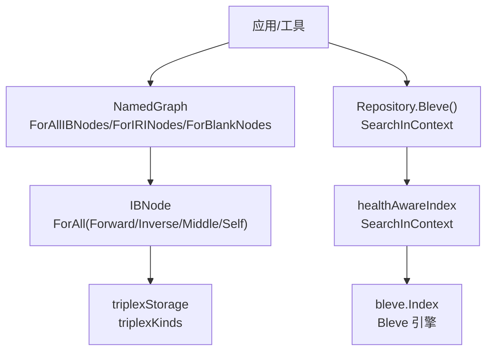
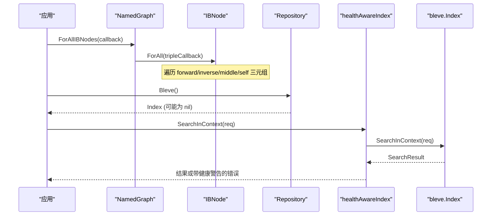
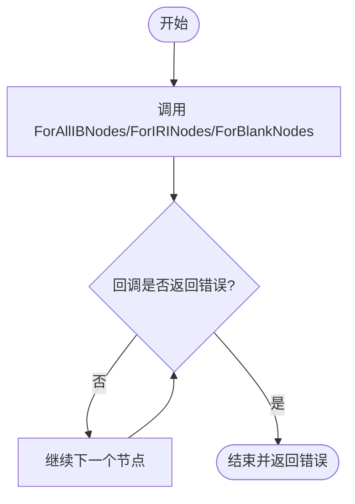
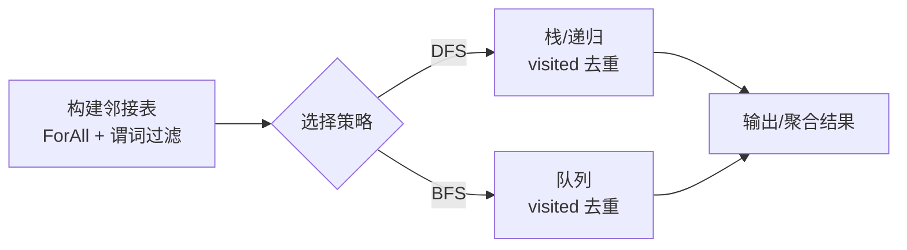
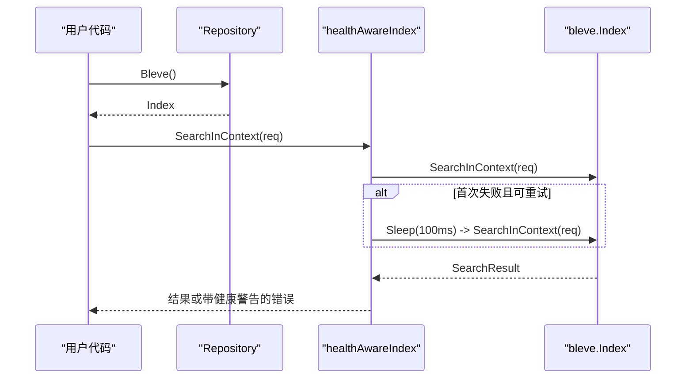
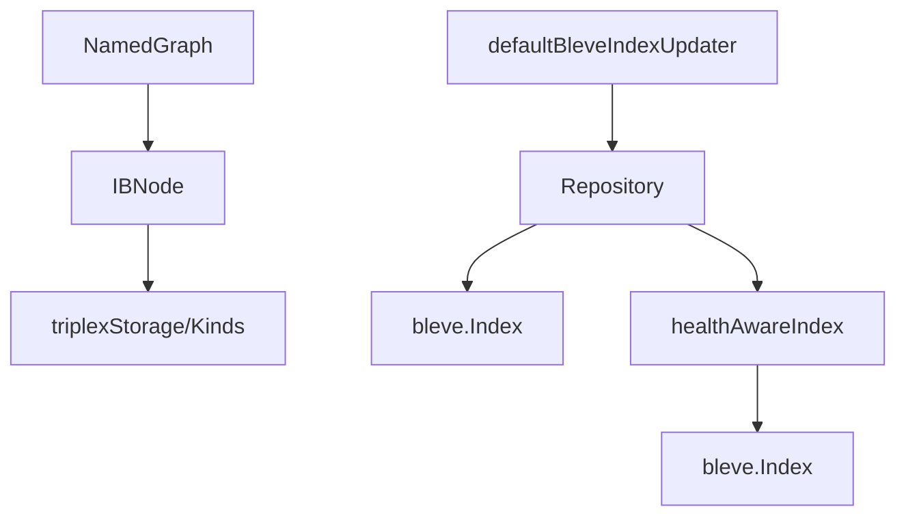

# 节点遍历和搜索

<cite>
**本文引用的文件**   
- [ibnode.go](file://sst/ibnode.go)
- [namedgraph.go](file://sst/namedgraph.go)
- [indexupdate.go](file://sst/indexupdate.go)
- [errrecovery.go](file://sst/errrecovery.go)
- [reporemote.go](file://sst/reporemote.go)
- [helloworldreadsst.go](file://examples/helloworldreadsst/helloworldreadsst.go)
- [p21.go](file://step/p21/p21.go)
- [filterextraction.go](file://tools/filterextraction/filterextraction.go)
- [searchInContext_test.go](file://sst_test/searchInContext_test.go)
</cite>

## 目录
1. [简介](#简介)
2. [项目结构](#项目结构)
3. [核心组件](#核心组件)
4. [架构总览](#架构总览)
5. [详细组件分析](#详细组件分析)
6. [依赖关系分析](#依赖关系分析)
7. [性能考虑](#性能考虑)
8. [故障排查指南](#故障排查指南)
9. [结论](#结论)
10. [附录](#附录)

## 简介
本文件聚焦于 SST 中的“节点遍历与搜索”能力，覆盖以下主题：
- 节点遍历方法：ForAll、ForAllIBNodes、ForIRINodes、ForBlankNodes、ForTermCollection、ForUndefinedIBNodes 的使用方式与语义。
- 节点搜索：基于 Bleve 的查询语法、条件构建、分页与排序。
- 谓词过滤与匹配：在遍历中按谓词（属性）进行筛选，以及基于词汇表的谓词归一化。
- 遍历策略：深度优先与广度优先的实现思路与适用场景。
- 性能优化：索引使用、批量更新、健康检查与重试、缓存策略。
- 复杂查询示例：多级关系查询、条件组合。
- 错误处理与异常恢复：遍历过程中的错误传播、panic 捕获与恢复。

## 项目结构
SST 将 RDF/OWL 数据以内存图结构组织，核心围绕 NamedGraph、IBNode、Triplex 存储与索引更新机制：
- 图与节点：NamedGraph 管理 IBNode（IRI 或 Blank Node），并通过 triplexStorage/triplexKinds 支持三向遍历（主体、谓词、客体）。
- 遍历接口：IBNode.ForAll 提供对关联三元组的统一遍历；NamedGraph 提供 ForAllIBNodes/ForIRINodes/ForBlankNodes 等集合级遍历。
- 索引与搜索：通过 Bleve 实现全文检索与结构化查询；异步更新、批处理与健康感知封装。
- 错误恢复：统一的 panic 捕获与可恢复错误包装，便于上层稳定消费。

图表来源
- [namedgraph.go:157-183](file://sst/namedgraph.go#L157-L183)
- [ibnode.go:743-758](file://sst/ibnode.go#L743-L758)
- [indexupdate.go:707-735](file://sst/indexupdate.go#L707-L735)

章节来源
- [namedgraph.go:157-183](file://sst/namedgraph.go#L157-L183)
- [ibnode.go:743-758](file://sst/ibnode.go#L743-L758)
- [indexupdate.go:707-735](file://sst/indexupdate.go#L707-L735)

## 核心组件
- IBNode.ForAll：对当前节点关联的所有三元组进行遍历，支持四种视角（forward/inverse/middle/self），回调返回错误可提前终止。
- NamedGraph 遍历：
  - ForAllIBNodes：遍历所有 IBNode。
  - ForIRINodes：仅遍历 IRI 节点。
  - ForBlankNodes：仅遍历空白节点。
  - ForTermCollection：遍历 TermCollection。
  - ForUndefinedIBNodes：遍历无主体三元组的 IBNode（类型未知）。
- 搜索与索引：
  - Repository.Bleve()：获取 bleve.Index（本地仓库可能为 nil）。
  - SearchInContext：上下文感知的搜索，支持分页、排序、字段选择。
  - healthAwareIndex：健康检查、重试、错误统计。
  - defaultBleveIndexUpdater：异步队列、批处理、预条件校验。

章节来源
- [ibnode.go:743-758](file://sst/ibnode.go#L743-L758)
- [namedgraph.go:157-183](file://sst/namedgraph.go#L157-L183)
- [indexupdate.go:77-158](file://sst/indexupdate.go#L77-L158)
- [indexupdate.go:436-501](file://sst/indexupdate.go#L436-L501)
- [reporemote.go:247-255](file://sst/reporemote.go#L247-L255)

## 架构总览
下图展示了从图遍历到索引搜索的整体流程，包括遍历回调、索引构建、健康检查与重试。

图表来源
- [namedgraph.go:1622-1628](file://sst/namedgraph.go#L1622-L1628)
- [ibnode.go:1831-1838](file://sst/ibnode.go#L1831-L1838)
- [indexupdate.go:707-735](file://sst/indexupdate.go#L707-L735)
- [reporemote.go:247-255](file://sst/reporemote.go#L247-L255)

## 详细组件分析

### 节点遍历 API 与用法
- ForAll（IBNode）
  - 作用：遍历与该节点相关的所有三元组，回调参数包含 index、subject、predicate、object。
  - 控制流：回调返回 error 时立即终止并向上返回。
  - 典型用途：按谓词过滤、收集对象、构建邻接表。
- ForAllIBNodes / ForIRINodes / ForBlankNodes（NamedGraph）
  - 作用：分别遍历全部 IBNode、IRI 节点、空白节点。
  - 控制流：回调返回 error 时终止。
- ForTermCollection / ForUndefinedIBNodes
  - 作用：遍历 TermCollection；定位未定义类型的 IBNode（无主体三元组）。
- 示例参考
  - 读取 SST 文件后遍历三元组输出：[helloworldreadsst.go](file://examples/helloworldreadsst/helloworldreadsst.go)
  - 在 P21 转换中按候选谓词收集使用关系：[p21.go](file://step/p21/p21.go)
  - 过滤器提取中对谓词进行词汇表归一化与分组：[filterextraction.go](file://tools/filterextraction/filterextraction.go)

图表来源
- [namedgraph.go:157-183](file://sst/namedgraph.go#L157-L183)
- [ibnode.go:1831-1838](file://sst/ibnode.go#L1831-L1838)

章节来源
- [ibnode.go:1831-1838](file://sst/ibnode.go#L1831-L1838)
- [namedgraph.go:157-183](file://sst/namedgraph.go#L157-L183)
- [helloworldreadsst.go:42-68](file://examples/helloworldreadsst/helloworldreadsst.go#L42-L68)
- [p21.go:2067-2113](file://step/p21/p21.go#L2067-L2113)
- [filterextraction.go:104-117](file://tools/filterextraction/filterextraction.go#L104-L117)

### 谓词过滤与匹配机制
- 在 ForAll 回调中，可通过 predicate.IRI()/Is(...) 判断谓词，结合对象类型分支处理。
- 词汇表归一化：利用 ElementInformer 的 SubPropertyOf/Top 等能力，将具体谓词映射到顶层谓词，便于聚合与规则匹配。
- 常见模式：
  - 只处理特定谓词的前向三元组（subject == node）。
  - 收集某谓词下的所有对象，形成邻接关系。
  - 根据谓词层级（SubPropertyOf）合并等价关系。

章节来源
- [p21.go:2067-2113](file://step/p21/p21.go#L2067-L2113)
- [filterextraction.go:79-101](file://tools/filterextraction/filterextraction.go#L79-L101)

### 深度优先与广度优先遍历策略
- 深度优先（DFS）
  - 适合：递归式探索、树形/层次结构展开、需要尽早访问深层节点的场景。
  - 实现要点：使用栈或递归，维护 visited 避免环。
- 广度优先（BFS）
  - 适合：最短路径、层级聚合、逐层扩展。
  - 实现要点：使用队列，维护 visited 避免重复。
- 在 SST 中，通常先通过 ForAll 构建邻接表，再按需选择 DFS/BFS 算法进行二次遍历。

[本节为概念性说明，不直接对应具体源码]

### 搜索与查询语法
- 获取索引：Repository.Bleve() 返回 bleve.Index（某些仓库可能为 nil）。
- 构造查询：
  - 全文：NewQueryStringQuery("关键词")
  - 精确匹配：NewMatchQuery("值").SetField("字段名")
  - 范围/前缀/布尔组合：使用 bleve query 包提供的各类 Query。
- 执行搜索：
  - SearchInContext(ctx, req)：支持认证上下文、分页（Size）、偏移（Start）、字段选择（Fields）。
- 健康与重试：
  - healthAwareIndex 自动记录错误/成功，对可重试错误进行短暂休眠后重试。
  - 若索引处于不健康状态但本次搜索成功，会返回带警告的错误提示。
- 异步更新与批处理：
  - defaultBleveIndexUpdater 使用后台 goroutine 队列，提交批量写入，超过阈值自动 flush。
  - updateIndexForGraph 将图数据转换为文档并加入 batch，必要时触发预条件检查。

图表来源
- [indexupdate.go:707-735](file://sst/indexupdate.go#L707-L735)
- [reporemote.go:150-207](file://sst/reporemote.go#L150-L207)

章节来源
- [searchInContext_test.go:215-235](file://sst_test/searchInContext_test.go#L215-L235)
- [searchInContext_test.go:776-797](file://sst_test/searchInContext_test.go#L776-L797)
- [searchInContext_test.go:842-847](file://sst_test/searchInContext_test.go#L842-L847)
- [searchInContext_test.go:1409-1436](file://sst_test/searchInContext_test.go#L1409-L1436)
- [indexupdate.go:436-501](file://sst/indexupdate.go#L436-L501)
- [indexupdate.go:707-735](file://sst/indexupdate.go#L707-L735)

### 复杂查询场景示例
- 多级关系查询
  - 步骤：
    1) 使用 ForAll 构建邻接表（按谓词过滤）。
    2) 使用 BFS/DFS 沿关系链扩展，限制最大深度以避免爆炸。
    3) 在每层应用谓词过滤与对象类型分支。
  - 参考：P21 转换中按候选谓词收集使用关系，并在满足条件时删除/替换节点。
- 条件组合
  - 使用 Bleve 的组合查询（must/must_not/should）表达多条件。
  - 结合 Fields 选择与 Size/Start 分页，提升交互体验。
  - 参考测试用例中的 MatchQuery、QueryStringQuery、分页与排序。

章节来源
- [p21.go:2067-2113](file://step/p21/p21.go#L2067-L2113)
- [searchInContext_test.go:215-235](file://sst_test/searchInContext_test.go#L215-L235)
- [searchInContext_test.go:1409-1436](file://sst_test/searchInContext_test.go#L1409-L1436)

### 遍历过程中的错误处理与异常恢复
- 遍历错误
  - ForAll/ForAllIBNodes 等回调返回 error 即终止遍历并向上返回。
  - 常见错误：节点无效、索引越界、谓词/对象缺失等。
- Panic 恢复
  - errrecovery 提供 recoveredError 与 handleWithRecovery，捕获 panic 并转为错误，支持堆栈信息。
- 索引健康
  - healthAwareIndex 记录错误/成功，对可重试错误进行重试，并在索引不健康时发出警告。
- 建议
  - 在回调中尽量返回错误而非 panic，以便可控退出。
  - 对关键路径使用 recover 包裹，确保系统稳定性。

章节来源
- [ibnode.go:47-60](file://sst/ibnode.go#L47-L60)
- [errrecovery.go:15-62](file://sst/errrecovery.go#L15-L62)
- [errrecovery.go:81-92](file://sst/errrecovery.go#L81-L92)
- [indexupdate.go:707-735](file://sst/indexupdate.go#L707-L735)

## 依赖关系分析
- 组件耦合
  - NamedGraph 依赖 IBNode 的 ForAll 完成三元组遍历。
  - Repository 通过 Bleve() 暴露索引能力，供上层搜索。
  - healthAwareIndex 代理 bleve.Index，注入健康检查与重试。
  - defaultBleveIndexUpdater 负责异步更新与批处理，降低主流程阻塞。
- 外部依赖
  - bleve 搜索引擎用于全文与结构化查询。
  - gRPC 远程索引访问（remoteIndex.SearchInContext）。

图表来源
- [namedgraph.go:157-183](file://sst/namedgraph.go#L157-L183)
- [indexupdate.go:77-158](file://sst/indexupdate.go#L77-L158)
- [indexupdate.go:707-735](file://sst/indexupdate.go#L707-L735)
- [reporemote.go:150-207](file://sst/reporemote.go#L150-L207)

章节来源
- [namedgraph.go:157-183](file://sst/namedgraph.go#L157-L183)
- [indexupdate.go:77-158](file://sst/indexupdate.go#L77-L158)
- [reporemote.go:150-207](file://sst/reporemote.go#L150-L207)

## 性能考虑
- 索引使用
  - 优先使用 Bleve 进行条件过滤与全文检索，减少全图扫描。
  - 使用 Fields 仅拉取必要字段，降低网络与序列化开销。
- 批处理与异步
  - defaultBleveIndexUpdater 使用队列与批处理，超过阈值自动 flush，避免频繁 I/O。
  - 提交阶段仅构建 batch，实际写入在后台执行，减少主流程阻塞。
- 健康检查与重试
  - healthAwareIndex 对可重试错误进行短暂休眠后重试，提高鲁棒性。
  - 当索引不健康时，即使本次搜索成功也会返回警告，便于监控告警。
- 缓存策略
  - 对于高频查询，可在应用层缓存结果（注意一致性）。
  - 远程索引通过 gRPC 流式传输，避免重复编码请求。
- 遍历优化
  - 在 ForAll 回调中尽早过滤，减少后续处理量。
  - 对大规模图，先构建邻接表再进行 DFS/BFS，避免重复查找。

[本节提供通用指导，不直接分析具体文件]

## 故障排查指南
- 常见问题
  - 节点无效或删除：ForAll 前检查 IsValid，避免 panic。
  - 索引不可用：Repository.Bleve() 返回 nil 时需降级处理（如回退到图遍历）。
  - 索引不健康：关注 healthAwareIndex 的健康状态与错误计数。
- 调试技巧
  - 使用 PrintTriples/Dump 输出图结构，辅助定位问题。
  - 在回调中打印关键谓词与对象，快速缩小范围。
  - 使用 RecoverHandler/StrictHandler 控制解析器错误行为（适用于读取阶段）。
- 恢复策略
  - 对关键操作使用 handleWithRecovery 捕获 panic，转为错误并附带堆栈。
  - 对索引操作设置超时与重试，避免长时间阻塞。

章节来源
- [ibnode.go:47-60](file://sst/ibnode.go#L47-L60)
- [indexupdate.go:707-735](file://sst/indexupdate.go#L707-L735)
- [errrecovery.go:15-62](file://sst/errrecovery.go#L15-L62)
- [errrecovery.go:81-92](file://sst/errrecovery.go#L81-L92)

## 结论
SST 提供了强大的节点遍历与搜索能力：
- 遍历层面：IBNode.ForAll 与 NamedGraph 的多类遍历方法，支持灵活的条件过滤与回调控制。
- 搜索层面：基于 Bleve 的全文与结构化查询，配合健康检查、重试与异步更新，兼顾性能与可靠性。
- 实践建议：优先使用索引进行条件过滤，结合 ForAll 构建邻接表后进行 DFS/BFS；对关键路径做好错误恢复与健康监控。

[本节为总结性内容，不直接分析具体文件]

## 附录
- 常用 API 速查
  - 遍历：IBNode.ForAll、NamedGraph.ForAllIBNodes/ForIRINodes/ForBlankNodes/ForTermCollection/ForUndefinedIBNodes
  - 搜索：Repository.Bleve()、SearchInContext、NewMatchQuery/NewQueryStringQuery
  - 健康：healthAwareIndex.SearchInContext、FlushBleveIndex
- 参考用例
  - 读取 SST 并遍历三元组：[helloworldreadsst.go](file://examples/helloworldreadsst/helloworldreadsst.go)
  - 谓词归一化与分组：[filterextraction.go](file://tools/filterextraction/filterextraction.go)
  - 搜索分页与排序：[searchInContext_test.go](file://sst_test/searchInContext_test.go)

[本节为补充信息，不直接分析具体文件]