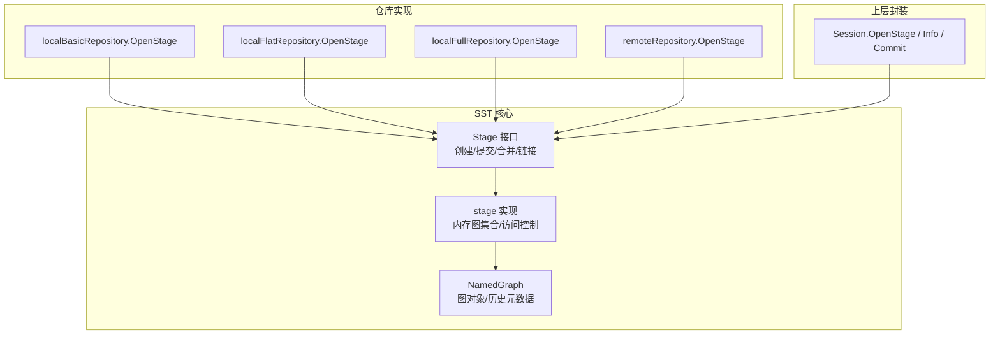
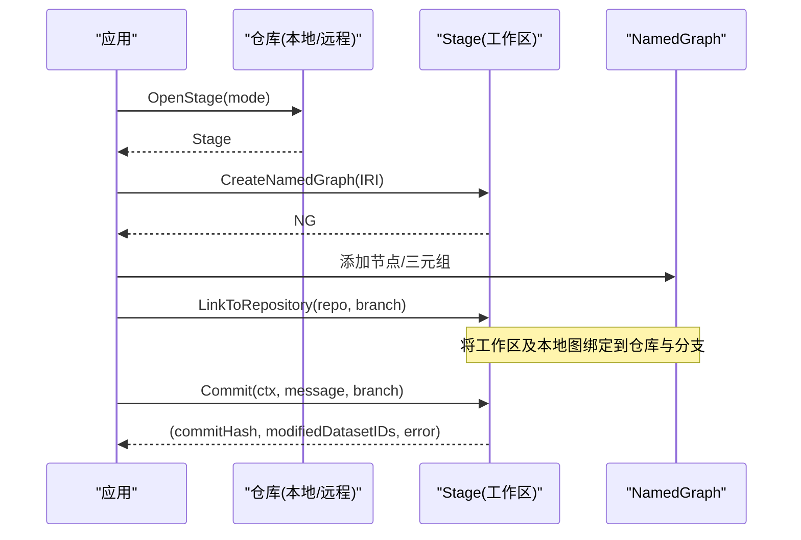
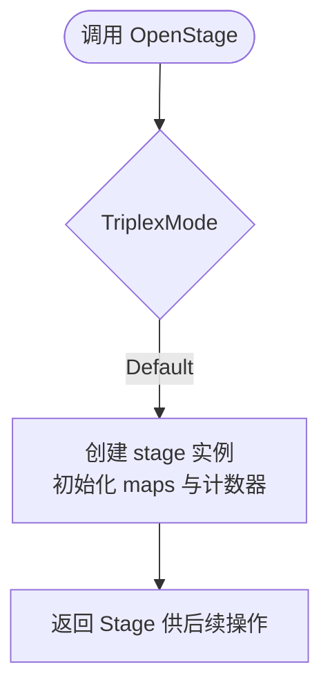
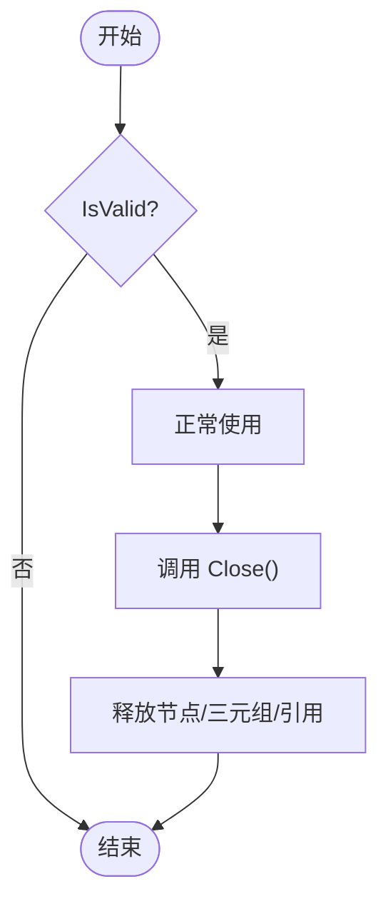
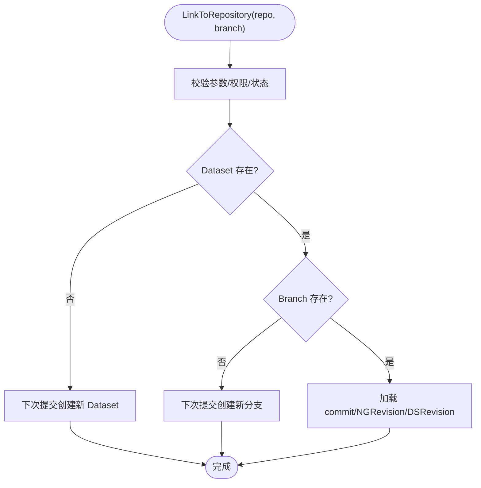
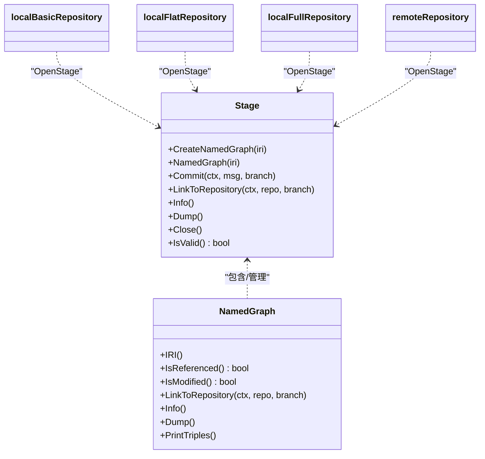

# 工作区操作

<cite>
**本文引用的文件**
- [stage.go](file://sst/stage.go)
- [namedgraph.go](file://sst/namedgraph.go)
- [repolocalbasic.go](file://sst/repolocalbasic.go)
- [repolocalflat.go](file://sst/repolocalflat.go)
- [repolocalfull.go](file://sst/repolocalfull.go)
- [reporemote.go](file://sst/reporemote.go)
- [session.go](file://mcp/cmd/session.go)
- [repolocalfullwithbleve.go](file://examples/helloworldrepolocalfullwithbleve/repolocalfullwithbleve.go)
</cite>

## 目录
1. [简介](#简介)
2. [项目结构](#项目结构)
3. [核心组件](#核心组件)
4. [架构总览](#架构总览)
5. [详细组件分析](#详细组件分析)
6. [依赖关系分析](#依赖关系分析)
7. [性能考虑](#性能考虑)
8. [故障排查指南](#故障排查指南)
9. [结论](#结论)
10. [附录：常见操作流程示例](#附录：常见操作流程示例)

## 简介
本文件面向使用 SST 进行数据版本管理的开发者，系统化说明“工作区（Stage）”的创建、打开、关闭与生命周期管理；解释 OpenStage 与 RepositoryOpenStage 的使用差异；阐述工作区与仓库的关联 LinkToRepository 的参数与分支管理；介绍工作区信息获取与调试输出；并提供可复用的典型操作流程示例。

## 项目结构
围绕工作区的核心代码主要位于 sst 包中：
- Stage 接口与实现：定义工作区的创建、提交、合并、链接、信息等能力
- NamedGraph：工作区内图对象，支持链接到仓库并维护历史
- 仓库实现：本地基础/扁平/完整仓库与远程仓库均提供 OpenStage 方法
- MCP Session：在会话层封装了 OpenStage、Info、Commit 等常用流程

图表来源
- [stage.go:74-234](file://sst/stage.go#L74-L234)
- [repolocalbasic.go:52-65](file://sst/repolocalbasic.go#L52-L65)
- [repolocalflat.go:54-61](file://sst/repolocalflat.go#L54-L61)
- [repolocalfull.go:244-257](file://sst/repolocalfull.go#L244-L257)
- [reporemote.go:126-139](file://sst/reporemote.go#L126-L139)
- [session.go:1024-1038](file://mcp/cmd/session.go#L1024-L1038)

章节来源
- [stage.go:74-234](file://sst/stage.go#L74-L234)
- [repolocalbasic.go:52-65](file://sst/repolocalbasic.go#L52-L65)
- [repolocalflat.go:54-61](file://sst/repolocalflat.go#L54-L61)
- [repolocalfull.go:244-257](file://sst/repolocalfull.go#L244-L257)
- [reporemote.go:126-139](file://sst/reporemote.go#L126-L139)
- [session.go:1024-1038](file://mcp/cmd/session.go#L1024-L1038)

## 核心组件
- Stage（工作区）
  - 职责：在工作区内创建/读取/修改 NamedGraph，提交变更到仓库，执行移动合并，链接到仓库，输出信息与调试
  - 关键方法：CreateNamedGraph、NamedGraph、ReferencedGraph、Commit、MoveAndMerge、LinkToRepository、Info、Dump、Close、IsValid
- NamedGraph（命名图）
  - 职责：承载 IBNode 与三元组，维护是否引用、是否修改、检出历史（commit/NGRevision/DSRevision）
  - 关键方法：IRI、IsReferenced、IsModified、Delete、Diff、FindCommonParentRevision、LinkToRepository、Info、Dump、PrintTriples
- 仓库实现
  - 本地基础/扁平/完整仓库与远程仓库均提供 OpenStage(mode)，返回一个未持久化的工作区实例
- MCP Session
  - 在会话层统一管理仓库、数据集与工作区别名，提供 OpenStage、Info、Commit 等便捷入口

章节来源
- [stage.go:74-234](file://sst/stage.go#L74-L234)
- [namedgraph.go:110-348](file://sst/namedgraph.go#L110-L348)
- [repolocalbasic.go:52-65](file://sst/repolocalbasic.go#L52-L65)
- [repolocalflat.go:54-61](file://sst/repolocalflat.go#L54-L61)
- [repolocalfull.go:244-257](file://sst/repolocalfull.go#L244-L257)
- [reporemote.go:126-139](file://sst/reporemote.go#L126-L139)
- [session.go:1024-1038](file://mcp/cmd/session.go#L1024-L1038)

## 架构总览
工作区是内存中的“暂存区”，用于编辑和组合多个 NamedGraph。它可与仓库关联以保留历史，也可作为临时工作区独立存在。

图表来源
- [repolocalbasic.go:52-65](file://sst/repolocalbasic.go#L52-L65)
- [repolocalflat.go:54-61](file://sst/repolocalflat.go#L54-L61)
- [repolocalfull.go:244-257](file://sst/repolocalfull.go#L244-L257)
- [reporemote.go:126-139](file://sst/reporemote.go#L126-L139)
- [stage.go:1381-1401](file://sst/stage.go#L1381-L1401)
- [namedgraph.go:435-503](file://sst/namedgraph.go#L435-L503)

## 详细组件分析

### 工作区创建与打开：OpenStage 与 RepositoryOpenStage
- OpenStage(mode)
  - 创建一个不关联任何仓库的临时工作区，适合纯内存编辑或后续 MoveAndMerge 到其他已链接的工作区
  - 内部初始化 localGraphs、referencedGraphs 与编号计数器
- RepositoryOpenStage(mode)
  - 各仓库实现（本地基础/扁平/完整、远程）均提供 OpenStage(mode) 方法，返回一个可立即使用的 Stage
  - 部分仓库实现在进入时进行资源锁定/检查，确保并发安全

图表来源
- [stage.go:1328-1334](file://sst/stage.go#L1328-L1334)
- [repolocalbasic.go:52-65](file://sst/repolocalbasic.go#L52-L65)
- [repolocalflat.go:54-61](file://sst/repolocalflat.go#L54-L61)
- [repolocalfull.go:244-257](file://sst/repolocalfull.go#L244-L257)
- [reporemote.go:126-139](file://sst/reporemote.go#L126-L139)

章节来源
- [stage.go:1328-1334](file://sst/stage.go#L1328-L1334)
- [repolocalbasic.go:52-65](file://sst/repolocalbasic.go#L52-L65)
- [repolocalflat.go:54-61](file://sst/repolocalflat.go#L54-L61)
- [repolocalfull.go:244-257](file://sst/repolocalfull.go#L244-L257)
- [reporemote.go:126-139](file://sst/reporemote.go#L126-L139)

### 工作区生命周期管理与内存释放
- 有效性判断
  - IsValid()：当工作区被删除或无效时返回 false；MoveAndMerge 等操作可能导致源工作区失效
  - assertAccess()：内部校验 localGraphs 是否为 nil，防止对已关闭/无效工作区继续操作
- 关闭与释放
  - Close()：遍历所有本地与引用图，清空节点引用、triplex 存储，并将 stage 引用置空；随后清空 maps 与 repo 引用，使内存可被垃圾回收
- 最佳实践
  - 使用 defer 确保 Close 被调用
  - 避免持有已失效 Stage 的引用

图表来源
- [stage.go:1529-1564](file://sst/stage.go#L1529-L1564)
- [stage.go:1318-1323](file://sst/stage.go#L1318-L1323)

章节来源
- [stage.go:1529-1564](file://sst/stage.go#L1529-L1564)
- [stage.go:1318-1323](file://sst/stage.go#L1318-L1323)

### 工作区验证状态检查与有效性判断
- 工作区级
  - IsValid()：判断 Stage 是否仍有效
  - assertAccess()：内部访问前校验，若失败则返回“阶段已删除或无效”错误
- 图级
  - NamedGraph.IsValid()：判断图及其所属工作区是否有效
  - IsReferenced()/IsEmpty()/IsModified()：描述图的引用状态、内容状态与修改状态
- 常见错误
  - ErrStageDeletedOrInvalid：对已关闭/无效工作区进行操作
  - ErrNamedGraphInvalid：对无效图进行操作

章节来源
- [stage.go:1529-1564](file://sst/stage.go#L1529-L1564)
- [stage.go:1318-1323](file://sst/stage.go#L1318-L1323)
- [namedgraph.go:129-145](file://sst/namedgraph.go#L129-L145)

### 工作区与仓库的关联：LinkToRepository 参数配置与分支管理
- 作用
  - 将工作区（以及其本地 NamedGraph）关联到指定仓库与分支，为后续 Commit 建立父历史
- 参数
  - ctx：上下文（用于查询仓库信息）
  - repo：目标仓库
  - branch：分支名（不能为空）
- 行为
  - 若仓库中不存在同名 Dataset：下次提交将创建新 Dataset（无父历史）
  - 若 Dataset 存在但分支不存在：下次提交将在该 Dataset 上创建新分支（无父历史）
  - 若 Dataset 与分支均存在：从分支头获取 commit/NGRevision/DSRevision 并写入图的历史元数据，以便后续提交延续历史
- 约束
  - 不允许对“引用型图”进行链接
  - 不允许对已删除的图进行链接
  - 若图已有检出历史（checkedOutCommits/Revisions），拒绝覆盖
  - 工作区若已绑定其他仓库，会报错

图表来源
- [namedgraph.go:435-503](file://sst/namedgraph.go#L435-L503)
- [stage.go:885-905](file://sst/stage.go#L885-L905)

章节来源
- [namedgraph.go:435-503](file://sst/namedgraph.go#L435-L503)
- [stage.go:885-905](file://sst/stage.go#L885-L905)

### 工作区信息获取与调试输出
- 信息
  - Stage.Info()：返回本地图数量、引用图数量、三元组总数等统计
  - NamedGraph.Info()：返回直接/间接导入图数量、三元组数量等
- 调试
  - Stage.Dump()：打印工作区信息及所有本地/引用图
  - NamedGraph.Dump()/PrintTriples()：打印图结构与三元组详情
- 上层封装
  - Session.Info(stageAlias)：结合会话元数据（仓库、分支、提交、修订）与 Stage.Info() 返回更丰富的信息

章节来源
- [stage.go:319-344](file://sst/stage.go#L319-L344)
- [stage.go:294-309](file://sst/stage.go#L294-L309)
- [namedgraph.go:304-320](file://sst/namedgraph.go#L304-L320)
- [session.go:1040-1055](file://mcp/cmd/session.go#L1040-L1055)

### 工作区提交与分支管理
- 提交
  - Stage.Commit(ctx, message, branch)：将工作区内的修改提交到仓库，返回提交哈希与受影响的 Dataset ID 列表
  - 提交成功后，会将本地图的 modified 标志复位
- 分支
  - 通过 LinkToRepository 指定分支，或在 Commit 时指定分支名以移动/创建分支指针
  - 若分支不存在，提交将创建新分支；若已存在，将以当前分支头为父提交

章节来源
- [stage.go:1381-1401](file://sst/stage.go#L1381-L1401)
- [namedgraph.go:435-503](file://sst/namedgraph.go#L435-L503)

## 依赖关系分析
- Stage 与 NamedGraph
  - Stage 管理本地与引用两类 NamedGraph，并在提交时根据修改标记计算受影响的数据集
- 仓库实现
  - 不同仓库实现统一暴露 OpenStage 接口，屏蔽底层差异
- 上层封装
  - Session 管理仓库、数据集与工作区别名，简化常用流程

图表来源
- [stage.go:74-234](file://sst/stage.go#L74-L234)
- [namedgraph.go:110-348](file://sst/namedgraph.go#L110-L348)
- [repolocalbasic.go:52-65](file://sst/repolocalbasic.go#L52-L65)
- [repolocalflat.go:54-61](file://sst/repolocalflat.go#L54-L61)
- [repolocalfull.go:244-257](file://sst/repolocalfull.go#L244-L257)
- [reporemote.go:126-139](file://sst/reporemote.go#L126-L139)

章节来源
- [stage.go:74-234](file://sst/stage.go#L74-L234)
- [namedgraph.go:110-348](file://sst/namedgraph.go#L110-L348)
- [repolocalbasic.go:52-65](file://sst/repolocalbasic.go#L52-L65)
- [repolocalflat.go:54-61](file://sst/repolocalflat.go#L54-L61)
- [repolocalfull.go:244-257](file://sst/repolocalfull.go#L244-L257)
- [reporemote.go:126-139](file://sst/reporemote.go#L126-L139)

## 性能考虑
- TriplexMode
  - DefaultTriplexMode 同时维护主体、谓词、客体三类三元索引，适合复杂查询但内存占用更高
- 内存释放
  - 及时调用 Close() 释放节点与三元组存储，避免长期持有大工作区导致内存压力
- 提交频率
  - 合理拆分提交粒度，减少单次提交的数据量与锁竞争
- 合并策略
  - MoveAndMerge 会在跨仓库场景设置 modified 标志，注意影响后续提交范围

[本节为通用指导，不直接分析具体文件]

## 故障排查指南
- 常见问题与定位
  - “阶段已删除或无效”：检查是否调用了 Close() 或对无效 Stage 继续操作
  - “分支名为空”：LinkToRepository 或 Commit 时需提供非空分支名
  - “图已被删除/不可链接”：引用型图或已删除图无法链接到仓库
  - “图已链接到仓库”：已有检出历史的图不可重复链接
  - “工作区与仓库不匹配”：工作区已绑定其他仓库时，不可再链接到新仓库
- 调试手段
  - 使用 Stage.Dump() 与 NamedGraph.Dump()/PrintTriples() 输出内部状态
  - 使用 Stage.Info() 与 NamedGraph.Info() 核对图数量与三元组计数
  - 在上层 Session 中使用 Info(stageAlias) 获取工作区元数据（仓库、分支、提交、修订）

章节来源
- [stage.go:1318-1323](file://sst/stage.go#L1318-L1323)
- [stage.go:1529-1564](file://sst/stage.go#L1529-L1564)
- [namedgraph.go:435-503](file://sst/namedgraph.go#L435-L503)
- [session.go:1040-1055](file://mcp/cmd/session.go#L1040-L1055)

## 结论
工作区（Stage）是 SST 的核心内存单元，负责数据的编辑、组合与提交。通过 OpenStage 快速创建，通过 LinkToRepository 与仓库及分支关联，通过 Commit 持久化并提交历史。配合 IsValid/Close 进行生命周期管理，利用 Info/Dump 进行调试与审计。遵循上述模式可获得稳定、可追溯且高性能的数据版本管理能力。

[本节为总结性内容，不直接分析具体文件]

## 附录：常见操作流程示例
以下示例展示典型工作区操作流程（创建、编辑、链接、提交、关闭）。为避免泄露实现细节，仅给出步骤与对应源码路径参考。

- 示例一：本地仓库创建工作区并提交
  - 步骤
    - 创建本地仓库
    - 打开工作区
    - 创建命名图并添加数据
    - 提交到默认分支
    - 关闭仓库
  - 参考路径
    - [repolocalfullwithbleve.go:44-66](file://examples/helloworldrepolocalfullwithbleve/repolocalfullwithbleve.go#L44-L66)

- 示例二：通过会话打开工作区并获取信息
  - 步骤
    - 通过 Session.OpenStage 打开工作区
    - 通过 Session.Info 获取工作区元数据
    - 提交后再次查看信息
  - 参考路径
    - [session.go:1024-1038](file://mcp/cmd/session.go#L1024-L1038)
    - [session.go:1040-1055](file://mcp/cmd/session.go#L1040-L1055)

- 示例三：将工作区与仓库分支关联
  - 步骤
    - 创建或打开工作区
    - 调用 LinkToRepository(repo, branch) 关联仓库与分支
    - 提交以延续历史
  - 参考路径
    - [namedgraph.go:435-503](file://sst/namedgraph.go#L435-L503)
    - [stage.go:885-905](file://sst/stage.go#L885-L905)

- 示例四：检查工作区有效性并释放内存
  - 步骤
    - 使用前检查 IsValid()
    - 使用后调用 Close() 释放内存
  - 参考路径
    - [stage.go:1529-1564](file://sst/stage.go#L1529-L1564)

章节来源
- [repolocalfullwithbleve.go:44-66](file://examples/helloworldrepolocalfullwithbleve/repolocalfullwithbleve.go#L44-L66)
- [session.go:1024-1038](file://mcp/cmd/session.go#L1024-L1038)
- [session.go:1040-1055](file://mcp/cmd/session.go#L1040-L1055)
- [namedgraph.go:435-503](file://sst/namedgraph.go#L435-L503)
- [stage.go:885-905](file://sst/stage.go#L885-L905)
- [stage.go:1529-1564](file://sst/stage.go#L1529-L1564)