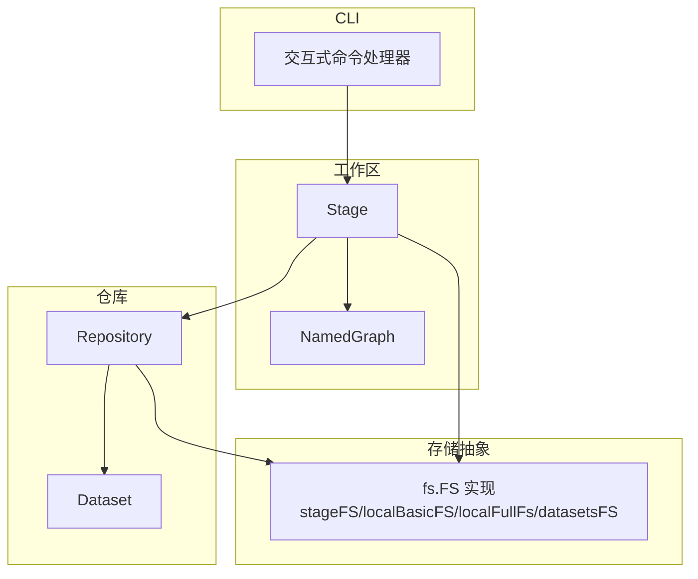
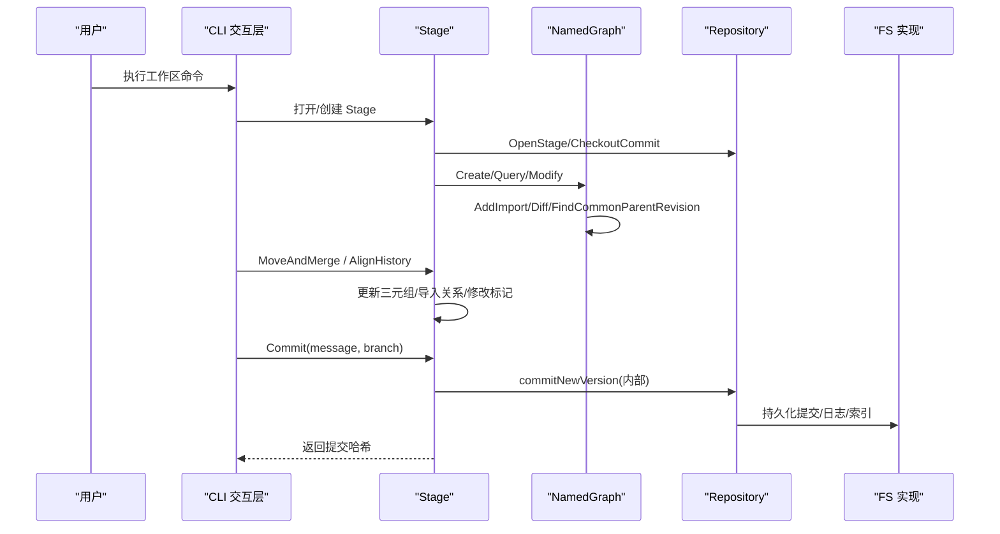
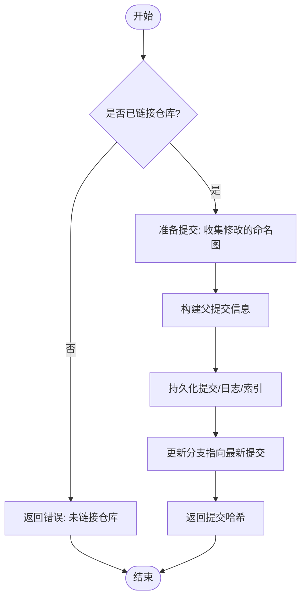
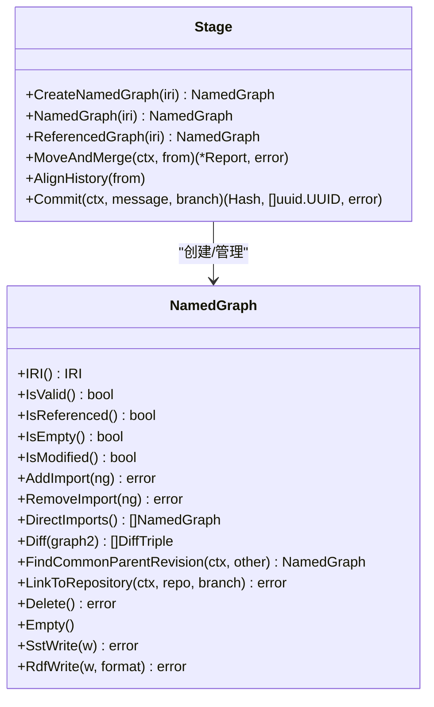
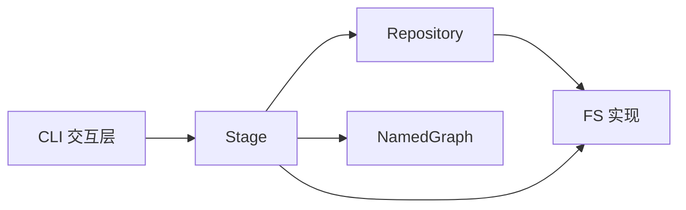

# 工作区管理

<cite>
**本文引用的文件**
- [stage.go](file://sst/stage.go)
- [namedgraph.go](file://sst/namedgraph.go)
- [repository.go](file://sst/repository.go)
- [commit.go](file://sst/commit.go)
- [stagefs.go](file://sst/stagefs.go)
- [stagefslocalbasic.go](file://sst/stagefslocalbasic.go)
- [stagefslocalfull.go](file://sst/stagefslocalfull.go)
- [stagefsdatasetsfs.go](file://sst/stagefsdatasetsfs.go)
- [stage_handler.go](file://cli/cmd/interactive/stage_handler.go)
</cite>

## 目录
1. [简介](#简介)
2. [项目结构](#项目结构)
3. [核心组件](#核心组件)
4. [架构总览](#架构总览)
5. [详细组件分析](#详细组件分析)
6. [依赖关系分析](#依赖关系分析)
7. [性能与批量操作建议](#性能与批量操作建议)
8. [故障排查指南](#故障排查指南)
9. [结论](#结论)
10. [附录：常见工作流示例](#附录常见工作流示例)

## 简介
本文件系统性阐述 SST 中的“工作区（Stage）”概念、命名图（NamedGraph）在工作区内的操作方法、提交与合并流程、事务性与回滚策略、冲突检测与解决、以及工作区与仓库的关系和数据同步机制。文档面向不同技术背景的读者，提供从高层到代码级的分层说明，并辅以图示和可操作的 CLI 命令路径，帮助快速上手与排障。

## 项目结构
SST 的工作区由以下关键模块构成：
- Stage（工作区）：内存中承载一个或多个 NamedGraph 的临时工作空间，支持创建、修改、查询、合并、提交等。
- NamedGraph（命名图）：RDF 命名图的内存表示，包含 IBNode、三元组、导入关系、版本元数据等。
- Repository（仓库）：持久化存储多个 Dataset（数据集），支持日志、查询、分支与修订历史。
- 文件系统抽象（FS）：将 BBolt/Bucket 或本地目录映射为 fs.FS，用于读写 SST 文件或阶段数据。
- CLI 交互层：提供交互式命令，封装 Stage/NamedGraph/Repository 的操作。

图表来源
- [stage.go:53-234](file://sst/stage.go#L53-L234)
- [namedgraph.go:42-108](file://sst/namedgraph.go#L42-L108)
- [repository.go:34-179](file://sst/repository.go#L34-L179)
- [stagefs.go:23-46](file://sst/stagefs.go#L23-L46)
- [stagefslocalbasic.go:21-30](file://sst/stagefslocalbasic.go#L21-L30)
- [stagefslocalfull.go:16-27](file://sst/stagefslocalfull.go#L16-L27)
- [stagefsdatasetsfs.go:22-30](file://sst/stagefsdatasetsfs.go#L22-L30)
- [stage_handler.go:19-146](file://cli/cmd/interactive/stage_handler.go#L19-L146)

章节来源
- [stage.go:53-234](file://sst/stage.go#L53-L234)
- [repository.go:34-179](file://sst/repository.go#L34-L179)
- [stagefs.go:23-46](file://sst/stagefs.go#L23-L46)
- [stage_handler.go:19-146](file://cli/cmd/interactive/stage_handler.go#L19-L146)

## 核心组件
- Stage（工作区）
  - 职责：在内存中维护一组本地 NamedGraph 与引用型 NamedGraph；提供创建、查询、遍历、移动合并、对齐历史、写入 SST/TriG、提交到仓库等操作。
  - 关键能力：MoveAndMerge（跨工作区/仓库的数据迁移与合并）、AlignHistory（复制 checkout 元数据）、Commit（生成新提交）。
- NamedGraph（命名图）
  - 职责：RDF 命名图的内存模型，管理节点（IRI/Blank Node）、三元组、导入关系、变更标记、检出元数据（checkedOutCommits/NGRevisions/DSRevisions）。
  - 关键能力：AddImport/RemoveImport、Diff、FindCommonParentRevision、LinkToRepository、Delete/Empty、SstWrite/RdfWrite。
- Repository（仓库）
  - 职责：持久化存储 Dataset，提供 OpenStage、CheckoutCommit、Log、SyncFrom、索引管理等。
  - 关键能力：OpenLocal/Remote、CreateLocal、RegisterIndexHandler、Bleve、Info、Log。
- 文件系统抽象
  - stageFS：以 BBolt Bucket 作为“阶段文件系统”，按 UUID 键存取命名图内容。
  - localBasicFS/localFullFs：分别对应基础/完整本地仓库的命名图访问方式。
  - datasetsFS：将数据集集合暴露为只读目录视图。

章节来源
- [stage.go:53-234](file://sst/stage.go#L53-L234)
- [namedgraph.go:42-108](file://sst/namedgraph.go#L42-L108)
- [repository.go:34-179](file://sst/repository.go#L34-L179)
- [stagefs.go:23-46](file://sst/stagefs.go#L23-L46)
- [stagefslocalbasic.go:21-30](file://sst/stagefslocalbasic.go#L21-L30)
- [stagefslocalfull.go:16-27](file://sst/stagefslocalfull.go#L16-L27)
- [stagefsdatasetsfs.go:22-30](file://sst/stagefsdatasetsfs.go#L22-L30)

## 架构总览
下图展示了工作区与仓库、命名图、文件系统之间的交互关系，以及 CLI 如何驱动这些操作。

图表来源
- [stage.go:121-177](file://sst/stage.go#L121-L177)
- [namedgraph.go:222-265](file://sst/namedgraph.go#L222-L265)
- [repository.go:60-89](file://sst/repository.go#L60-L89)
- [stage_handler.go:374-427](file://cli/cmd/interactive/stage_handler.go#L374-L427)

## 详细组件分析

### Stage（工作区）
- 生命周期与状态
  - 通过 Repository.OpenStage 或 CheckoutCommit 创建/加载。
  - 可链接到仓库（LinkToRepository），也可保持为临时工作区。
  - 支持 Dump/Info 进行调试与信息统计。
- 命名图管理
  - CreateNamedGraph 创建本地命名图。
  - NamedGraph/ReferencedGraph 获取本地或引用型命名图。
  - ForNamedGraphs/ForReferencedNamedGraphs 遍历回调。
- 合并与对齐
  - MoveAndMerge：将源 Stage 的命名图移动到目标 Stage，自动处理引用/本地、跨仓库、三方合并等场景，并输出详细报告。
  - AlignHistory：将从 Stage 的仓库指针与 checkout 元数据复制到目标 Stage，便于后续提交保持一致的历史上下文。
- 提交
  - Commit(ctx, message, branch)：将工作区的修改持久化为仓库提交，并为每个修改的命名图创建新的命名图修订，同时更新数据集修订与分支指针。

图表来源
- [stage.go:121-177](file://sst/stage.go#L121-L177)
- [commit.go:18-29](file://sst/commit.go#L18-L29)

章节来源
- [stage.go:53-234](file://sst/stage.go#L53-L234)
- [stage.go:468-800](file://sst/stage.go#L468-L800)
- [commit.go:18-29](file://sst/commit.go#L18-L29)

### NamedGraph（命名图）
- 结构与状态
  - 包含字符串节点、UUID 节点、三元组存储、导入关系、修改标记、检出元数据（checkedOutCommits/NGRevisions/DSRevisions）。
  - 引用型命名图仅保存被其他命名图引用的节点，不可直接修改或提交。
- 操作能力
  - 创建节点：CreateIRINode/CreateBlankNode/CreateCollection。
  - 导入管理：AddImport/RemoveImport/DirectImports。
  - 差异比较：Diff 返回 import 级别与三元组级别的差异。
  - 共同祖先查找：FindCommonParentRevision 用于三方合并。
  - 链接仓库：LinkToRepository 将命名图与仓库分支关联，以便提交时继承历史。
  - 删除/清空：Delete/Empty。
  - 序列化：SstWrite/RdfWrite。

图表来源
- [namedgraph.go:42-108](file://sst/namedgraph.go#L42-L108)
- [namedgraph.go:117-350](file://sst/namedgraph.go#L117-L350)
- [stage.go:74-177](file://sst/stage.go#L74-L177)

章节来源
- [namedgraph.go:42-108](file://sst/namedgraph.go#L42-L108)
- [namedgraph.go:117-350](file://sst/namedgraph.go#L117-L350)
- [namedgraph.go:415-503](file://sst/namedgraph.go#L415-L503)
- [namedgraph.go:572-622](file://sst/namedgraph.go#L572-L622)

### 仓库（Repository）与数据集（Dataset）
- 仓库类型
  - 远程仓库：基于 gRPC 连接，支持日志、查询、修订历史。
  - 本地完整仓库：BBolt + Bleve，支持分支与修订历史。
  - 本地基础仓库：BBolt + Bleve，无修订历史。
  - 本地扁平仓库：纯文件目录，无事务与历史。
- 关键接口
  - OpenStage/CheckoutCommit：创建工作区或加载特定提交。
  - Log/Info：查看日志与仓库信息。
  - SyncFrom：从其他仓库同步提交。
  - RegisterIndexHandler/RebuildBleveIndex：索引管理与重建。

章节来源
- [repository.go:34-179](file://sst/repository.go#L34-L179)
- [repository.go:240-309](file://sst/repository.go#L240-L309)
- [repository.go:311-423](file://sst/repository.go#L311-L423)
- [repository.go:465-562](file://sst/repository.go#L465-L562)
- [repository.go:564-694](file://sst/repository.go#L564-L694)

### 文件系统抽象（FS）
- stageFS：将 BBolt Bucket 映射为 fs.FS，支持读取/写入命名图文件，使用 SHA256 去重存储。
- localBasicFS/localFullFs：分别适配基础/完整本地仓库的命名图访问模式。
- datasetsFS：将数据集集合暴露为只读目录视图。

章节来源
- [stagefs.go:23-169](file://sst/stagefs.go#L23-L169)
- [stagefslocalbasic.go:21-126](file://sst/stagefslocalbasic.go#L21-L126)
- [stagefslocalfull.go:16-129](file://sst/stagefslocalfull.go#L16-L129)
- [stagefsdatasetsfs.go:22-85](file://sst/stagefsdatasetsfs.go#L22-L85)

### CLI 交互层（工作区命令）
- 列出命名图/引用命名图
- 解析命名图别名
- 移动合并（moveandmerge）
- 对齐历史（alignhistory）
- 导出 TriG/SST 文件
- 提交（commit）
- 验证（validate）

章节来源
- [stage_handler.go:19-146](file://cli/cmd/interactive/stage_handler.go#L19-L146)
- [stage_handler.go:186-306](file://cli/cmd/interactive/stage_handler.go#L186-L306)
- [stage_handler.go:374-427](file://cli/cmd/interactive/stage_handler.go#L374-L427)
- [stage_handler.go:429-486](file://cli/cmd/interactive/stage_handler.go#L429-L486)

## 依赖关系分析
- Stage 依赖 Repository 以加载/提交数据；依赖 FS 以读写 SST 文件。
- NamedGraph 依赖 Stage 以获取上下文与提交元数据；依赖导入关系与三元组存储。
- Repository 依赖 FS 以持久化提交、日志与索引。
- CLI 依赖 Stage/Repository 以驱动用户操作。

图表来源
- [stage.go:53-234](file://sst/stage.go#L53-L234)
- [repository.go:34-179](file://sst/repository.go#L34-L179)
- [stage_handler.go:19-146](file://cli/cmd/interactive/stage_handler.go#L19-L146)

章节来源
- [stage.go:53-234](file://sst/stage.go#L53-L234)
- [repository.go:34-179](file://sst/repository.go#L34-L179)
- [stage_handler.go:19-146](file://cli/cmd/interactive/stage_handler.go#L19-L146)

## 性能与批量操作建议
- 批量添加三元组
  - 优先在同一命名图中集中创建节点与三元组，减少多次分配与索引更新。
  - 使用 TermCollection 批量表达列表结构，降低重复开销。
- 合并优化
  - MoveAndMerge 会记录详细动作报告，建议在大规模合并前评估报告中的统计项，避免不必要的三方合并。
  - 对于相同修订的命名图，系统会跳过合并仅更新三元组，提升效率。
- 提交批量化
  - 将多个命名图的修改集中在一次 Commit 中，减少多次持久化与索引重建成本。
- 索引与查询
  - 合理使用 RegisterIndexHandler，避免频繁重建索引；必要时调用 RebuildBleveIndex。
- 内存与三元组模式
  - 根据应用需求选择合适的 TriplexMode（当前默认使用全部三种三元组），平衡内存与遍历性能。

[本节为通用指导，不直接分析具体文件]

## 故障排查指南
- 常见错误
  - 未链接仓库：尝试提交时若 Stage 未链接仓库，将返回错误。
  - 命名图不存在：查询或操作不存在的命名图将返回错误。
  - 空分支名：LinkToRepository 要求非空分支名。
  - 已链接命名图：对已有检出历史的命名图再次 LinkToRepository 会报错。
  - 无法删除引用型命名图：引用型命名图不能直接删除。
- 排查步骤
  - 检查 Stage.IsValid 与 Repository() 是否为 nil。
  - 使用 Info/Dump 打印工作区与命名图统计信息。
  - 使用 Diff 对比两个命名图，定位差异。
  - 使用 FindCommonParentRevision 确认共同祖先是否存在。
  - 查看 CLI 输出的错误提示与日志级别。

章节来源
- [stage.go:21-31](file://sst/stage.go#L21-L31)
- [namedgraph.go:20-40](file://sst/namedgraph.go#L20-L40)
- [namedgraph.go:415-503](file://sst/namedgraph.go#L415-L503)
- [stage_handler.go:374-427](file://cli/cmd/interactive/stage_handler.go#L374-L427)

## 结论
SST 的工作区（Stage）提供了强大的 RDF 数据管理能力，结合命名图（NamedGraph）的灵活操作与仓库（Repository）的版本控制，实现了高效的数据编辑、合并与提交。通过文件系统抽象，SST 在不同存储后端上保持一致的 API。CLI 交互层简化了常用工作流，便于快速上手。遵循本文的最佳实践与故障排查建议，可有效提升开发效率与系统稳定性。

[本节为总结性内容，不直接分析具体文件]

## 附录：常见工作流示例
以下为典型工作流的 CLI 命令路径与说明（不展示代码内容，仅提供命令入口）：

- 创建工作区并列出命名图
  - 命令：list named graphs
  - 入口：handleListNamedGraphs
  - 参考：[stage_handler.go:19-35](file://cli/cmd/interactive/stage_handler.go#L19-L35)

- 列出引用型命名图
  - 命令：list referenced named graphs
  - 入口：handleListReferencedNamedGraphs
  - 参考：[stage_handler.go:37-53](file://cli/cmd/interactive/stage_handler.go#L37-L53)

- 解析命名图别名
  - 命令：namedgraph <iri> [-a <alias>]
  - 入口：handleNamedGraph
  - 参考：[stage_handler.go:55-97](file://cli/cmd/interactive/stage_handler.go#L55-L97)

- 移动合并（跨工作区/仓库）
  - 命令：<target-stage>.moveandmerge <source-stage>
  - 入口：handleMoveAndMerge
  - 参考：[stage_handler.go:99-146](file://cli/cmd/interactive/stage_handler.go#L99-L146)

- 对齐历史（复制 checkout 元数据）
  - 命令：<to-stage>.alignhistory <from-stage>
  - 入口：handleAlignHistory
  - 参考：[stage_handler.go:148-184](file://cli/cmd/interactive/stage_handler.go#L148-L184)

- 导出 TriG
  - 命令：<stage>.rdfwrite <output-file>
  - 入口：handleStageRdfWrite
  - 参考：[stage_handler.go:186-241](file://cli/cmd/interactive/stage_handler.go#L186-L241)

- 导出 SST 文件目录
  - 命令：<stage>.writesstfilesdirectory <directory>
  - 入口：handleWriteSstFilesDirectory
  - 参考：[stage_handler.go:243-306](file://cli/cmd/interactive/stage_handler.go#L243-L306)

- 提交
  - 命令：<stage>.commit "<message>" [branch]
  - 入口：handleStageCommit
  - 参考：[stage_handler.go:374-427](file://cli/cmd/interactive/stage_handler.go#L374-L427)

- 验证
  - 命令：<stage>.validate [-o <file>]
  - 入口：handleStageValidate
  - 参考：[stage_handler.go:429-486](file://cli/cmd/interactive/stage_handler.go#L429-L486)

章节来源
- [stage_handler.go:19-486](file://cli/cmd/interactive/stage_handler.go#L19-L486)