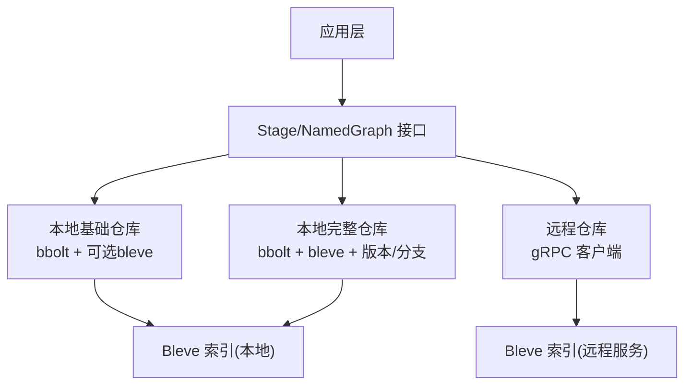
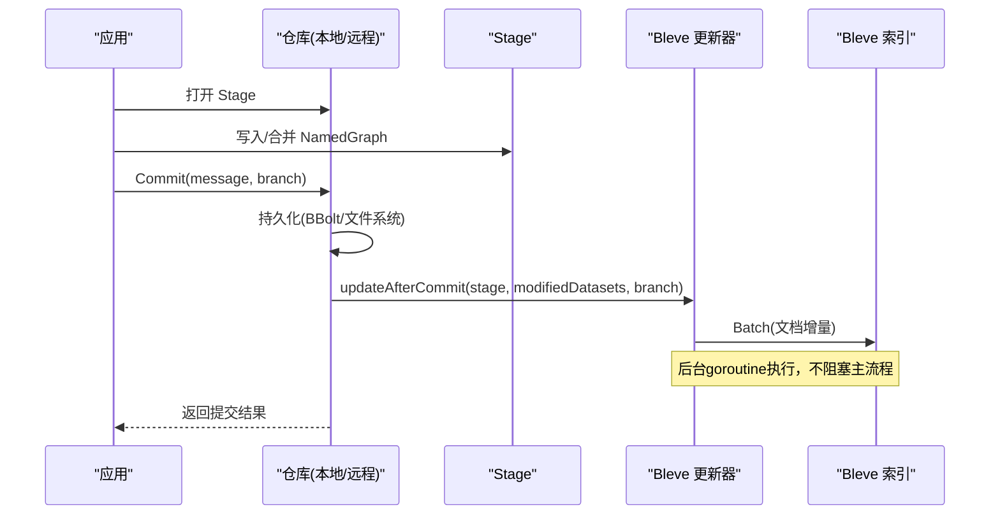
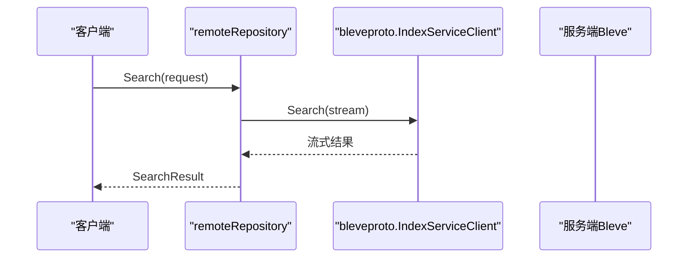
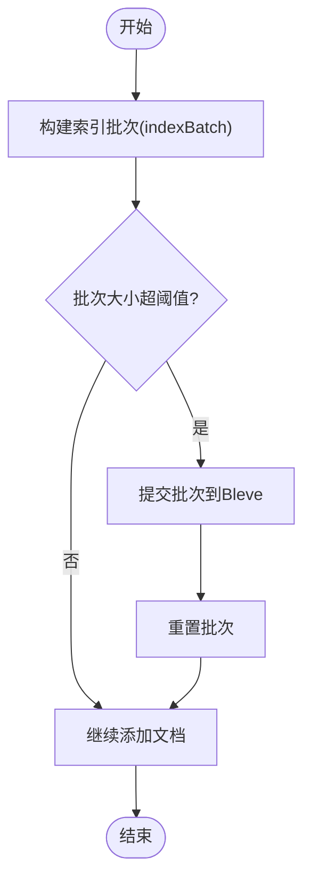
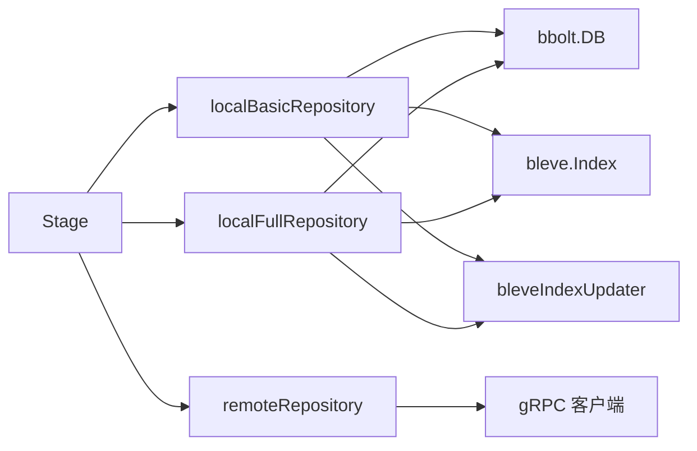

# 性能优化

<cite>
**本文引用的文件**
- [repolocalbasic.go](file://sst/repolocalbasic.go)
- [repolocalflat.go](file://sst/repolocalflat.go)
- [repolocalfull.go](file://sst/repolocalfull.go)
- [reporemote.go](file://sst/reporemote.go)
- [stage.go](file://sst/stage.go)
- [indexupdate.go](file://sst/indexupdate.go)
- [hash_base58_benchmark_test.go](file://sst/hash_base58_benchmark_test.go)
</cite>

## 目录
1. [简介](#简介)
2. [项目结构](#项目结构)
3. [核心组件](#核心组件)
4. [架构总览](#架构总览)
5. [详细组件分析](#详细组件分析)
6. [依赖关系分析](#依赖关系分析)
7. [性能考量](#性能考量)
8. [故障排查指南](#故障排查指南)
9. [结论](#结论)
10. [附录](#附录)

## 简介
本文件聚焦于 SST Core 的性能优化，覆盖以下主题：
- 不同存储后端（本地基础、本地完整、远程）的性能特点与适用场景
- 三元组模式（TriplexMode）对性能与内存的影响
- 批量操作的最佳实践与优化技巧
- 索引策略与查询优化方法
- 内存管理与垃圾回收建议
- 性能监控与瓶颈分析方法
- 实际性能测试与优化案例

## 项目结构
SST Core 提供多种仓库实现与统一的 Stage/NamedGraph 抽象，并通过 Bleve 索引增强检索能力。关键路径：
- 本地基础仓库：基于 bbolt + 可选 bleve 索引，适合轻量级、低内存占用场景
- 本地完整仓库：基于 bbolt + bleve 索引，支持版本历史、分支、提交等高级特性
- 远程仓库：通过 gRPC 访问服务端，客户端仅持有连接与缓存
- 索引更新：异步队列 + 健康感知代理，避免阻塞主流程

图表来源
- [repolocalbasic.go:34-42](file://sst/repolocalbasic.go#L34-L42)
- [repolocalfull.go:220-230](file://sst/repolocalfull.go#L220-L230)
- [reporemote.go:88-99](file://sst/reporemote.go#L88-L99)
- [indexupdate.go:77-98](file://sst/indexupdate.go#L77-L98)

章节来源
- [repolocalbasic.go:34-42](file://sst/repolocalbasic.go#L34-L42)
- [repolocalflat.go:28-32](file://sst/repolocalflat.go#L28-L32)
- [repolocalfull.go:220-230](file://sst/repolocalfull.go#L220-L230)
- [reporemote.go:88-99](file://sst/reporemote.go#L88-L99)

## 核心组件
- 仓库实现
  - 本地基础仓库：使用 bbolt 持久化数据集，可选 bleve 全文索引；关闭时按序释放资源
  - 本地完整仓库：在基础之上增加版本、分支、提交元数据，支持 checkout 到指定提交
  - 远程仓库：封装 gRPC 客户端，统一认证与分页，搜索通过远程 Bleve 服务完成
- 阶段与图
  - Stage 管理 NamedGraph 的内存视图，支持 MoveAndMerge、Commit、导出 RDF 等
  - TriplexMode 控制内部三元组结构的创建粒度，影响内存与遍历性能
- 索引更新
  - 异步默认更新器：后台 goroutine 处理 Bleve Batch，避免阻塞写入
  - 健康感知代理：记录错误/成功，重试可恢复错误，保障搜索可用性

章节来源
- [stage.go:33-51](file://sst/stage.go#L33-L51)
- [indexupdate.go:77-98](file://sst/indexupdate.go#L77-L98)
- [repolocalbasic.go:418-442](file://sst/repolocalbasic.go#L418-L442)
- [repolocalfull.go:734-761](file://sst/repolocalfull.go#L734-L761)
- [reporemote.go:655-670](file://sst/reporemote.go#L655-L670)

## 架构总览
下图展示了写路径中“提交后索引更新”的异步流水线，以及读路径中的远程搜索流程。

图表来源
- [indexupdate.go:160-249](file://sst/indexupdate.go#L160-L249)
- [repolocalbasic.go:616-653](file://sst/repolocalbasic.go#L616-L653)
- [repolocalfull.go:734-761](file://sst/repolocalfull.go#L734-L761)

图表来源
- [reporemote.go:146-207](file://sst/reporemote.go#L146-L207)

## 详细组件分析

### 存储后端对比与适用场景
- 本地基础仓库（localBasicRepository）
  - 特点：bbolt 存储数据集；可选 bleve 索引；无版本/分支；关闭时先关闭更新器再关闭索引与数据库
  - 适用：小规模数据、简单读写、内存敏感、无需历史回溯
  - 性能要点：索引重建与预提交条件检查在注册索引时设置；Info 统计包含 BBolt DB 大小与 Bleve 索引大小
- 本地完整仓库（localFullRepository）
  - 特点：bbolt 存储 + bleve 索引；支持 commit/dataset revision/named graph revision；分支与叶子提交；checkout 到任意提交
  - 适用：需要版本控制、多分支协作、审计追踪
  - 性能要点：构建索引时删除旧目录并重建；提交后异步更新索引；支持 RebuildBleveIndex
- 远程仓库（remoteRepository）
  - 特点：gRPC 客户端；列表/获取数据集分页；搜索走远程 Bleve；认证通过上下文注入 token
  - 适用：集中式存储、跨进程/跨机器共享、客户端轻量化
  - 性能要点：Search 使用流式调用；请求消息缓存减少重复编码；关闭时等待所有阶段退出并关闭连接

章节来源
- [repolocalbasic.go:67-222](file://sst/repolocalbasic.go#L67-L222)
- [repolocalbasic.go:616-653](file://sst/repolocalbasic.go#L616-L653)
- [repolocalbasic.go:660-723](file://sst/repolocalbasic.go#L660-L723)
- [repolocalfull.go:259-426](file://sst/repolocalfull.go#L259-L426)
- [repolocalfull.go:721-761](file://sst/repolocalfull.go#L721-L761)
- [reporemote.go:146-207](file://sst/reporemote.go#L146-L207)
- [reporemote.go:287-468](file://sst/reporemote.go#L287-L468)
- [reporemote.go:655-670](file://sst/reporemote.go#L655-L670)

### 三元组模式（TriplexMode）对性能与内存的影响
- 定义与作用
  - DefaultTriplexMode 为当前唯一可用模式，会在内部同时维护 subject/predicate/object 三种三元组视图
  - 注释说明：仅 subject 最省内存；subject+object 适合双向遍历；三者全开适合大量子属性与应用特定个体
- 性能影响
  - 内存：三视图会显著增加内存占用，但提升多方向遍历与查询效率
  - 写入：新增三元组时需同步维护多个索引结构
  - 读取：复杂查询可减少多次扫描，提高吞吐
- 实践建议
  - 若仅需单向遍历或内存受限，未来可考虑只启用 subject 视图
  - 当前版本固定为 DefaultTriplexMode，需评估数据规模与查询模式

章节来源
- [stage.go:33-51](file://sst/stage.go#L33-L51)

### 批量操作最佳实践与优化技巧
- 索引批量写入
  - 使用 indexBatch 累积文档，超过阈值（maxBatchDocSize）自动 flush，降低系统调用次数
  - 提交后统一提交 batch，并在成功后执行预条件约束检查
- 预提交条件
  - 在 RegisterIndexHandler 中设置 preCommitCondition，确保唯一性等约束在提交前校验
- 异步更新
  - defaultBleveIndexUpdater 使用 channel + goroutine 队列，避免阻塞主线程
  - flush/close 保证优雅退出与任务排空
- 远程搜索
  - 使用流式 Search 接口，减少单次响应体积；必要时复用 PreparedMsg 以减少编码开销

图表来源
- [indexupdate.go:424-434](file://sst/indexupdate.go#L424-L434)
- [indexupdate.go:160-249](file://sst/indexupdate.go#L160-L249)

章节来源
- [indexupdate.go:77-98](file://sst/indexupdate.go#L77-L98)
- [indexupdate.go:160-249](file://sst/indexupdate.go#L160-L249)
- [indexupdate.go:424-434](file://sst/indexupdate.go#L424-L434)
- [reporemote.go:146-207](file://sst/reporemote.go#L146-L207)

### 索引策略与查询优化
- 索引重建
  - 当 deriveInfo 变化或目录不存在/损坏时，删除旧索引并重建，确保一致性
- 健康感知
  - healthAwareIndex 包装底层索引，记录错误/成功，对可恢复错误进行短暂休眠重试
- 预条件检查
  - 提交后根据配置查询冲突项，失败则拒绝提交，保证数据完整性
- 远程搜索
  - 通过 bleveproto 将搜索请求序列化并流式传输，结合 OAuth 认证

章节来源
- [repolocalbasic.go:67-222](file://sst/repolocalbasic.go#L67-L222)
- [repolocalfull.go:259-426](file://sst/repolocalfull.go#L259-L426)
- [indexupdate.go:504-573](file://sst/indexupdate.go#L504-L573)
- [indexupdate.go:650-735](file://sst/indexupdate.go#L650-L735)
- [reporemote.go:146-207](file://sst/reporemote.go#L146-L207)

### 内存管理与垃圾回收建议
- 阶段生命周期
  - Stage.Close 使内存可被 GC 回收；MoveAndMerge 会使源 Stage 失效，应及时释放引用
- 仓库关闭顺序
  - 先关闭索引更新器，再关闭索引与数据库，确保后台任务排空
- 资源清理
  - 远程仓库关闭时等待所有 in-flight stage 退出，再关闭 gRPC 连接
- 批处理内存
  - 控制 indexBatch 大小，避免单批次过大导致峰值内存飙升

章节来源
- [stage.go:174-177](file://sst/stage.go#L174-L177)
- [repolocalbasic.go:418-442](file://sst/repolocalbasic.go#L418-L442)
- [repolocalfull.go:734-761](file://sst/repolocalfull.go#L734-L761)
- [reporemote.go:655-670](file://sst/reporemote.go#L655-L670)
- [indexupdate.go:424-434](file://sst/indexupdate.go#L424-L434)

### 性能监控与瓶颈分析
- 指标采集
  - 仓库 Info 提供 BBolt DB 大小、Bleve 索引大小、数据集数量等
  - 健康状态：healthAwareIndex 记录错误计数与最近成功时间
- 日志与诊断
  - 全局日志记录索引重建、错误、警告信息
  - 远程搜索日志包含 repoName、请求/响应耗时标记点（便于埋点）
- 基准测试
  - Base58 编解码基准，用于评估哈希/ID 转换热点

章节来源
- [repolocalbasic.go:660-723](file://sst/repolocalbasic.go#L660-L723)
- [indexupdate.go:650-735](file://sst/indexupdate.go#L650-L735)
- [reporemote.go:146-207](file://sst/reporemote.go#L146-L207)
- [hash_base58_benchmark_test.go:39-67](file://sst/hash_base58_benchmark_test.go#L39-L67)

### 实际性能测试与优化案例
- 基准测试
  - Base58 编解码：通过 go test -bench 运行，观察 mr-tron/base58 包性能
- 索引重建
  - 当 deriveInfo 变更时触发重建，注意重建期间搜索不可用
- 异步更新
  - 提交后批量更新索引，避免阻塞；可通过 FlushBleveIndex 在测试中等待队列清空
- 远程搜索
  - 使用流式接口减少内存占用；合理设置分页大小

章节来源
- [hash_base58_benchmark_test.go:39-67](file://sst/hash_base58_benchmark_test.go#L39-L67)
- [indexupdate.go:633-648](file://sst/indexupdate.go#L633-L648)
- [repolocalbasic.go:67-222](file://sst/repolocalbasic.go#L67-L222)
- [reporemote.go:146-207](file://sst/reporemote.go#L146-L207)

## 依赖关系分析
- 组件耦合
  - Stage 与 Repository 解耦，通过接口交互；具体实现可选择本地或远程
  - 索引更新器与仓库实现松耦合，通过回调与队列传递任务
- 外部依赖
  - bbolt：本地键值存储
  - bleve：全文检索
  - gRPC：远程通信
- 潜在循环依赖
  - 通过接口与回调避免直接循环；例如 preCommitCondition 回调在注册时绑定

图表来源
- [repolocalbasic.go:34-42](file://sst/repolocalbasic.go#L34-L42)
- [repolocalfull.go:220-230](file://sst/repolocalfull.go#L220-L230)
- [reporemote.go:88-99](file://sst/reporemote.go#L88-L99)
- [indexupdate.go:77-98](file://sst/indexupdate.go#L77-L98)

章节来源
- [repolocalbasic.go:34-42](file://sst/repolocalbasic.go#L34-L42)
- [repolocalfull.go:220-230](file://sst/repolocalfull.go#L220-L230)
- [reporemote.go:88-99](file://sst/reporemote.go#L88-L99)
- [indexupdate.go:77-98](file://sst/indexupdate.go#L77-L98)

## 性能考量
- 选择合适存储后端
  - 本地基础：低内存、简单场景
  - 本地完整：需要版本/分支/审计
  - 远程：分布式部署、客户端轻量化
- 控制三元组视图
  - 当前固定为 DefaultTriplexMode，需权衡内存与查询复杂度
- 批量与异步
  - 使用 indexBatch 控制批次大小；利用异步更新器避免阻塞
- 索引健康
  - 关注 healthAwareIndex 的错误计数与重试行为
- 远程网络
  - 合理使用分页与流式接口，减少带宽与内存压力

[本节为通用指导，不直接分析具体文件]

## 故障排查指南
- 常见问题
  - 索引不可用：检查 healthAwareIndex 的健康状态与错误计数
  - 提交失败：查看预提交条件是否满足（唯一性等）
  - 远程搜索超时：检查 gRPC 连接与认证 token
- 定位步骤
  - 查看仓库 Info 统计，确认 BBolt/Bleve 大小与数据集数量
  - 使用 FlushBleveIndex 等待索引更新完成后再验证
  - 检查日志中的错误堆栈与警告信息

章节来源
- [indexupdate.go:650-735](file://sst/indexupdate.go#L650-L735)
- [repolocalbasic.go:660-723](file://sst/repolocalbasic.go#L660-L723)
- [reporemote.go:146-207](file://sst/reporemote.go#L146-L207)

## 结论
- 本地基础仓库适合轻量场景；本地完整仓库提供完整版本控制能力；远程仓库支持分布式部署
- TriplexMode 影响内存与查询性能，当前默认开启三视图以优化典型应用
- 批量与异步机制显著提升吞吐，配合健康感知与预条件检查保障稳定性
- 通过 Info、日志与基准测试可有效监控与优化性能

[本节为总结，不直接分析具体文件]

## 附录
- 术语
  - Stage：内存中的图集合视图，支持修改与提交
  - NamedGraph：命名图，包含 IBNode 与三元组
  - TriplexMode：三元组视图模式，影响内存与遍历性能
  - Bleve：全文检索引擎
  - BBolt：嵌入式键值存储
- 参考路径
  - 索引更新：见 indexupdate.go
  - 仓库实现：见 repolocalbasic.go / repolocalfull.go / reporemote.go
  - 阶段与模式：见 stage.go

[本节为补充信息，不直接分析具体文件]