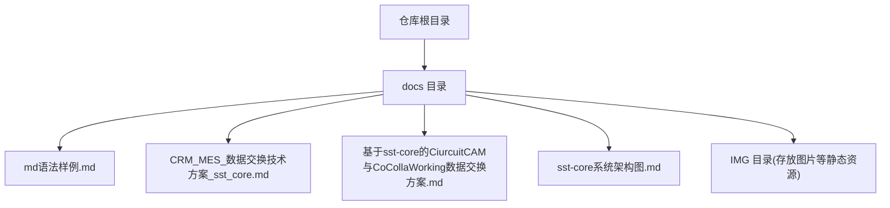
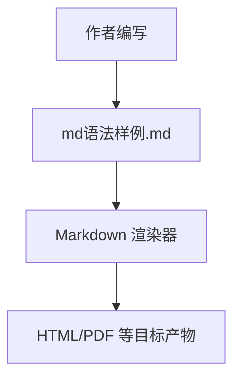
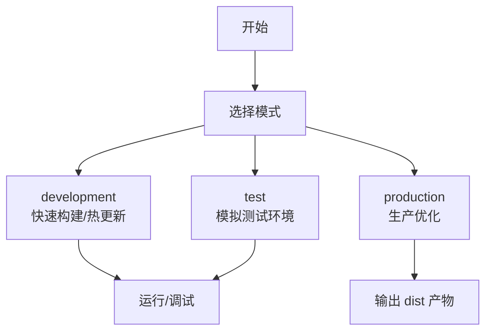
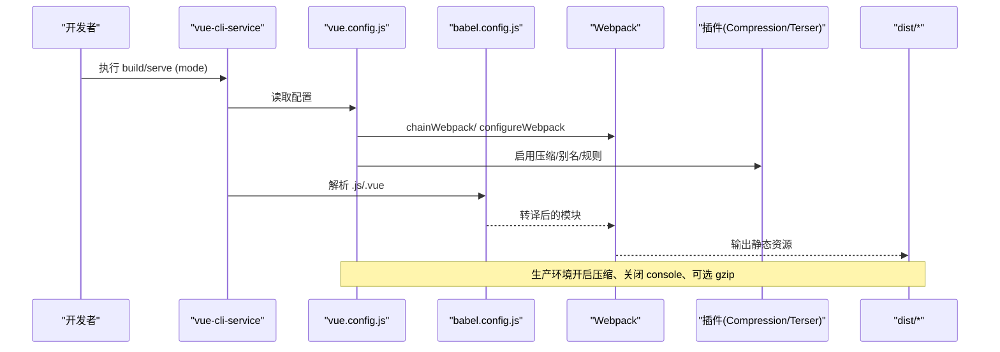
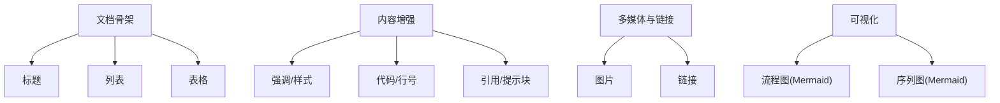
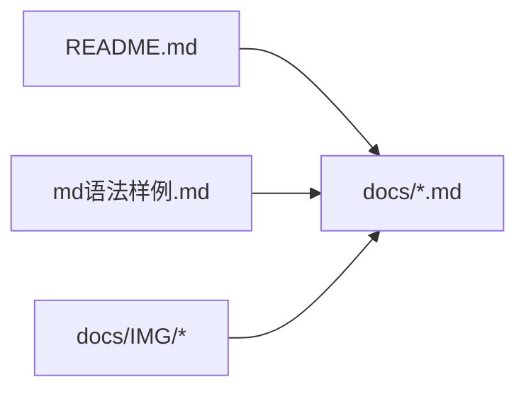

# Markdown语法参考

<cite>
**本文引用的文件**   
- [README.md](file://README.md)
- [md语法样例.md](file://docs/md语法样例.md)
</cite>

## 目录
1. [简介](#简介)
2. [项目结构](#项目结构)
3. [核心组件](#核心组件)
4. [架构总览](#架构总览)
5. [详细组件分析](#详细组件分析)
6. [依赖关系分析](#依赖关系分析)
7. [性能考虑](#性能考虑)
8. [故障排查指南](#故障排查指南)
9. [结论](#结论)
10. [附录](#附录)

## 简介
本文件为“Markdown语法参考”，面向文档编写者与开发者，提供在仓库中撰写与排版文档的规范与示例。内容涵盖标题、强调、列表、表格、流程图/序列图（Mermaid）、图片、链接、引用、代码块与行号、行内代码、分割线等常用语法，并给出在本仓库中的使用建议与最佳实践。

## 项目结构
仓库中与文档相关的资源主要位于 docs 目录，其中包含若干技术方案说明与一个 Markdown 语法样例文件。该样例文件集中展示了各类 Markdown 语法的写法，适合作为团队文档编写的统一模板。



[本节不直接分析具体源码文件，故无“章节来源”]

## 核心组件
本参考聚焦于 Markdown 文档写作能力，核心“组件”即各类语法元素及其组合方式：
- 标题层级：从一级到六级标题，用于构建文档骨架
- 文本样式：斜体、粗体、删除线及组合样式
- 列表：无序列表、有序列表、任务列表
- 表格：基础表格与对齐列
- 图表：Mermaid 流程图与序列图
- 媒体与链接：图片、超链接
- 引用：标准引用与提示型引用块
- 代码：代码块与行号、行内代码
- 分隔：水平分割线

这些元素共同构成可维护、可读性强的技术文档体系。

[本节不直接分析具体源码文件，故无“章节来源”]

## 架构总览
下图展示文档在仓库中的组织与渲染流程：作者基于样例文件进行编写，最终由 Markdown 渲染器输出为 HTML/PDF 等目标格式，供阅读或发布。



[本节为概念性流程图，未映射到具体源码文件，故无“图示来源”]

## 详细组件分析

### 标题与层级
- 使用一至六个 # 表示标题层级，建议按“章-节-小节”组织文档结构
- 保持层级连贯，避免跳级；同一层级标题语义一致

参考路径
- [md语法样例.md:1-11](file://docs/md语法样例.md#L1-L11)

**章节来源**
- [md语法样例.md:1-11](file://docs/md语法样例.md#L1-L11)

### 强调与文本样式
- 斜体：*文字* 或 _文字_
- 粗体：**文字** 或 __文字__
- 删除线：~~文字~~
- 组合样式：在同一文本中混合使用

参考路径
- [md语法样例.md:18-27](file://docs/md语法样例.md#L18-L27)

**章节来源**
- [md语法样例.md:18-27](file://docs/md语法样例.md#L18-L27)

### 列表
- 无序列表：以 - 开头
- 有序列表：以数字加点开头，支持嵌套
- 任务列表：以 - [ ] 或 - [x] 表示未完成/已完成

参考路径
- [md语法样例.md:29-49](file://docs/md语法样例.md#L29-L49)

**章节来源**
- [md语法样例.md:29-49](file://docs/md语法样例.md#L29-L49)

### 表格
- 使用 | 分隔列，首行为表头，第二行定义对齐
- 适合对比、参数说明、状态汇总等场景

参考路径
- [md语法样例.md:52-57](file://docs/md语法样例.md#L52-L57)

**章节来源**
- [md语法样例.md:52-57](file://docs/md语法样例.md#L52-L57)

### Mermaid 流程图
- 使用 ```mermaid
包裹流程图代码
- 适用于业务流程、阶段划分、决策分支等可视化表达


参考路径
- [md语法样例.md:59-68](file://docs/md语法样例.md#L59-L68)

**图示来源**
- [md语法样例.md:59-68](file://docs/md语法样例.md#L59-L68)

**章节来源**
- [md语法样例.md:59-68](file://docs/md语法样例.md#L59-L68)

### Mermaid 序列图
- 使用 sequenceDiagram 描述跨参与者的交互时序
- 适合 API 调用链、命令执行流程、编译构建过程等



参考路径
- [md语法样例.md:70-88](file://docs/md语法样例.md#L70-L88)

**图示来源**
- [md语法样例.md:70-88](file://docs/md语法样例.md#L70-L88)

**章节来源**
- [md语法样例.md:70-88](file://docs/md语法样例.md#L70-L88)

### 图片与链接
- 图片：
- 链接：[文本](URL) 或直接粘贴 URL 自动生成链接

参考路径
- [md语法样例.md:91-98](file://docs/md语法样例.md#L91-L98)

**章节来源**
- [md语法样例.md:91-98](file://docs/md语法样例.md#L91-L98)

### 引用与提示块
- 标准引用：> 文本
- 提示型引用块：> [!NOTE] / > [!WARNING] 等

参考路径
- [md语法样例.md:99-110](file://docs/md语法样例.md#L99-L110)

**章节来源**
- [md语法样例.md:99-110](file://docs/md语法样例.md#L99-L110)

### 代码块与行号、行内代码
- 代码块：```语言 {.line-numbers} ... ```
- 行内代码：`代码片段`

参考路径
- [md语法样例.md:113-125](file://docs/md语法样例.md#L113-L125)

**章节来源**
- [md语法样例.md:113-125](file://docs/md语法样例.md#L113-L125)

### 分割线
- 使用 --- 或 *** 或 ___ 生成水平分割线

参考路径
- [md语法样例.md:127-142](file://docs/md语法样例.md#L127-L142)

**章节来源**
- [md语法样例.md:127-142](file://docs/md语法样例.md#L127-L142)

### 概念总览
下图总结 Markdown 文档的核心要素与用途，便于快速定位合适的语法元素。



[本节为概念性流程图，未映射到具体源码文件，故无“图示来源”]

## 依赖关系分析
文档与仓库其他部分的耦合度较低，主要依赖如下：
- 文档编写依赖样例文件作为语法基准
- 图片等资源通常存放在 docs/IMG 或项目静态资源目录
- 技术文档可能引用仓库内的 README 或其他说明文件



**图示来源**
- [README.md:1-15](file://README.md#L1-L15)
- [md语法样例.md:1-142](file://docs/md语法样例.md#L1-L142)

**章节来源**
- [README.md:1-15](file://README.md#L1-L15)
- [md语法样例.md:1-142](file://docs/md语法样例.md#L1-L142)

## 性能考虑
- 控制图片体积与尺寸，优先使用矢量图或压缩后的位图
- 合理使用 Mermaid 图表规模，避免过大的流程图导致渲染缓慢
- 长文档建议分页或分章节，提升加载与检索效率
- 代码块仅保留必要信息，避免冗余日志

[本节为通用建议，不涉及具体源码文件，故无“章节来源”]

## 故障排查指南
常见问题与处理建议：
- 标题层级错乱：检查是否跳级或混用不同标记风格
- 列表缩进异常：确保子项缩进一致，避免空格与制表符混用
- 表格错位：核对列数与分隔符数量，必要时使用对齐列
- Mermaid 不渲染：确认代码块语言标识为 mermaid，且语法正确
- 图片无法显示：检查路径是否正确，相对路径需相对于当前文档位置
- 引用块样式异常：确认提示型引用块语法符合规范

[本节为通用指导，不涉及具体源码文件，故无“章节来源”]

## 结论
通过统一的 Markdown 语法规范与样例参考，团队可在 SST Core 仓库中产出结构清晰、可读性强、易于维护的技术文档。建议在新增文档时复用 md语法样例.md 的结构与风格，并在需要时引入 Mermaid 图表以提升表达效果。

[本节为总结性内容，不涉及具体源码文件，故无“章节来源”]

## 附录
- 推荐文档命名：采用中文名词短语，如“xxx技术方案.md”
- 图片命名：使用英文或拼音，避免特殊字符
- 版本与变更记录：在文档末尾添加变更历史段落，记录修改时间、作者与要点

[本节为补充说明，不涉及具体源码文件，故无“章节来源”]