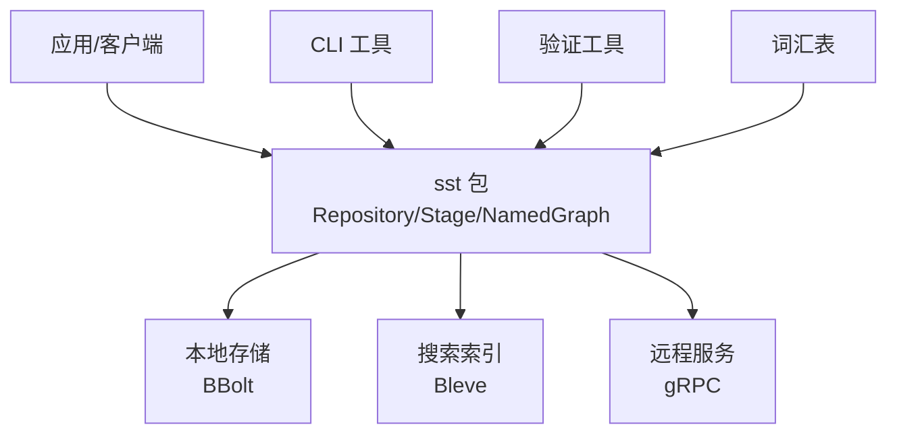
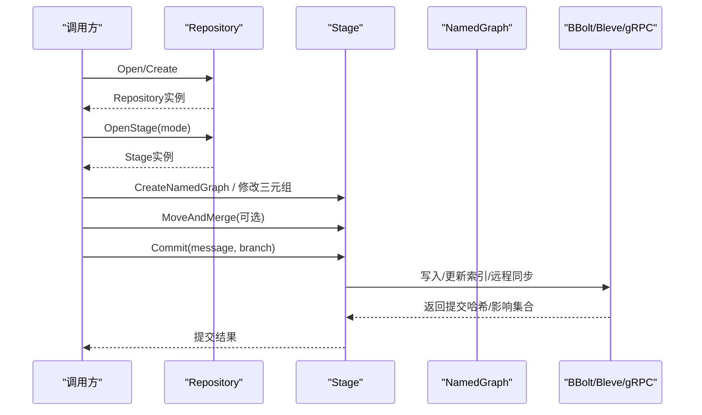
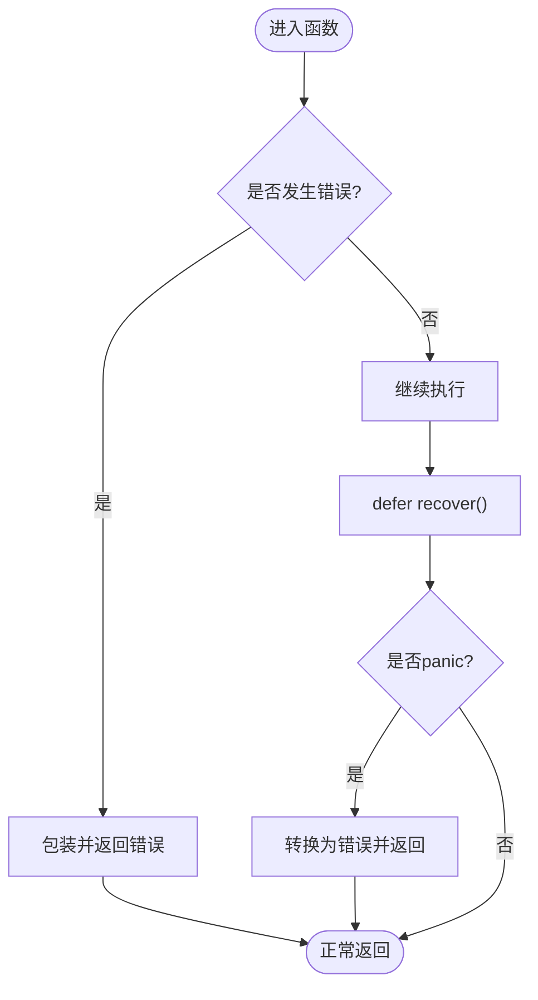
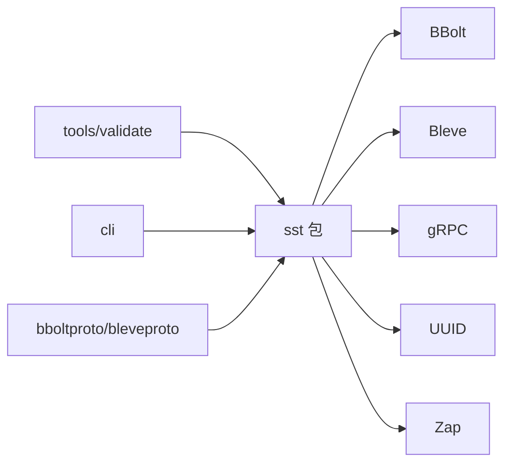

# 代码规范和最佳实践

<cite>
**本文引用的文件**
- [.golangci.yaml](file://.golangci.yaml)
- [go.mod](file://go.mod)
- [README.md](file://README.md)
- [doc.go](file://doc.go)
- [sst/repository.go](file://sst/repository.go)
- [sst/stage.go](file://sst/stage.go)
- [sst/errrecovery.go](file://sst/errrecovery.go)
- [cli/cmd/utils/log.go](file://cli/cmd/utils/log.go)
- [tools/validate/validate.go](file://tools/validate/validate.go)
- [bboltproto/repository.pb.go](file://bboltproto/repository.pb.go)
</cite>

## 目录
1. [简介](#简介)
2. [项目结构](#项目结构)
3. [核心组件](#核心组件)
4. [架构总览](#架构总览)
5. [详细组件分析](#详细组件分析)
6. [依赖分析](#依赖分析)
7. [性能考虑](#性能考虑)
8. [故障排查指南](#故障排查指南)
9. [结论](#结论)
10. [附录](#附录)

## 简介
本规范面向SST Core（语义STEP技术核心库）的Go语言工程，目标是统一编码约定、包组织、接口设计、错误处理、日志记录、测试与性能优化策略，并给出可执行的代码审查清单与常见反模式规避方法。文档基于仓库现有实现与配置提炼而成，确保与当前代码一致且可落地执行。

## 项目结构
- 顶层模块为 github.com/semanticstep/sst-core，Go版本在 go.mod 中声明。
- 对外API集中在 sst 包；CLI工具在 cli 包；验证工具在 tools/validate；协议定义在 bboltproto 与 bleveproto；词汇表在 vocabularies；示例在 examples。
- README 明确对外包范围：sst、examples、vocabularies、defaultderive、cmd。

图表来源
- [go.mod:1-80](file://go.mod#L1-L80)
- [README.md:1-15](file://README.md#L1-L15)

章节来源
- [go.mod:1-80](file://go.mod#L1-L80)
- [README.md:1-15](file://README.md#L1-L15)

## 核心组件
- Repository：持久化数据集、提交历史、查询能力（Bleve）、文档管理、同步等。提供多种实现（本地完整/基础/扁平、远程）。
- Stage：内存工作区，支持创建/修改 NamedGraph、合并迁移、提交到仓库。
- NamedGraph/IBNode/Term：RDF三元组模型的核心抽象，支撑图遍历与序列化。
- 工具链：CLI、MCP、验证器、转换器、默认派生索引映射等。

章节来源
- [sst/repository.go:34-179](file://sst/repository.go#L34-L179)
- [sst/stage.go:64-234](file://sst/stage.go#L64-L234)

## 架构总览
SST以“仓库-阶段-图”为核心分层：
- 仓库层负责数据持久化、版本控制、索引与远程访问。
- 阶段层提供事务性内存视图，支持多图的移动与合并。
- 图层承载RDF三元组，支持序列化、遍历与类型推断。

图表来源
- [sst/repository.go:240-309](file://sst/repository.go#L240-L309)
- [sst/stage.go:468-800](file://sst/stage.go#L468-L800)

## 详细组件分析

### 命名与包组织规范
- 包名使用小写英文，避免下划线；文件名与包名一致。
- 对外API集中在 sst 包，内部实现按职责拆分（如 stage、repository、rdf 读写、索引等）。
- CLI、工具、示例分别位于独立子包，便于隔离与复用。
- 生成的protobuf代码位于 bboltproto/bleveproto，不应直接由用户导入。

章节来源
- [README.md:1-15](file://README.md#L1-L15)
- [doc.go:1-6](file://doc.go#L1-L6)

### golangci-lint 规则与自定义检查
- 启用规则：errorlint、exhaustive、forbidigo、godot、godox、revive、unconvert、unparam。
- forbidigo 禁止 fmt.Printf 与标准 log 包输出，CLI输出应使用 fmt.Println 或全局日志；库调试使用 GlobalLogger。
- 排除规则对测试、CLI、工具、示例等路径放宽 forbidigo；同时忽略部分导出注释与未检查错误提示。
- 格式化启用 gofumpt，生成代码与第三方目录排除。

章节来源
- [.golangci.yaml:1-53](file://.golangci.yaml#L1-L53)

### 错误处理模式
- 统一错误变量集中定义（如 ErrNotSupported、ErrDatasetNotFound 等），便于上层判断与包装。
- 关键流程使用 recover 捕获 panic，转换为错误并通过通道返回，保证并发安全。
- 外部资源操作（文件、网络）的错误需显式检查并返回，避免静默失败。
- 日志中附带上下文信息（如IRI、哈希、分支名），便于定位问题。

图表来源
- [sst/errrecovery.go:59-92](file://sst/errrecovery.go#L59-L92)
- [sst/repository.go:197-215](file://sst/repository.go#L197-L215)

章节来源
- [sst/errrecovery.go:59-92](file://sst/errrecovery.go#L59-L92)
- [sst/repository.go:197-215](file://sst/repository.go#L197-L215)

### 日志记录规范
- 库内调试使用 sst.GlobalLogger（zap），避免污染CLI stderr。
- CLI工具如需临时屏蔽标准输出，可使用 MuteStdout/RestoreStdout 进行重定向。
- 日志级别建议：Debug用于详细过程，Info用于关键步骤，Warn/Error用于异常与失败。
- 日志内容包含必要上下文（如IRI、哈希、分支、时间戳），便于审计与排障。

章节来源
- [.golangci.yaml:12-19](file://.golangci.yaml#L12-L19)
- [cli/cmd/utils/log.go:10-41](file://cli/cmd/utils/log.go#L10-L41)
- [tools/validate/validate.go:238-261](file://tools/validate/validate.go#L238-L261)

### 接口设计原则
- Repository 接口清晰分离关注点：生命周期管理、数据集操作、索引管理、文档管理、日志与同步。
- Stage 接口聚焦内存工作区：创建/获取图、遍历、合并、提交、导出。
- 所有公开方法接受 context.Context，支持超时与取消，便于远程调用与资源清理。
- 错误通过返回值传递，避免panic作为控制流。

章节来源
- [sst/repository.go:34-179](file://sst/repository.go#L34-L179)
- [sst/stage.go:64-234](file://sst/stage.go#L64-L234)

### 注释与文档要求
- 对外包与类型需提供 godoc 风格注释，说明用途、参数、返回值与注意事项。
- 复杂逻辑（如 MoveAndMerge）需在函数注释中描述行为、边界条件与典型用法。
- 生成的protobuf代码无需手动注释，但调用处应补充业务语义说明。

章节来源
- [sst/stage.go:132-163](file://sst/stage.go#L132-L163)
- [sst/repository.go:240-309](file://sst/repository.go#L240-L309)

### 测试覆盖率与质量
- 单元测试覆盖核心路径与边界条件，建议使用 testify/assert/require。
- 集成测试覆盖本地/远程仓库、Bleve搜索、提交历史、合并场景。
- 对解析器/转换器等复杂逻辑，提供 fixture 数据与断言。
- 建议在CI中运行 golangci-lint 与覆盖率统计。

章节来源
- [sst_test/searchInContext_test.go:387-679](file://sst_test/searchInContext_test.go#L387-L679)
- [sst_test/remoteRepositoryMultipleCommits_test.go:143-176](file://sst_test/remoteRepositoryMultipleCommits_test.go#L143-L176)

### 实际编程实践示例（路径引用）
- 打开远程仓库并建立认证：[OpenRemoteRepository:240-309](file://sst/repository.go#L240-L309)
- 创建本地仓库并初始化日志条目：[CreateLocalRepository:311-423](file://sst/repository.go#L311-L423)
- 阶段合并与提交：[MoveAndMerge:468-800](file://sst/stage.go#L468-L800)
- 验证器中的结构化日志与报告：[ValidateRdfType:263-362](file://tools/validate/validate.go#L263-L362)
- 协议消息定义（示例）：[CommitDetail:6261-6280](file://bboltproto/repository.pb.go#L6261-L6280)

## 依赖分析
- 核心依赖：BBolt（持久化）、Bleve（全文检索）、gRPC（远程通信）、UUID（标识）、Zap（日志）。
- 协议层：bboltproto/bleveproto 由 .proto 生成，保持向后兼容。
- 词汇表：vocabularies 提供预编译本体常量，简化上层开发。

图表来源
- [go.mod:1-80](file://go.mod#L1-L80)

章节来源
- [go.mod:1-80](file://go.mod#L1-L80)

## 性能考虑
- 三范式模式（TriplexMode）：根据查询方向选择 subject/predicate/object 索引组合，平衡内存与性能。
- 批量写入与延迟索引更新：提交时批量更新Bleve索引，减少频繁IO。
- 远程调用使用context超时与重试策略，避免阻塞。
- 大对象序列化采用流式写入，降低内存峰值。
- 合理使用缓存（如可过期缓存）提升热点数据读取性能。

章节来源
- [sst/stage.go:33-51](file://sst/stage.go#L33-L51)
- [sst/repository.go:91-120](file://sst/repository.go#L91-L120)

## 故障排查指南
- 常见问题：
  - 远程连接失败：检查TLS配置与OAuth令牌获取。
  - 索引不一致：重建Bleve索引或校验派生包版本。
  - 合并冲突：查看 MoveAndMergeReport 中的 actions 与 warnings。
  - 权限不足：确认仓库访问模式与配额限制。
- 诊断手段：
  - 启用Debug日志，记录关键路径与上下文。
  - 使用 Info/Dump 输出仓库与阶段状态。
  - 检查错误码与包装原因链。

章节来源
- [sst/repository.go:240-309](file://sst/repository.go#L240-L309)
- [sst/stage.go:374-433](file://sst/stage.go#L374-L433)

## 结论
本规范基于SST Core现有实现与配置，明确了Go编码约定、包组织、接口设计、错误处理、日志记录、测试与性能优化策略。遵循这些实践可提升代码一致性、可维护性与运行稳定性。建议在团队内推广并纳入CI门禁。

## 附录

### 代码审查清单
- 命名与格式：符合gofumpt与revive规则，无禁用注释滥用。
- 错误处理：所有错误显式检查与返回，无静默失败。
- 日志规范：使用GlobalLogger，避免fmt.Printf/标准log。
- 接口契约：方法签名清晰，context使用合理，错误语义明确。
- 测试覆盖：核心路径有单测/集成测试，边界条件已覆盖。
- 性能考量：避免不必要拷贝，合理使用批处理与缓存。
- 安全性：输入校验、权限检查、敏感信息不泄露。

### 常见反模式与规避
- 使用panic作为控制流：改为错误返回与recover包装。
- 忽略错误返回值：必须检查并记录/处理。
- 直接打印到stderr：改用日志框架或CLI专用输出。
- 过度耦合：通过接口解耦，避免跨包直接依赖实现。
- 长事务与大对象：拆分为小批次，流式处理。
- 硬编码路径/URL：使用配置或环境变量注入。