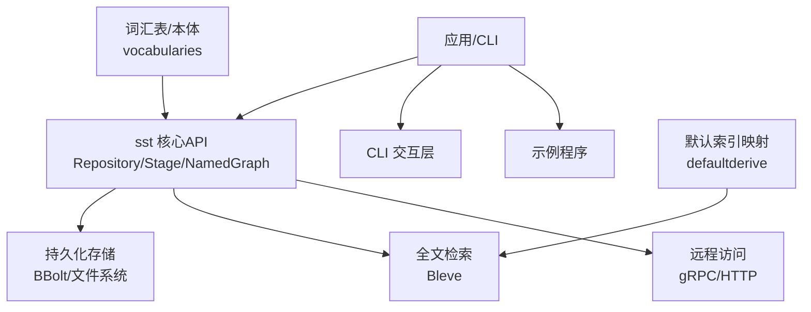
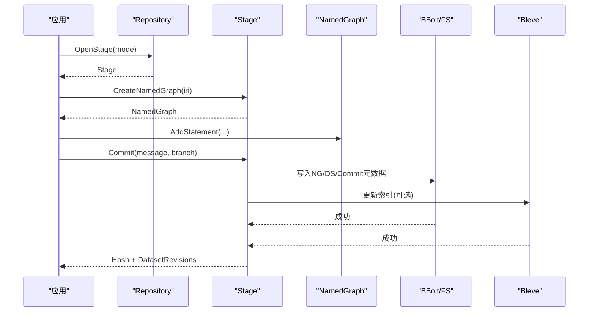
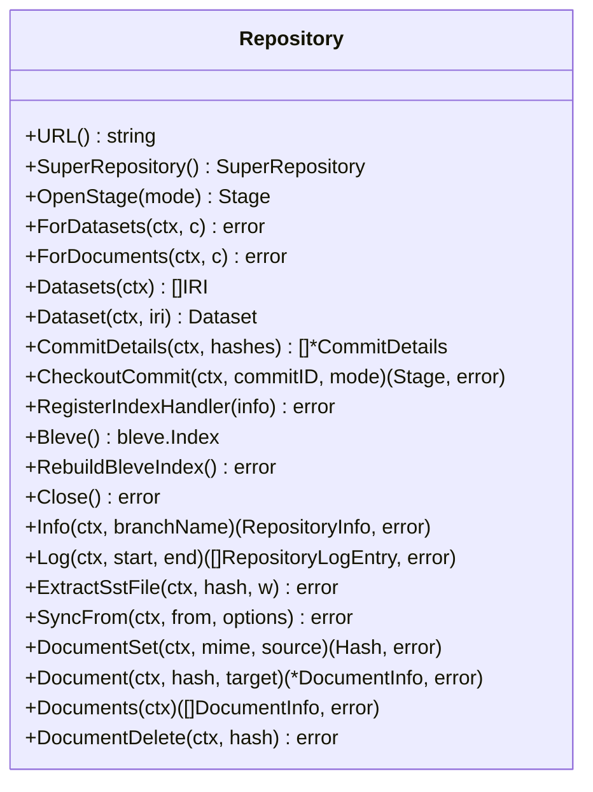
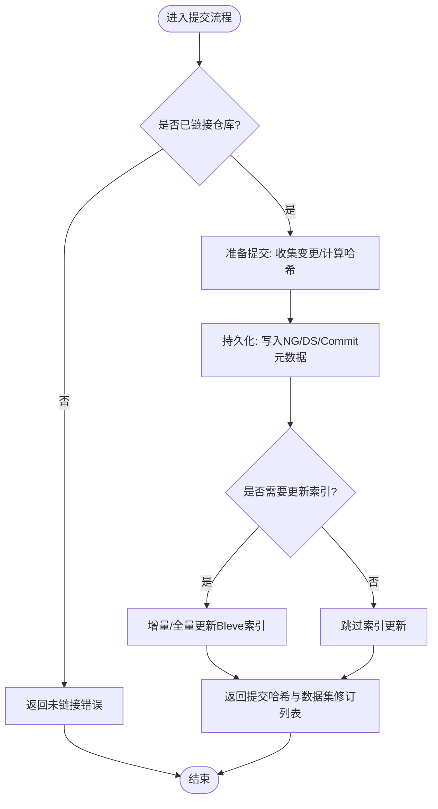
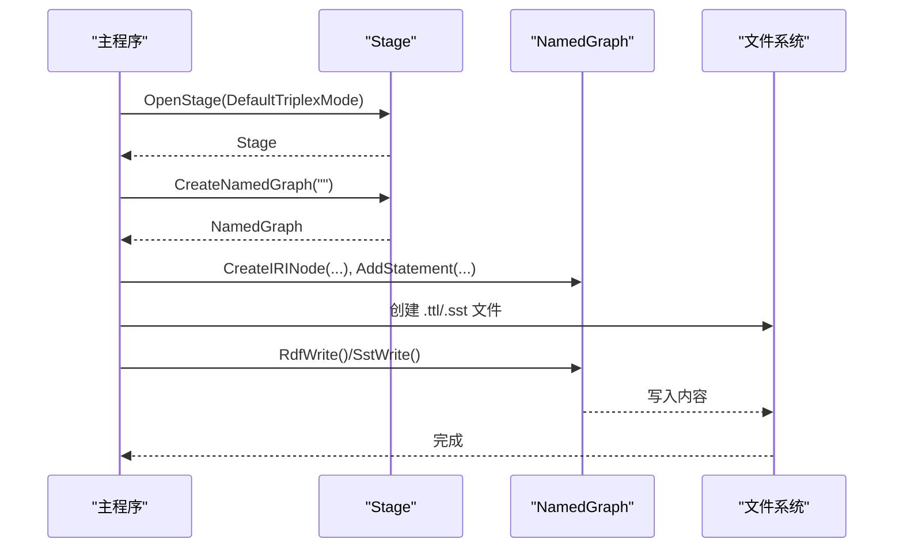
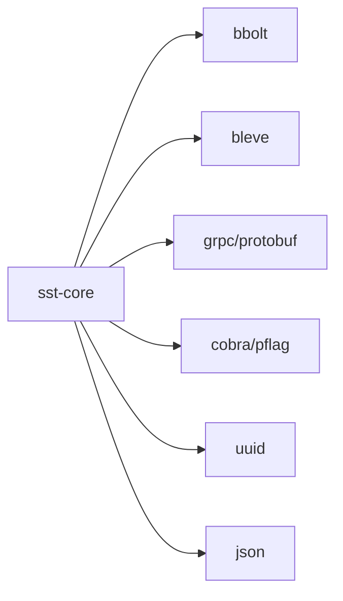

# 开发指南

<cite>
**本文引用的文件**
- [README.md](file://README.md)
- [go.mod](file://go.mod)
- [doc.go](file://doc.go)
- [sst/README.md](file://sst/README.md)
- [cli/CLI_INTRODUCTION.md](file://cli/CLI_INTRODUCTION.md)
- [.golangci.yaml](file://.golangci.yaml)
- [sst/repository.go](file://sst/repository.go)
- [sst/stage.go](file://sst/stage.go)
- [sst/types.go](file://sst/types.go)
- [examples/helloworldwrite/helloworldwrite.go](file://examples/helloworldwrite/helloworldwrite.go)
- [examples/helloworldreadsst/helloworldreadsst.go](file://examples/helloworldreadsst/helloworldreadsst.go)
- [sst_test/simple_test.go](file://sst_test/simple_test.go)
</cite>

## 目录
1. [简介](#简介)
2. [项目结构](#项目结构)
3. [核心组件](#核心组件)
4. [架构总览](#架构总览)
5. [详细组件分析](#详细组件分析)
6. [依赖分析](#依赖分析)
7. [性能考虑](#性能考虑)
8. [故障排查指南](#故障排查指南)
9. [结论](#结论)
10. [附录](#附录)

## 简介
本指南面向SST（Semantic STEP Technology）核心库的开发者，覆盖开发环境搭建、代码规范与最佳实践、测试策略与单元测试编写、调试与性能分析方法、插件与扩展点实现、贡献流程、版本发布流程，以及实际开发案例与常见问题解决方案。SST以RDF/RDFS/OWL为基础，采用Turtle作为主要交换格式，并提供类似Git的版本控制能力来管理数据集与命名图的重放与合并。

## 项目结构
仓库采用按功能域划分的模块化组织：
- sst：核心API与数据模型，包含Repository、Stage、NamedGraph等关键类型与实现
- cli：命令行工具，提供交互式命令与批量操作
- examples：示例程序，演示读写SST/Turtle、本地/远程仓库使用
- vocabularies：预编译词汇表与本体映射，便于早期绑定
- defaultderive：默认Bleve索引映射配置
- tools：编译器、验证器、图形转换等工具集
- mcp：MCP协议服务相关
- bboltproto/bleveproto：序列化与远程通信协议定义
- sst_test：集成与端到端测试套件

图表来源
- [sst/repository.go:34-179](file://sst/repository.go#L34-L179)
- [sst/stage.go:53-177](file://sst/stage.go#L53-L177)
- [go.mod:5-34](file://go.mod#L5-L34)

章节来源
- [README.md:1-15](file://README.md#L1-L15)
- [go.mod:1-80](file://go.mod#L1-L80)

## 核心组件
- Repository：仓库接口，负责数据集、文档、提交历史、索引与同步等能力
- Stage：工作区，用于加载、修改并提交命名图与三元组
- NamedGraph：命名图，承载三元组与节点集合
- TriplexMode：三元组索引模式，平衡内存与遍历性能
- SSTDeriveInfo：Bleve索引映射与文档派生信息

章节来源
- [sst/repository.go:34-179](file://sst/repository.go#L34-L179)
- [sst/stage.go:33-177](file://sst/stage.go#L33-L177)
- [sst/types.go:9-200](file://sst/types.go#L9-L200)

## 架构总览
SST将RDF/OWL数据在内存中组织为三元组与命名图，并通过仓库进行持久化与版本控制。支持本地与远程仓库，内置Bleve全文检索，提供类似Git的分支、提交、合并概念。

图表来源
- [sst/repository.go:60-128](file://sst/repository.go#L60-L128)
- [sst/stage.go:121-177](file://sst/stage.go#L121-L177)

## 详细组件分析

### 仓库（Repository）
- 职责：打开阶段、列举数据集/文档、提交详情、检出提交、索引注册与重建、日志、提取SST文件、同步、文档存取
- 关键点：
  - 上下文参数用于超时与用户标识
  - 支持多种仓库类型（本地完整/基础/扁平、远程）
  - Bleve索引可注册自定义映射或移除现有索引
  - 支持从其他仓库同步提交与数据集

图表来源
- [sst/repository.go:34-179](file://sst/repository.go#L34-L179)

章节来源
- [sst/repository.go:34-179](file://sst/repository.go#L34-L179)

### 工作区（Stage）
- 职责：创建/获取命名图、遍历本地与引用图、提交变更、移动合并、对齐历史、链接仓库、导出SST文件目录、信息查询
- 关键点：
  - TriplexMode决定三元组索引粒度与内存占用
  - MoveAndMerge自动处理同名图的合并策略
  - AlignHistory用于外部编辑后保持提交历史一致性

图表来源
- [sst/stage.go:121-177](file://sst/stage.go#L121-L177)

章节来源
- [sst/stage.go:33-200](file://sst/stage.go#L33-L200)

### 数据类型与静态资源
- 定义了RDF/XSD/SST框架相关的静态命名图与字面量类型常量，确保类型一致性与快速访问
- 通过静态对象减少运行时开销并保证语义一致性

章节来源
- [sst/types.go:9-200](file://sst/types.go#L9-L200)

### CLI 交互与命令
- 提供交互式命令界面，支持仓库/数据集/阶段/命名图/IBNode等操作
- 支持导入/导出（如AP242 XML、STEP P21）、校验、差异比较、历史查看等
- 适合调试、测试与快速验证核心功能

章节来源
- [cli/CLI_INTRODUCTION.md:1-800](file://cli/CLI_INTRODUCTION.md#L1-L800)

### 示例程序
- HelloWorldWrite：创建简单RDF图并输出Turtle与SST二进制
- HelloWorldReadSST：读取SST文件并打印三元组结构

图表来源
- [examples/helloworldwrite/helloworldwrite.go:39-96](file://examples/helloworldwrite/helloworldwrite.go#L39-L96)
- [examples/helloworldreadsst/helloworldreadsst.go:30-68](file://examples/helloworldreadsst/helloworldreadsst.go#L30-L68)

章节来源
- [examples/helloworldwrite/helloworldwrite.go:1-98](file://examples/helloworldwrite/helloworldwrite.go#L1-L98)
- [examples/helloworldreadsst/helloworldreadsst.go:1-69](file://examples/helloworldreadsst/helloworldreadsst.go#L1-L69)

## 依赖分析
- 语言与模块：Go 1.25+，模块名 github.com/semanticstep/sst-core
- 关键依赖：
  - BBolt：键值持久化
  - Bleve：全文检索
  - gRPC/Protobuf：远程通信
  - Cobra/Pflag：CLI命令解析
  - UUID、JSON、Term等常用库
- 间接依赖包括词干提取、压缩、内存映射等，支撑高性能检索与存储

图表来源
- [go.mod:5-34](file://go.mod#L5-L34)

章节来源
- [go.mod:1-80](file://go.mod#L1-L80)

## 性能考虑
- 三元组索引模式选择：
  - 仅主体三元组：内存最省，适合只读或单向遍历
  - 主体+客体三元组：适合双向遍历场景
  - 全部三元组：典型应用下性能最优，但内存占用更高
- 索引重建：
  - 本地完整仓库支持保留历史的完全重建
  - 本地基础仓库支持无历史的完全重建
  - 远程仓库需服务端操作；扁平仓库无索引
- 批量写入与流式处理：
  - 使用SST二进制格式提升读写效率
  - 合理设置上下文超时与并发度
- 内存管理：
  - 及时关闭Stage与Repository释放资源
  - 避免长时间持有大对象引用

章节来源
- [sst/stage.go:33-51](file://sst/stage.go#L33-L51)
- [sst/repository.go:91-120](file://sst/repository.go#L91-L120)

## 故障排查指南
- 常见错误与定位：
  - 未链接仓库提交：检查Stage是否已调用LinkToRepository
  - 命名图不存在：确认IRI唯一性与存在性
  - 索引不一致：必要时执行RebuildBleveIndex
  - 远程连接失败：检查网络、认证与超时配置
- 调试建议：
  - 使用CLI的log/history/diff命令辅助定位问题
  - 利用validate命令校验RDF语法与约束
  - 通过dump内部桶键查看底层数据结构
- 日志与输出：
  - 遵循代码规范，禁止直接使用fmt.Printf/log包输出到stderr
  - 使用全局日志器或CLI专用输出通道

章节来源
- [sst/stage.go:21-31](file://sst/stage.go#L21-L31)
- [cli/CLI_INTRODUCTION.md:339-383](file://cli/CLI_INTRODUCTION.md#L339-L383)
- [.golangci.yaml:12-34](file://.golangci.yaml#L12-L34)

## 结论
SST为核心RDF/OWL数据处理提供了高性能、可扩展且具备版本控制能力的平台。通过清晰的Repository/Stage抽象、灵活的索引机制与完善的CLI工具链，开发者可以快速构建工业级知识图谱与产品数据管理系统。遵循本文档的规范与实践，有助于提升代码质量、稳定性与可维护性。

## 附录

### 开发环境与配置要求
- Go版本：1.25+
- 依赖管理：使用go.mod进行模块与依赖锁定
- 构建CLI：参考CLI介绍中的构建命令
- 环境变量：根据认证与远程访问需求配置相应环境变量

章节来源
- [go.mod:1-80](file://go.mod#L1-L80)
- [cli/CLI_INTRODUCTION.md:8-21](file://cli/CLI_INTRODUCTION.md#L8-L21)

### 代码规范与编程最佳实践
- 禁止使用fmt.Printf与标准log包直接输出到stderr
- 统一使用全局日志器或CLI专用输出
- 对错误返回值进行检查，避免忽略Close/Flush等操作的错误
- 生成的代码路径放宽限制，便于第三方集成

章节来源
- [.golangci.yaml:12-34](file://.golangci.yaml#L12-L34)

### 测试策略与单元测试编写方法
- 单元与示例测试：
  - 使用sst_test包下的示例测试展示基本用法
  - 针对RDF读写、命名图操作、差异计算等编写用例
- 集成测试：
  - 覆盖本地/远程仓库的提交、分支、同步、索引等场景
  - 使用真实或模拟认证提供者进行端到端验证
- 基准测试：
  - 对哈希、读写性能等进行基准测试，评估优化效果

章节来源
- [sst_test/simple_test.go:1-44](file://sst_test/simple_test.go#L1-L44)

### 调试技巧与性能分析方法
- 使用CLI的history/diff/validate命令进行问题定位
- 通过dump命令检查BBolt内部结构
- 使用Bleve查询与字段列表验证索引状态
- 结合pprof与性能剖析工具定位热点

章节来源
- [cli/CLI_INTRODUCTION.md:231-265](file://cli/CLI_INTRODUCTION.md#L231-L265)
- [cli/CLI_INTRODUCTION.md:339-383](file://cli/CLI_INTRODUCTION.md#L339-L383)

### 插件开发与扩展点实现指南
- 自定义Bleve索引映射：
  - 通过RegisterIndexHandler注册新的索引映射或移除现有映射
  - 使用SSTDeriveInfo指定包名、版本与默认映射函数
- 词汇表与早期绑定：
  - 在vocabularies中添加新词汇表，并在应用中引入以实现编译期校验
- 远程扩展：
  - 基于gRPC/Protobuf扩展远程接口，保持与客户端兼容

章节来源
- [sst/repository.go:91-120](file://sst/repository.go#L91-L120)
- [README.md:5-12](file://README.md#L5-L12)

### 贡献代码的流程和规范
- 代码风格：遵循golangci-lint规则与格式化要求
- 提交信息：清晰描述变更内容与动机
- 测试覆盖：新增功能需配套单测与集成测试
- 审查流程：提交PR后进行代码审查与自动化检查

章节来源
- [.golangci.yaml:1-53](file://.golangci.yaml#L1-L53)

### 版本发布与发布流程
- 模块版本：依据go.mod进行版本管理与依赖升级
- 兼容性：保持向后兼容，谨慎修改公共接口
- 发布产物：构建CLI与核心库，附带文档与示例
- 回归验证：运行完整测试套件与基准测试

章节来源
- [go.mod:1-80](file://go.mod#L1-L80)

### 实际开发案例
- 创建并导出RDF图：参考HelloWorldWrite示例
- 读取SST文件并遍历三元组：参考HelloWorldReadSST示例
- 使用CLI进行仓库操作：参考CLI介绍中的命令示例

章节来源
- [examples/helloworldwrite/helloworldwrite.go:39-96](file://examples/helloworldwrite/helloworldwrite.go#L39-L96)
- [examples/helloworldreadsst/helloworldreadsst.go:30-68](file://examples/helloworldreadsst/helloworldreadsst.go#L30-L68)
- [cli/CLI_INTRODUCTION.md:123-383](file://cli/CLI_INTRODUCTION.md#L123-L383)

### 常见问题解决方案
- 无法提交：确认Stage已链接仓库且存在变更
- 索引失效：执行RebuildBleveIndex或使用CLI重建索引
- 远程访问失败：检查网络、认证与超时配置
- 数据不一致：使用diff与validate命令比对与校验

章节来源
- [sst/stage.go:21-31](file://sst/stage.go#L21-L31)
- [sst/repository.go:91-120](file://sst/repository.go#L91-L120)
- [cli/CLI_INTRODUCTION.md:549-641](file://cli/CLI_INTRODUCTION.md#L549-L641)