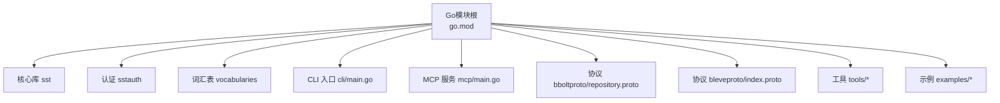
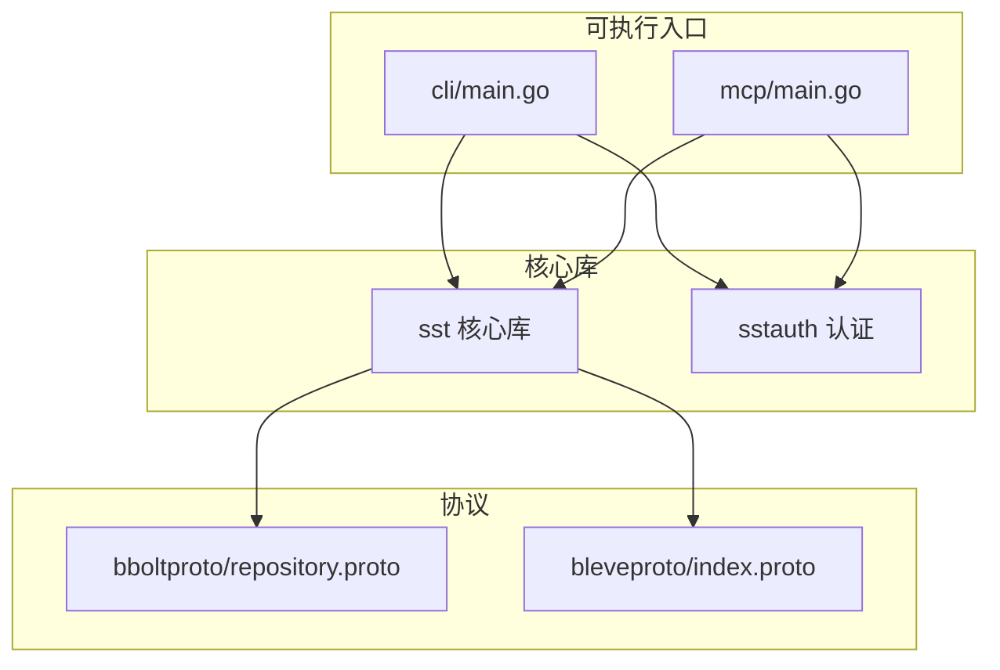
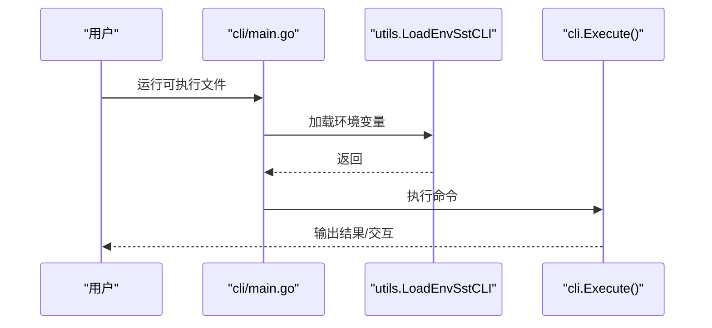
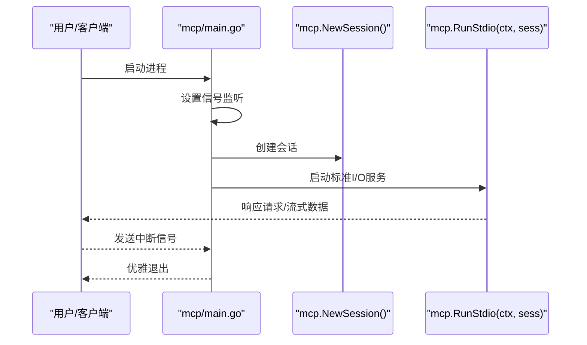
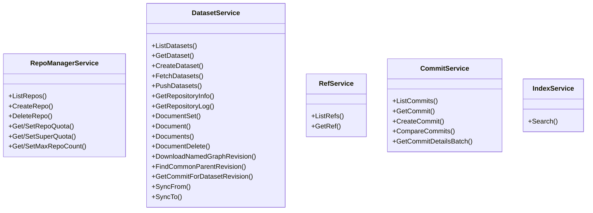
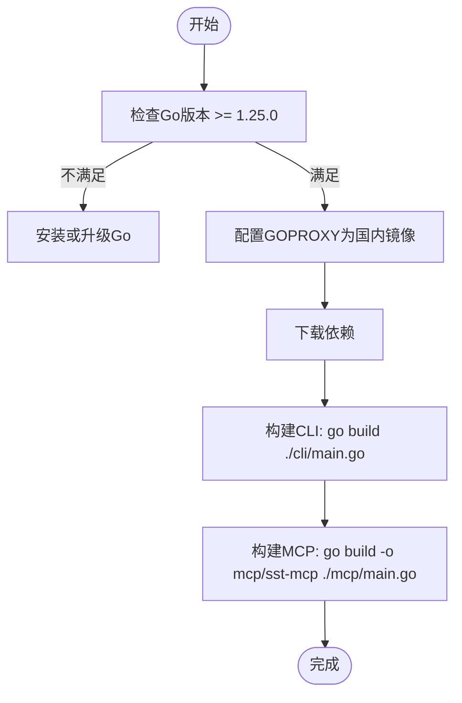

# Qoder环境编译指南

<cite>
**本文引用的文件**
- [go.mod](file://go.mod)
- [README.md](file://README.md)
- [sst_core编译运行指导.txt](file://sst_core编译运行指导.txt)
- [cli/main.go](file://cli/main.go)
- [mcp/main.go](file://mcp/main.go)
- [bboltproto/repository.proto](file://bboltproto/repository.proto)
- [bleveproto/index.proto](file://bleveproto/index.proto)
- [.golangci.yaml](file://.golangci.yaml)
</cite>

## 目录
1. [简介](#简介)
2. [项目结构](#项目结构)
3. [核心组件](#核心组件)
4. [架构总览](#架构总览)
5. [详细组件分析](#详细组件分析)
6. [依赖分析](#依赖分析)
7. [性能考虑](#性能考虑)
8. [故障排查指南](#故障排查指南)
9. [结论](#结论)
10. [附录](#附录)

## 简介
本指南面向在Qoder环境中构建与运行SST Core（语义STEP技术核心库）的开发者，提供从环境准备、依赖配置到编译产物输出的完整步骤。本项目为Go模块工程，包含本地/远程仓库实现、CLI工具、MCP服务以及若干示例与工具集。通过本指南，你将能在Windows环境下使用Qoder终端完成编译并生成可执行文件。

## 项目结构
- 顶层模块：Go模块根目录，定义模块名与Go版本，集中声明直接依赖与间接依赖。
- 核心库：sst包提供SST核心API；sstauth提供认证能力；vocabularies提供预编译词汇表。
- 命令行入口：cli/main.go作为CLI程序入口，负责加载环境与执行命令。
- MCP服务：mcp/main.go暴露SST操作给AI客户端（Model Context Protocol）。
- 协议定义：bboltproto与bleveproto分别定义仓库管理与索引服务的gRPC协议。
- 工具与示例：tools与examples提供转换、验证、可视化等辅助能力与参考用法。

图表来源
- [go.mod:1-80](file://go.mod#L1-L80)
- [cli/main.go:1-18](file://cli/main.go#L1-L18)
- [mcp/main.go:1-33](file://mcp/main.go#L1-L33)
- [bboltproto/repository.proto:1-742](file://bboltproto/repository.proto#L1-L742)
- [bleveproto/index.proto:1-21](file://bleveproto/index.proto#L1-L21)

章节来源
- [go.mod:1-80](file://go.mod#L1-L80)
- [README.md:1-15](file://README.md#L1-L15)

## 核心组件
- CLI工具：位于cli/main.go，启动时加载环境变量并执行命令。
- MCP服务：位于mcp/main.go，基于标准输入输出模式运行，支持信号中断。
- 协议层：仓库管理与搜索索引通过gRPC协议暴露，便于远程访问与扩展。
- 核心库：提供本地/远程仓库、数据集、命名图、提交、分支、文档等能力。

章节来源
- [cli/main.go:1-18](file://cli/main.go#L1-L18)
- [mcp/main.go:1-33](file://mcp/main.go#L1-L33)
- [bboltproto/repository.proto:1-742](file://bboltproto/repository.proto#L1-L742)
- [bleveproto/index.proto:1-21](file://bleveproto/index.proto#L1-L21)

## 架构总览
下图展示了CLI与MCP两个主要可执行入口及其与核心库和协议的交互关系。

图表来源
- [cli/main.go:1-18](file://cli/main.go#L1-L18)
- [mcp/main.go:1-33](file://mcp/main.go#L1-L33)
- [bboltproto/repository.proto:1-742](file://bboltproto/repository.proto#L1-L742)
- [bleveproto/index.proto:1-21](file://bleveproto/index.proto#L1-L21)

## 详细组件分析

### CLI 入口（cli/main.go）
- 职责：初始化环境变量，调用命令执行器。
- 构建方式：在Qoder终端中执行 go build ./cli/main.go，将在cli目录下生成可执行文件。
- 关键点：依赖utils.LoadEnvSstCLI进行环境加载，随后进入命令处理流程。

图表来源
- [cli/main.go:1-18](file://cli/main.go#L1-L18)

章节来源
- [cli/main.go:1-18](file://cli/main.go#L1-L18)

### MCP 服务（mcp/main.go）
- 职责：以标准I/O模式运行，接收上下文与中断信号，创建会话并启动服务。
- 构建方式：go build -o mcp/sst-mcp ./mcp/main.go。
- 关键点：使用signal.NotifyContext处理中断，确保优雅退出。

图表来源
- [mcp/main.go:1-33](file://mcp/main.go#L1-L33)

章节来源
- [mcp/main.go:1-33](file://mcp/main.go#L1-L33)

### gRPC 协议（仓库管理与索引）
- 仓库管理：定义RepoManagerService、DatasetService、RefService、CommitService等，涵盖仓库配额、数据集、分支、提交、日志、文档同步等能力。
- 索引服务：IndexService提供Search接口，用于对索引进行查询。

图表来源
- [bboltproto/repository.proto:1-742](file://bboltproto/repository.proto#L1-L742)
- [bleveproto/index.proto:1-21](file://bleveproto/index.proto#L1-L21)

章节来源
- [bboltproto/repository.proto:1-742](file://bboltproto/repository.proto#L1-L742)
- [bleveproto/index.proto:1-21](file://bleveproto/index.proto#L1-L21)

## 依赖分析
- Go版本：要求Go 1.25.0。
- 关键依赖：Bleve搜索引擎、gRPC与Protobuf、OIDC认证、BBolt存储、Cobra命令行框架等。
- 模块代理：默认代理可能在国内不可用，建议配置国内镜像以提升下载速度。

图表来源
- [go.mod:1-80](file://go.mod#L1-L80)
- [sst_core编译运行指导.txt:1-32](file://sst_core编译运行指导.txt#L1-L32)

章节来源
- [go.mod:1-80](file://go.mod#L1-L80)
- [sst_core编译运行指导.txt:1-32](file://sst_core编译运行指导.txt#L1-L32)

## 性能考虑
- 索引与搜索：Bleve提供高性能全文检索，合理配置映射与分词策略可提升查询效率。
- 存储后端：BBolt作为嵌入式键值存储，适合高并发读场景；注意写入路径与事务粒度。
- 网络传输：gRPC流式接口适用于大数据量传输（如数据集同步），应控制批次大小与超时。
- 资源限制：仓库配额与最大计数可通过协议接口进行约束，避免单租户占用过多资源。

[本节为通用性能讨论，不直接分析具体文件]

## 故障排查指南
常见问题与解决思路：
- Go命令未找到：确认已安装Go并将Go的bin目录加入系统PATH，重启终端或系统后重试。
- 依赖下载超时：将GOPROXY设置为国内镜像（例如 https://goproxy.cn,direct），永久生效后可减少下载失败。
- 构建失败：检查Go版本是否匹配（>= 1.25.0），清理缓存后重新下载依赖。
- 权限问题：确保对目标输出目录有写权限。

章节来源
- [sst_core编译运行指导.txt:1-32](file://sst_core编译运行指导.txt#L1-L32)

## 结论
在Qoder环境中构建SST Core的关键在于正确配置Go环境与模块代理，然后按入口分别构建CLI与MCP。项目采用清晰的模块化设计，核心库、协议与服务解耦良好，便于扩展与维护。遵循本指南的步骤，即可顺利完成编译与运行。

[本节为总结性内容，不直接分析具体文件]

## 附录
- 快速构建命令
  - CLI：go build ./cli/main.go
  - MCP：go build -o mcp/sst-mcp ./mcp/main.go
- 代码规范：项目启用golangci-lint与格式化规则，可在开发前配置IDE集成以获得一致风格。

章节来源
- [.golangci.yaml:1-53](file://.golangci.yaml#L1-L53)