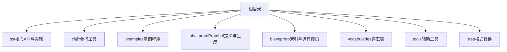
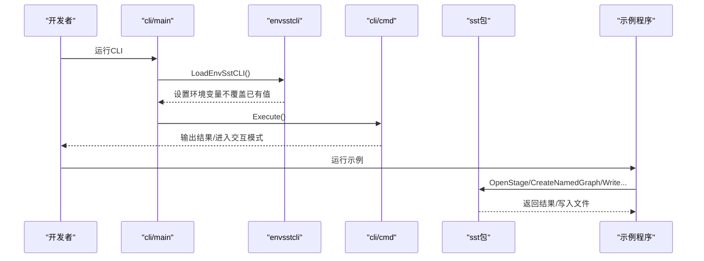
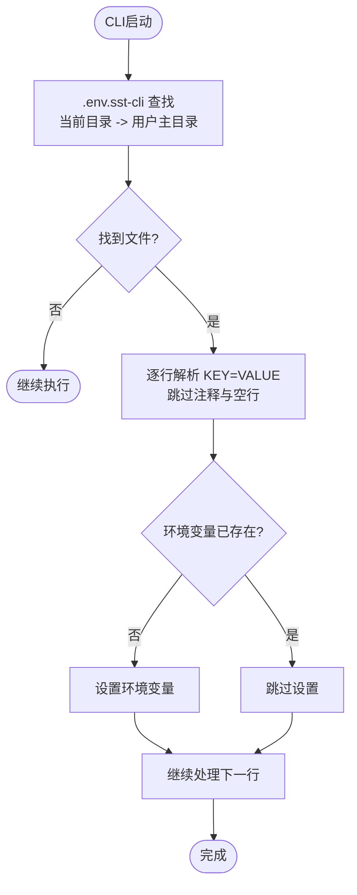
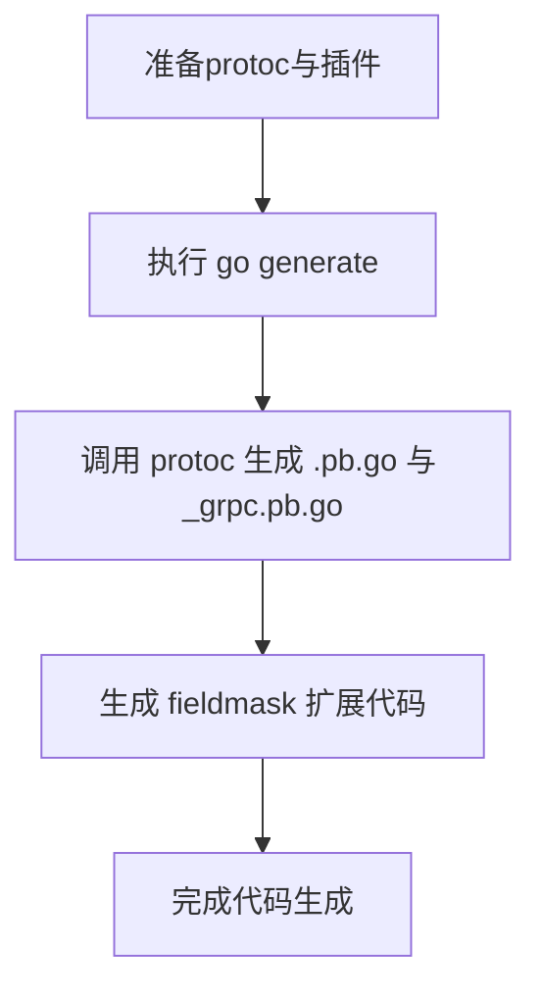
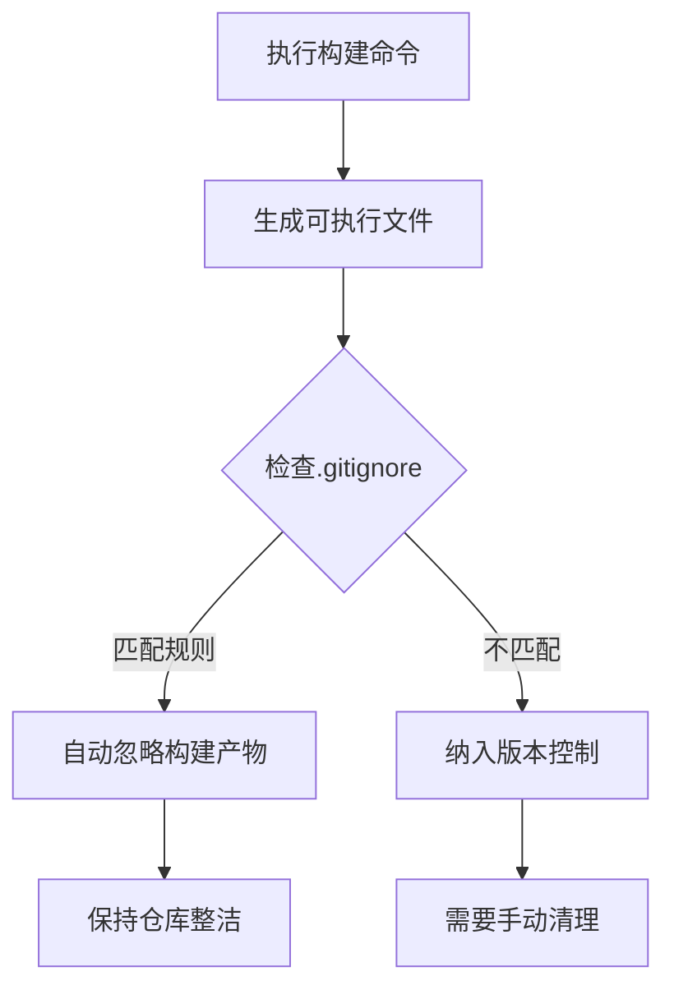
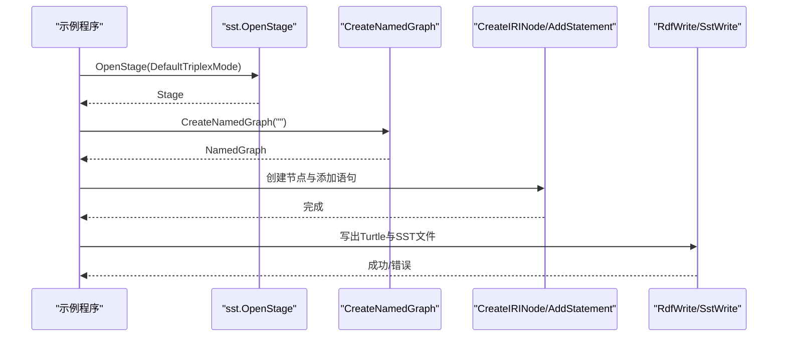
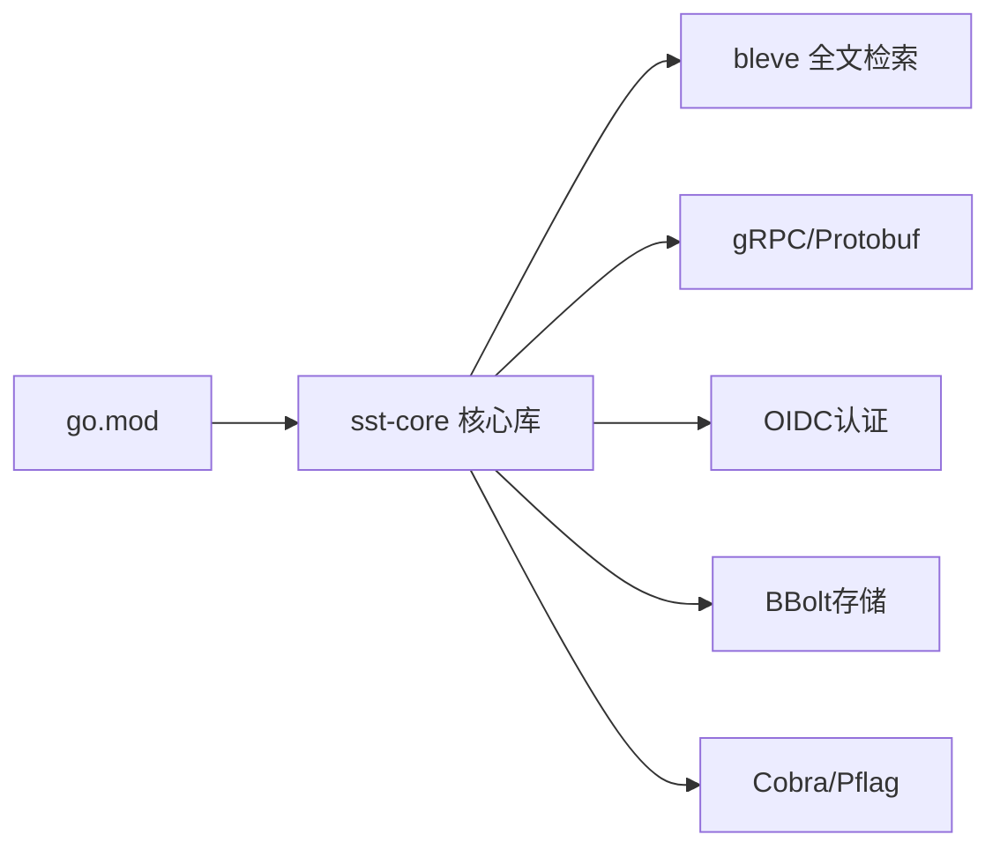
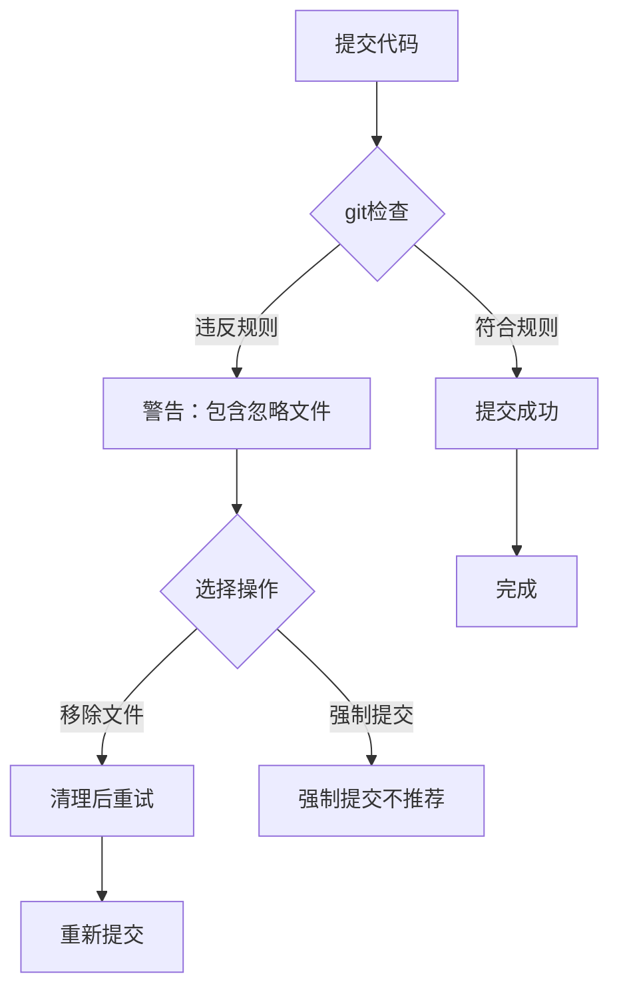

# 开发环境搭建

<cite>
**本文引用的文件**
- [go.mod](file://go.mod)
- [.golangci.yaml](file://.golangci.yaml)
- [.gitignore](file://.gitignore)
- [README.md](file://README.md)
- [cli/main.go](file://cli/main.go)
- [cli/cmd/utils/envsstcli.go](file://cli/cmd/utils/envsstcli.go)
- [bboltproto/remote.go](file://bboltproto/remote.go)
- [bleveproto/doc.go](file://bleveproto/doc.go)
- [examples/helloworldwrite/helloworldwrite.go](file://examples/helloworldwrite/helloworldwrite.go)
- [sst_core编译运行指导.txt](file://sst_core编译运行指导.txt)
</cite>

## 更新摘要
**变更内容**
- 更新了构建产物管理部分，新增对main.exe和sst.exe等可执行文件的忽略规则说明
- 完善了本地构建流程中的输出文件管理最佳实践
- 增强了版本控制与构建产物的分离指导

## 目录
1. [简介](#简介)
2. [项目结构](#项目结构)
3. [核心组件](#核心组件)
4. [架构总览](#架构总览)
5. [详细组件分析](#详细组件分析)
6. [依赖分析](#依赖分析)
7. [性能注意事项](#性能注意事项)
8. [故障排查指南](#故障排查指南)
9. [结论](#结论)
10. [附录](#附录)

## 简介
本指南面向SST Core（sst-core）项目的开发者，提供从零开始搭建本地开发环境的完整步骤。内容涵盖：
- Go语言版本要求与依赖管理
- 代码质量工具链安装与配置（golangci-lint、gofumpt等）
- 工作目录与项目结构说明
- IDE配置建议（VS Code、GoLand）
- 环境变量与构建脚本使用
- 克隆仓库、安装依赖与环境验证流程
- **新增** 构建产物管理与版本控制最佳实践

## 项目结构
仓库采用多模块的Go工程组织方式，根目录包含核心库、命令行工具、示例、协议定义与词汇表等。关键目录职责如下：
- sst：SST核心API与实现（仓库、数据集、阶段、命名图、序列化等）
- cli：命令行入口与交互式命令集
- examples：示例程序，便于快速上手
- bboltproto / bleveproto：基于Protobuf的远程接口定义与生成代码
- vocabularies：预编译的高层本体映射，简化应用开发
- tools：辅助工具（编译器、校验器、格式转换器等）
- step：数据格式转换相关能力（如AP242 XML导入导出）

**章节来源**
- [README.md:1-15](file://README.md#L1-L15)

## 核心组件
- 核心API包：位于sst包，提供Repository、Dataset、Stage、NamedGraph、IBNode等核心抽象，是应用开发的主要入口。
- CLI工具：位于cli包，提供类似Git风格的命令行交互能力，用于调试与测试SST Core及仓库。
- 示例程序：examples下提供HelloWorld读写示例，帮助快速理解SST的使用方式。
- Protobuf远程接口：bboltproto与bleveproto定义了远程通信所需的消息类型与gRPC服务桩。

**章节来源**
- [sst/doc.go:1-6](file://sst/doc.go#L1-L6)
- [cli/main.go:1-18](file://cli/main.go#L1-L18)
- [examples/helloworldwrite/helloworldwrite.go:1-98](file://examples/helloworldwrite/helloworldwrite.go#L1-L98)

## 架构总览
下图展示了CLI启动时加载环境变量并执行命令的基本流程，以及示例程序的典型调用路径。

**图表来源**
- [cli/main.go:12-17](file://cli/main.go#L12-L17)
- [cli/cmd/utils/envsstcli.go:14-34](file://cli/cmd/utils/envsstcli.go#L14-L34)
- [examples/helloworldwrite/helloworldwrite.go:42-95](file://examples/helloworldwrite/helloworldwrite.go#L42-L95)

**章节来源**
- [cli/main.go:1-18](file://cli/main.go#L1-L18)
- [cli/cmd/utils/envsstcli.go:1-85](file://cli/cmd/utils/envsstcli.go#L1-L85)
- [examples/helloworldwrite/helloworldwrite.go:1-98](file://examples/helloworldwrite/helloworldwrite.go#L1-L98)

## 详细组件分析

### 环境变量与认证配置
- 环境变量文件：CLI在启动时会尝试从当前工作目录或用户主目录下读取.env.sst-cli文件，按行解析KEY=VALUE，忽略注释与空行，支持引号包裹的值。
- 变量覆盖策略：仅当目标环境变量未设置时才写入，避免覆盖现有环境。
- 远程认证所需变量：SST_OIDC_REALM_URL、SST_OIDC_CLIENT_ID、SST_OIDC_CLIENT_SECRET；可选变量：SST_USERNAME、SST_PASSWORD（非交互式登录需同时设置）。

**图表来源**
- [cli/cmd/utils/envsstcli.go:14-34](file://cli/cmd/utils/envsstcli.go#L14-L34)
- [cli/cmd/utils/envsstcli.go:47-75](file://cli/cmd/utils/envsstcli.go#L47-L75)

**章节来源**
- [cli/cmd/utils/envsstcli.go:1-85](file://cli/cmd/utils/envsstcli.go#L1-L85)

### 构建与Protobuf生成
- 依赖protoc编译器及相关插件：protoc-gen-go、protoc-gen-go-grpc、protoc-gen-fieldmask。
- 生成命令通过go:generate指令声明，确保跨平台一致性。
- 需要确保GOPATH/bin或自定义bin目录在PATH中，以便正确发现插件。

**图表来源**
- [bboltproto/remote.go:11-20](file://bboltproto/remote.go#L11-L20)

**章节来源**
- [bboltproto/remote.go:1-25](file://bboltproto/remote.go#L1-L25)

### 构建产物管理
**更新** 项目现已配置了完善的构建产物忽略规则，确保版本控制的整洁性。

- **可执行文件忽略**：`.gitignore`中已配置忽略`main.exe`和`sst.exe`等Windows平台可执行文件
- **构建输出规范**：推荐使用`go build -o cli/sst ./cli/main.go`将CLI构建到指定目录
- **临时文件管理**：项目自动忽略测试输出、IDE配置等临时文件
- **跨平台兼容**：忽略规则支持不同平台的构建产物格式

**图表来源**
- [.gitignore:31-33](file://.gitignore#L31-L33)

**章节来源**
- [.gitignore:1-35](file://.gitignore#L1-L35)
- [sst_core编译运行指导.txt:15-18](file://sst_core编译运行指导.txt#L15-L18)

### 示例程序与基本用法
- 示例helloworldwrite演示了如何创建阶段、命名图、节点与三元组，并分别导出为Turtle文本与SST二进制文件。
- 该示例体现了SST的核心工作流：OpenStage -> CreateNamedGraph -> 创建节点与关系 -> 写出数据。

**图表来源**
- [examples/helloworldwrite/helloworldwrite.go:42-95](file://examples/helloworldwrite/helloworldwrite.go#L42-L95)

**章节来源**
- [examples/helloworldwrite/helloworldwrite.go:1-98](file://examples/helloworldwrite/helloworldwrite.go#L1-L98)

## 依赖分析
- Go版本：项目要求Go 1.25.0及以上。
- 主要依赖包括：Bleve全文检索、gRPC与Protobuf、OIDC认证、BBolt存储、Cobra/Pflag命令行框架、UUID与JSON库等。
- 间接依赖众多，由Go模块系统自动管理，无需手动维护。

**图表来源**
- [go.mod:1-34](file://go.mod#L1-L34)

**章节来源**
- [go.mod:1-80](file://go.mod#L1-L80)

## 性能注意事项
- 使用SST二进制格式进行读写可显著提升处理速度，适合大规模数据处理场景。
- 全文检索基于Bleve，建议在数据量较大时合理配置索引字段与查询参数。
- 远程仓库与gRPC通信需注意网络延迟与并发控制，必要时启用连接池与重试机制。

[本节为通用指导，不直接分析具体文件]

## 故障排查指南
- 环境变量未生效：确认.env.sst-cli位置与权限，检查是否被现有环境变量覆盖；查看CLI启动日志。
- Protobuf生成失败：确认protoc与插件已安装且PATH正确；核对go:generate命令中的-I与插件路径。
- 依赖下载失败：检查网络代理与Go模块镜像配置；必要时清理缓存后重试。
- 代码质量检查报错：根据.golangci.yaml规则定位问题，优先修复forbidigo与格式化相关提示。
- **新增** 构建产物污染：如果git status显示大量.exe文件，检查.gitignore配置是否正确，清理不必要的构建产物。

**章节来源**
- [.golangci.yaml:1-53](file://.golangci.yaml#L1-L53)
- [cli/cmd/utils/envsstcli.go:14-34](file://cli/cmd/utils/envsstcli.go#L14-L34)
- [bboltproto/remote.go:11-20](file://bboltproto/remote.go#L11-L20)
- [.gitignore:31-33](file://.gitignore#L31-L33)

## 结论
按照本指南完成Go版本与依赖管理、工具链安装、环境变量配置与构建脚本使用后，即可顺利在本地开展SST Core的开发与测试。建议结合IDE的最佳实践提升编码效率，并通过示例程序快速验证环境正确性。**特别注意**：利用项目配置的.gitignore规则管理构建产物，保持版本库的整洁性。

[本节为总结性内容，不直接分析具体文件]

## 附录

### 环境搭建步骤清单
- 安装Go并确保版本满足要求（1.25.0+）
- 克隆仓库到本地工作目录
- 安装依赖：在项目根目录执行依赖拉取与校验
- 安装代码质量工具：golangci-lint（含gofumpt等格式化与检查）
- 安装Protobuf工具链：protoc与插件（protoc-gen-go、protoc-gen-go-grpc、protoc-gen-fieldmask）
- 配置环境变量：如需远程认证，创建.env.sst-cli并填写必要变量
- 构建与运行：构建CLI或运行示例程序以验证环境
- **新增** 构建产物管理：利用.gitignore规则自动忽略main.exe、sst.exe等可执行文件

**章节来源**
- [go.mod:1-3](file://go.mod#L1-L3)
- [cli/main.go:12-17](file://cli/main.go#L12-L17)
- [cli/cmd/utils/envsstcli.go:14-34](file://cli/cmd/utils/envsstcli.go#L14-L34)
- [bboltproto/remote.go:11-20](file://bboltproto/remote.go#L11-L20)
- [.gitignore:31-33](file://.gitignore#L31-L33)

### 代码质量工具配置要点
- 启用linter：errorlint、exhaustive、forbidigo、godot、godox、revive、unconvert、unparam
- 禁用特定打印函数：禁止fmt.Printf与标准log包输出，推荐使用全局日志器
- 启用formatter：gofumpt，统一代码风格
- 排除规则：对测试、示例、工具与第三方目录放宽限制

**章节来源**
- [.golangci.yaml:1-53](file://.golangci.yaml#L1-L53)

### IDE配置建议
- VS Code
  - 安装Go扩展，启用gopls语言服务器
  - 配置golangci-lint集成，开启保存时格式化与检查
  - 设置go.work或使用go.mod进行模块管理
- GoLand
  - 启用Gocode/Gopls，配置代码检查与格式化
  - 将golangci-lint加入外部工具，便于一键检查
  - 配置Run/Debug模板以快速运行CLI与示例

[本节为通用指导，不直接分析具体文件]

### 构建脚本与命令参考
- 构建CLI：在项目根目录执行构建命令，指定输出路径
- 运行示例：进入examples目录，运行对应示例程序
- 生成Protobuf：在项目根目录执行go generate以重新生成远程接口代码
- **新增** 构建产物清理：使用`go clean`命令清理构建缓存和临时文件

**章节来源**
- [cli/main.go:12-17](file://cli/main.go#L12-L17)
- [bboltproto/remote.go:11-20](file://bboltproto/remote.go#L11-L20)
- [sst_core编译运行指导.txt:15-18](file://sst_core编译运行指导.txt#L15-L18)

### 版本控制最佳实践
**新增** 项目已配置完善的.gitignore规则，确保版本控制的高效性：

- **可执行文件忽略**：自动忽略main.exe、sst.exe等Windows平台可执行文件
- **测试输出管理**：忽略测试过程中生成的临时文件和输出
- **IDE配置隔离**：忽略.vscode、.idea等IDE配置文件
- **敏感信息保护**：忽略.env.sst-cli、.env.sst-test等包含敏感信息的环境文件

**图表来源**
- [.gitignore:1-35](file://.gitignore#L1-L35)

**章节来源**
- [.gitignore:1-35](file://.gitignore#L1-L35)