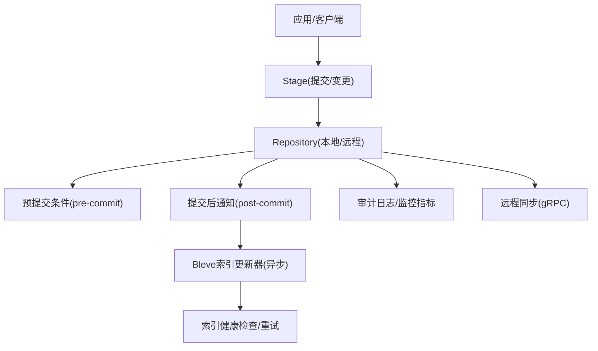
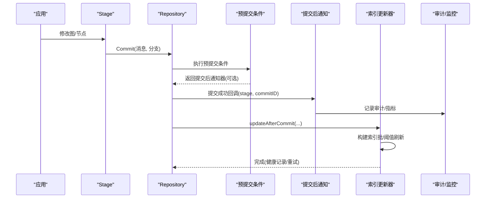
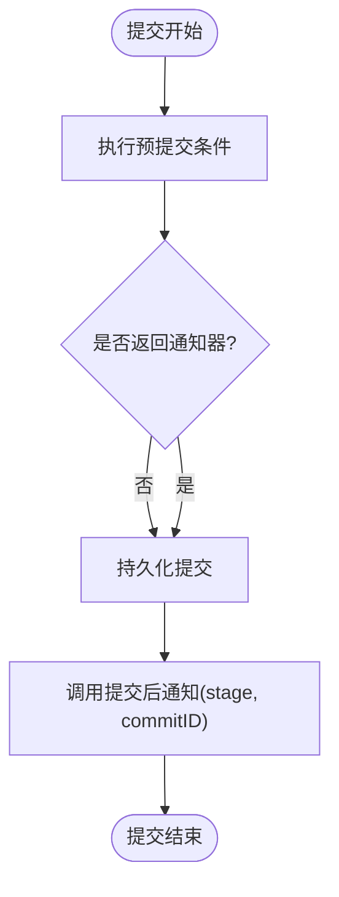
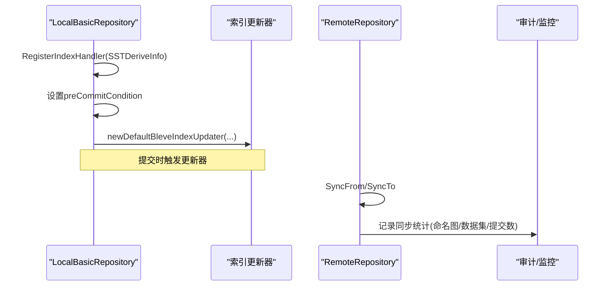
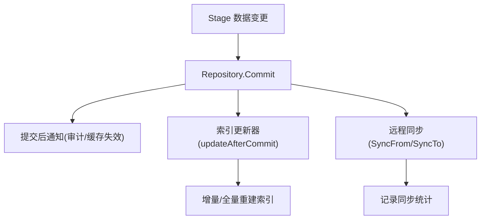
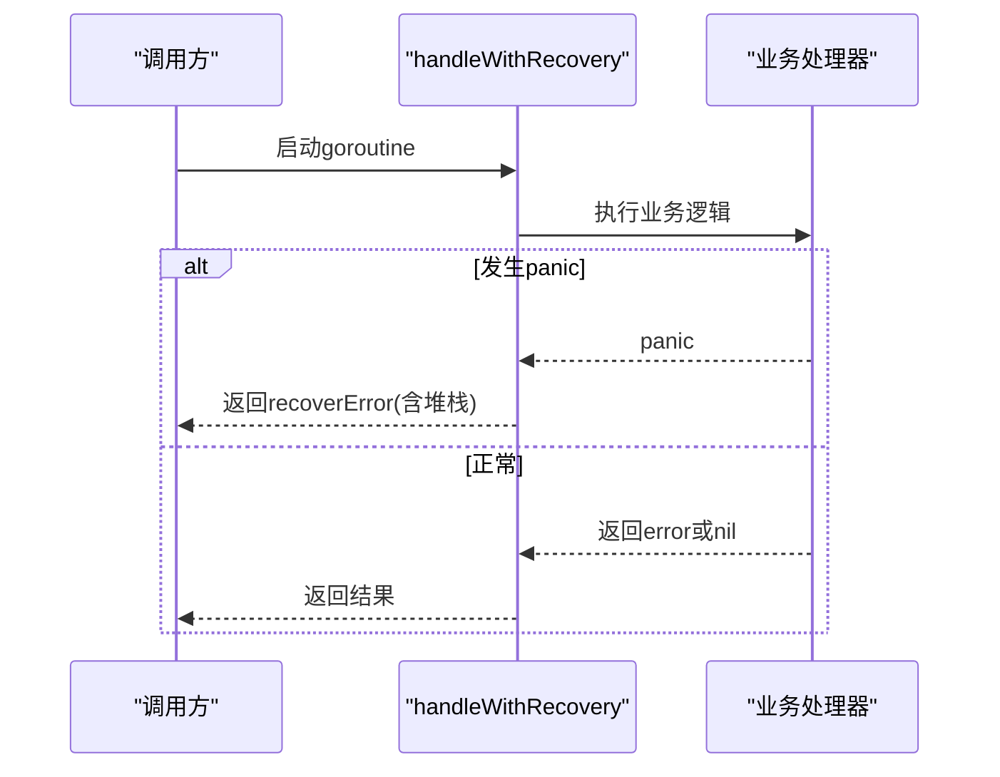
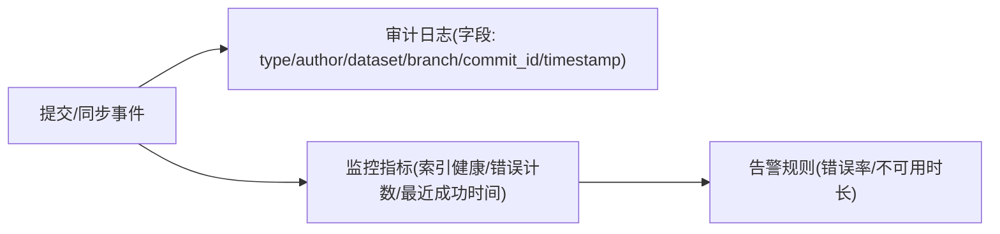
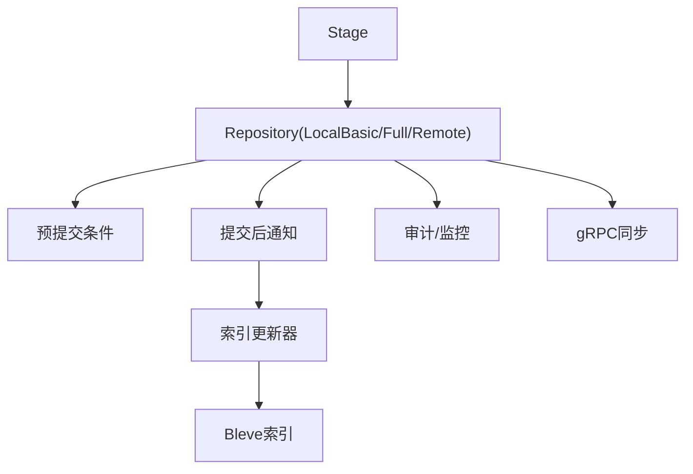

# 事件监听和钩子扩展

<cite>
**本文引用的文件**
- [bbolt_structure.go](file://sst/bbolt_structure.go)
- [indexupdate.go](file://sst/indexupdate.go)
- [repolocalbasic.go](file://sst/repolocalbasic.go)
- [stage.go](file://sst/stage.go)
- [errrecovery.go](file://sst/errrecovery.go)
- [reporemote.go](file://sst/reporemote.go)
- [repository.go](file://sst/repository.go)
- [repolocalfull.go](file://sst/repolocalfull.go)
- [repolocalflat_test.go](file://sst/repolocalflat_test.go)
</cite>

## 目录
1. [简介](#简介)
2. [项目结构](#项目结构)
3. [核心组件](#核心组件)
4. [架构总览](#架构总览)
5. [详细组件分析](#详细组件分析)
6. [依赖关系分析](#依赖关系分析)
7. [性能考虑](#性能考虑)
8. [故障排查指南](#故障排查指南)
9. [结论](#结论)
10. [附录](#附录)

## 简介
本指南面向需要在 SST 中实现“事件监听与钩子扩展”的开发者，系统说明 SST 的事件系统与回调机制、生命周期事件的触发时机与处理方式、数据变更通知与状态同步方案、异步事件处理与错误恢复、审计日志与监控告警的实现案例，以及事件系统的性能考量与最佳实践。SST 通过“预提交条件（pre-commit condition）”和“提交后通知（post-commit notification）”两类钩子，将仓库级操作（如提交、分支变更、同步等）与外部系统（索引、审计、告警、缓存失效等）解耦，提供可扩展且高性能的事件驱动能力。

## 项目结构
围绕事件与钩子的关键代码分布在以下模块：
- 钩子接口与存储层：定义 pre-commit/post-commit 回调类型与调用点，位于 bbolt 结构相关文件中。
- 索引更新器：在提交后异步更新 Bleve 全文索引，并执行约束检查，作为典型的事件消费者。
- 仓库实现：LocalBasic/LocalFull/Remote 仓库在提交、分支变更、同步等生命周期节点触发钩子或调用索引更新器。
- 阶段（Stage）：封装对 NamedGraph 的修改与提交，是事件触发的上游入口之一。
- 错误恢复：提供 panic 捕获与可恢复错误包装，保障事件处理的健壮性。
- 远程同步：通过 gRPC 流式传输数据，并在完成后记录统计信息，可作为审计与监控的数据源。



图表来源
- [bbolt_structure.go:61-79](file://sst/bbolt_structure.go#L61-L79)
- [indexupdate.go:39-75](file://sst/indexupdate.go#L39-L75)
- [repolocalbasic.go:117-145](file://sst/repolocalbasic.go#L117-L145)
- [reporemote.go:2007-2029](file://sst/reporemote.go#L2007-L2029)

章节来源
- [bbolt_structure.go:61-79](file://sst/bbolt_structure.go#L61-L79)
- [indexupdate.go:39-75](file://sst/indexupdate.go#L39-L75)
- [repolocalbasic.go:117-145](file://sst/repolocalbasic.go#L117-L145)
- [reporemote.go:2007-2029](file://sst/reporemote.go#L2007-L2029)

## 核心组件
- 预提交条件回调（pre-commit condition）
  - 作用：在持久化提交前进行校验或准备（例如构建索引批、收集待检查约束）。
  - 返回：可选的“提交后通知器”，用于在提交成功后执行后续动作（如 LocalBasic 将暂存索引合并到主索引）。
- 提交后通知回调（post-commit notification）
  - 作用：在提交成功后通知外部系统（如审计、缓存失效、下游同步）。
  - 参数：当前 Stage 与 commit ID（某些实现可能为空或占位值）。
- 索引更新器（bleveIndexUpdaterI）
  - 职责：在提交、分支设置/删除、同步等事件后异步更新搜索索引，并执行唯一性等前置约束检查。
  - 特性：后台队列、批量写入、健康感知与重试、flush/close 控制。
- 仓库实现（LocalBasic/LocalFull/Remote）
  - 在 Commit/SetBranch/RemoveBranch/SyncFrom 等生命周期节点调用上述钩子或索引更新器。
- 错误恢复
  - 提供 recover 包装，将 panic 转换为可恢复错误，便于上层统一处理与上报。

章节来源
- [bbolt_structure.go:61-79](file://sst/bbolt_structure.go#L61-L79)
- [indexupdate.go:39-75](file://sst/indexupdate.go#L39-L75)
- [repolocalbasic.go:117-145](file://sst/repolocalbasic.go#L117-L145)
- [repolocalfull.go:763-768](file://sst/repolocalfull.go#L763-L768)
- [errrecovery.go:15-93](file://sst/errrecovery.go#L15-L93)

## 架构总览
SST 的事件系统以“仓库生命周期事件”为中心，通过“预提交条件”和“提交后通知”两个钩子点，将业务逻辑与基础设施（索引、审计、监控、同步）解耦。索引更新器采用异步队列模式，避免阻塞数据库事务；同时具备健康检测与重试，确保在高并发与异常场景下的稳定性。



图表来源
- [repolocalbasic.go:117-145](file://sst/repolocalbasic.go#L117-L145)
- [indexupdate.go:160-249](file://sst/indexupdate.go#L160-L249)
- [repolocalflat_test.go:91-138](file://sst/repolocalflat_test.go#L91-L138)

## 详细组件分析

### 钩子系统：预提交条件与提交后通知
- 预提交条件
  - 由仓库实现注册回调，在提交前执行，可返回一个“提交后通知器”。
  - 典型用途：为 LocalBasic 准备索引批、收集需要后置执行的约束检查。
- 提交后通知
  - 提交成功后由仓库调用，携带 stage 与 commitID。
  - 典型用途：审计日志、缓存失效、下游通知、指标上报。



图表来源
- [bbolt_structure.go:61-79](file://sst/bbolt_structure.go#L61-L79)
- [repolocalbasic.go:626-649](file://sst/repolocalbasic.go#L626-L649)
- [repolocalflat_test.go:91-138](file://sst/repolocalflat_test.go#L91-L138)

章节来源
- [bbolt_structure.go:61-79](file://sst/bbolt_structure.go#L61-L79)
- [repolocalbasic.go:626-649](file://sst/repolocalbasic.go#L626-L649)
- [repolocalflat_test.go:91-138](file://sst/repolocalflat_test.go#L91-L138)

### 索引更新器：异步事件消费者
- 设计要点
  - 后台工作协程消费任务队列，避免阻塞提交事务。
  - 批量写入与阈值刷新，降低 I/O 开销。
  - 健康感知：记录错误/成功，必要时重试搜索。
  - flush/close：测试与关闭时保证队列清空。
- 触发时机
  - updateAfterCommit：提交后重建/增量更新索引，并执行约束检查。
  - updateAfterSetBranch/updateAfterRemoveBranch：分支变更后重算或删除文档。
  - updateAfterSync：从其他仓库同步后，以“sync”作者标记更新索引。

```mermaid
classDiagram
class bleveIndexUpdaterI {
+updateAfterCommit(ctx, repo, stage, notifier, commitInfo, modifiedDatasets, branch)
+updateAfterSetBranch(ctx, repo, dsID, branch)
+updateAfterRemoveBranch(ctx, repo, dsID, branch)
+updateAfterSync(ctx, repo, dsID, branch)
+flush()
+close()
}
class defaultBleveIndexUpdater {
-queue chan func()
-stop chan struct{}
-idx healthAwareIndex
+run()
+submit(fn)
+recordError(err)
+recordSuccess()
}
class healthAwareIndex {
-inner Index
-health atomic.Value
+Search(req)
+Batch(batch)
+Delete(id)
}
bleveIndexUpdaterI <|.. defaultBleveIndexUpdater
defaultBleveIndexUpdater --> healthAwareIndex : "使用"
```

图表来源
- [indexupdate.go:39-75](file://sst/indexupdate.go#L39-L75)
- [indexupdate.go:77-158](file://sst/indexupdate.go#L77-L158)
- [indexupdate.go:650-795](file://sst/indexupdate.go#L650-L795)

章节来源
- [indexupdate.go:39-75](file://sst/indexupdate.go#L39-L75)
- [indexupdate.go:77-158](file://sst/indexupdate.go#L77-L158)
- [indexupdate.go:160-249](file://sst/indexupdate.go#L160-L249)
- [indexupdate.go:251-344](file://sst/indexupdate.go#L251-L344)
- [indexupdate.go:650-795](file://sst/indexupdate.go#L650-L795)

### 仓库实现：事件触发点
- LocalBasicRepository
  - 注册索引处理器时设置 preCommitCondition，并在提交后调用 postCommitNotification。
  - 当存在 Bleve 索引时，构建健康感知索引与异步更新器。
- LocalFullRepository
  - 暴露 preCommitCondition 与 postCommitNotification 获取器，供上层组合使用。
- RemoteRepository
  - SyncFrom/SyncTo 流程中记录同步统计，可用于审计与监控。



图表来源
- [repolocalbasic.go:67-145](file://sst/repolocalbasic.go#L67-L145)
- [repolocalbasic.go:147-200](file://sst/repolocalbasic.go#L147-L200)
- [repolocalfull.go:763-768](file://sst/repolocalfull.go#L763-L768)
- [reporemote.go:2161-2185](file://sst/reporemote.go#L2161-L2185)

章节来源
- [repolocalbasic.go:67-145](file://sst/repolocalbasic.go#L67-L145)
- [repolocalbasic.go:147-200](file://sst/repolocalbasic.go#L147-L200)
- [repolocalfull.go:763-768](file://sst/repolocalfull.go#L763-L768)
- [reporemote.go:2161-2185](file://sst/reporemote.go#L2161-L2185)

### 数据变更通知与状态同步
- 数据变更来源
  - Stage 中对 NamedGraph/IBNode 的增删改，最终通过 Repository.Commit 持久化。
- 通知与同步
  - 提交后通知：可触发下游系统（如缓存、搜索引擎、外部服务）的状态同步。
  - 索引更新器：在默认分支上自动重建/增量更新文档，并执行约束检查。
  - 同步流程：RemoteRepository 支持跨仓库同步，并在完成后输出统计信息。



图表来源
- [stage.go:121-130](file://sst/stage.go#L121-L130)
- [indexupdate.go:160-249](file://sst/indexupdate.go#L160-L249)
- [reporemote.go:2007-2029](file://sst/reporemote.go#L2007-L2029)
- [reporemote.go:2161-2185](file://sst/reporemote.go#L2161-L2185)

章节来源
- [stage.go:121-130](file://sst/stage.go#L121-L130)
- [indexupdate.go:160-249](file://sst/indexupdate.go#L160-L249)
- [reporemote.go:2007-2029](file://sst/reporemote.go#L2007-L2029)
- [reporemote.go:2161-2185](file://sst/reporemote.go#L2161-L2185)

### 异步事件处理与错误恢复
- 异步处理
  - 索引更新器通过后台队列与 goroutine 处理任务，支持 flush/close 控制。
  - 批量写入与阈值刷新，减少频繁 I/O。
- 错误恢复
  - handleWithRecovery 捕获 panic，生成包含堆栈的可恢复错误，便于统一上报。
  - 健康感知索引在搜索失败时尝试重试，并记录错误计数与最近成功时间。



图表来源
- [errrecovery.go:81-93](file://sst/errrecovery.go#L81-L93)
- [indexupdate.go:100-158](file://sst/indexupdate.go#L100-L158)
- [indexupdate.go:703-735](file://sst/indexupdate.go#L703-L735)

章节来源
- [errrecovery.go:81-93](file://sst/errrecovery.go#L81-L93)
- [indexupdate.go:100-158](file://sst/indexupdate.go#L100-L158)
- [indexupdate.go:703-735](file://sst/indexupdate.go#L703-L735)

### 审计日志与监控告警实现案例
- 审计日志
  - 提交后通知回调中记录审计字段（如 author、timestamp、commit_id、branch、dataset 等），可通过配置注入日志器。
  - 远程同步完成后输出统计信息（命名图/数据集/提交/文档信息等），便于追踪同步范围与效率。
- 监控告警
  - 索引健康状态（healthy、errorCount、lastError、lastSuccess）可作为监控指标。
  - 当索引不健康但搜索成功时，返回附带警告的错误，便于告警系统捕获。



图表来源
- [bbolt_structure.go:147-191](file://sst/bbolt_structure.go#L147-L191)
- [reporemote.go:2161-2185](file://sst/reporemote.go#L2161-L2185)
- [indexupdate.go:650-735](file://sst/indexupdate.go#L650-L735)

章节来源
- [bbolt_structure.go:147-191](file://sst/bbolt_structure.go#L147-L191)
- [reporemote.go:2161-2185](file://sst/reporemote.go#L2161-L2185)
- [indexupdate.go:650-735](file://sst/indexupdate.go#L650-L735)

## 依赖关系分析
- 组件耦合
  - 仓库实现依赖索引更新器与钩子接口，形成松耦合的事件消费模型。
  - 索引更新器依赖 Bleve 索引与健康感知代理，屏蔽底层 I/O 细节。
- 直接/间接依赖
  - Stage -> Repository -> 钩子/索引更新器 -> 索引/日志/监控。
  - RemoteRepository -> gRPC 流 -> 审计统计。
- 循环依赖
  - 未见明显循环依赖；事件流向单向（仓库 -> 消费者）。



图表来源
- [stage.go:121-130](file://sst/stage.go#L121-L130)
- [repolocalbasic.go:67-145](file://sst/repolocalbasic.go#L67-L145)
- [indexupdate.go:39-75](file://sst/indexupdate.go#L39-L75)
- [reporemote.go:2007-2029](file://sst/reporemote.go#L2007-L2029)

章节来源
- [stage.go:121-130](file://sst/stage.go#L121-L130)
- [repolocalbasic.go:67-145](file://sst/repolocalbasic.go#L67-L145)
- [indexupdate.go:39-75](file://sst/indexupdate.go#L39-L75)
- [reporemote.go:2007-2029](file://sst/reporemote.go#L2007-L2029)

## 性能考虑
- 异步与批处理
  - 索引更新器使用后台队列与批量写入，避免阻塞提交事务；按阈值刷新批次，降低 I/O 压力。
- 健康感知与重试
  - 搜索失败时短暂休眠并重试，提升可用性；记录错误计数与最近成功时间，便于监控。
- 分支过滤
  - 仅在默认分支上进行索引更新，减少不必要的工作。
- 资源管理
  - flush/close 确保队列清空与协程退出，防止资源泄漏。
- 建议
  - 合理设置批量大小与阈值，平衡吞吐与延迟。
  - 对高并发场景，关注队列长度与背压策略。
  - 结合监控指标（错误率、健康状态）动态调整参数。

章节来源
- [indexupdate.go:77-158](file://sst/indexupdate.go#L77-L158)
- [indexupdate.go:160-249](file://sst/indexupdate.go#L160-L249)
- [indexupdate.go:650-735](file://sst/indexupdate.go#L650-L735)

## 故障排查指南
- 常见问题
  - 索引更新失败：检查索引路径、映射配置与权限；查看健康状态与错误计数。
  - 预提交条件失败：确认约束查询与数据一致性；定位冲突文档集合。
  - 提交后通知未触发：确认仓库实现是否正确注册回调；检查分支是否为默认分支。
  - 远程同步异常：核对 gRPC 连接与认证；检查流式传输错误与响应统计。
- 诊断步骤
  - 启用详细日志（zap），观察提交、索引更新、同步流程的关键日志。
  - 使用 FlushBleveIndex 等待异步任务完成，验证最终一致性。
  - 检查 recoveredError 的堆栈信息，定位 panic 来源。
- 恢复策略
  - 重建索引（删除索引目录并重新构建）。
  - 重试搜索与批量写入；必要时降级为只读或暂停写入。

章节来源
- [indexupdate.go:366-422](file://sst/indexupdate.go#L366-L422)
- [indexupdate.go:504-584](file://sst/indexupdate.go#L504-L584)
- [indexupdate.go:633-648](file://sst/indexupdate.go#L633-L648)
- [errrecovery.go:15-93](file://sst/errrecovery.go#L15-L93)
- [reporemote.go:2161-2185](file://sst/reporemote.go#L2161-L2185)

## 结论
SST 的事件系统通过“预提交条件”和“提交后通知”两大钩子，将仓库生命周期事件与外部系统解耦，并以异步索引更新器为核心实现数据变更通知与状态同步。其健康感知、重试与批量写入机制保障了在高并发与异常场景下的稳定性。结合审计日志与监控指标，可实现完整的可观测性与告警能力。遵循本文的最佳实践，可在保证性能的同时，灵活扩展事件处理能力。

## 附录
- 快速上手
  - 注册索引处理器：在仓库打开/创建时调用 RegisterIndexHandler，传入 SSTDeriveInfo。
  - 配置提交后通知：在仓库配置中注入 postCommitNotification 回调，用于审计与监控。
  - 等待异步完成：使用 FlushBleveIndex 确保索引更新任务全部处理完毕。
- 参考路径
  - 钩子接口与调用点：[bbolt_structure.go:61-79](file://sst/bbolt_structure.go#L61-L79)
  - 索引更新器实现：[indexupdate.go:39-75](file://sst/indexupdate.go#L39-L75)
  - 仓库触发点：[repolocalbasic.go:117-145](file://sst/repolocalbasic.go#L117-L145)
  - 远程同步统计：[reporemote.go:2161-2185](file://sst/reporemote.go#L2161-L2185)
  - 错误恢复：[errrecovery.go:81-93](file://sst/errrecovery.go#L81-L93)