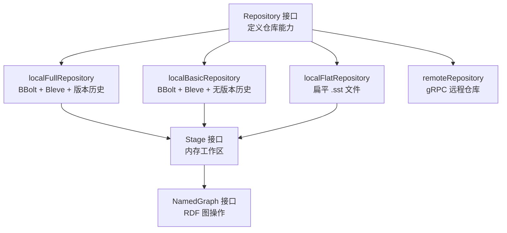
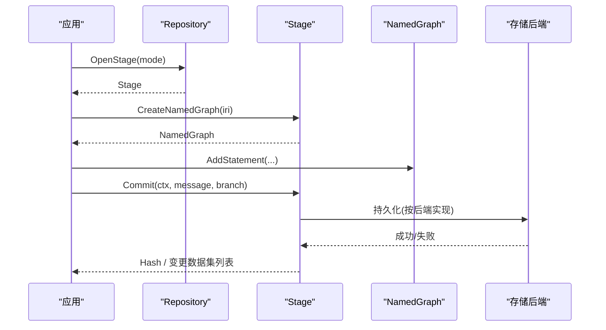
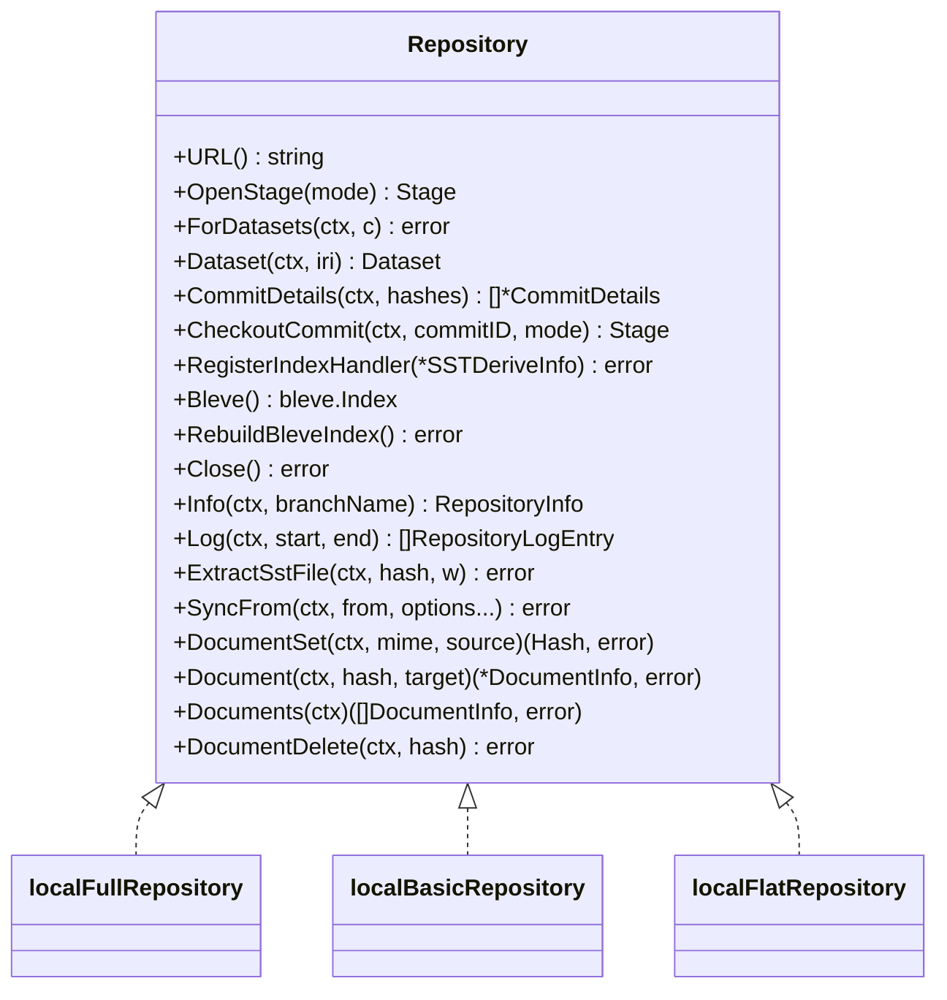
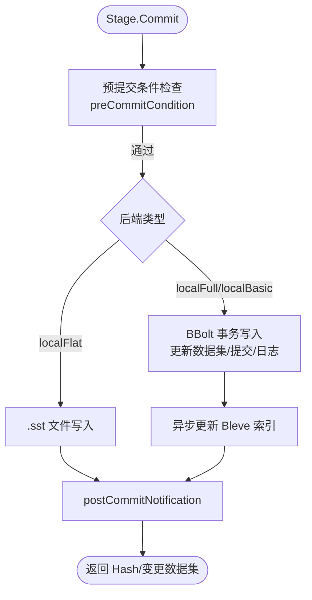
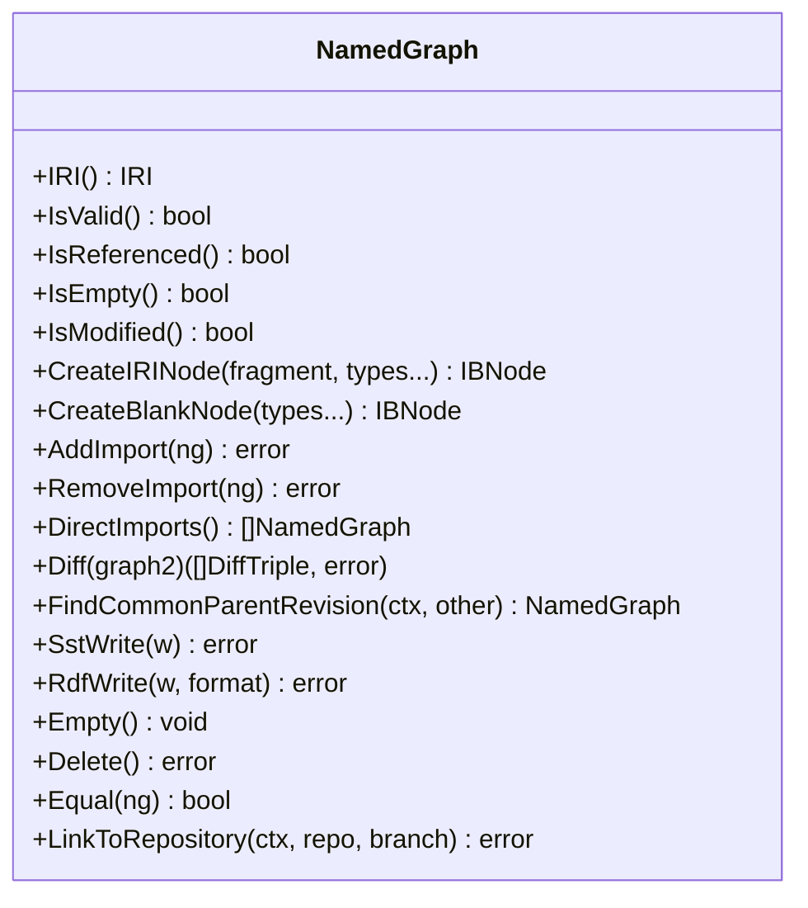
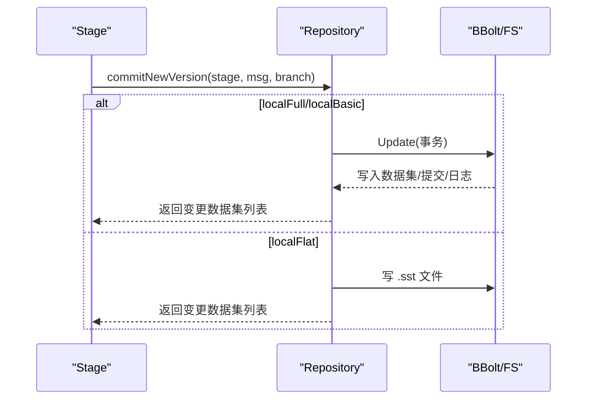
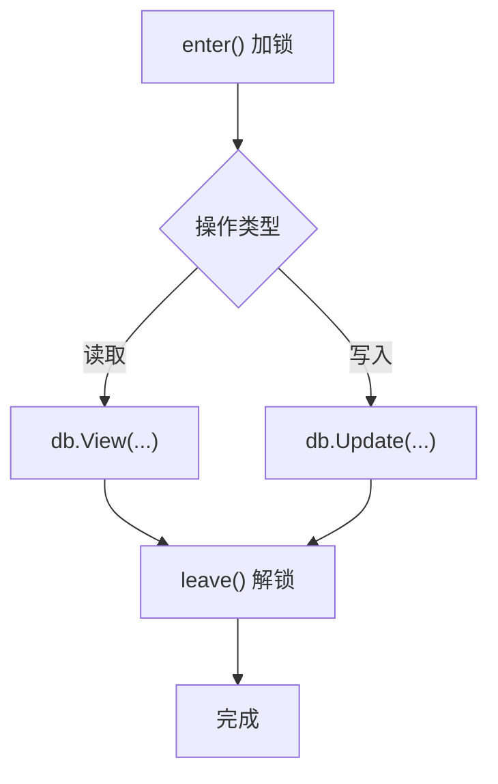
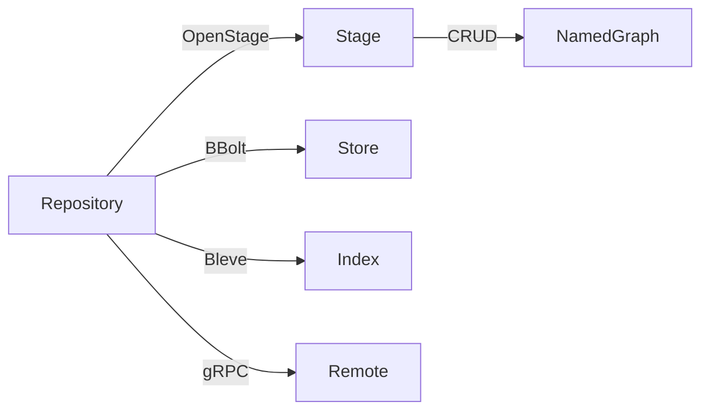

# 存储后端扩展

<cite>
**本文引用的文件**
- [repository.go](file://sst/repository.go)
- [stage.go](file://sst/stage.go)
- [namedgraph.go](file://sst/namedgraph.go)
- [types.go](file://sst/types.go)
- [repolocalbasic.go](file://sst/repolocalbasic.go)
- [repolocalfull.go](file://sst/repolocalfull.go)
- [repolocalflat.go](file://sst/repolocalflat.go)
- [commit.go](file://sst/commit.go)
- [repolocalfull_test.go](file://examples/helloworldrepolocalfull/repolocalfull.go)
- [helloworldrepolocalflat.go](file://examples/helloworldrepolocalflat/helloworldrepolocalflat.go)
</cite>

## 目录
1. [简介](#简介)
2. [项目结构](#项目结构)
3. [核心组件](#核心组件)
4. [架构总览](#架构总览)
5. [详细组件分析](#详细组件分析)
6. [依赖关系分析](#依赖关系分析)
7. [性能与调优](#性能与调优)
8. [故障排查指南](#故障排查指南)
9. [结论](#结论)
10. [附录：实现自定义存储后端步骤](#附录实现自定义存储后端步骤)

## 简介
本指南面向希望扩展 SST 存储后端的开发者，系统阐述 Repository 接口设计与存储抽象层，说明如何实现自定义存储后端；详解 Stage 与 NamedGraph 接口的实现要求；给出数据持久化与事务处理的设计模式；总结并发控制与锁机制；并提供本地文件存储与数据库存储的实现案例；最后给出性能调优与监控方法。

## 项目结构
SST 的存储抽象位于 sst 包中，核心由 Repository、Stage、NamedGraph 三部分组成，并通过多种具体实现（localFull、localBasic、localFlat）提供不同的持久化策略。示例代码展示了如何创建、写入、提交和检出数据集。

图表来源
- [repository.go:50-179](file://sst/repository.go#L50-L179)
- [repolocalfull.go:217-257](file://sst/repolocalfull.go#L217-L257)
- [repolocalbasic.go:34-65](file://sst/repolocalbasic.go#L34-L65)
- [repolocalflat.go:28-61](file://sst/repolocalflat.go#L28-L61)
- [stage.go:74-234](file://sst/stage.go#L74-L234)
- [namedgraph.go:117-409](file://sst/namedgraph.go#L117-L409)

章节来源
- [repository.go:50-179](file://sst/repository.go#L50-L179)
- [stage.go:74-234](file://sst/stage.go#L74-L234)
- [namedgraph.go:117-409](file://sst/namedgraph.go#L117-L409)

## 核心组件
- Repository 接口：定义仓库的打开阶段、数据集枚举、索引管理、提交元数据、日志、文档存取、同步等能力。
- Stage 接口：内存中的工作区，承载多个 NamedGraph，支持创建、移动合并、提交到仓库、导出 RDF/SST 等。
- NamedGraph 接口：RDF 命名图的内存表示，支持节点创建、三元组遍历、导入关系、差异比较、共同祖先查找、序列化等。
- CommitDetails：提交元数据结构，包含作者、时间、消息、父提交、数据集/命名图修订等。

章节来源
- [repository.go:50-179](file://sst/repository.go#L50-L179)
- [stage.go:74-234](file://sst/stage.go#L74-L234)
- [namedgraph.go:117-409](file://sst/namedgraph.go#L117-L409)
- [commit.go:18-29](file://sst/commit.go#L18-L29)

## 架构总览
SST 将“工作区”与“持久化”解耦：应用通过 Repository.OpenStage 获取 Stage，在内存中修改 NamedGraph，再通过 Stage.Commit 持久化到具体后端。不同后端以相同接口暴露能力，屏蔽底层差异。

图表来源
- [repository.go:60-89](file://sst/repository.go#L60-L89)
- [stage.go:121-130](file://sst/stage.go#L121-L130)
- [namedgraph.go:200-227](file://sst/namedgraph.go#L200-L227)

## 详细组件分析

### Repository 接口与实现
- 统一入口：OpenStage、ForDatasets、Dataset、CommitDetails、CheckoutCommit、Bleve、RebuildBleveIndex、Close、Info、Log、ExtractSstFile、SyncFrom、DocumentSet/Document/Documents/Delete。
- 本地实现：
  - localFullRepository：基于 BBolt 存储，支持分支、提交历史、数据集/命名图修订、Bleve 全文索引。
  - localBasicRepository：基于 BBolt 存储，无提交历史，仅当前快照。
  - localFlatRepository：基于文件系统扁平 .sst 文件，无索引、无历史。
- 远程实现：通过 gRPC 访问远端仓库（不在本节展开）。

图表来源
- [repository.go:50-179](file://sst/repository.go#L50-L179)
- [repolocalfull.go:217-257](file://sst/repolocalfull.go#L217-L257)
- [repolocalbasic.go:34-65](file://sst/repolocalbasic.go#L34-L65)
- [repolocalflat.go:28-61](file://sst/repolocalflat.go#L28-L61)

章节来源
- [repository.go:50-179](file://sst/repository.go#L50-L179)
- [repolocalfull.go:217-257](file://sst/repolocalfull.go#L217-L257)
- [repolocalbasic.go:34-65](file://sst/repolocalbasic.go#L34-L65)
- [repolocalflat.go:28-61](file://sst/repolocalflat.go#L28-L61)

### Stage 接口与实现要点
- 作用：内存工作区，维护 localGraphs 与 referencedGraphs，负责 MoveAndMerge、提交、导出等。
- 关键方法：CreateNamedGraph、NamedGraph(s)、MoveAndMerge、Commit、AlignHistory、WriteSstFilesDirectory、RdfWrite、Info/Dump。
- 提交流程：调用 Repository.commitNewVersion，内部根据后端类型执行持久化（BBolt 或写 .sst 文件），并触发索引更新与后置通知。

图表来源
- [stage.go:121-130](file://sst/stage.go#L121-L130)
- [repolocalbasic.go:616-653](file://sst/repolocalbasic.go#L616-L653)
- [repolocalflat.go:301-322](file://sst/repolocalflat.go#L301-L322)
- [repolocalfull.go:721-732](file://sst/repolocalfull.go#L721-L732)

章节来源
- [stage.go:74-234](file://sst/stage.go#L74-L234)
- [repolocalbasic.go:616-653](file://sst/repolocalbasic.go#L616-L653)
- [repolocalflat.go:301-322](file://sst/repolocalflat.go#L301-L322)
- [repolocalfull.go:721-732](file://sst/repolocalfull.go#L721-L732)

### NamedGraph 接口与实现要点
- 作用：RDF 命名图的内存模型，管理 IBNode、triplexStorage、导入关系、提交元数据等。
- 关键能力：创建节点、添加语句、遍历节点、导入/移除导入、Diff、FindCommonParentRevision、LinkToRepository、SstWrite/RdfWrite、Empty/Delete、Equal。
- LinkToRepository：为无历史的 NamedGraph 建立与仓库分支的关联，以便后续提交继承父提交。

图表来源
- [namedgraph.go:117-409](file://sst/namedgraph.go#L117-L409)
- [namedgraph.go:415-503](file://sst/namedgraph.go#L415-L503)

章节来源
- [namedgraph.go:117-409](file://sst/namedgraph.go#L117-L409)
- [namedgraph.go:415-503](file://sst/namedgraph.go#L415-L503)

### 数据持久化与事务处理
- localFullRepository：使用 BBolt 事务封装读写，保证原子性；提交时写入 commits/datasets 等桶，并维护分支引用与日志。
- localBasicRepository：同样基于 BBolt，但不维护提交历史；提交时仅写数据集快照。
- localFlatRepository：直接写 .sst 文件，无事务语义；适合简单场景。

图表来源
- [repolocalbasic.go:459-472](file://sst/repolocalbasic.go#L459-L472)
- [repolocalbasic.go:616-653](file://sst/repolocalbasic.go#L616-L653)
- [repolocalflat.go:301-322](file://sst/repolocalflat.go#L301-L322)
- [repolocalfull.go:595-719](file://sst/repolocalfull.go#L595-L719)

章节来源
- [repolocalbasic.go:459-472](file://sst/repolocalbasic.go#L459-L472)
- [repolocalbasic.go:616-653](file://sst/repolocalbasic.go#L616-L653)
- [repolocalflat.go:301-322](file://sst/repolocalflat.go#L301-L322)
- [repolocalfull.go:595-719](file://sst/repolocalfull.go#L595-L719)

### 并发控制与锁机制
- 仓库级状态机：stateControl 通过 CompareAndSwap 与 WaitGroup 确保关闭顺序正确，避免竞态。
- 读/写路径：view/update 方法封装 BBolt 的 View/Update 事务，进入/离开时加锁，保证并发安全。
- 索引更新：Bleve 索引更新采用异步后台任务，避免阻塞提交主路径。
- 配额与文档写入：quotaState 使用互斥量串行化配额检查与写入。

图表来源
- [repolocalbasic.go:444-472](file://sst/repolocalbasic.go#L444-L472)
- [repolocalfull.go:734-761](file://sst/repolocalfull.go#L734-L761)
- [repolocalfull.go:210-215](file://sst/repolocalfull.go#L210-L215)

章节来源
- [repolocalbasic.go:444-472](file://sst/repolocalbasic.go#L444-L472)
- [repolocalfull.go:734-761](file://sst/repolocalfull.go#L734-L761)
- [repolocalfull.go:210-215](file://sst/repolocalfull.go#L210-L215)

### 本地文件存储与数据库存储案例
- 本地文件存储（LocalFlat）：每个数据集一个 .sst 文件，无索引、无历史；适合轻量、可移植的场景。
- 数据库存储（LocalFull/LocalBasic）：BBolt 键值库，支持事务、分支、提交历史、Bleve 索引；适合生产环境。

章节来源
- [repolocalflat.go:28-61](file://sst/repolocalflat.go#L28-L61)
- [repolocalflat.go:301-322](file://sst/repolocalflat.go#L301-L322)
- [repolocalbasic.go:34-65](file://sst/repolocalbasic.go#L34-L65)
- [repolocalfull.go:217-257](file://sst/repolocalfull.go#L217-L257)

### 示例用法
- LocalFull：创建仓库、添加数据、提交、导出 TTL、重新打开并检出验证。
- LocalFlat：创建扁平仓库、添加数据、提交、导出 TTL。

章节来源
- [repolocalfull_test.go:24-94](file://examples/helloworldrepolocalfull/repolocalfull.go#L24-L94)
- [helloworldrepolocalflat.go:23-75](file://examples/helloworldrepolocalflat/helloworldrepolocalflat.go#L23-L75)

## 依赖关系分析
- Repository 与 Stage/NamedGraph 松耦合：通过接口交互，便于替换后端。
- 索引与存储分离：Bleve 索引通过配置注入，不影响核心存储逻辑。
- 外部依赖：BBolt（本地 KV）、Bleve（搜索）、gRPC（远程）、UUID/JSON 等。

图表来源
- [repository.go:50-179](file://sst/repository.go#L50-L179)
- [repolocalfull.go:217-257](file://sst/repolocalfull.go#L217-L257)
- [repolocalbasic.go:34-65](file://sst/repolocalbasic.go#L34-L65)
- [repolocalflat.go:28-61](file://sst/repolocalflat.go#L28-L61)

章节来源
- [repository.go:50-179](file://sst/repository.go#L50-L179)
- [repolocalfull.go:217-257](file://sst/repolocalfull.go#L217-L257)
- [repolocalbasic.go:34-65](file://sst/repolocalbasic.go#L34-L65)
- [repolocalflat.go:28-61](file://sst/repolocalflat.go#L28-L61)

## 性能与调优
- 索引重建与增量更新：
  - RebuildBleveIndex：全量重建索引，适用于映射变更或索引损坏。
  - 默认异步更新：提交后后台更新索引，减少提交延迟。
- 存储选择：
  - LocalFull：高吞吐、强一致、支持历史与查询。
  - LocalBasic：简化历史，降低复杂度。
  - LocalFlat：最小依赖，易迁移，但无事务与索引。
- 资源监控：
  - Info 提供仓库大小、数据集数量、索引大小等信息。
  - 计算 BBolt 文件大小与 Bleve 目录大小用于容量规划。
- 并发优化：
  - 使用 view/update 隔离读写事务。
  - 后台索引更新避免阻塞主路径。
  - 配额检查串行化，防止竞争。

章节来源
- [repolocalbasic.go:147-222](file://sst/repolocalbasic.go#L147-L222)
- [repolocalfull.go:345-426](file://sst/repolocalfull.go#L345-L426)
- [repolocalbasic.go:660-723](file://sst/repolocalbasic.go#L660-L723)
- [repolocalflat.go:381-430](file://sst/repolocalflat.go#L381-L430)

## 故障排查指南
- 常见错误：
  - 仓库不存在/已存在：创建/打开时的目录校验。
  - 数据集未找到：按 IRI/UUID 查找失败。
  - 不支持的方法：如 Basic/Flat 仓库对某些高级功能返回 NotSupported。
  - 预提交条件失败：注册索引处理器后的唯一性等约束不满足。
- 定位建议：
  - 使用 Info 查看仓库状态与大小。
  - 检查 Bleve 索引目录是否存在且可写。
  - 确认 BBolt 文件权限与磁盘空间。
  - 对于 Flat 仓库，检查 .sst 文件命名与内容完整性。

章节来源
- [repository.go:197-215](file://sst/repository.go#L197-L215)
- [repolocalbasic.go:769-798](file://sst/repolocalbasic.go#L769-L798)
- [repolocalflat.go:154-160](file://sst/repolocalflat.go#L154-L160)

## 结论
SST 通过清晰的 Repository/Stage/NamedGraph 三层抽象，实现了存储后端的高度可扩展性。开发者可根据需求选择本地文件、BBolt 数据库或远程仓库作为后端；借助事务、索引与并发控制，兼顾性能与一致性。遵循本文档的接口契约与实现要点，即可快速构建定制化的存储后端。

## 附录：实现自定义存储后端步骤
- 实现 Repository 接口：
  - 至少实现 OpenStage、ForDatasets、Dataset、Close、Info。
  - 若需版本历史与分支，参考 localFullRepository 的事务与引用管理。
  - 若仅需快照，参考 localBasicRepository 的简洁实现。
  - 若仅需文件存储，参考 localFlatRepository 的文件读写。
- 实现 Stage 与 NamedGraph：
  - 复用现有 stage/namedGraph 实现，或通过 OpenStage 返回兼容对象。
  - 确保 MoveAndMerge、Commit、RdfWrite/SstWrite 行为符合预期。
- 集成索引与监控：
  - 可选注册 Bleve 索引处理器，开启搜索能力。
  - 提供 Info 统计，便于容量与性能监控。
- 并发与事务：
  - 使用 view/update 封装读写，确保并发安全。
  - 如需跨进程/分布式，考虑引入分布式锁与事务协议。

章节来源
- [repository.go:50-179](file://sst/repository.go#L50-L179)
- [repolocalfull.go:217-257](file://sst/repolocalfull.go#L217-L257)
- [repolocalbasic.go:34-65](file://sst/repolocalbasic.go#L34-L65)
- [repolocalflat.go:28-61](file://sst/repolocalflat.go#L28-L61)
- [stage.go:74-234](file://sst/stage.go#L74-L234)
- [namedgraph.go:117-409](file://sst/namedgraph.go#L117-L409)