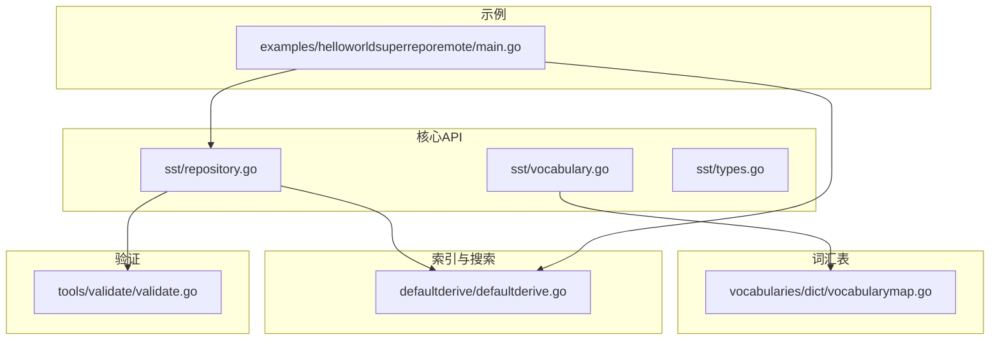
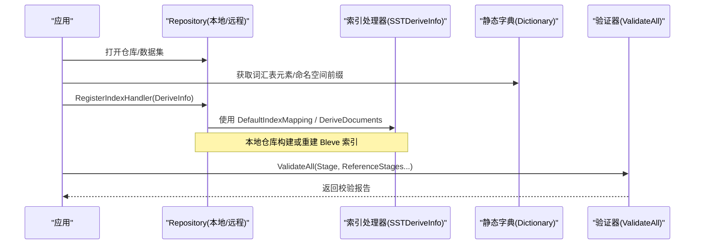
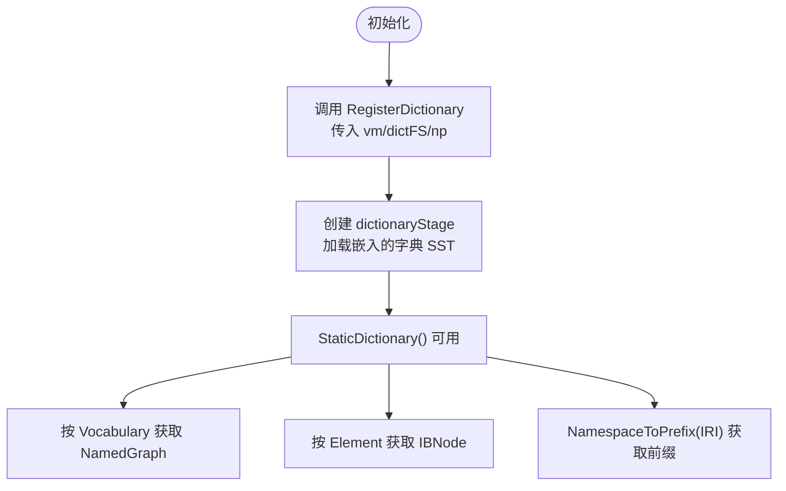
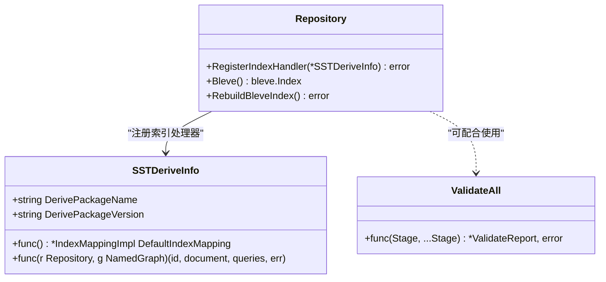
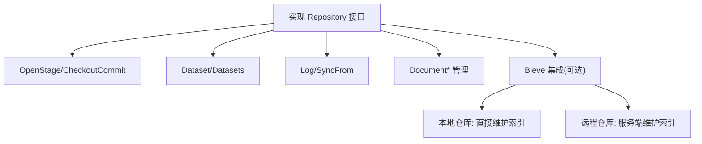
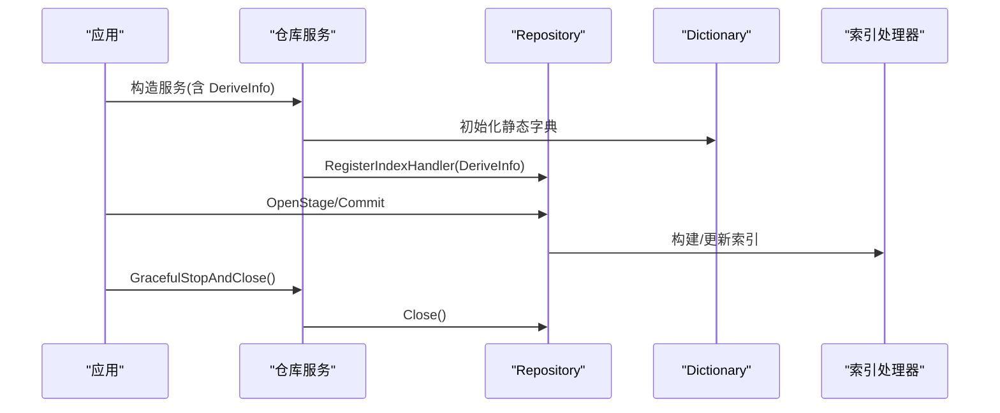
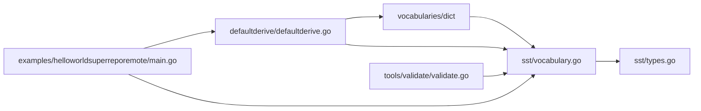

# 插件开发和扩展机制

<cite>
**本文引用的文件**
- [vocabulary.go](file://sst/vocabulary.go)
- [vocabularymap.go](file://vocabularies/dict/vocabularymap.go)
- [defaultderive.go](file://defaultderive/defaultderive.go)
- [repository.go](file://sst/repository.go)
- [validate.go](file://tools/validate/validate.go)
- [types.go](file://sst/types.go)
- [helloworldsuperreporemote/main.go](file://examples/helloworldsuperreporemote/main.go)
</cite>

## 目录
1. [简介](#简介)
2. [项目结构](#项目结构)
3. [核心组件](#核心组件)
4. [架构总览](#架构总览)
5. [详细组件分析](#详细组件分析)
6. [依赖关系分析](#依赖关系分析)
7. [性能考虑](#性能考虑)
8. [故障排查指南](#故障排查指南)
9. [结论](#结论)
10. [附录](#附录)

## 简介
本指南面向希望在 SST Core 中开发插件与扩展的工程师，系统阐述以下主题：
- 插件架构设计与扩展点识别
- 词汇表注册机制与自定义本体定义
- 索引处理器（Bleve）与验证规则的扩展方法
- 存储后端接口的实现指南
- 事件监听器与钩子函数的使用方法
- 插件生命周期管理与依赖注入模式
- 实际插件开发案例与最佳实践
- 插件打包、分发与版本管理建议

SST 通过“词汇表 + 索引映射 + 验证规则 + 存储后端”的分层设计，将领域语义、检索能力、数据质量与持久化策略解耦，便于以插件方式扩展。

## 项目结构
- sst：核心 API、类型、仓库接口、词汇表运行时支持
- vocabularies：预编译的词汇表包（如 rdfs、owl、lci、sso 等），并通过字典映射集中注册
- defaultderive：默认的 Bleve 索引映射与文档提取逻辑（可作为插件基线）
- tools/validate：内置验证规则集合（类型、域/值域、函数式属性等）
- examples：示例应用，展示如何配置远程服务器并注入索引处理器

**图表来源**
- [repository.go:34-179](file://sst/repository.go#L34-L179)
- [vocabulary.go:15-107](file://sst/vocabulary.go#L15-L107)
- [vocabularymap.go:27-30](file://vocabularies/dict/vocabularymap.go#L27-L30)
- [defaultderive.go:127-134](file://defaultderive/defaultderive.go#L127-L134)
- [validate.go:57-114](file://tools/validate/validate.go#L57-L114)
- [helloworldsuperreporemote/main.go:45-76](file://examples/helloworldsuperreporemote/main.go#L45-L76)

**章节来源**
- [repository.go:34-179](file://sst/repository.go#L34-L179)
- [vocabulary.go:15-107](file://sst/vocabulary.go#L15-L107)
- [vocabularymap.go:27-30](file://vocabularies/dict/vocabularymap.go#L27-L30)
- [defaultderive.go:127-134](file://defaultderive/defaultderive.go#L127-L134)
- [validate.go:57-114](file://tools/validate/validate.go#L57-L114)
- [helloworldsuperreporemote/main.go:45-76](file://examples/helloworldsuperreporemote/main.go#L45-L76)

## 核心组件
- 词汇表与元素信息：提供编译期常量与运行时查询能力，支持命名空间到前缀映射、静态字典阶段访问
- 索引处理器：通过 SSTDeriveInfo 暴露默认索引映射与文档提取函数，供本地仓库注册
- 验证器：提供多种校验规则（类型、域/值域、函数式属性等），可组合运行
- 存储后端：Repository 接口抽象了本地/远程/扁平等多种实现，统一开放 Stage/Dataset/Commit 等操作
- 示例集成：在远程服务启动时注入 DeriveInfo，使服务端具备全文检索能力

**章节来源**
- [vocabulary.go:60-107](file://sst/vocabulary.go#L60-L107)
- [repository.go:181-191](file://sst/repository.go#L181-L191)
- [validate.go:57-114](file://tools/validate/validate.go#L57-L114)
- [helloworldsuperreporemote/main.go:45-76](file://examples/helloworldsuperreporemote/main.go#L45-L76)

## 架构总览
SST 的扩展点围绕“词汇表注册 → 索引映射 → 验证规则 → 存储后端”形成闭环：
- 词汇表：通过 RegisterDictionary 将预编译的元素信息与嵌入的字典 SST 文件关联，提供只读访问
- 索引：通过 RegisterIndexHandler 注入 SSTDeriveInfo，指定默认映射与文档提取函数；本地仓库据此构建 Bleve 索引
- 验证：ValidateAll 串联多种规则，对 Stage 中的 NamedGraph 进行一致性检查
- 存储：Repository 接口统一封装不同后端，上层应用无需关心具体实现

**图表来源**
- [repository.go:91-120](file://sst/repository.go#L91-L120)
- [repository.go:181-191](file://sst/repository.go#L181-L191)
- [vocabulary.go:82-107](file://sst/vocabulary.go#L82-L107)
- [validate.go:57-114](file://tools/validate/validate.go#L57-L114)

## 详细组件分析

### 词汇表注册机制与自定义本体定义
- 注册入口：RegisterDictionary(vm, dictFS, np)
  - vm：Element -> ElementInformer 的映射
  - dictFS：嵌入的文件系统，包含字典 SST 文件
  - np：命名空间到前缀的映射
- 静态字典阶段：StaticDictionary() 提供只读访问，支持按 Vocabulary 获取 NamedGraph，按 Element 获取 IBNode
- 元素信息：ElementInformer 提供 IsClass/IsProperty/Domain/Range/SubtypeOf 等语义查询
- 命名空间前缀：NamespaceToPrefix 用于 IRI 解析与日志输出

**图表来源**
- [vocabulary.go:15-107](file://sst/vocabulary.go#L15-L107)
- [vocabularymap.go:27-30](file://vocabularies/dict/vocabularymap.go#L27-L30)

**章节来源**
- [vocabulary.go:60-107](file://sst/vocabulary.go#L60-L107)
- [vocabularymap.go:27-30](file://vocabularies/dict/vocabularymap.go#L27-L30)

### 索引处理器与验证规则的扩展方法
- 索引处理器（SSTDeriveInfo）
  - 字段：DerivePackageName、DerivePackageVersion、DefaultIndexMapping、DeriveDocuments
  - 用法：本地仓库通过 RegisterIndexHandler 注册；Remote 由服务端固定配置
  - 默认实现：defaultderive.DeriveInfo() 提供默认映射与文档提取
- 验证规则（ValidateAll）
  - 支持 KindRdfType、KindDomainRange、KindFunctionalProperty 等
  - 输入：待验证 Stage + 可选参考 Stage
  - 输出：ValidateReport，包含错误与发现项

**图表来源**
- [repository.go:91-120](file://sst/repository.go#L91-L120)
- [repository.go:181-191](file://sst/repository.go#L181-L191)
- [defaultderive.go:127-134](file://defaultderive/defaultderive.go#L127-L134)
- [validate.go:57-114](file://tools/validate/validate.go#L57-L114)

**章节来源**
- [repository.go:91-120](file://sst/repository.go#L91-L120)
- [repository.go:181-191](file://sst/repository.go#L181-L191)
- [defaultderive.go:127-134](file://defaultderive/defaultderive.go#L127-L134)
- [validate.go:57-114](file://tools/validate/validate.go#L57-L114)

### 存储后端接口的实现指南
- Repository 接口定义了统一的仓库操作：OpenStage、Dataset、Datasets、CheckoutCommit、Log、SyncFrom、Document* 等
- 不同实现：
  - 本地完整仓库：支持日志、查询、修订历史
  - 本地基础仓库：支持日志、查询，无修订历史
  - 本地扁平仓库：仅 SST 文件目录，无日志/查询
  - 远程仓库：基于 gRPC 的服务端实现
- 扩展要点：
  - 实现 OpenStage/Dataset 等核心方法
  - 如需全文检索，需对接 Bleve（本地）或通过远程服务暴露
  - 若作为 SuperRepository 成员，某些功能可能不可用（如 RegisterIndexHandler）

**图表来源**
- [repository.go:34-179](file://sst/repository.go#L34-L179)

**章节来源**
- [repository.go:34-179](file://sst/repository.go#L34-L179)

### 事件监听器与钩子函数
- 当前代码库未提供通用的“事件总线”或“全局钩子”机制
- 常见扩展点：
  - 索引处理器：在文档提取阶段（DeriveDocuments）执行自定义逻辑
  - 验证规则：在 ValidateAll 中添加新的校验种类
  - 存储后端：在 Commit/Checkout 流程中插入自定义行为（通过实现 Repository/Stage）
- 建议：
  - 使用上下文传递（context.Context）携带请求级状态
  - 通过中间件或服务包装器在调用链上注入横切逻辑

[本节为概念性说明，不直接分析具体文件]

### 插件生命周期管理与依赖注入模式
- 生命周期
  - 应用启动：注册词汇表（RegisterDictionary）、注册索引处理器（RegisterIndexHandler）
  - 运行期：打开仓库/数据集、读写 Stage、提交变更、刷新索引（FlushBleveIndex）
  - 关闭：Close 释放资源
- 依赖注入
  - 通过构造函数参数或配置对象注入 DeriveInfo、认证上下文等
  - 示例中通过 RepositoryServerConfig 注入 DeriveInfo

**图表来源**
- [helloworldsuperreporemote/main.go:45-76](file://examples/helloworldsuperreporemote/main.go#L45-L76)
- [repository.go:91-120](file://sst/repository.go#L91-L120)
- [vocabulary.go:82-107](file://sst/vocabulary.go#L82-L107)

**章节来源**
- [helloworldsuperreporemote/main.go:45-76](file://examples/helloworldsuperreporemote/main.go#L45-L76)
- [repository.go:91-120](file://sst/repository.go#L91-L120)
- [vocabulary.go:82-107](file://sst/vocabulary.go#L82-L107)

### 实际插件开发案例与最佳实践
- 案例：远程仓库服务启用全文检索
  - 步骤：
    - 准备 DeriveInfo（可使用 defaultderive.DeriveInfo()）
    - 在 RepositoryServerConfig 中设置 DeriveInfo
    - 启动服务后，客户端可通过 repo.Bleve() 进行搜索
- 最佳实践：
  - 词汇表：优先使用预编译词汇表，必要时扩展 ElementInformer
  - 索引映射：保持字段稳定，避免破坏兼容性的重命名
  - 验证规则：将业务约束封装为独立的 ValidationKind，便于复用
  - 存储后端：明确能力边界（是否支持索引、是否支持同步）

**章节来源**
- [helloworldsuperreporemote/main.go:45-76](file://examples/helloworldsuperreporemote/main.go#L45-L76)
- [defaultderive.go:127-134](file://defaultderive/defaultderive.go#L127-L134)

## 依赖关系分析
- 词汇表依赖：vocabularies/dict 集中注册各领域的 ElementInformer，并通过 embed.FS 加载字典 SST
- 索引依赖：defaultderive 依赖 sst 与多个词汇表包，生成 Bleve 映射与文档提取逻辑
- 验证依赖：tools/validate 依赖 sst 与词汇表，读取三元组并进行规则检查
- 示例依赖：示例应用通过配置注入 DeriveInfo，驱动服务端索引能力

**图表来源**
- [vocabularymap.go:27-30](file://vocabularies/dict/vocabularymap.go#L27-L30)
- [vocabulary.go:15-107](file://sst/vocabulary.go#L15-L107)
- [defaultderive.go:127-134](file://defaultderive/defaultderive.go#L127-L134)
- [validate.go:57-114](file://tools/validate/validate.go#L57-L114)
- [helloworldsuperreporemote/main.go:45-76](file://examples/helloworldsuperreporemote/main.go#L45-L76)

**章节来源**
- [vocabularymap.go:27-30](file://vocabularies/dict/vocabularymap.go#L27-L30)
- [vocabulary.go:15-107](file://sst/vocabulary.go#L15-L107)
- [defaultderive.go:127-134](file://defaultderive/defaultderive.go#L127-L134)
- [validate.go:57-114](file://tools/validate/validate.go#L57-L114)
- [helloworldsuperreporemote/main.go:45-76](file://examples/helloworldsuperreporemote/main.go#L45-L76)

## 性能考虑
- 索引构建：首次构建或版本变更时会触发全量重建，建议在低峰期执行
- 词汇表查找：ElementInformer 查找为 O(1) 哈希表，注意避免频繁重复查询
- 验证开销：ValidateAll 会遍历所有三元组，大数据集建议分批或增量校验
- 远程缓存：远程请求存在缓存层，合理设置过期策略可减少网络开销

[本节提供通用指导，不直接分析具体文件]

## 故障排查指南
- 词汇表未注册：NamespaceToPrefix 警告提示未设置映射，检查是否在应用启动时调用 RegisterDictionary
- 索引不一致：修改 DerivePackageVersion 后会触发重建，确保客户端与服务端一致
- 验证失败：根据 ValidateReport 中的 Rule 与 Message 定位问题，必要时增加参考 Stage
- 远程索引重建：RebuildBleveIndex 在服务端执行，客户端不应直接删除索引目录

**章节来源**
- [vocabulary.go:115-123](file://sst/vocabulary.go#L115-L123)
- [repository.go:109-120](file://sst/repository.go#L109-L120)
- [validate.go:57-114](file://tools/validate/validate.go#L57-L114)

## 结论
SST 通过清晰的扩展点与分层设计，使得词汇表、索引、验证与存储均可独立演进。开发者应：
- 优先使用预编译词汇表与默认索引映射
- 在 DeriveDocuments 与 ValidateAll 中实现业务定制
- 选择合适的存储后端，并在生命周期内正确注入依赖
- 遵循版本管理与兼容性原则，确保插件稳定可靠

[本节为总结性内容，不直接分析具体文件]

## 附录
- 常用扩展点清单
  - 词汇表：RegisterDictionary、StaticDictionary、NamespaceToPrefix
  - 索引：RegisterIndexHandler、Bleve、RebuildBleveIndex
  - 验证：ValidateAll、新增 ValidationKind
  - 存储：实现 Repository 接口
- 参考路径
  - 词汇表注册：[vocabulary.go:15-107](file://sst/vocabulary.go#L15-L107)
  - 索引处理器：[repository.go:91-120](file://sst/repository.go#L91-L120)、[defaultderive.go:127-134](file://defaultderive/defaultderive.go#L127-L134)
  - 验证规则：[validate.go:57-114](file://tools/validate/validate.go#L57-L114)
  - 示例集成：[helloworldsuperreporemote/main.go:45-76](file://examples/helloworldsuperreporemote/main.go#L45-L76)