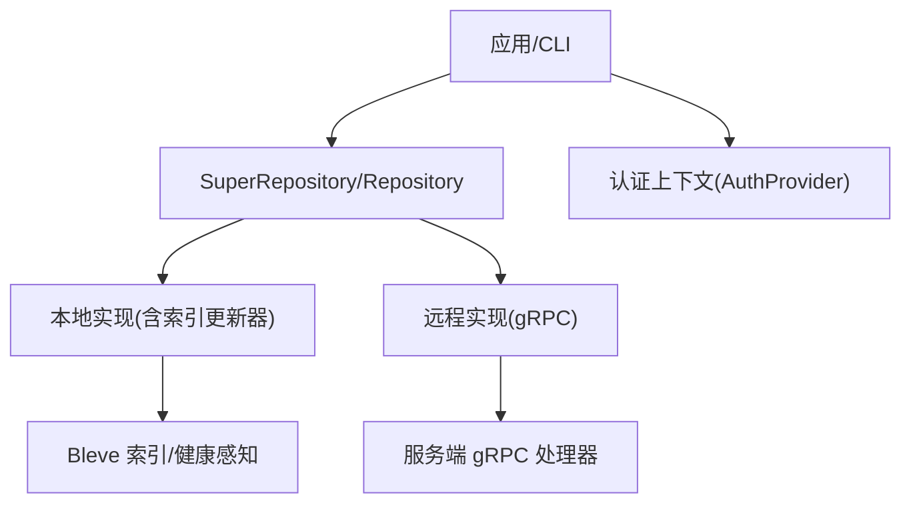
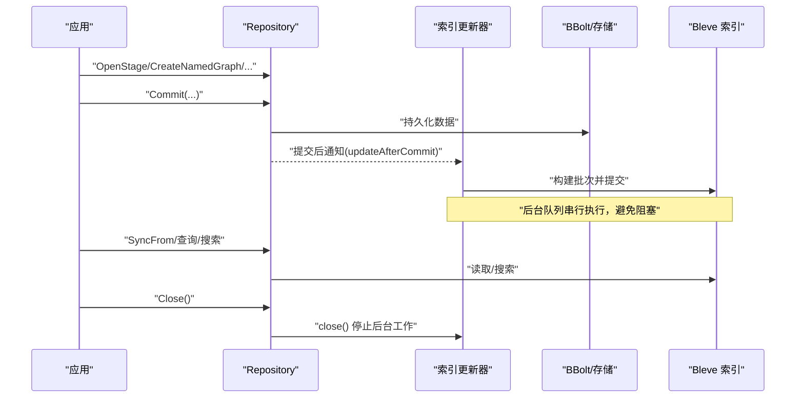
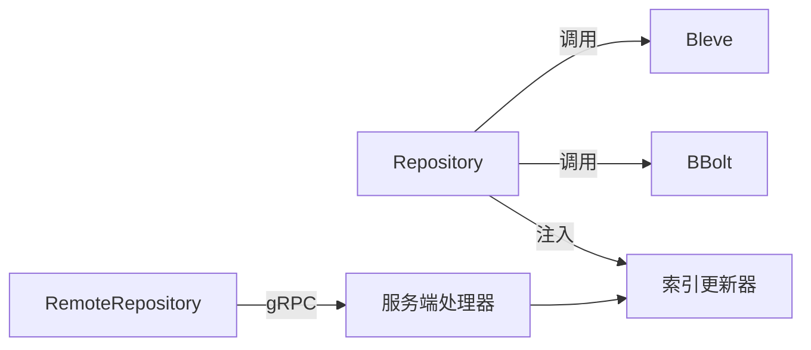
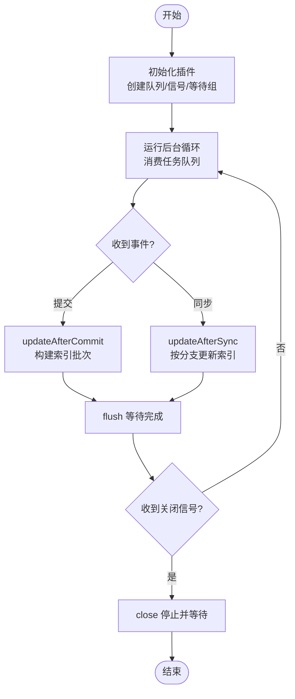

# 插件生命周期管理

<cite>
**本文引用的文件**
- [repository.go](file://sst/repository.go)
- [indexupdate.go](file://sst/indexupdate.go)
- [reporemote.go](file://sst/reporemote.go)
- [main.go](file://examples/helloworldsuperreporemote/main.go)
- [config.go](file://cli/cmd/interactive/config.go)
- [ACCESS_RIGHTS.md](file://sstauth/ACCESS_RIGHTS.md)
- [searchInContext_test.go](file://sst_test/searchInContext_test.go)
- [commit_parent_and_leaf_test.go](file://sst_test/commit_parent_and_leaf_test.go)
</cite>

## 目录
1. [简介](#简介)
2. [项目结构](#项目结构)
3. [核心组件](#核心组件)
4. [架构总览](#架构总览)
5. [详细组件分析](#详细组件分析)
6. [依赖关系分析](#依赖关系分析)
7. [性能考量](#性能考量)
8. [故障排查指南](#故障排查指南)
9. [结论](#结论)
10. [附录](#附录)

## 简介
本指南围绕 SST 的“插件化”能力与生命周期管理展开，重点说明：
- 插件在 SST 中的角色：以“索引处理器/派生信息”为代表的可插拔扩展点。
- 生命周期阶段：初始化、启动、运行（提交/同步等事件驱动）、销毁。
- 依赖注入与服务发现：通过配置对象注入派生信息与默认映射；通过仓库接口进行服务发现与调用。
- 配置管理与参数传递：服务器配置、客户端上下文、认证与权限。
- 插件间通信与资源共享：基于仓库级共享状态与异步队列。
- 部署与版本管理：服务器启动、索引重建、优雅停机。
- 隔离与安全沙箱：进程/连接级隔离、RBAC 鉴权、配额限制。

## 项目结构
SST 的核心 API 位于 sst 包，提供 Repository、Dataset、Stage、NamedGraph、IBNode 等接口。插件相关的关键点包括：
- 仓库配置与索引更新器：仓库内部维护 bleveIndexUpdater 与 pre/post commit 钩子，用于触发索引或外部处理逻辑。
- 远程仓库与 gRPC 通道：封装连接、请求缓存、索引访问。
- 示例服务器：演示如何构建并启动 SuperRepository 服务，注入 DeriveInfo（派生信息），支持 TLS、OIDC 等。
- CLI 交互配置：集中管理仓库、数据集、阶段、命名图、节点及认证上下文。



图表来源
- [repository.go:211-247](file://sst/repository.go#L211-L247)
- [reporemote.go:88-108](file://sst/reporemote.go#L88-L108)
- [main.go:68-79](file://examples/helloworldsuperreporemote/main.go#L68-L79)

章节来源
- [repository.go:211-247](file://sst/repository.go#L211-L247)
- [reporemote.go:88-108](file://sst/reporemote.go#L88-L108)
- [main.go:68-79](file://examples/helloworldsuperreporemote/main.go#L68-L79)

## 核心组件
- 仓库配置与插件注入
  - repoConfig 包含 preCommitCondition、postCommitNotification、bleveIndexUpdater 以及 deriveInfo（派生信息）。这些字段是“插件”接入点：pre/post 钩子可在提交前后执行自定义逻辑；bleveIndexUpdater 负责索引维护；deriveInfo 提供索引映射与文档派生能力。
- 异步索引更新器
  - defaultBleveIndexUpdater 使用后台 goroutine + 任务队列，将索引写入与 BBolt 写操作解耦，避免阻塞持久化路径。提供 flush/close/submit 等方法，保证有序、可靠地消费任务。
- 远程仓库
  - remoteRepository 封装 gRPC 连接、客户端、请求缓存与远程索引访问，统一对外暴露 Repository 接口。
- 示例服务器
  - 通过 NewSuperServer 创建服务，注入 RepositoryServerConfig（包含 RepoDir、Issuer、ClientID、ServerCert、Verbose、DeriveInfo），并监听端口提供服务。

章节来源
- [repository.go:211-247](file://sst/repository.go#L211-L247)
- [indexupdate.go:77-158](file://sst/indexupdate.go#L77-L158)
- [reporemote.go:88-108](file://sst/reporemote.go#L88-L108)
- [main.go:68-79](file://examples/helloworldsuperreporemote/main.go#L68-L79)

## 架构总览
下图展示插件在 SST 中的生命周期与关键交互：



图表来源
- [indexupdate.go:160-170](file://sst/indexupdate.go#L160-L170)
- [indexupdate.go:122-138](file://sst/indexupdate.go#L122-L138)
- [reporemote.go:88-108](file://sst/reporemote.go#L88-L108)

## 详细组件分析

### 组件A：索引更新器（插件）
- 职责
  - 接收提交/同步事件，异步构建 Bleve 索引批次并执行提交。
  - 记录成功/失败，便于健康感知与监控。
- 生命周期
  - 初始化：newDefaultBleveIndexUpdater 创建队列、停止信号、等待组，并启动后台 run 循环。
  - 运行：run 持续从队列取任务执行；flush 阻塞直到已提交任务完成；close 关闭队列并等待所有任务结束。
  - 事件驱动：updateAfterCommit/updateAfterSync 根据仓库事件触发索引更新。
- 复杂度
  - 队列长度上限为缓冲大小；任务串行执行，时间复杂度与任务数线性相关；内存占用与队列深度成正比。
- 错误处理
  - recordError/recordSuccess 上报指标；对删除分支等场景进行容错日志记录。

```mermaid
classDiagram
class defaultBleveIndexUpdater {
-queue chan func()
-stop chan struct{}
-once sync.Once
-wg sync.WaitGroup
-idx *healthAwareIndex
+run() void
+flush() void
+close() void
+submit(fn) void
+recordError(err) void
+recordSuccess() void
+updateAfterCommit(ctx,repo,stage,pcNotifier,commitInfo,modifiedDatasets,branchName) void
+updateAfterSync(ctx,repo,dsID,branch) void
}
```

图表来源
- [indexupdate.go:77-158](file://sst/indexupdate.go#L77-L158)
- [indexupdate.go:160-170](file://sst/indexupdate.go#L160-L170)
- [indexupdate.go:312-345](file://sst/indexupdate.go#L312-L345)

章节来源
- [indexupdate.go:77-158](file://sst/indexupdate.go#L77-L158)
- [indexupdate.go:160-170](file://sst/indexupdate.go#L160-L170)
- [indexupdate.go:312-345](file://sst/indexupdate.go#L312-L345)

### 组件B：仓库配置与插件注入
- 插件注入点
  - preCommitCondition：提交前条件检查，返回 postCommitNotifier 以便后续回调。
  - postCommitNotification：提交后通知，可用于触发索引或其他副作用。
  - bleveIndexUpdater：可选的索引维护器，nil 表示不更新索引。
  - deriveInfo：派生信息，包含包名、版本、默认索引映射、派生文档函数等，作为“插件能力”注入。
- 作用
  - 将“索引/派生/审计”等横切关注点以插件形式注入到仓库中，保持核心流程稳定。

章节来源
- [repository.go:211-247](file://sst/repository.go#L211-L247)

### 组件C：远程仓库与连接管理
- 连接与状态
  - remoteRepository 持有 gRPC 连接、客户端、请求缓存与远程索引访问。
  - stateControl 管理 open/closing/closed 状态，确保并发安全与优雅关闭。
- 插件集成
  - 远程仓库通过 gRPC 调用服务端索引/数据接口，间接复用服务端的索引更新器与插件能力。

章节来源
- [reporemote.go:88-108](file://sst/reporemote.go#L88-L108)

### 组件D：服务器启动与插件装配
- 启动流程
  - 解析命令行参数，准备 DeriveInfo（派生信息），加载 TLS 证书，构造 RepositoryServerConfig。
  - 调用 NewSuperServer 创建服务，注册 RBAC 拦截器，监听端口并 Serve。
  - 监听中断信号，调用 GracefulStopAndClose 优雅停机。
- 插件装配
  - 通过 RepositoryServerConfig.DeriveInfo 注入索引映射与派生能力；通过 Issuer/ClientID 启用认证授权。

章节来源
- [main.go:68-79](file://examples/helloworldsuperreporemote/main.go#L68-L79)
- [main.go:97-110](file://examples/helloworldsuperreporemote/main.go#L97-L110)

### 组件E：CLI 交互配置与会话资源
- 会话资源
  - InteractiveConfig 集中管理仓库、超级仓库、数据集、阶段、命名图、节点别名及认证上下文。
- 作用
  - 在交互式环境中，将打开的资源与上下文统一管理，便于命令处理与插件能力调用。

章节来源
- [config.go:11-47](file://cli/cmd/interactive/config.go#L11-L47)
- [config.go:49-72](file://cli/cmd/interactive/config.go#L49-L72)

## 依赖关系分析
- 耦合与内聚
  - 仓库与索引更新器通过接口解耦，便于替换或禁用索引功能。
  - 远程仓库与 gRPC 客户端强耦合，但通过封装隐藏细节，提升内聚性。
- 外部依赖
  - Bleve 全文检索、BBolt 持久化、gRPC 网络传输、OIDC/RBAC 认证。
- 潜在循环依赖
  - 当前设计通过回调与接口避免循环；需确保 pre/post 钩子不反向依赖仓库内部未导出状态。



图表来源
- [repository.go:211-247](file://sst/repository.go#L211-L247)
- [reporemote.go:88-108](file://sst/reporemote.go#L88-L108)
- [indexupdate.go:77-158](file://sst/indexupdate.go#L77-L158)

章节来源
- [repository.go:211-247](file://sst/repository.go#L211-L247)
- [reporemote.go:88-108](file://sst/reporemote.go#L88-L108)
- [indexupdate.go:77-158](file://sst/indexupdate.go#L77-L158)

## 性能考量
- 异步索引更新
  - 后台队列串行执行，避免阻塞 BBolt 写入；合理设置队列容量与批大小可降低延迟与抖动。
- 健康感知
  - 记录错误/成功，结合健康指标可快速定位索引问题。
- 远程调用
  - 使用请求缓存减少重复网络开销；注意超时与重试策略。
- 资源控制
  - 配额限制防止单仓库过度占用资源；优雅停机确保资源释放。

[本节为通用指导，无需特定文件引用]

## 故障排查指南
- 常见问题
  - 索引更新失败：检查 updateAfterCommit/updateAfterSync 的错误记录与健康指标。
  - 远程连接异常：确认 gRPC 连接、TLS 配置与 OIDC 令牌有效性。
  - 配额超限：提交时若触发 ErrQuotaExceeded，需调整配额或清理数据。
- 诊断步骤
  - 查看日志中的错误堆栈与上下文。
  - 验证仓库状态（open/closing/closed）与连接存活。
  - 使用 Info/Log 接口获取仓库元数据与操作历史。

章节来源
- [reporemote.go:88-108](file://sst/reporemote.go#L88-L108)
- [ACCESS_RIGHTS.md:314-360](file://sstauth/ACCESS_RIGHTS.md#L314-L360)

## 结论
SST 通过仓库配置注入、异步索引更新器与远程仓库封装，实现了可扩展、高性能且安全的插件化架构。插件在提交/同步等事件驱动下运行，具备清晰的初始化、运行与销毁生命周期。结合认证授权与配额控制，可在多租户与远程场景中保障稳定性与安全性。

[本节为总结，无需特定文件引用]

## 附录

### 插件生命周期流程图


图表来源
- [indexupdate.go:100-138](file://sst/indexupdate.go#L100-L138)
- [indexupdate.go:160-170](file://sst/indexupdate.go#L160-L170)
- [indexupdate.go:312-345](file://sst/indexupdate.go#L312-L345)

### 典型用例：注册索引处理器与搜索
- 注册索引处理器：在仓库上注册 DeriveInfo，使索引具备默认映射与派生能力。
- 搜索：通过 Bleve 接口执行查询，支持上下文超时与分页。

章节来源
- [searchInContext_test.go:1475-1507](file://sst_test/searchInContext_test.go#L1475-L1507)
- [commit_parent_and_leaf_test.go:572-609](file://sst_test/commit_parent_and_leaf_test.go#L572-L609)