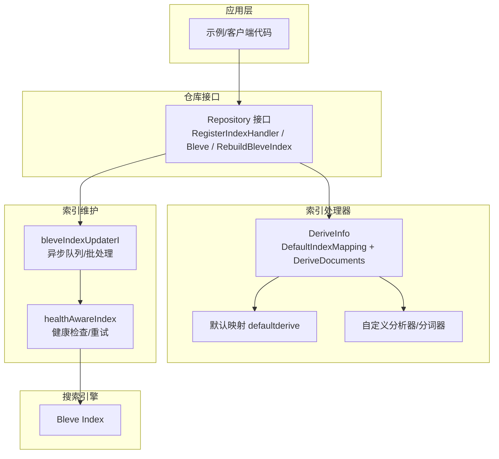
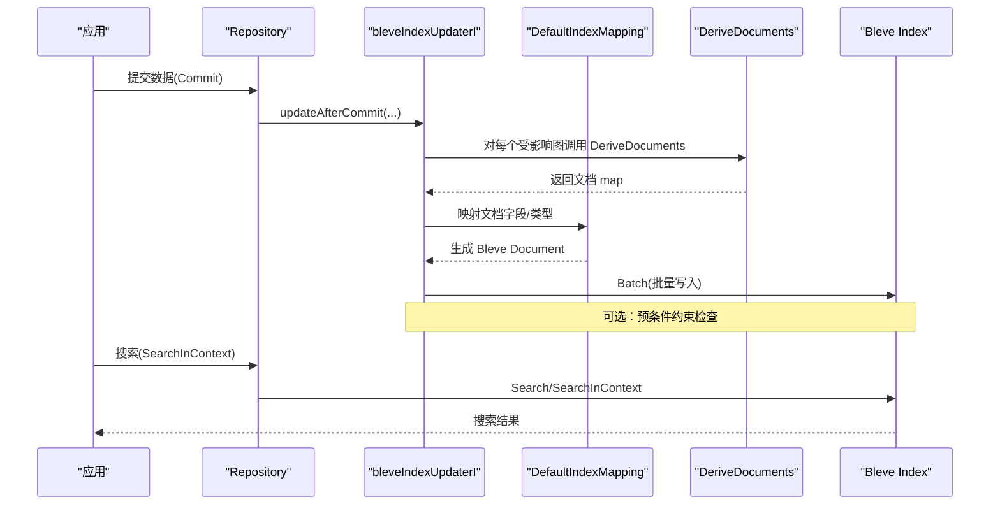
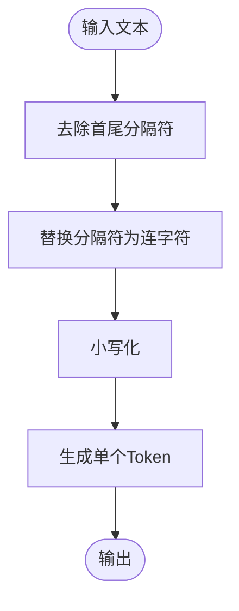
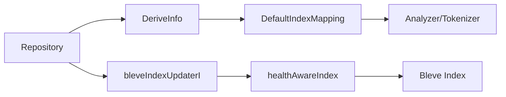

# 索引处理器扩展

<cite>
**本文引用的文件**
- [defaultderive.go](file://defaultderive/defaultderive.go)
- [phrase.go](file://defaultderive/analyzerphrase/phrase.go)
- [separatedkeyword.go](file://defaultderive/analyzerseparatedkeyword/separatedkeyword.go)
- [separated.go](file://defaultderive/tokenizerseparated/separated.go)
- [repository.go](file://sst/repository.go)
- [indexupdate.go](file://sst/indexupdate.go)
- [repolocalfullwithbleve.go](file://examples/helloworldrepolocalfullwithbleve/repolocalfullwithbleve.go)
- [searchInContext_test.go](file://sst_test/searchInContext_test.go)
</cite>

## 目录
1. [简介](#简介)
2. [项目结构](#项目结构)
3. [核心组件](#核心组件)
4. [架构总览](#架构总览)
5. [详细组件分析](#详细组件分析)
6. [依赖关系分析](#依赖关系分析)
7. [性能与缓存策略](#性能与缓存策略)
8. [故障排查指南](#故障排查指南)
9. [结论](#结论)
10. [附录：最佳实践与示例](#附录最佳实践与示例)

## 简介
本指南面向需要在 SST（Semantic STEP Technology）中扩展索引处理器的开发者，重点说明如何集成 Bleve 搜索引擎、配置索引映射、创建自定义分析与分词器、定义字段类型、扩展全文搜索查询、优化索引性能与缓存策略，以及实现自定义索引处理器。文档同时覆盖索引更新与重建的最佳实践，并提供可复用的示例路径。

## 项目结构
SST 将“索引处理器”抽象为可插拔的 DeriveInfo，包含默认索引映射和从 NamedGraph 推导文档的函数；Bleve 作为底层搜索引擎，通过健康感知包装与异步批处理机制进行索引维护；测试与示例展示了注册处理器、执行搜索、刷新与重建索引的流程。

图表来源
- [repository.go:84-130](file://sst/repository.go#L84-L130)
- [defaultderive.go:127-210](file://defaultderive/defaultderive.go#L127-L210)
- [indexupdate.go:39-75](file://sst/indexupdate.go#L39-L75)
- [indexupdate.go:650-795](file://sst/indexupdate.go#L650-L795)

章节来源
- [repository.go:84-130](file://sst/repository.go#L84-L130)
- [defaultderive.go:127-210](file://defaultderive/defaultderive.go#L127-L210)
- [indexupdate.go:39-75](file://sst/indexupdate.go#L39-L75)

## 核心组件
- 索引处理器接口与注册
  - Repository 提供 RegisterIndexHandler、Bleve、RebuildBleveIndex 等能力，用于注册索引处理器并访问底层 Bleve 索引。
- 默认索引映射与文档推导
  - defaultderive 提供默认索引映射与从 NamedGraph 到 Bleve 文档的推导逻辑，支持多种文档类型与字段子文档结构。
- 自定义分析与分词器
  - 通过 Bleve 注册表注册自定义 Analyzer 与 Tokenizer，并在映射中使用。
- 索引维护与健康感知
  - 异步索引更新器负责批量写入、预条件校验、分支变更同步；健康感知包装提供错误记录与重试。

章节来源
- [repository.go:84-130](file://sst/repository.go#L84-L130)
- [defaultderive.go:127-210](file://defaultderive/defaultderive.go#L127-L210)
- [phrase.go:12-31](file://defaultderive/analyzerphrase/phrase.go#L12-L31)
- [separatedkeyword.go:12-31](file://defaultderive/analyzerseparatedkeyword/separatedkeyword.go#L12-L31)
- [separated.go:12-46](file://defaultderive/tokenizerseparated/separated.go#L12-L46)
- [indexupdate.go:39-75](file://sst/indexupdate.go#L39-L75)

## 架构总览
SST 在提交数据后触发索引更新流程：收集受影响的 NamedGraph，调用 DeriveDocuments 生成文档，使用 DefaultIndexMapping 映射为 Bleve 文档，批量写入索引，并在必要时执行预条件约束检查。搜索时通过 Repository.Bleve() 获取 bleve.Index，可直接构造查询或分页排序。

图表来源
- [indexupdate.go:160-249](file://sst/indexupdate.go#L160-L249)
- [indexupdate.go:436-501](file://sst/indexupdate.go#L436-L501)
- [repository.go:104-120](file://sst/repository.go#L104-L120)

## 详细组件分析

### 默认索引映射与字段类型
- 文档类型与子文档
  - 支持通用文档与多种领域文档类型（如组织、表示上下文、形状特征定义等），通过 addDerivedDocumentMapping 统一构建字段映射。
- 字段映射策略
  - 短语字段：使用 phrase 分析器，适合全文检索。
  - 关键词字段：使用 keyword 分析器，适合精确匹配与聚合。
  - 分隔关键词字段：使用 separated 分词器+小写过滤，适合特定分隔符场景。
  - 数值字段：NumericFieldMapping，用于范围查询与排序。
  - 仅索引字段：Store=false，DocValues=false，节省存储。
- 版本标记字段
  - 通过 versionField 注入 sst/sso 版本标记，便于索引迁移与兼容性管理。

章节来源
- [defaultderive.go:155-210](file://defaultderive/defaultderive.go#L155-L210)
- [defaultderive.go:213-291](file://defaultderive/defaultderive.go#L213-L291)

### 自定义分析器与分词器
- 短语分析器（phrase）
  - 组合 single 分词器与小写过滤器，保持词序，适合短语匹配。
- 分隔关键词分析器（sepratedkeyword）
  - 组合 separated 分词器与小写过滤器，按指定分隔符拆分并标准化。
- 自定义分词器（separated）
  - 去除首尾分隔符并将下划线、斜杠、空格替换为连字符，输出单一 token。

图表来源
- [separated.go:24-36](file://defaultderive/tokenizerseparated/separated.go#L24-L36)
- [phrase.go:14-27](file://defaultderive/analyzerphrase/phrase.go#L14-L27)
- [separatedkeyword.go:14-27](file://defaultderive/analyzerseparatedkeyword/separatedkeyword.go#L14-L27)

章节来源
- [phrase.go:12-31](file://defaultderive/analyzerphrase/phrase.go#L12-L31)
- [separatedkeyword.go:12-31](file://defaultderive/analyzerseparatedkeyword/separatedkeyword.go#L12-L31)
- [separated.go:12-46](file://defaultderive/tokenizerseparated/separated.go#L12-L46)

### 索引映射的配置与字段类型定义
- 字段类型选择
  - 全文检索：phrase 分析器字段，支持短语与模糊匹配。
  - 精确匹配/聚合：keyword 字段，禁用 DocValues 以节省内存。
  - 特殊分词：separated 分词器字段，适用于带分隔符的标识符。
  - 数值型：NumericFieldMapping，支持范围与排序。
  - 仅索引：Store=false，减少磁盘占用。
- 子文档结构
  - label、id、idOwner、definedBy 等通过子文档映射组织，便于复杂查询与排序。

章节来源
- [defaultderive.go:213-291](file://defaultderive/defaultderive.go#L213-L291)

### 全文搜索查询的扩展方法
- 基本查询
  - 使用 MatchQuery 针对 label 或短语字段进行搜索。
- 分页与排序
  - 使用 NewSearchRequestOptions 设置 Size/From 实现分页；结合 sortable 字段进行排序。
- 上下文与超时
  - 使用 SearchInContext 支持上下文取消与超时控制。
- 直接访问索引
  - 通过 repo.Bleve() 获取 bleve.Index，直接构造查询或打开本地 index.bleve 文件。

章节来源
- [searchInContext_test.go:215-235](file://sst_test/searchInContext_test.go#L215-L235)
- [searchInContext_test.go:313-351](file://sst_test/searchInContext_test.go#L313-L351)
- [repolocalfullwithbleve.go:90-127](file://examples/helloworldrepolocalfullwithbleve/repolocalfullwithbleve.go#L90-L127)

### 自定义索引处理器的实现案例
- 注册索引处理器
  - 通过 RegisterIndexHandler 传入 DeriveInfo，包含包名、版本、默认映射与文档推导函数。
- 文档推导
  - DeriveDocuments 遍历 NamedGraph 节点，识别类型并提取字段，生成 Bleve 文档。
- 示例参考
  - 示例程序演示了创建仓库、注册处理器、添加数据、提交、搜索与直接打开索引的流程。

章节来源
- [repository.go:91-107](file://sst/repository.go#L91-L107)
- [defaultderive.go:127-134](file://defaultderive/defaultderive.go#L127-L134)
- [repolocalfullwithbleve.go:27-88](file://examples/helloworldrepolocalfullwithbleve/repolocalfullwithbleve.go#L27-L88)

### 索引更新与重建的最佳实践
- 增量更新
  - 提交后自动触发 updateAfterCommit，仅对受影响的 NamedGraph 进行增量索引更新。
- 分支操作
  - SetBranch/RemoveBranch 会触发对应数据集的索引重建或删除。
- 全量重建
  - RebuildBleveIndex 关闭当前索引、删除目录并从头重建，保留版本历史（LocalFull）或不保留（LocalBasic）。
- 一致性保障
  - 预条件约束检查确保唯一性；健康感知包装在错误时重试并记录状态。

章节来源
- [indexupdate.go:160-249](file://sst/indexupdate.go#L160-L249)
- [indexupdate.go:251-344](file://sst/indexupdate.go#L251-L344)
- [indexupdate.go:366-422](file://sst/indexupdate.go#L366-L422)
- [repository.go:109-120](file://sst/repository.go#L109-L120)

## 依赖关系分析
- 组件耦合
  - Repository 依赖 DeriveInfo 完成文档推导；索引维护器依赖 Repository 获取 Bleve 索引；默认映射依赖自定义分析器/分词器。
- 外部依赖
  - Bleve 提供搜索引擎与分析框架；Go 标准库与第三方工具用于日志、并发与序列化。
- 潜在循环依赖
  - 通过接口解耦（bleveIndexUpdaterI、Repository）避免循环依赖。

图表来源
- [repository.go:84-130](file://sst/repository.go#L84-L130)
- [defaultderive.go:127-210](file://defaultderive/defaultderive.go#L127-L210)
- [indexupdate.go:39-75](file://sst/indexupdate.go#L39-L75)
- [indexupdate.go:650-795](file://sst/indexupdate.go#L650-L795)

章节来源
- [repository.go:84-130](file://sst/repository.go#L84-L130)
- [defaultderive.go:127-210](file://defaultderive/defaultderive.go#L127-L210)
- [indexupdate.go:39-75](file://sst/indexupdate.go#L39-L75)

## 性能与缓存策略
- 异步批处理
  - 默认更新器使用后台 goroutine 与队列，批量写入以降低 I/O 开销。
- 阈值控制
  - 当批次大小超过阈值时自动提交，避免单次批过大导致内存压力。
- 健康感知与重试
  - 搜索失败时记录错误并尝试重试，提升鲁棒性。
- 缓存策略
  - 默认实现无额外缓存层，直接操作 Bleve 索引；可通过上下文控制超时与取消。
- 建议
  - 合理设置批大小与刷新频率；避免频繁重建索引；使用 keyword 字段进行精确匹配以减少分析开销。

章节来源
- [indexupdate.go:77-138](file://sst/indexupdate.go#L77-L138)
- [indexupdate.go:424-434](file://sst/indexupdate.go#L424-L434)
- [indexupdate.go:650-735](file://sst/indexupdate.go#L650-L735)

## 故障排查指南
- 常见问题
  - 索引未更新：确认是否调用 FlushBleveIndex 等待异步任务完成。
  - 搜索结果为空：检查字段映射与分析器是否正确；验证查询字段与内容。
  - 预条件冲突：查看唯一性约束是否被违反，调整数据或查询。
- 诊断步骤
  - 使用 Bleve 统计信息检查索引状态；查看日志中的错误与警告；通过直接打开 index.bleve 验证文档。
- 恢复措施
  - 必要时执行 RebuildBleveIndex 重建索引；检查版本标记以确保映射兼容。

章节来源
- [indexupdate.go:633-648](file://sst/indexupdate.go#L633-L648)
- [indexupdate.go:504-573](file://sst/indexupdate.go#L504-L573)
- [searchInContext_test.go:776-797](file://sst_test/searchInContext_test.go#L776-L797)

## 结论
SST 的索引处理器扩展通过可插拔的 DeriveInfo 与 Bleve 搜索引擎实现了灵活的全文检索能力。开发者可以基于默认映射快速上手，并通过自定义分析器与分词器满足特定需求。异步批处理与健康感知机制保障了性能与稳定性。遵循最佳实践可有效提升索引质量与系统可靠性。

## 附录：最佳实践与示例
- 注册索引处理器
  - 在应用启动时调用 RegisterIndexHandler，传入 DeriveInfo。
- 自定义分析器/分词器
  - 实现 AnalyzerConstructor 与 Tokenizer，并通过 registry 注册；在映射中引用。
- 字段类型选择
  - 全文检索用 phrase；精确匹配用 keyword；数值查询用 NumericFieldMapping。
- 搜索与分页
  - 使用 MatchQuery 与 NewSearchRequestOptions 实现分页；结合 Sort 字段排序。
- 刷新与重建
  - 提交后调用 FlushBleveIndex 确保更新完成；需要时调用 RebuildBleveIndex 重建。
- 示例参考
  - 查看示例程序了解完整流程与用法。

章节来源
- [repolocalfullwithbleve.go:27-88](file://examples/helloworldrepolocalfullwithbleve/repolocalfullwithbleve.go#L27-L88)
- [searchInContext_test.go:215-235](file://sst_test/searchInContext_test.go#L215-L235)
- [repository.go:91-120](file://sst/repository.go#L91-L120)