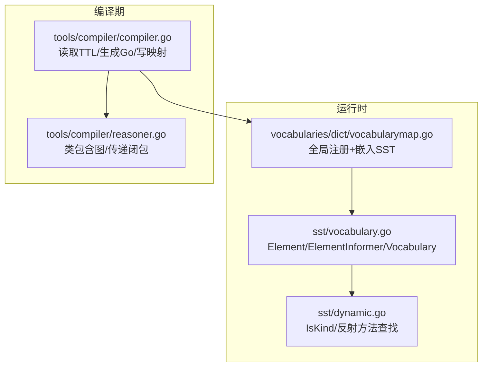
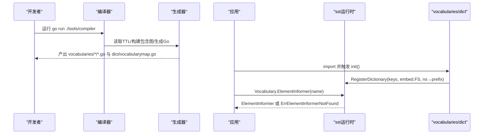
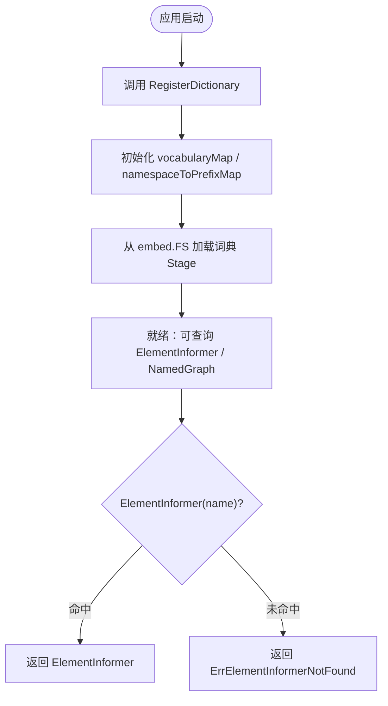
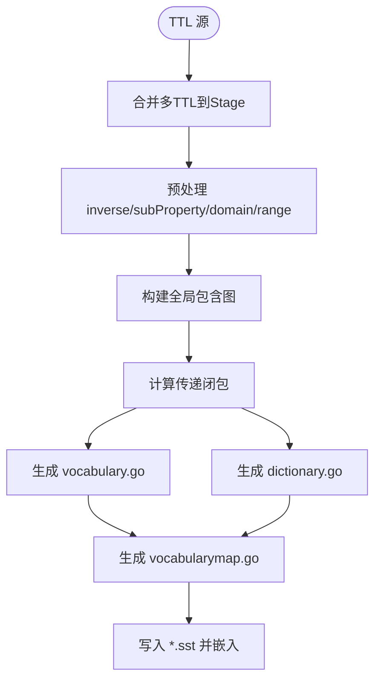
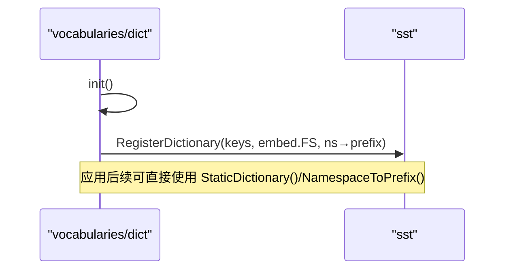
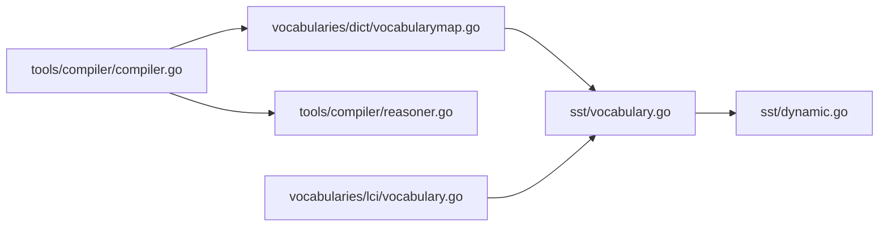

# 词汇表扩展机制

<cite>
**本文引用的文件**
- [vocabulary.go](file://sst/vocabulary.go)
- [dynamic.go](file://sst/dynamic.go)
- [vocabularymap.go](file://vocabularies/dict/vocabularymap.go)
- [compiler.go](file://tools/compiler/compiler.go)
- [reasoner.go](file://tools/compiler/reasoner.go)
- [README.md](file://tools/compiler/README.md)
- [vocabulary.go（lci）](file://vocabularies/lci/vocabulary.go)
</cite>

## 目录
1. [简介](#简介)
2. [项目结构](#项目结构)
3. [核心组件](#核心组件)
4. [架构总览](#架构总览)
5. [详细组件分析](#详细组件分析)
6. [依赖关系分析](#依赖关系分析)
7. [性能考虑](#性能考虑)
8. [故障排查指南](#故障排查指南)
9. [结论](#结论)
10. [附录](#附录)

## 简介
本指南系统性说明 SST 的词汇表扩展机制，涵盖：
- 词汇表的注册与动态加载流程
- 如何创建自定义本体定义与词汇表映射
- Element 与 ElementInformer 接口的实现要点
- 词汇表编译器与生成工具的使用
- 预编译词汇表的嵌入与运行时加载策略
- 实际本体定义示例与最佳实践
- 词汇表版本管理与兼容性处理

SST 通过“编译期生成 + 运行期注册”的方式，将 RDF/OWL 本体转换为类型化的 Go 词汇包，并在应用启动时完成全局注册，从而提供编译期检查、运行时类型/kind 判定与命名空间前缀解析等能力。

## 项目结构
- sst 包：定义词汇表核心接口与运行时机制（Element、ElementInformer、Vocabulary、静态字典 Stage、注册入口等）
- vocabularies 包：由编译器生成的各本体词汇包（如 lci、owl、rdfs、xsd 等），以及全局词汇映射与嵌入式 SST 数据
- tools/compiler：本体到 Go 词汇包的编译器，包含 OWL 微型推理器与代码生成逻辑
- 其他：CLI、MCP、示例等与本主题无直接关联



图表来源
- [vocabulary.go:15-123](file://sst/vocabulary.go#L15-L123)
- [dynamic.go:9-44](file://sst/dynamic.go#L9-L44)
- [vocabularymap.go:27-30](file://vocabularies/dict/vocabularymap.go#L27-L30)
- [compiler.go:815-879](file://tools/compiler/compiler.go#L815-L879)
- [reasoner.go:87-128](file://tools/compiler/reasoner.go#L87-L128)

章节来源
- [vocabulary.go:15-123](file://sst/vocabulary.go#L15-L123)
- [vocabularymap.go:27-30](file://vocabularies/dict/vocabularymap.go#L27-L30)
- [compiler.go:815-879](file://tools/compiler/compiler.go#L815-L879)
- [reasoner.go:87-128](file://tools/compiler/reasoner.go#L87-L128)

## 核心组件
- Vocabulary：表示一个外部本体（以 BaseIRI 标识）
- Element：词汇表中某个 IRI 节点的身份（Vocabulary + Name）
- ElementInfo：对 Element 的元信息扩展（是否类/属性/数据类型/个体、域/范围、父类等）
- ElementInformer：在 Element 基础上提供语义查询方法（IsClass/Domain/Range/SubtypeOf 等）
- Dictionary：只读访问内置词典（NamedGraph/IBNode）的扩展 Stage
- 全局注册表：Element → ElementInformer 的全局映射，用于运行时查找
- 命名空间→前缀映射：用于 IRIs 到短前缀的转换

章节来源
- [vocabulary.go:125-212](file://sst/vocabulary.go#L125-L212)
- [vocabulary.go:214-308](file://sst/vocabulary.go#L214-L308)
- [vocabulary.go:89-123](file://sst/vocabulary.go#L89-L123)

## 架构总览
SST 词汇表体系分为“编译期”和“运行期”两部分：
- 编译期：编译器读取 Turtle 本体，构建跨词汇的全局类包含图，生成每个词汇包的常量、类型、AsIs_/AsKind_ 方法，并输出全局词汇映射与嵌入式 SST 数据
- 运行期：应用初始化时调用 RegisterDictionary，将全局映射与嵌入式 SST 注入 SST 运行时；随后可通过 Vocabulary.ElementInformer(name) 获取元素元信息，并通过 IsKind 进行运行时类型判断



图表来源
- [compiler.go:815-879](file://tools/compiler/compiler.go#L815-L879)
- [compiler.go:883-970](file://tools/compiler/compiler.go#L883-L970)
- [vocabularymap.go:27-30](file://vocabularies/dict/vocabularymap.go#L27-L30)
- [vocabulary.go:94-107](file://sst/vocabulary.go#L94-L107)
- [vocabulary.go:214-223](file://sst/vocabulary.go#L214-L223)

## 详细组件分析

### 词汇表注册与动态加载
- 全局注册入口：RegisterDictionary(vm, dictFS, np)
  - vm：Element → ElementInformer 的全局映射（由编译器生成）
  - dictFS：嵌入的 SST 文件系统（包含 NamedGraph 序列化数据）
  - np：命名空间到前缀的映射（用于 IRI 显示/序列化）
- 内部流程：
  - 初始化 vocabularyMap 与 namespaceToPrefixMap
  - 使用 embed.FS 构造只读 dictionaryStage，支持按 Vocabulary.BaseIRI 获取 NamedGraph 与 IBNode
- 运行时查找：
  - Vocabulary.ElementInformer(name) 基于 Element{Vocabulary, Name} 在全局映射中查找
  - 若未找到返回 ErrElementInformerNotFound



图表来源
- [vocabulary.go:94-107](file://sst/vocabulary.go#L94-L107)
- [vocabulary.go:15-58](file://sst/vocabulary.go#L15-L58)
- [vocabulary.go:214-223](file://sst/vocabulary.go#L214-L223)

章节来源
- [vocabulary.go:94-107](file://sst/vocabulary.go#L94-L107)
- [vocabulary.go:15-58](file://sst/vocabulary.go#L15-L58)
- [vocabulary.go:214-223](file://sst/vocabulary.go#L214-L223)

### Element 与 ElementInformer 接口
- Element：承载词汇与名称，提供 IRI 拼接、TermKind 等基础能力
- ElementInfo：扩展字段标记元素类别（类/属性/数据类型/个体）、主类覆盖关系、域/范围、子类型/子属性、逆属性、集合成员类型等
- ElementInformer：暴露语义查询方法（IsClass/IsProperty/IsDatatypeProperty/IsObjectProperty/IsDatatype/IsIndividual/IsMainClass/Domain/Range/SubtypeOf/SubPropertyOf/InverseOf/CollectionMember）
- 运行时类型/kind 检查：
  - dynamic.go 中的 isKind 通过反射查找 AsKind_<目标> 方法是否存在，从而判断实例属于某 kind
  - 编译器为每个类生成所有可达父类的 AsKind_* 方法（基于全局包含图）

```mermaid
classDiagram
class Element {
+Vocabulary Vocabulary
+Name string
+IRI() IRI
+TermKind() TermKind
+IsTermCollection() bool
+VocabularyElement() Element
+GoSimpleName() string
}
class ElementInfo {
+AClass bool
+AProperty bool
+ADatatypeProperty bool
+AnObjectProperty bool
+ADatatype bool
+AnIndividual bool
+AMainClassSupersedure map[Element]struct{}
+ADomain ElementInformer
+ARange ElementInformer
+ASubtypeOf []ElementInformer
+ASubPropertyOf ElementInformer
+AnInverseOf ElementInformer
+ACollectionMemberType ElementInformer
}
class ElementInformer {
+IsClass() bool
+IsProperty() bool
+IsDatatypeProperty() bool
+IsObjectProperty() bool
+IsDatatype() bool
+IsIndividual() bool
+IsMainClass(mainClass Element) bool
+Domain() ElementInformer
+Range() ElementInformer
+SubtypeOf() []ElementInformer
+SubPropertyOf() ElementInformer
+InverseOf() ElementInformer
+CollectionMember() ElementInformer
}
Element <|-- ElementInfo : "嵌入"
ElementInfo ..|> ElementInformer : "实现"
```

图表来源
- [vocabulary.go:125-212](file://sst/vocabulary.go#L125-L212)
- [vocabulary.go:214-308](file://sst/vocabulary.go#L214-L308)
- [dynamic.go:9-44](file://sst/dynamic.go#L9-L44)

章节来源
- [vocabulary.go:125-212](file://sst/vocabulary.go#L125-L212)
- [vocabulary.go:214-308](file://sst/vocabulary.go#L214-L308)
- [dynamic.go:9-44](file://sst/dynamic.go#L9-L44)

### 词汇表编译器与生成工具
- 输入：Turtle 本体（来自独立模块的 embed.FS 或本地目录）
- 处理：
  - 合并多个 .ttl 到一个 Stage
  - 预处理 inverse/subProperty/domain/range 一致性
  - 构建跨词汇的全局类包含图（subsumption graph）并计算传递闭包
  - 为每个命名类生成 AsKind_* 方法（指向所有可达命名父类）
- 输出：
  - vocabularies/<name>/vocabulary.go：完整词汇包（含 ElementInfo、接口、kind 方法）
  - vocabularies/<name>/dictionary.go：轻量引用词汇包（仅 Element）
  - vocabularies/dict/vocabularymap.go：全局 Element→ElementInformer 映射 + 嵌入 SST 文件 + init() 自动注册
- 使用方式：
  - 运行 go run ./tools/compiler
  - 或构建二进制后执行



图表来源
- [compiler.go:815-879](file://tools/compiler/compiler.go#L815-L879)
- [compiler.go:1000-1166](file://tools/compiler/compiler.go#L1000-L1166)
- [compiler.go:883-970](file://tools/compiler/compiler.go#L883-L970)
- [reasoner.go:87-128](file://tools/compiler/reasoner.go#L87-L128)

章节来源
- [compiler.go:815-879](file://tools/compiler/compiler.go#L815-L879)
- [compiler.go:1000-1166](file://tools/compiler/compiler.go#L1000-L1166)
- [compiler.go:883-970](file://tools/compiler/compiler.go#L883-L970)
- [reasoner.go:87-128](file://tools/compiler/reasoner.go#L87-L128)
- [README.md:13-136](file://tools/compiler/README.md#L13-L136)

### 预编译词汇表的嵌入与运行时加载策略
- 嵌入：vocabularymap.go 通过 //go:embed *.sst 将序列化后的 NamedGraph 打包进二进制
- 加载：init() 中调用 RegisterDictionary(keys, dictFS, ns→prefix)，完成全局注册
- 访问：
  - StaticDictionary().Vocabulary(BaseIRI) 获取只读 NamedGraph
  - StaticDictionary().Element(Element) 获取 IBNode
  - NamespaceToPrefix(iri) 将 IRI 转为短前缀形式



图表来源
- [vocabularymap.go:27-30](file://vocabularies/dict/vocabularymap.go#L27-L30)
- [compiler.go:935-970](file://tools/compiler/compiler.go#L935-L970)
- [vocabulary.go:15-58](file://sst/vocabulary.go#L15-L58)
- [vocabulary.go:82-85](file://sst/vocabulary.go#L82-L85)
- [vocabulary.go:115-123](file://sst/vocabulary.go#L115-L123)

章节来源
- [vocabularymap.go:27-30](file://vocabularies/dict/vocabularymap.go#L27-L30)
- [compiler.go:935-970](file://tools/compiler/compiler.go#L935-L970)
- [vocabulary.go:15-58](file://sst/vocabulary.go#L15-L58)
- [vocabulary.go:82-85](file://sst/vocabulary.go#L82-L85)
- [vocabulary.go:115-123](file://sst/vocabulary.go#L115-L123)

### 自定义本体定义与词汇表映射
步骤建议：
- 准备 Turtle 本体文件（遵循 RDFS/OWL 约定，必要时使用 ssmeta 标注 MainClass/OptionClass/AbstractClass/RootClass 等）
- 将本体放入编译器可读取的位置（如独立模块的 ontologies 目录或本地目录）
- 运行编译器生成词汇包与全局映射
- 确保新增词汇被纳入 neededCompileTTL/neededCompileDictTTL 配置（如需）
- 重新生成 vocabularymap.go，使 init() 自动注册新词汇

注意事项：
- 跨词汇的类包含关系会被编译器统一处理，无需手动维护
- 属性层次（subPropertyOf）会同步 domain/range 与 inverse 关系
- 生成的 AsKind_* 方法保证运行时 IsKind 的高效判断

章节来源
- [compiler.go:137-157](file://tools/compiler/compiler.go#L137-L157)
- [compiler.go:1000-1166](file://tools/compiler/compiler.go#L1000-L1166)
- [reasoner.go:87-128](file://tools/compiler/reasoner.go#L87-L128)

### 运行时类型/kind 检查与最佳实践
- 使用 IsKind：通过反射检查具体 ElementInformer 类型是否实现了 AsKind_<目标> 方法
- 利用编译器生成的 AsKind_* 方法，避免在运行时做复杂推理
- 对于业务主类（ssmeta:MainClass），可使用 IsMainClass 判断是否覆盖某主类

章节来源
- [dynamic.go:9-44](file://sst/dynamic.go#L9-L44)
- [vocabulary.go:268-278](file://sst/vocabulary.go#L268-L278)

### 实际示例与参考
- 已生成的 lci 词汇包展示了类、属性、数据类型、个体等的完整定义与继承关系
- 可参考 lci/vocabulary.go 中抽象类、选项类、主类覆盖等字段的设置方式

章节来源
- [vocabulary.go（lci）:1-200](file://vocabularies/lci/vocabulary.go#L1-L200)

## 依赖关系分析
- 运行时依赖：
  - sst/vocabulary.go 提供核心接口与注册机制
  - sst/dynamic.go 提供 IsKind 的反射实现
  - vocabularies/dict/vocabularymap.go 提供全局映射与嵌入数据，并在 init() 中完成注册
- 编译期依赖：
  - tools/compiler/compiler.go 驱动整体流程
  - tools/compiler/reasoner.go 构建类包含图并计算传递闭包
  - 生成的词汇包之间可能存在相互引用（例如 lci 依赖 owl/rdfs/xsd）



图表来源
- [vocabulary.go:94-107](file://sst/vocabulary.go#L94-L107)
- [dynamic.go:9-44](file://sst/dynamic.go#L9-L44)
- [vocabularymap.go:27-30](file://vocabularies/dict/vocabularymap.go#L27-L30)
- [compiler.go:815-879](file://tools/compiler/compiler.go#L815-L879)
- [reasoner.go:87-128](file://tools/compiler/reasoner.go#L87-L128)

章节来源
- [vocabulary.go:94-107](file://sst/vocabulary.go#L94-L107)
- [dynamic.go:9-44](file://sst/dynamic.go#L9-L44)
- [vocabularymap.go:27-30](file://vocabularies/dict/vocabularymap.go#L27-L30)
- [compiler.go:815-879](file://tools/compiler/compiler.go#L815-L879)
- [reasoner.go:87-128](file://tools/compiler/reasoner.go#L87-L128)

## 性能考虑
- 编译期推理：
  - 全局包含图一次性构建，避免运行期重复推理
  - 传递闭包计算确保 AsKind_* 方法完备，运行时 IsKind 为 O(1) 方法存在性检查
- 运行期开销：
  - 全局映射查找为哈希表 O(1)
  - 嵌入 SST 减少 I/O 与网络开销
- 内存占用：
  - 嵌入 SST 会增加二进制体积，但换来更快的启动与访问速度
  - 可按需选择仅嵌入必要词汇

## 故障排查指南
常见问题与定位：
- 运行时找不到 ElementInformer：
  - 检查是否在 init() 中调用了 RegisterDictionary
  - 确认 vocabularymap.go 已正确生成并包含新词汇
  - 查看错误 ErrElementInformerNotFound
- 命名空间前缀为空：
  - 检查 namespaceToPrefixMap 是否正确设置
  - 调用 NamespaceToPrefix 时若未注册会记录警告日志
- 编译器报错或生成不完整：
  - 检查 Turtle 语法与 rdfs/owl 约束
  - 确认 inverse/subProperty/domain/range 一致性预处理已通过
  - 查看编译器日志输出与错误计数限制

章节来源
- [vocabulary.go:214-223](file://sst/vocabulary.go#L214-L223)
- [vocabulary.go:115-123](file://sst/vocabulary.go#L115-L123)
- [compiler.go:1280-1329](file://tools/compiler/compiler.go#L1280-L1329)

## 结论
SST 的词汇表扩展机制通过“编译期生成 + 运行期注册”的组合，提供了强类型、可扩展且高性能的本体访问能力。借助 OWL 微型推理器与全局包含图，系统能够在编译期完成复杂的类关系推导，并在运行期以极低开销进行类型/kind 检查。通过统一的注册入口与嵌入策略，应用可以无缝集成多种标准与领域本体，同时保持清晰的版本管理与兼容控制。

## 附录
- 快速上手：
  - 运行编译器：go run ./tools/compiler
  - 构建二进制：go build -o tools/compiler/compiler ./tools/compiler
- 关键路径：
  - 运行时注册：RegisterDictionary
  - 运行时查询：Vocabulary.ElementInformer(name)
  - 运行时类型检查：isKind（反射 AsKind_* 方法）
  - 嵌入数据：//go:embed *.sst
- 参考文档：
  - 编译器 README 提供了功能概述、构建方式、输出文件说明与架构要点

章节来源
- [README.md:13-136](file://tools/compiler/README.md#L13-L136)
- [compiler.go:815-879](file://tools/compiler/compiler.go#L815-L879)
- [vocabulary.go:94-107](file://sst/vocabulary.go#L94-L107)
- [vocabulary.go:214-223](file://sst/vocabulary.go#L214-L223)
- [dynamic.go:9-44](file://sst/dynamic.go#L9-L44)
- [vocabularymap.go:27-30](file://vocabularies/dict/vocabularymap.go#L27-L30)