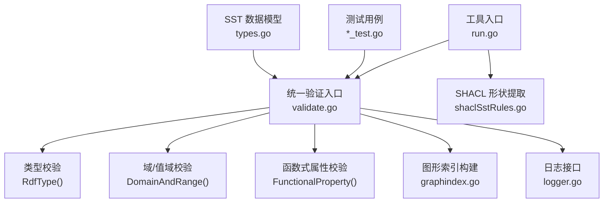
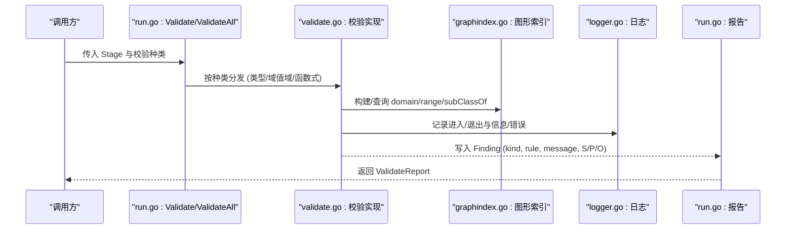
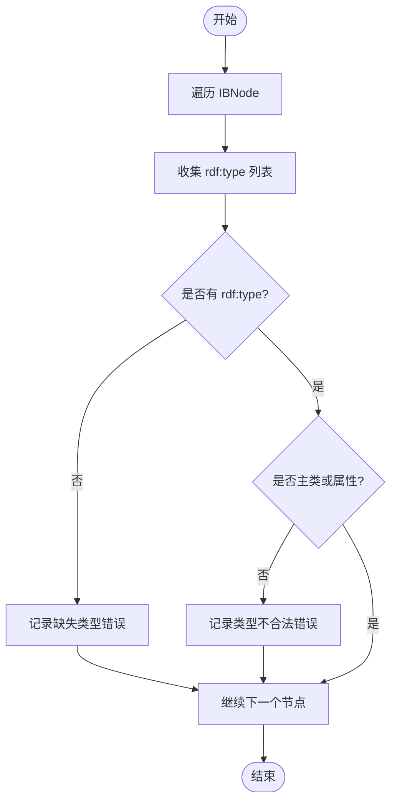
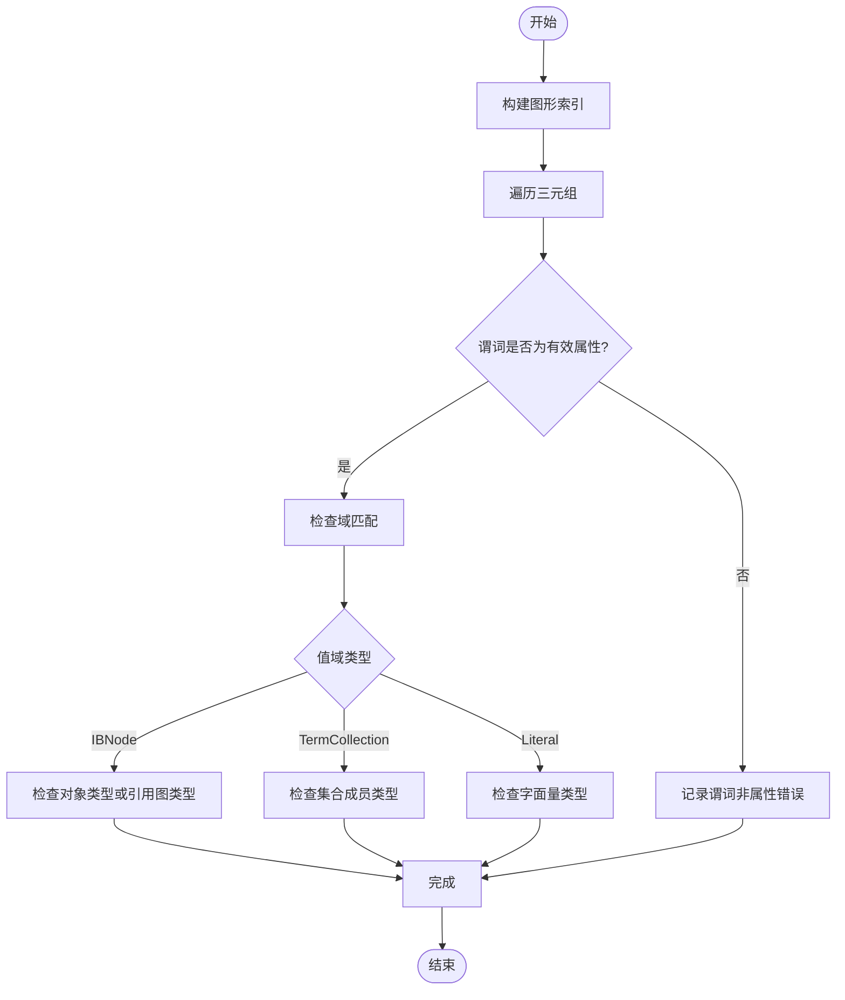
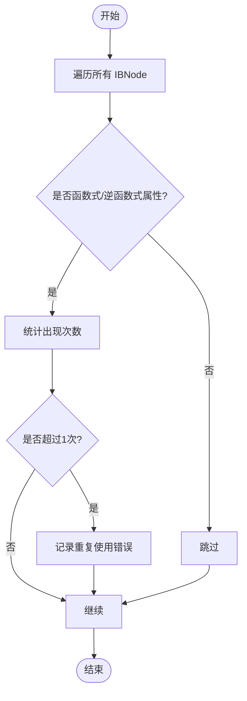
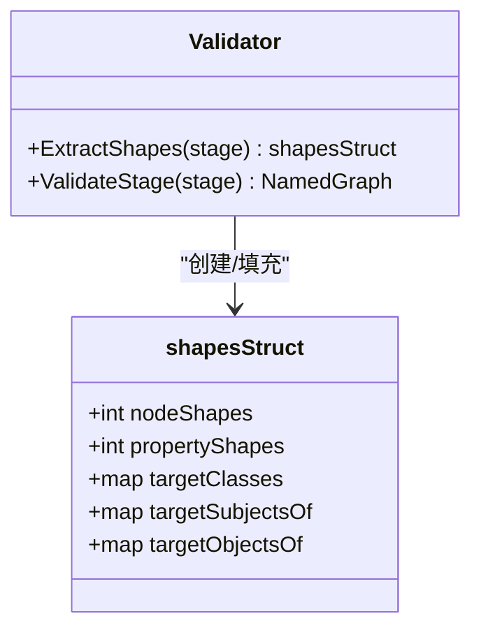
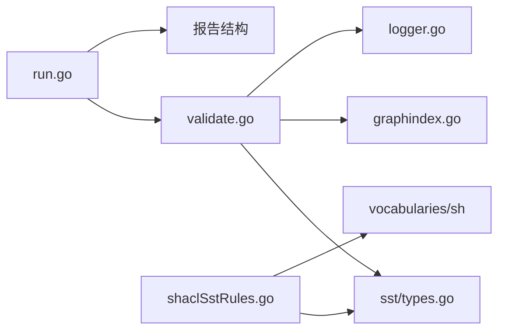

# 验证规则扩展

<cite>
**本文引用的文件**
- [tools/validate/validate.go](file://tools/validate/validate.go)
- [tools/validate/run.go](file://tools/validate/run.go)
- [tools/validate/graphindex.go](file://tools/validate/graphindex.go)
- [tools/validate/logger.go](file://tools/validate/logger.go)
- [tools/validate/shaclSstRules.go](file://tools/validate/shaclSstRules.go)
- [tools/validate/validateall_test.go](file://tools/validate/validateall_test.go)
- [tools/validate/validaterealvoc_test.go](file://tools/validate/validaterealvoc_test.go)
- [sst/types.go](file://sst/types.go)
</cite>

## 目录
1. [简介](#简介)
2. [项目结构](#项目结构)
3. [核心组件](#核心组件)
4. [架构总览](#架构总览)
5. [详细组件分析](#详细组件分析)
6. [依赖关系分析](#依赖关系分析)
7. [性能考虑](#性能考虑)
8. [故障排查指南](#故障排查指南)
9. [结论](#结论)
10. [附录](#附录)

## 简介
本指南面向需要在 SST 中扩展 SHACL 约束验证能力的开发者。仓库提供了基于 RDF/RDFS/OWL 的内置校验能力（类型、域/值域、函数式属性等），并预留了 SHACL 形状提取与报告生成的入口，便于在此基础上实现自定义验证规则与检查逻辑。本文将系统说明：
- 如何理解并利用现有验证框架与扩展点
- 如何使用验证上下文与数据模型进行复杂业务规则校验
- 如何生成结构化与可读性更强的验证报告
- 如何实现批量与异步验证
- 如何进行性能优化与结果缓存

## 项目结构
验证相关代码集中在 tools/validate 包，围绕“阶段 Stage”和“命名图 NamedGraph”的数据模型展开，提供统一的验证入口、日志接口、索引构建与报告输出。SHACL 支持目前以“形状提取”为主，后续可在此之上扩展为完整的 SHACL 引擎。

图表来源
- [tools/validate/run.go:441-472](file://tools/validate/run.go#L441-L472)
- [tools/validate/validate.go:57-114](file://tools/validate/validate.go#L57-L114)
- [tools/validate/graphindex.go:28-56](file://tools/validate/graphindex.go#L28-L56)
- [tools/validate/logger.go:22-31](file://tools/validate/logger.go#L22-L31)
- [tools/validate/shaclSstRules.go:22-34](file://tools/validate/shaclSstRules.go#L22-L34)
- [sst/types.go:9-30](file://sst/types.go#L9-L30)

章节来源
- [tools/validate/run.go:441-472](file://tools/validate/run.go#L441-L472)
- [tools/validate/validate.go:57-114](file://tools/validate/validate.go#L57-L114)

## 核心组件
- 验证入口与编排
  - ValidateAll：将待验证 Stage 与参考 Stage 合并到工作 Stage，按图遍历执行多种校验，返回报告。
  - Validate：对指定 Stage 执行一组校验种类，默认包含类型、域/值域、函数式属性。
- 校验种类
  - RdfType：检查主体是否具备 rdf:type，且类型属于主类或属性定义。
  - DomainAndRange：基于词汇表与图内 rdfs:domain/range/subClassOf 声明，校验谓词应用是否符合域/值域约束；支持集合与字面量范围。
  - FunctionalProperty / InverseFunctionalProperty：确保函数式/逆函数式属性的唯一性约束。
- 图形索引
  - buildGraphIndex：一次性扫描图，建立 domainOf、rangeOf、subClassOf 的查找表，避免重复扫描。
- 日志与错误
  - Logger 接口与输出实现 outputLog：统一记录进入/离开、信息、警告、错误级别日志，支持三元组格式化。
- SHACL 形状
  - ExtractShapes：从图中提取 sh:NodeShape、sh:Property 等形状，映射目标类/属性到形状。
  - ValidateStage：创建 sh:ValidationReport 节点，当前作为占位入口，可扩展为完整 SHACL 执行器。

章节来源
- [tools/validate/validate.go:57-114](file://tools/validate/validate.go#L57-L114)
- [tools/validate/validate.go:171-261](file://tools/validate/validate.go#L171-L261)
- [tools/validate/validate.go:263-362](file://tools/validate/validate.go#L263-L362)
- [tools/validate/validate.go:566-800](file://tools/validate/validate.go#L566-L800)
- [tools/validate/graphindex.go:28-56](file://tools/validate/graphindex.go#L28-L56)
- [tools/validate/logger.go:22-31](file://tools/validate/logger.go#L22-L31)
- [tools/validate/shaclSstRules.go:22-34](file://tools/validate/shaclSstRules.go#L22-L34)
- [tools/validate/shaclSstRules.go:67-138](file://tools/validate/shaclSstRules.go#L67-L138)

## 架构总览
下图展示了验证流程的整体架构：调用方通过 run.go 暴露的 Validate/ValidateAll 触发校验，内部根据校验种类分发到具体实现，使用 graphindex 加速查询，并通过 logger 输出日志，最终汇总为 ValidateReport。

图表来源
- [tools/validate/run.go:441-472](file://tools/validate/run.go#L441-L472)
- [tools/validate/validate.go:57-114](file://tools/validate/validate.go#L57-L114)
- [tools/validate/graphindex.go:28-56](file://tools/validate/graphindex.go#L28-L56)
- [tools/validate/logger.go:22-31](file://tools/validate/logger.go#L22-L31)
- [tools/validate/run.go:236-295](file://tools/validate/run.go#L236-L295)

## 详细组件分析

### 组件A：RDF 类型校验（RdfType）
- 功能要点
  - 遍历每个 IBNode，收集其 rdf:type 列表。
  - 跳过 NG 节点与 TermCollection。
  - 若缺少 rdf:type，记录错误。
  - 若非主类或属性定义，记录错误。
- 复杂度
  - 时间复杂度 O(N)，N 为三元组数量；空间复杂度 O(T)，T 为类型数量。
- 扩展点
  - 可在 isMainClassNode 与 isValidProperty 中增加领域特定主类/属性识别逻辑。
  - 可通过 Logger 注入自定义告警策略。

图表来源
- [tools/validate/validate.go:263-362](file://tools/validate/validate.go#L263-L362)

章节来源
- [tools/validate/validate.go:263-362](file://tools/validate/validate.go#L263-L362)

### 组件B：域/值域校验（DomainAndRange）
- 功能要点
  - 构建 graphIndex，快速查找 rdfs:domain、rdfs:range、rdfs:subClassOf。
  - 早期绑定：优先使用词汇表中的谓词元信息（Domain/Range）。
  - 晚期绑定：若谓词不在词汇表中，则依据图内声明判断是否为属性，并推导域/值域。
  - 支持对象类型与字面量类型的值域匹配，以及 TermCollection 成员类型检查。
- 复杂度
  - 构建索引 O(N)，校验过程近似 O(N + M log K)（M 为三元组数，K 为继承链长度）。
- 扩展点
  - 在 literalCheck 中扩展更多 XSD 类型匹配。
  - 在 rangeFromGraph/isKindFromGraph 中增强子类型推理。

图表来源
- [tools/validate/validate.go:566-800](file://tools/validate/validate.go#L566-L800)
- [tools/validate/graphindex.go:28-56](file://tools/validate/graphindex.go#L28-L56)

章节来源
- [tools/validate/validate.go:566-800](file://tools/validate/validate.go#L566-L800)
- [tools/validate/graphindex.go:28-56](file://tools/validate/graphindex.go#L28-L56)

### 组件C：函数式属性校验（FunctionalProperty）
- 功能要点
  - 检测 owl:FunctionalProperty 与 owl:InverseFunctionalProperty。
  - 维护映射统计同一主体/客体上谓词出现次数，超过一次即报错。
  - 支持 rdfs:subPropertyOf 继承链上的函数式属性判定。
- 复杂度
  - 时间复杂度 O(N)，空间复杂度 O(P)，P 为涉及的谓词-客体组合数。
- 扩展点
  - 可增加更细粒度的作用域控制（如限定命名图或上下文）。

图表来源
- [tools/validate/validate.go:171-261](file://tools/validate/validate.go#L171-L261)

章节来源
- [tools/validate/validate.go:171-261](file://tools/validate/validate.go#L171-L261)

### 组件D：SHACL 形状提取与报告入口
- 功能要点
  - ExtractShapes：扫描 sh:NodeShape、sh:Property、sh:TargetClass 等，建立目标到形状的映射。
  - ValidateStage：创建 sh:ValidationReport 节点，设置 conforms=false，并打印形状统计。
- 扩展方向
  - 将 ExtractShapes 的结果与 DomainAndRange/RdfType 等校验结合，形成完整的 SHACL 执行管线。
  - 将报告输出扩展为符合 SHACL 规范的 sh:Result 三元组集合。

图表来源
- [tools/validate/shaclSstRules.go:12-20](file://tools/validate/shaclSstRules.go#L12-L20)
- [tools/validate/shaclSstRules.go:22-34](file://tools/validate/shaclSstRules.go#L22-L34)
- [tools/validate/shaclSstRules.go:67-138](file://tools/validate/shaclSstRules.go#L67-L138)

章节来源
- [tools/validate/shaclSstRules.go:22-34](file://tools/validate/shaclSstRules.go#L22-L34)
- [tools/validate/shaclSstRules.go:67-138](file://tools/validate/shaclSstRules.go#L67-L138)

### 组件E：日志与错误处理
- 日志接口
  - Logger 提供 Log/LogForGraph/Logf/LogfForGraph，支持 InfoEnter/InfoLeave/Info/Warn/Error 等级别。
  - TripleStringFormatter 用于三元组格式化的错误消息。
- 错误处理
  - 各校验函数通过 report.Error/Warn 记录发现项，并在遇到错误时返回错误。
  - 输出日志可根据 quiet/verbose 开关控制。

章节来源
- [tools/validate/logger.go:11-35](file://tools/validate/logger.go#L11-L35)
- [tools/validate/run.go:65-121](file://tools/validate/run.go#L65-L121)
- [tools/validate/run.go:236-295](file://tools/validate/run.go#L236-L295)

## 依赖关系分析
- 模块耦合
  - validate.go 依赖 sst 数据模型与 vocabularies（rdf/rdfs/owl/ssmeta/xsd），并通过 graphindex 提升性能。
  - run.go 提供 CLI 风格参数与报告格式化，封装 Validate 入口。
  - shaclSstRules.go 依赖 sh 词汇，负责形状解析。
- 外部依赖
  - sst 核心库提供 Stage、NamedGraph、IBNode、Term 等数据结构。
  - 词汇表提供预定义类型与属性元信息。

图表来源
- [tools/validate/validate.go:57-114](file://tools/validate/validate.go#L57-L114)
- [tools/validate/run.go:441-472](file://tools/validate/run.go#L441-L472)
- [tools/validate/shaclSstRules.go:67-138](file://tools/validate/shaclSstRules.go#L67-L138)
- [sst/types.go:9-30](file://sst/types.go#L9-L30)

章节来源
- [tools/validate/validate.go:57-114](file://tools/validate/validate.go#L57-L114)
- [tools/validate/run.go:441-472](file://tools/validate/run.go#L441-L472)
- [tools/validate/shaclSstRules.go:67-138](file://tools/validate/shaclSstRules.go#L67-L138)
- [sst/types.go:9-30](file://sst/types.go#L9-L30)

## 性能考虑
- 索引化
  - 使用 buildGraphIndex 预先计算 domain/range/subClassOf，减少重复扫描，提高校验速度。
- 早期绑定
  - 优先使用词汇表的谓词元信息，避免昂贵的晚期绑定推断。
- 流式处理
  - 利用 ForAll/ForAllIBNodes 回调遍历三元组，降低内存占用。
- 结果缓存
  - 可将 ValidateReport 序列化后缓存（JSON/文本），避免重复计算。
  - 对于大型 Stage，可按命名图粒度缓存中间结果。
- 并发与批处理
  - 对多个命名图可并行执行校验（注意共享状态与锁）。
  - 对多 Stage 可分片处理，聚合报告。

[本节为通用指导，无需具体文件来源]

## 故障排查指南
- 常见问题
  - 缺少 rdf:type：检查主体是否定义了类型，并确保类型为主类或属性。
  - 域/值域不匹配：确认谓词是否在词汇表中或图内正确声明 rdfs:domain/range。
  - 谓词不是属性：确保谓词类型为 rdf:Property/owl:ObjectProperty/owl:DatatypeProperty，或通过 subPropertyOf 链连接到已知属性。
  - 函数式属性重复：检查同一主体/客体上是否多次赋值。
- 定位方法
  - 启用 verbose 模式查看详细信息。
  - 使用 FormatHumanReadable 输出人类可读的报告，按命名图分组查看错误与警告。
  - 关注 Finding 的 Rule、Message、S/P/O 字段定位问题三元组。

章节来源
- [tools/validate/run.go:297-439](file://tools/validate/run.go#L297-L439)
- [tools/validate/validate.go:263-362](file://tools/validate/validate.go#L263-L362)
- [tools/validate/validate.go:566-800](file://tools/validate/validate.go#L566-L800)
- [tools/validate/validate.go:171-261](file://tools/validate/validate.go#L171-L261)

## 结论
SST 的验证框架提供了坚实的内置校验能力与清晰的扩展点。通过合理利用图形索引、词汇表元信息与日志接口，可以在保持高性能的同时，灵活扩展自定义规则与 SHACL 支持。建议在实际项目中：
- 明确业务规则边界，优先使用词汇表与图内声明进行早期绑定。
- 将复杂规则拆分为独立的校验函数，复用现有基础设施。
- 采用批处理与并发策略提升吞吐，结合缓存降低重复计算成本。
- 完善报告输出与错误定位，便于问题追踪与修复。

[本节为总结性内容，无需具体文件来源]

## 附录

### 编写自定义验证规则的步骤
- 选择扩展点
  - 新增校验种类：在 ValidationKind 中添加新枚举，并在 Validate/ValidateAll 中分发。
  - 复用现有逻辑：在 DomainAndRange/RdfType/FunctionalProperty 中插入条件分支。
- 实现校验函数
  - 接收 NamedGraph、*ValidateReport、Logger。
  - 使用 ForAll/ForAllIBNodes 遍历三元组，必要时构建局部索引。
  - 通过 report.Error/Warn 记录发现项，必要时返回错误。
- 集成与测试
  - 在测试中构造 TTL 数据，调用 Validate/ValidateAll，断言报告内容与 Passed 标志。
  - 使用 FormatHumanReadable 输出可读报告，辅助调试。

章节来源
- [tools/validate/run.go:211-234](file://tools/validate/run.go#L211-L234)
- [tools/validate/run.go:441-472](file://tools/validate/run.go#L441-L472)
- [tools/validate/validateall_test.go:19-87](file://tools/validate/validateall_test.go#L19-L87)
- [tools/validate/validaterealvoc_test.go:54-333](file://tools/validate/validaterealvoc_test.go#L54-L333)

### 验证上下文与数据模型的使用
- 上下文
  - 使用 NamedGraph 作为校验上下文，隔离不同数据集的校验。
  - 通过 referenceStages 引入外部词汇或参考数据，避免污染输入 Stage。
- 数据模型
  - IBNode/Term/Literal 表示三元组的主体、谓词、客体。
  - StaticDictionary 提供词汇元素查询，支持早期绑定。
  - types.go 定义了常用字面量类型与资源类型，便于类型匹配。

章节来源
- [tools/validate/validate.go:57-114](file://tools/validate/validate.go#L57-L114)
- [sst/types.go:9-30](file://sst/types.go#L9-L30)

### 批量验证与异步验证
- 批量验证
  - 对多个 Stage 或命名图循环调用 Validate/ValidateAll，聚合报告。
  - 使用 NewReport 初始化报告，按命名图分组记录 Findings。
- 异步验证
  - 使用 goroutine 并行执行不同命名图的校验，注意共享资源的同步。
  - 将结果写入通道，主协程聚合报告。

章节来源
- [tools/validate/run.go:441-472](file://tools/validate/run.go#L441-L472)
- [tools/validate/validate.go:57-114](file://tools/validate/validate.go#L57-L114)

### 复杂业务规则案例
- 几何集合与点类型
  - 验证 GeometricSet 的 element 指向 CartesianPoint，且坐标列表满足范围要求。
- 子属性链与主类继承
  - 通过 rdfs:subPropertyOf 与 ssmeta:MainClass 的组合，允许间接继承的主类实例通过校验。

章节来源
- [tools/validate/validateall_test.go:89-124](file://tools/validate/validateall_test.go#L89-L124)
- [tools/validate/validaterealvoc_test.go:94-148](file://tools/validate/validaterealvoc_test.go#L94-L148)