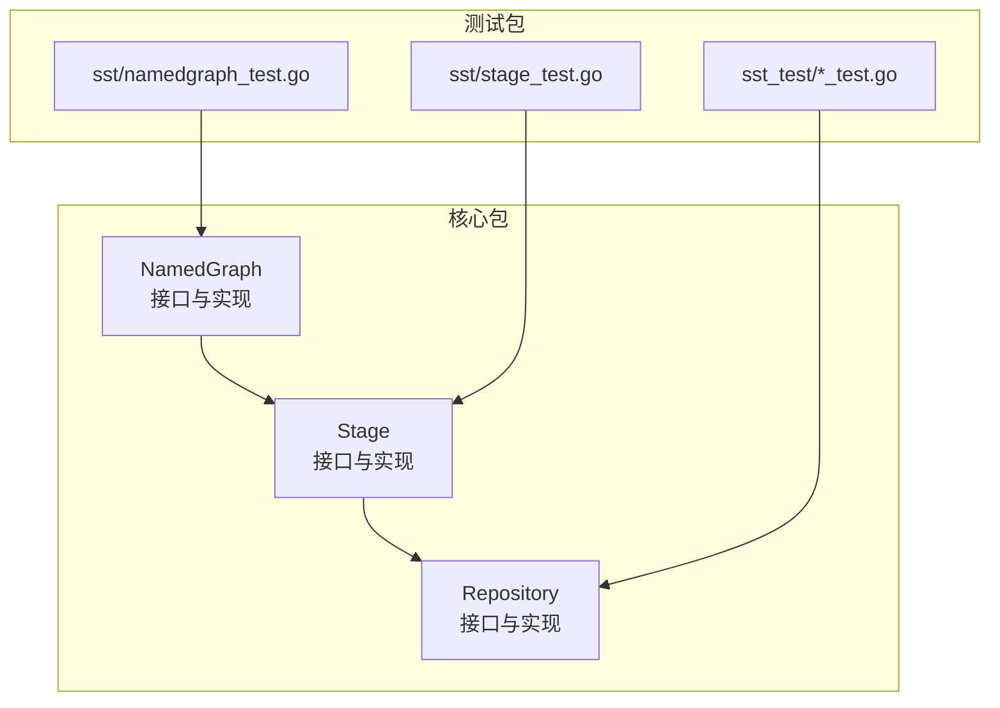
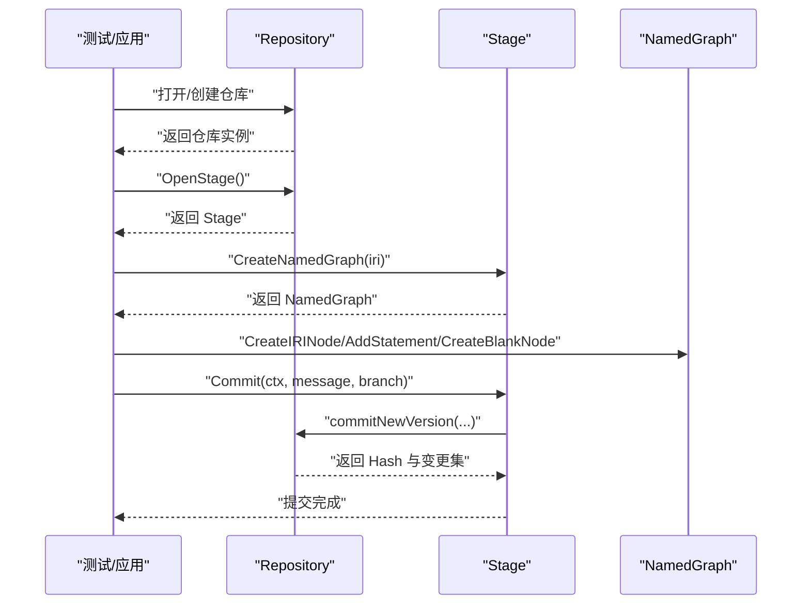
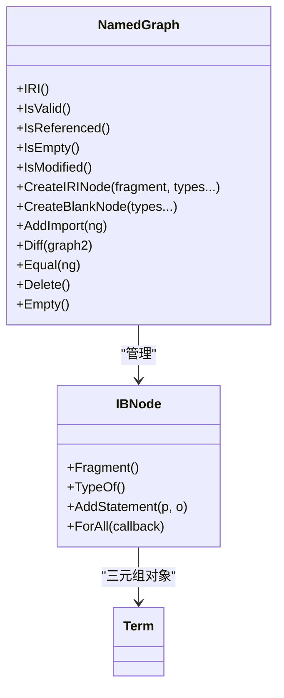
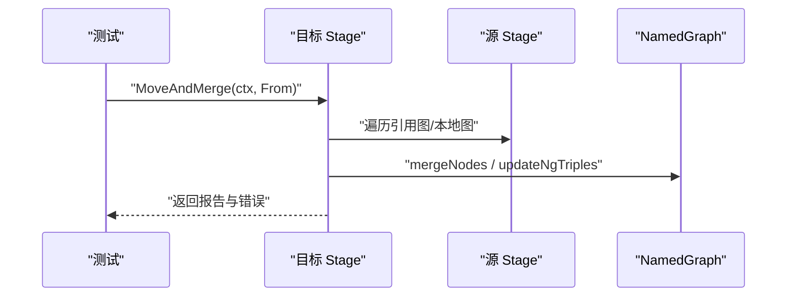
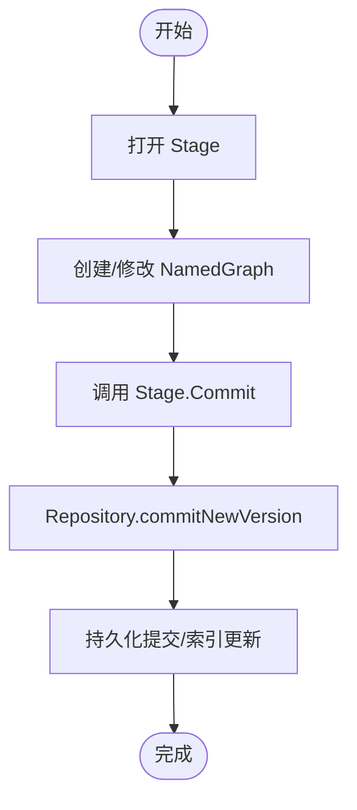
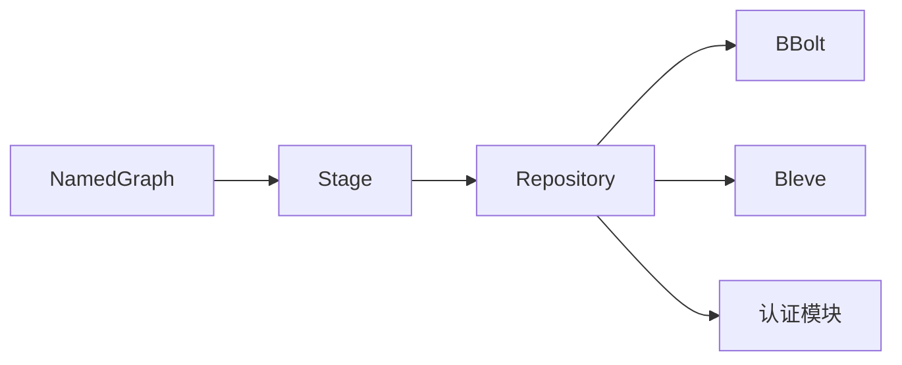

# 单元测试指南

<cite>
**本文引用的文件**
- [sst/namedgraph.go](file://sst/namedgraph.go)
- [sst/stage.go](file://sst/stage.go)
- [sst/repository.go](file://sst/repository.go)
- [sst/namedgraph_test.go](file://sst/namedgraph_test.go)
- [sst/stage_test.go](file://sst/stage_test.go)
- [sst/ibnode_test.go](file://sst/ibnode_test.go)
- [sst_test/namedgraph_test.go](file://sst_test/namedgraph_test.go)
- [sst_test/stage_test.go](file://sst_test/stage_test.go)
</cite>

## 目录
1. [简介](#简介)
2. [项目结构](#项目结构)
3. [核心组件](#核心组件)
4. [架构总览](#架构总览)
5. [详细组件分析](#详细组件分析)
6. [依赖关系分析](#依赖关系分析)
7. [性能考虑](#性能考虑)
8. [故障排查指南](#故障排查指南)
9. [结论](#结论)
10. [附录](#附录)

## 简介
本指南面向希望为 SST 核心组件编写高质量单元测试的工程师。内容聚焦于 NamedGraph、Stage、Repository 等关键接口的测试方法，系统讲解表驱动测试（Table-Driven Tests）在 Go testing 包中的使用模式；介绍如何准备 IRI 节点、字面量、三元组等测试数据；提供并发测试的最佳实践与断言库使用方法，并给出常见测试场景示例。所有说明均基于仓库中现有实现与测试用例进行提炼与归纳。

## 项目结构
SST 核心代码位于 sst 包，包含 NamedGraph、Stage、Repository 等核心接口及其实现；测试代码分布在 sst 包内（单元级）和 sst_test 包（集成/端到端级）。命名规范遵循 Go 约定：*_test.go 用于测试，testdata 目录存放测试数据。

图表来源
- [sst/namedgraph.go:110-409](file://sst/namedgraph.go#L110-L409)
- [sst/stage.go:64-234](file://sst/stage.go#L64-L234)
- [sst/repository.go:34-179](file://sst/repository.go#L34-L179)

章节来源
- [sst/namedgraph.go:110-409](file://sst/namedgraph.go#L110-L409)
- [sst/stage.go:64-234](file://sst/stage.go#L64-L234)
- [sst/repository.go:34-179](file://sst/repository.go#L34-L179)

## 核心组件
- NamedGraph：RDF 命名图在内存中的表示，负责节点管理、三元组存储、导入关系、差异比较、提交历史关联等。
- Stage：一组 NamedGraph 的内存工作区，支持创建/获取图、合并移动、提交到仓库、导出 RDF/SST 等。
- Repository：持久化存储多个 Dataset（含默认 NamedGraph 及导入图），支持版本历史、查询索引、文档管理等。

章节来源
- [sst/namedgraph.go:110-409](file://sst/namedgraph.go#L110-L409)
- [sst/stage.go:64-234](file://sst/stage.go#L64-L234)
- [sst/repository.go:34-179](file://sst/repository.go#L34-L179)

## 架构总览
下图展示了从应用层通过 Stage 操作 NamedGraph，再经由 Repository 提交或读取数据的典型流程。

图表来源
- [sst/repository.go:60-89](file://sst/repository.go#L60-L89)
- [sst/stage.go:121-130](file://sst/stage.go#L121-L130)
- [sst/namedgraph.go:200-215](file://sst/namedgraph.go#L200-L215)

## 详细组件分析

### NamedGraph 测试要点
- 目标：验证节点创建、三元组增删、导入关系、差异比较、相等性判断、清空/删除等行为。
- 常用断言：使用 testify/assert 对 IRINodeCount、BlankNodeCount、IsModified、IsEmpty、Equal 等进行断言。
- 表驱动测试：将不同输入（如 baseIRI、是否引用、是否跟踪谓词）组织为测试表，循环执行 t.Run。
- 数据准备：通过 CreateIRINode、CreateBlankNode、AddStatement 构造最小可验证的图结构；必要时借助 RdfRead 加载 TTL 样例。

章节来源
- [sst/namedgraph.go:110-409](file://sst/namedgraph.go#L110-L409)
- [sst/namedgraph_test.go:15-111](file://sst/namedgraph_test.go#L15-L111)
- [sst_test/namedgraph_test.go:31-50](file://sst_test/namedgraph_test.go#L31-L50)

#### 类关系图（概念映射）

图表来源
- [sst/namedgraph.go:110-409](file://sst/namedgraph.go#L110-L409)

### Stage 测试要点
- 目标：验证图的创建与枚举、MoveAndMerge 行为、AlignHistory 历史对齐、LinkToRepository 绑定、提交与导出。
- 表驱动测试：以不同 Stage 初始状态（本地图数量、引用图集合）作为测试项，断言结果集合与统计信息。
- 并发安全：Stage 内部维护 map 与切片，测试并发时应避免共享可变状态；如需并发，应隔离 Stage 实例或使用只读路径。
- 数据准备：通过 OpenStage 创建空 Stage，CreateNamedGraph 构建图，必要时结合 SstRead/RdfRead 加载外部数据。

章节来源
- [sst/stage.go:64-234](file://sst/stage.go#L64-L234)
- [sst/stage_test.go:15-113](file://sst/stage_test.go#L15-L113)
- [sst/stage_test.go:115-198](file://sst/stage_test.go#L115-L198)
- [sst_test/stage_test.go:29-185](file://sst_test/stage_test.go#L29-L185)

#### 序列图：MoveAndMerge 调用链

图表来源
- [sst/stage.go:468-800](file://sst/stage.go#L468-L800)

### Repository 测试要点
- 目标：验证仓库创建/打开、数据集列表、分支/提交详情、Checkout、Index 重建、日志、文档存取等。
- 表驱动测试：以不同仓库类型（本地完整/基础/扁平）、不同分支名、不同提交哈希作为测试项。
- 并发安全：Repository 通常封装底层 BBolt/Bleve，读写需遵循其并发模型；测试中应避免跨 goroutine 共享同一 Stage。
- 数据准备：使用 CreateLocalRepository/OpenLocalRepository/OpenLocalFlatRepository 构造仓库，配合 Commit/Checkout 生成数据。

章节来源
- [sst/repository.go:34-179](file://sst/repository.go#L34-L179)
- [sst/repository.go:311-423](file://sst/repository.go#L311-L423)
- [sst/repository.go:465-562](file://sst/repository.go#L465-L562)
- [sst/repository.go:564-704](file://sst/repository.go#L564-L704)

#### 流程图：提交流程（Stage -> Repository）

图表来源
- [sst/stage.go:121-130](file://sst/stage.go#L121-L130)
- [sst/repository.go:130-131](file://sst/repository.go#L130-L131)

## 依赖关系分析
- NamedGraph 依赖 Stage 提供的上下文与生命周期管理。
- Stage 依赖 Repository 进行持久化与版本控制。
- Repository 依赖 BBolt（持久化）、Bleve（索引）、认证模块（远程访问）等。

图表来源
- [sst/namedgraph.go:110-409](file://sst/namedgraph.go#L110-L409)
- [sst/stage.go:64-234](file://sst/stage.go#L64-L234)
- [sst/repository.go:34-179](file://sst/repository.go#L34-L179)

章节来源
- [sst/namedgraph.go:110-409](file://sst/namedgraph.go#L110-L409)
- [sst/stage.go:64-234](file://sst/stage.go#L64-L234)
- [sst/repository.go:34-179](file://sst/repository.go#L34-L179)

## 性能考虑
- 三元组模式：DefaultTriplexMode 同时维护主体、谓词、对象三元组，适合复杂查询但占用更多内存。测试时可根据场景选择合适模式。
- 批量写入：在测试中尽量批量创建节点与三元组，减少频繁扩容与索引更新。
- 并发限制：避免在多个 goroutine 中并发修改同一 Stage/NamedGraph；对只读遍历可使用 ForAll* 系列方法。
- 资源清理：测试结束后及时 Close 仓库与释放临时目录，避免资源泄漏。

## 故障排查指南
- 常见问题
  - 未链接仓库导致无法提交：确保 Stage 已 LinkToRepository 或通过 OpenStage 后正确设置 repo。
  - 重复导入或导入环：AddImport 会校验冲突与环，测试中应覆盖这些边界条件。
  - 删除受引用图失败：Delete 会检查是否被其他图引用，测试中应验证错误码。
  - 分支不存在：CheckoutBranch 可能返回 ErrBranchNotFound，测试中应断言错误。
- 调试技巧
  - 使用 Dump/PrintTriples 输出图结构与三元组，辅助定位问题。
  - 使用 Info/StageInfo/RepositoryInfo 获取统计信息，验证预期规模。

章节来源
- [sst/namedgraph.go:222-294](file://sst/namedgraph.go#L222-L294)
- [sst/stage.go:121-170](file://sst/stage.go#L121-L170)
- [sst/repository.go:125-179](file://sst/repository.go#L125-L179)

## 结论
通过对 NamedGraph、Stage、Repository 的深入分析与现有测试用例的总结，可以形成一套系统化、可扩展的单元测试策略：以表驱动测试组织多场景输入，以最小化测试数据快速验证核心行为，以并发隔离保障稳定性，以断言库保证结果正确性。建议在新增功能时同步补充对应测试用例，保持覆盖率与质量。

## 附录

### 表驱动测试最佳实践（Go testing）
- 定义测试结构体：name、args、want、assertion。
- 使用 for _, tt := range tests 循环，t.Run(tt.name, ...) 执行。
- 每个用例独立初始化 Stage/NamedGraph，避免共享可变状态。
- 使用 require 进行前置断言，使用 assert 进行结果断言。

章节来源
- [sst/namedgraph_test.go:15-111](file://sst/namedgraph_test.go#L15-L111)
- [sst/stage_test.go:15-113](file://sst/stage_test.go#L15-L113)
- [sst/ibnode_test.go:50-249](file://sst/ibnode_test.go#L50-L249)

### 测试数据准备（IRI、字面量、三元组）
- IRI 节点：CreateIRINode(fragment, types...)，fragment 为空时自动生成 UUID。
- 空白节点：CreateBlankNode(types...)，用于无 IRI 的资源。
- 三元组：通过 AddStatement(predicate, object) 添加，object 可为 IBNode 或 Literal。
- 集合：CreateCollection(...) 生成 TermCollection，便于表达有序/无序集合。

章节来源
- [sst/namedgraph.go:200-215](file://sst/namedgraph.go#L200-L215)

### 并发测试最佳实践
- 隔离 Stage：每个 goroutine 使用独立的 Stage 实例，避免共享。
- 只读并行：对只读遍历（ForAll*）可在不同 Stage 上并行执行。
- 提交串行化：对同一仓库的提交建议串行或在不同分支/数据集上隔离。
- 资源释放：defer repo.Close() 与清理临时目录，防止文件句柄泄漏。

章节来源
- [sst/stage.go:121-170](file://sst/stage.go#L121-L170)
- [sst/repository.go:121-179](file://sst/repository.go#L121-L179)

### 常见测试场景示例
- 新建图并验证节点计数与类型：参考 [sst_test/namedgraph_test.go:31-50](file://sst_test/namedgraph_test.go#L31-L50)。
- 读取 TTL 并写入 SST，再合并 Stage：参考 [sst_test/stage_test.go:29-185](file://sst_test/stage_test.go#L29-L185)。
- 对齐历史 AlignHistory：参考 [sst/stage_test.go:115-198](file://sst/stage_test.go#L115-L198)。
- 删除图并提交后验证分支状态：参考 [sst_test/namedgraph_test.go:123-192](file://sst_test/namedgraph_test.go#L123-L192)。

章节来源
- [sst_test/namedgraph_test.go:31-50](file://sst_test/namedgraph_test.go#L31-L50)
- [sst_test/stage_test.go:29-185](file://sst_test/stage_test.go#L29-L185)
- [sst/stage_test.go:115-198](file://sst/stage_test.go#L115-L198)
- [sst_test/namedgraph_test.go:123-192](file://sst_test/namedgraph_test.go#L123-L192)