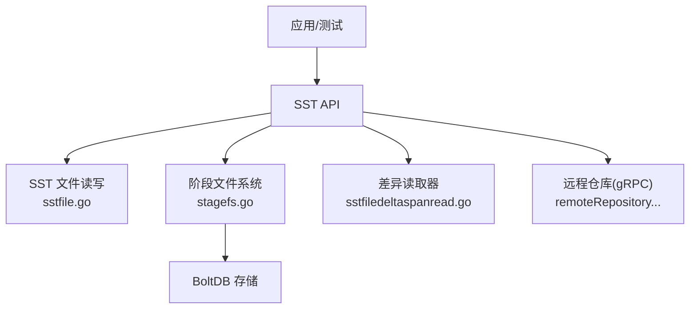
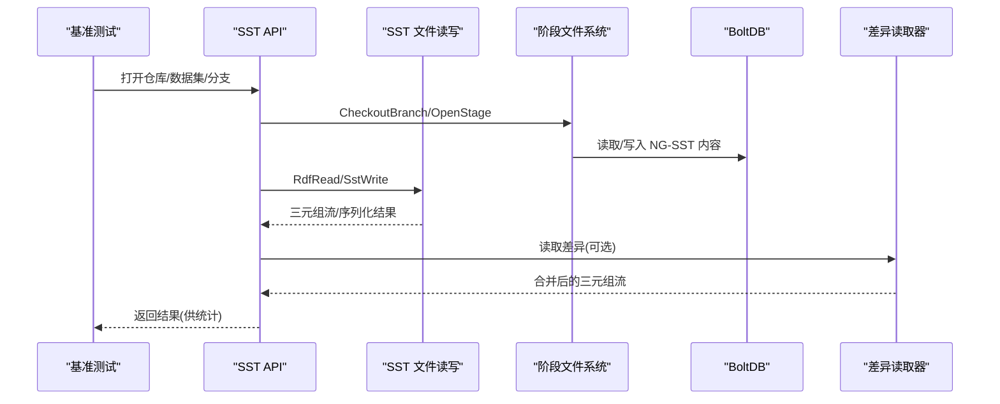
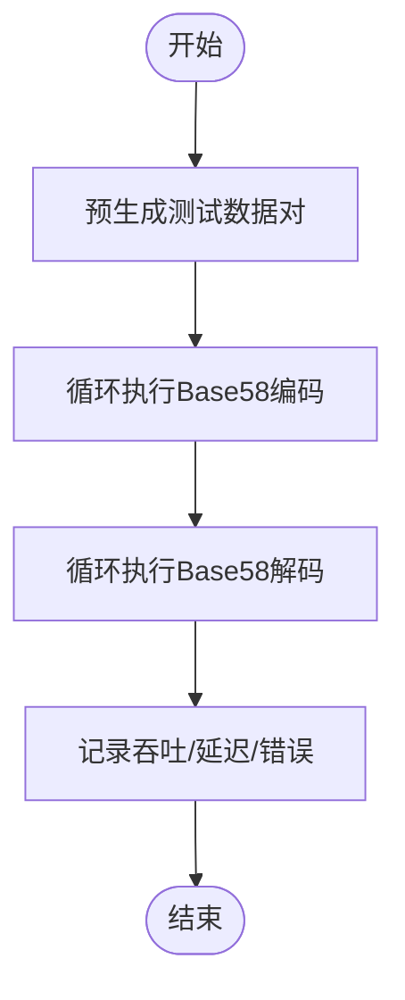
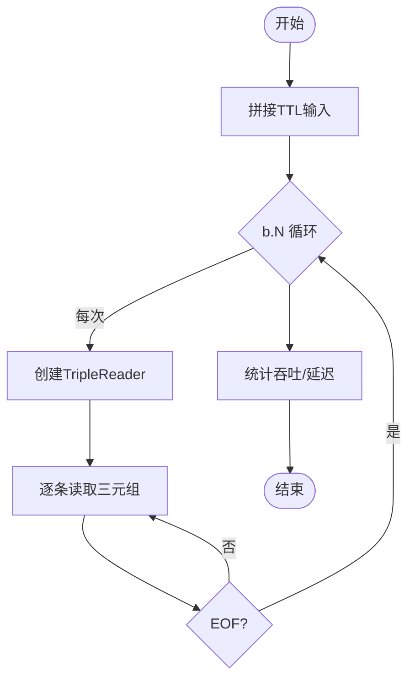
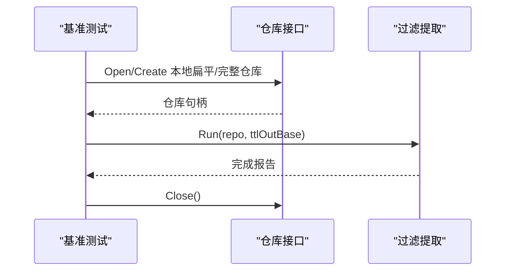
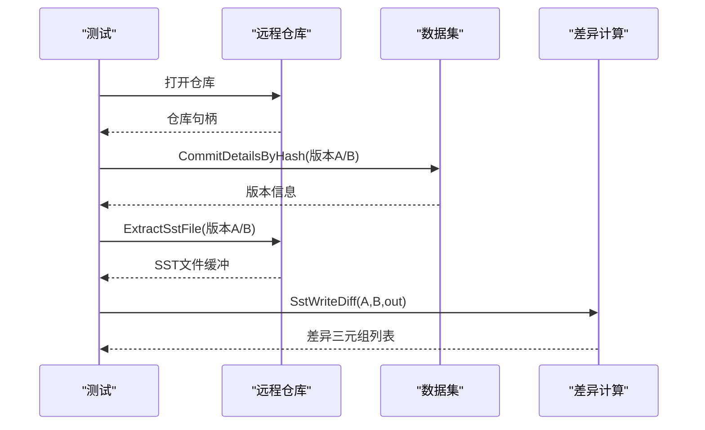
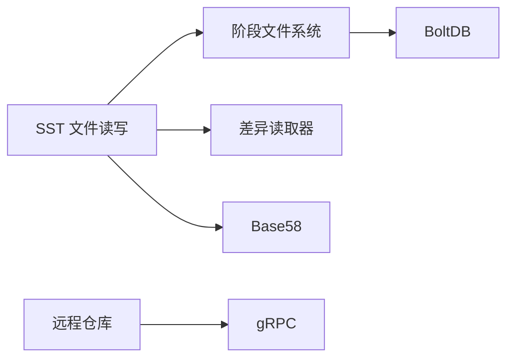

# 性能基准测试

<cite>
**本文引用的文件**
- [hash_base58_benchmark_test.go](file://sst/hash_base58_benchmark_test.go)
- [rdfttl_test.go](file://sst/rdfttl_test.go)
- [filterextraction_test.go](file://tools/filterextraction/filterextraction_test.go)
- [sstfile.go](file://sst/sstfile.go)
- [stagefs.go](file://sst/stagefs.go)
- [sstfiledeltaspanread.go](file://sst/sstfiledeltaspanread.go)
- [repolocalflat_test.go](file://sst/repolocalflat_test.go)
- [remoteRepositoryMultipleCommits_test.go](file://sst_test/remoteRepositoryMultipleCommits_test.go)
- [go.mod](file://go.mod)
</cite>

## 目录
1. [简介](#简介)
2. [项目结构](#项目结构)
3. [核心组件](#核心组件)
4. [架构总览](#架构总览)
5. [详细组件分析](#详细组件分析)
6. [依赖分析](#依赖分析)
7. [性能考量](#性能考量)
8. [故障排查指南](#故障排查指南)
9. [结论](#结论)
10. [附录](#附录)

## 简介
本文件面向SST（Semantic STEP Technology）核心库，目标是建立一套可复用的性能基准测试体系，用于测量SST组件在大数据集处理、并发读写与内存使用方面的表现。我们将基于Go原生基准测试能力，结合仓库中已有的基准用例，设计有意义的场景，定义并收集吞吐、延迟与资源利用率等指标，构建回归检测机制，并在持续集成中自动化执行，确保代码变更不会引入性能退化。同时提供瓶颈分析与优化建议，帮助定位热点路径与资源瓶颈。

## 项目结构
SST核心库围绕RDF三元组的高效存储与检索展开，包含：
- SST二进制文件格式与读写实现
- 阶段文件系统（StageFS）将NamedGraph版本化存储在BoltDB
- 差异计算与增量读取（delta span）
- 多种仓库类型（本地扁平、本地完整、远程gRPC）
- 现有基准用例覆盖Base58编解码、TTL解析、仓库创建与过滤提取流程

图表来源
- [sstfile.go:12-54](file://sst/sstfile.go#L12-L54)
- [stagefs.go:23-46](file://sst/stagefs.go#L23-L46)
- [sstfiledeltaspanread.go:51-703](file://sst/sstfiledeltaspanread.go#L51-L703)

章节来源
- [go.mod:1-80](file://go.mod#L1-L80)

## 核心组件
- SST文件结构与编码：定义了SST文件的头部、导入/引用、字典与内容段，以及字面量类型的紧凑编码策略，为高性能读写奠定基础。
- 阶段文件系统（StageFS）：以UUID为键的命名图版本管理，通过BoltDB持久化NG-SST文件内容，支持只读与读写模式。
- 差异读取器（Delta Span Reader）：高效合并基础图与差异数据，按节点索引与三元组计数进行流式读取，避免全量加载。
- 仓库层：支持本地扁平、本地完整与远程仓库，提供Commit、Checkout、SyncFrom等操作，便于构造复杂工作负载。

章节来源
- [sstfile.go:12-54](file://sst/sstfile.go#L12-L54)
- [stagefs.go:23-46](file://sst/stagefs.go#L23-L46)
- [sstfiledeltaspanread.go:51-703](file://sst/sstfiledeltaspanread.go#L51-L703)

## 架构总览
下图展示从应用调用到存储层的整体流程，包括基准测试如何覆盖关键路径：

图表来源
- [stagefs.go:48-121](file://sst/stagefs.go#L48-L121)
- [sstfile.go:12-54](file://sst/sstfile.go#L12-L54)
- [sstfiledeltaspanread.go:51-703](file://sst/sstfiledeltaspanread.go#L51-L703)

## 详细组件分析

### Base58编解码基准
- 目标：评估哈希相关编解码的性能，作为底层字符串/字节处理的基线。
- 场景：预生成大量随机字节对，分别进行Base58编码与解码循环。
- 指标：每秒操作数、每字节耗时、错误率（解码）。
- 扩展建议：增加不同输入长度分布、对比不同Base58实现、记录CPU缓存命中情况。

图表来源
- [hash_base58_benchmark_test.go:24-67](file://sst/hash_base58_benchmark_test.go#L24-L67)

章节来源
- [hash_base58_benchmark_test.go:24-67](file://sst/hash_base58_benchmark_test.go#L24-L67)

### TTL读取基准
- 目标：评估RDF Turtle格式解析的吞吐与延迟。
- 场景：拼接多个TTL片段形成大数据集，循环创建TripleReader并逐条读取。
- 指标：MB/s吞吐、平均/分位延迟、错误率。
- 扩展建议：加入不同命名空间密度、重复前缀、长IRI与短IRI混合；对比不同读取模式。

图表来源
- [rdfttl_test.go:468-483](file://sst/rdfttl_test.go#L468-L483)

章节来源
- [rdfttl_test.go:468-483](file://sst/rdfttl_test.go#L468-L483)

### 仓库创建与过滤提取基准
- 目标：评估不同仓库类型在创建、填充与过滤提取时的性能。
- 场景：在临时目录中创建本地扁平、扁平存储与完整仓库，执行过滤提取流程，比较三种实现的吞吐与延迟。
- 指标：仓库创建时间、数据写入速率、过滤提取耗时、内存峰值。
- 扩展建议：增加并发写入、不同数据集规模、不同分支数量。

图表来源
- [filterextraction_test.go:161-285](file://tools/filterextraction/filterextraction_test.go#L161-L285)

章节来源
- [filterextraction_test.go:161-285](file://tools/filterextraction/filterextraction_test.go#L161-L285)

### 提交与差异读取基准
- 目标：评估多次提交与差异读取的性能，模拟真实工作负载中的历史对齐与增量同步。
- 场景：远程仓库多提交测试中，提取两个版本的SST文件并计算差异，验证差异三元组数量与一致性。
- 指标：提交耗时、差异计算耗时、差异大小、读取吞吐。
- 扩展建议：增加提交粒度、差异比例、并发差异计算。

图表来源
- [remoteRepositoryMultipleCommits_test.go:2169-2207](file://sst_test/remoteRepositoryMultipleCommits_test.go#L2169-L2207)

章节来源
- [remoteRepositoryMultipleCommits_test.go:2169-2207](file://sst_test/remoteRepositoryMultipleCommits_test.go#L2169-L2207)

### 本地扁平仓库提交基准
- 目标：评估本地扁平仓库的提交路径性能，覆盖空消息、简单提交等边界条件。
- 场景：构造Stage并提交，捕获错误与耗时，验证提交行为正确性。
- 指标：提交延迟、错误率、内存占用。
- 扩展建议：批量提交、不同分支、不同数据集规模。

章节来源
- [repolocalflat_test.go:16-56](file://sst/repolocalflat_test.go#L16-L56)

## 依赖分析
- 外部依赖：BoltDB用于持久化，Bleve用于全文检索，gRPC用于远程仓库通信，Base58用于标识符编码。
- 内部耦合：SST文件读写与阶段文件系统紧密耦合，差异读取器依赖字典与三元组索引结构。
- 潜在循环：无明显循环依赖，但需注意StageFS与BoltDB的锁竞争与事务边界。

图表来源
- [go.mod:1-80](file://go.mod#L1-L80)
- [stagefs.go:23-46](file://sst/stagefs.go#L23-L46)
- [sstfile.go:12-54](file://sst/sstfile.go#L12-L54)

章节来源
- [go.mod:1-80](file://go.mod#L1-L80)

## 性能考量
- 吞吐与延迟：基准应同时报告吞吐（MB/s或三元组/秒）与延迟（P50/P95/P99），以便区分批处理与交互式场景。
- 内存使用：在基准中启用内存剖析，记录峰值内存与分配次数，识别热点对象与频繁分配路径。
- I/O与缓存：关注磁盘顺序读写、页缓存命中率，必要时使用独立SSD与冷启动场景。
- 并发模型：针对写路径（提交、写入SST）与读路径（RdfRead、差异读取）分别设计并发基准，评估锁竞争与并行度收益。
- 回归检测：设定阈值（如延迟增长超过5%或吞吐下降超过10%即告警），在CI中自动比对基线。

## 故障排查指南
- 差异读取异常：当移除与新增计数均为0时，差异写入可能跳过相同三元组计数，导致读取器漂移。需检查差异写入逻辑是否跳过相同计数，并确保读者与写者一致。
- 节点计数不一致：差异字典解析时应使用computeDiffNodeCount而非直接相加，避免索引错位。
- 调试建议：使用差异解析测试验证组合节点映射是否正确；若出现panic，优先检查差异流是否偏移。

章节来源
- [DIFF_FORMAT.md:254-280](file://sst_test/DIFF_FORMAT.md#L254-L280)

## 结论
通过系统化基准测试，可以全面评估SST在数据解析、存储、差异计算与远程同步等关键环节的性能表现。结合吞吐、延迟与内存指标，配合回归检测与CI自动化，能够有效保障代码演进过程中的稳定性与效率。建议在后续迭代中持续完善基准场景，覆盖更多真实负载与极端情况，并建立长期性能趋势看板。

## 附录
- 基准运行命令示例：
  - go test -bench=. -benchmem ./sst/...
  - go test -bench=. -benchmem ./tools/filterextraction/...
- 指标采集建议：
  - 使用pprof进行CPU与内存剖析
  - 使用go test -benchtime与-count控制运行时长与重复次数
  - 在CI中保存基准结果与报告，设置阈值告警