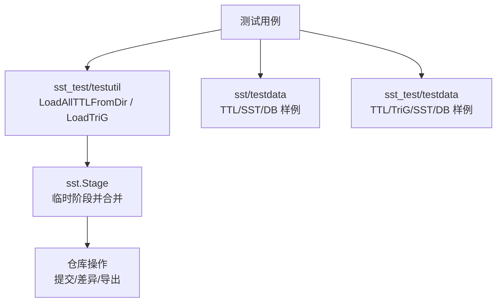
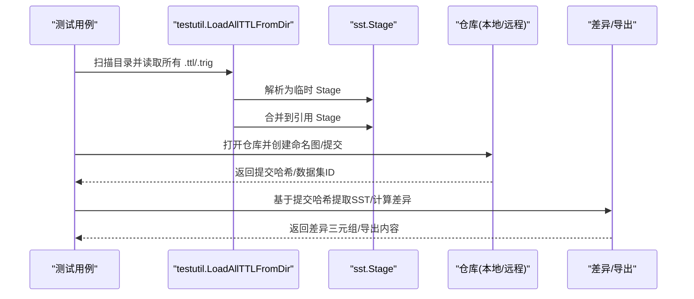
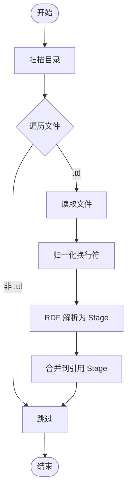
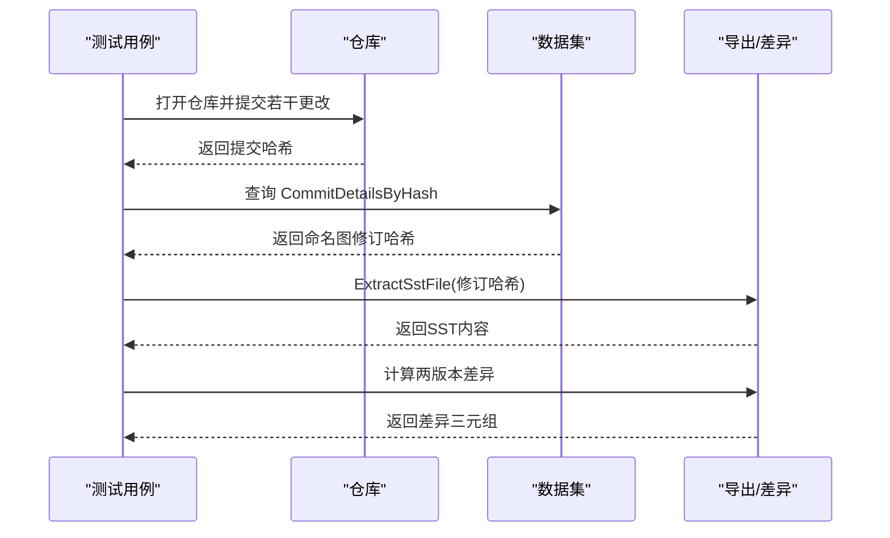
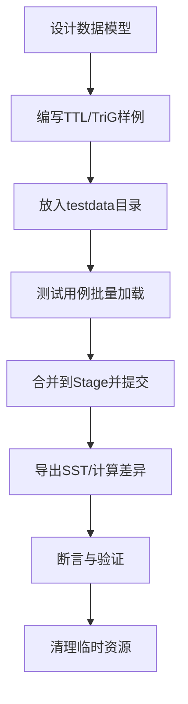

# 测试数据管理

<cite>
**本文引用的文件**
- [loadttl.go](file://sst_test/testutil/loadttl.go)
- [detaillog.go](file://sst_test/testutil/detaillog.go)
- [testauth.go](file://sst_test/testutil/testauth.go)
- [extractSstFileTest/local_test.go](file://sst_test/extractSstFileTest/local_test.go)
- [repositoryCommitDetailsTest/local_test.go](file://sst_test/repositoryCommitDetailsTest/local_test.go)
- [sstwritediffByRdfRead_test.go](file://sst_test/sstwritediffByRdfRead_test.go)
- [0f8b94cb-a412-4bd1-b614-eaf3c3b4c47e.ttl](file://sst/testdata/0f8b94cb-a412-4bd1-b614-eaf3c3b4c47e.ttl)
- [format-test.ttl](file://sst/testdata/format-test.ttl)
</cite>

## 目录
1. [简介](#简介)
2. [项目结构](#项目结构)
3. [核心组件](#核心组件)
4. [架构总览](#架构总览)
5. [详细组件分析](#详细组件分析)
6. [依赖关系分析](#依赖关系分析)
7. [性能考量](#性能考量)
8. [故障排查指南](#故障排查指南)
9. [结论](#结论)
10. [附录](#附录)

## 简介
本文件面向 SST 核心仓库的测试数据管理，目标是制定系统化策略，覆盖：
- 测试数据的组织结构（TTL、JSON、二进制）
- 数据集创建与维护（真实世界数据模拟与边界条件）
- 版本控制与变更管理
- 加载与解析工具方法（批量导入与验证）
- 隔离策略（确保测试间独立性）
- 生成器与模板系统

## 项目结构
仓库中测试数据主要分布在以下位置：
- sst/testdata：核心库的静态测试数据（TTL、SST、数据库等）
- sst_test/testdata：测试套件使用的输入/输出样例（TTL、TriG、SST、DB）
- sst_test/testutil：测试工具包（TTL/TriG 批量加载、日志开关、认证与服务器启动辅助）

图表来源
- [loadttl.go:18-58](file://sst_test/testutil/loadttl.go#L18-L58)
- [loadttl.go:60-77](file://sst_test/testutil/loadttl.go#L60-L77)

章节来源
- [loadttl.go:18-77](file://sst_test/testutil/loadttl.go#L18-L77)

## 核心组件
- TTL/TriG 批量加载器：将目录下所有 .ttl 或指定 .trig 文件解析为 Stage 并合并，提供统一的参考数据源。
- 测试日志开关：通过 flag 控制是否输出详细日志，便于调试。
- 测试认证与服务器：动态生成证书、启动本地 gRPC 服务，用于远程仓库集成测试。
- 仓库提取与差异：从仓库中提取特定版本的 SST 内容，并进行差异计算与应用。

章节来源
- [loadttl.go:18-77](file://sst_test/testutil/loadttl.go#L18-L77)
- [detaillog.go:13-46](file://sst_test/testutil/detaillog.go#L13-L46)
- [testauth.go:40-127](file://sst_test/testutil/testauth.go#L40-L127)
- [extractSstFileTest/local_test.go:21-113](file://sst_test/extractSstFileTest/local_test.go#L21-L113)

## 架构总览
下图展示了测试数据从静态文件到可执行测试的完整流程，包括批量加载、合并、提交、差异与导出。

图表来源
- [loadttl.go:18-77](file://sst_test/testutil/loadttl.go#L18-L77)
- [extractSstFileTest/local_test.go:21-113](file://sst_test/extractSstFileTest/local_test.go#L21-L113)
- [sstwritediffByRdfRead_test.go:175-277](file://sst_test/sstwritediffByRdfRead_test.go#L175-L277)

## 详细组件分析

### TTL/TriG 批量加载器
- 功能：读取目录下所有 .ttl 文件，统一换行符后解析为 Stage，再合并到一个引用 Stage；支持单独加载 TriG。
- 关键点：
  - 使用严格处理器解析，保证错误快速失败。
  - 自动归一化 Windows 换行符，避免解析异常。
  - 返回合并后的 Stage 供后续测试复用。

图表来源
- [loadttl.go:18-58](file://sst_test/testutil/loadttl.go#L18-L58)

章节来源
- [loadttl.go:18-58](file://sst_test/testutil/loadttl.go#L18-L58)

### 测试日志开关
- 功能：通过命令行 flag 控制是否启用详细日志，便于在运行单个测试时输出上下文信息。
- 用法：在测试主函数中调用入口以解析 flag，并在需要时输出详细日志。

章节来源
- [detaillog.go:13-46](file://sst_test/testutil/detaillog.go#L13-L46)

### 测试认证与服务器
- 功能：动态生成 CA 与服务端证书，配置 gRPC 传输凭证；启动本地服务器用于远程仓库测试；提供 OAuth per-RPC 凭证选项。
- 关键点：
  - 证书一次性生成并缓存，避免重复开销。
  - 支持 TLS 与 OAuth 两种认证方式组合。
  - 提供便捷函数启动服务器并在测试结束时优雅关闭。

章节来源
- [testauth.go:40-127](file://sst_test/testutil/testauth.go#L40-L127)
- [testauth.go:147-204](file://sst_test/testutil/testauth.go#L147-L204)

### 仓库提取与差异
- 功能：从仓库中按命名图版本哈希提取 SST 内容，并计算两个版本间的差异三元组。
- 关键点：
  - 通过 CommitDetails 获取命名图的修订哈希。
  - ExtractSstFile 将指定修订导出为字节流。
  - 使用差异工具对两个版本进行对比，得到增删改的三元组集合。

图表来源
- [extractSstFileTest/local_test.go:21-113](file://sst_test/extractSstFileTest/local_test.go#L21-L113)
- [sstwritediffByRdfRead_test.go:175-277](file://sst_test/sstwritediffByRdfRead_test.go#L175-L277)

章节来源
- [extractSstFileTest/local_test.go:21-113](file://sst_test/extractSstFileTest/local_test.go#L21-L113)
- [sstwritediffByRdfRead_test.go:175-277](file://sst_test/sstwritediffByRdfRead_test.go#L175-L277)

### 测试数据组织与示例
- TTL 样例：包含复杂的产品模型与属性定义，用于验证 RDF 读写、命名图、导入等能力。
- 格式测试：简化版 LCI 本体，用于校验解析与序列化一致性。
- 二进制样例：SST 与数据库文件，用于持久化与增量更新测试。

章节来源
- [0f8b94cb-a412-4bd1-b614-eaf3c3b4c47e.ttl:1-415](file://sst/testdata/0f8b94cb-a412-4bd1-b614-eaf3c3b4c47e.ttl#L1-L415)
- [format-test.ttl:1-39](file://sst/testdata/format-test.ttl#L1-L39)

## 依赖关系分析
- 测试用例依赖 testutil 提供的加载与认证工具。
- 加载器依赖 sst 的 RDF 解析与 Stage 合并能力。
- 仓库操作依赖本地/远程仓库实现，并通过提交哈希定位具体版本。
- 差异工具依赖导出的 SST 内容进行三元组级比较。

图表来源
- [loadttl.go:18-77](file://sst_test/testutil/loadttl.go#L18-L77)
- [extractSstFileTest/local_test.go:21-113](file://sst_test/extractSstFileTest/local_test.go#L21-L113)
- [sstwritediffByRdfRead_test.go:175-277](file://sst_test/sstwritediffByRdfRead_test.go#L175-L277)

章节来源
- [loadttl.go:18-77](file://sst_test/testutil/loadttl.go#L18-L77)
- [extractSstFileTest/local_test.go:21-113](file://sst_test/extractSstFileTest/local_test.go#L21-L113)
- [sstwritediffByRdfRead_test.go:175-277](file://sst_test/sstwritediffByRdfRead_test.go#L175-L277)

## 性能考量
- 批量加载：建议将大型数据集拆分为多个 TTL 文件，利用批量加载器并行或顺序合并，减少单次 I/O 压力。
- 换行符归一化：在解析前统一换行符，避免解析器回退带来的额外开销。
- 证书与服务器：证书一次性生成并缓存，避免重复计算；测试结束后及时关闭服务器释放端口。
- 差异计算：尽量基于最小必要版本进行差异计算，减少内存占用与 CPU 时间。

[本节为通用指导，不直接分析具体文件]

## 故障排查指南
- TTL 解析失败：检查文件格式与编码，确认换行符已归一化；使用严格处理器以便快速定位错误。
- 仓库提交失败：确认仓库路径有效且权限正确；检查命名图 ID 是否冲突。
- 差异结果为空：确认两个版本确实存在差异；检查提取的修订哈希是否正确。
- 认证失败：确认证书链完整，OAuth token 有效；检查 gRPC 传输凭证配置。

章节来源
- [loadttl.go:18-77](file://sst_test/testutil/loadttl.go#L18-L77)
- [testauth.go:40-127](file://sst_test/testutil/testauth.go#L40-L127)
- [extractSstFileTest/local_test.go:21-113](file://sst_test/extractSstFileTest/local_test.go#L21-L113)

## 结论
本仓库提供了完善的测试数据管理基础设施：
- 通过批量加载器统一处理 TTL/TriG 数据，确保一致性与可维护性。
- 借助仓库提交与差异机制，实现版本化的测试数据管理与验证。
- 提供认证与服务器工具，支持远程仓库集成测试。
- 通过严格的错误处理与日志开关，提升调试效率与稳定性。

[本节为总结，不直接分析具体文件]

## 附录

### 测试数据生命周期流程图

[此图为概念性流程，不映射到具体源码文件]

### 版本控制与变更管理建议
- 将每个重要场景的数据集独立成文件，并以语义化名称命名（如 Test_Stage_Merge1.ttl）。
- 对同一数据集的多版本，采用后缀区分（如 xxx-v1.ttl、xxx-v2.ttl），便于回归测试。
- 在测试中通过 CommitDetails 记录并断言关键提交哈希，确保数据演进可追溯。

章节来源
- [repositoryCommitDetailsTest/local_test.go:21-113](file://sst_test/repositoryCommitDetailsTest/local_test.go#L21-L113)

### 隔离策略
- 每个测试使用独立的临时目录（t.TempDir）存放仓库与中间产物，避免交叉污染。
- 测试结束后清理生成的 SST、数据库与临时文件，确保环境干净。

章节来源
- [extractSstFileTest/local_test.go:21-113](file://sst_test/extractSstFileTest/local_test.go#L21-L113)
- [sstwritediffByRdfRead_test.go:175-277](file://sst_test/sstwritediffByRdfRead_test.go#L175-L277)

### 生成器与模板系统
- 可使用现有 TTL 样例作为模板，替换标识符与属性值生成新数据集。
- 结合批量加载器，将模板实例化为多套测试数据，提高覆盖率与可维护性。

章节来源
- [format-test.ttl:1-39](file://sst/testdata/format-test.ttl#L1-L39)
- [loadttl.go:18-58](file://sst_test/testutil/loadttl.go#L18-L58)