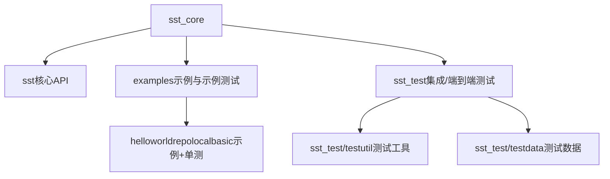
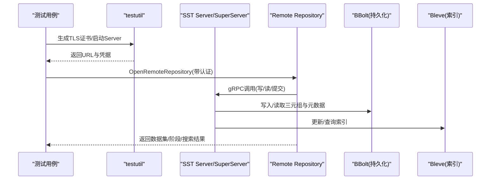
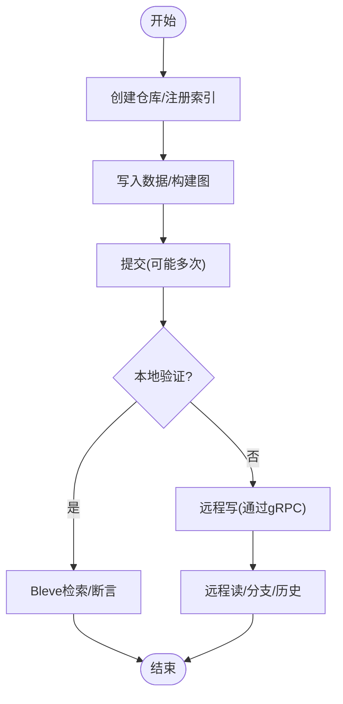
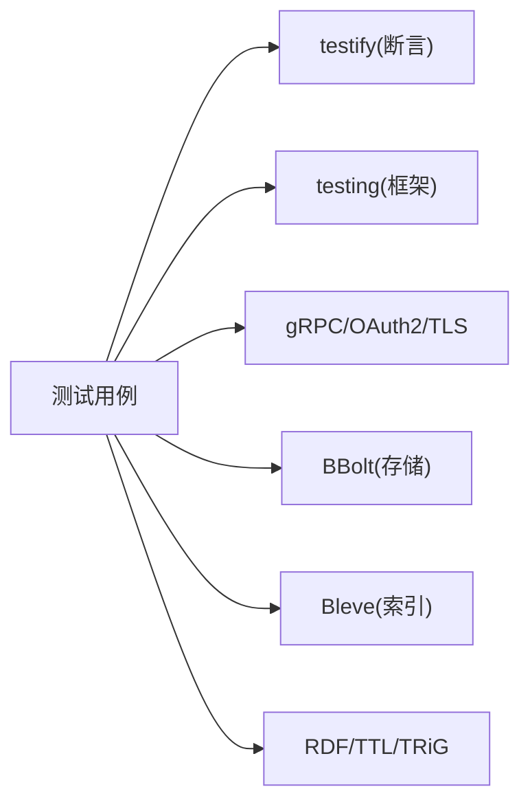

# 测试策略和编写指南

<cite>
**本文引用的文件**
- [README.md](file://README.md)
- [go.mod](file://go.mod)
- [testutil/doc.go](file://sst_test/testutil/doc.go)
- [testutil/loadttl.go](file://sst_test/testutil/loadttl.go)
- [testutil/testauth.go](file://sst_test/testauth.go)
- [examples/helloworldrepolocalbasic/repolocalbasic_test.go](file://examples/helloworldrepolocalbasic/repolocalbasic_test.go)
- [sst/hash_base58_benchmark_test.go](file://sst/hash_base58_benchmark_test.go)
- [sst_test/branch_test.go](file://sst_test/branch_test.go)
- [sst_test/localFullRepository_test.go](file://sst_test/localFullRepository_test.go)
- [sst_test/remoteRepositoryMultipleCommits_test.go](file://sst_test/remoteRepositoryMultipleCommits_test.go)
- [sst_test/remoteRepository_test.go](file://sst_test/remoteRepository_test.go)
</cite>

## 目录
1. [简介](#简介)
2. [项目结构](#项目结构)
3. [核心组件](#核心组件)
4. [架构总览](#架构总览)
5. [详细组件分析](#详细组件分析)
6. [依赖分析](#依赖分析)
7. [性能考虑](#性能考虑)
8. [故障排查指南](#故障排查指南)
9. [结论](#结论)
10. [附录](#附录)

## 简介
本指南面向SST Core项目的测试实践，覆盖单元测试、集成测试与端到端测试的层次划分；说明测试数据准备与模拟对象的使用；介绍测试框架选择与用法（含表驱动测试与并发测试）；明确覆盖率要求与性能基准测试方法；提供用例编写最佳实践与常见场景示例；并给出测试环境配置与持续集成流程建议，以及失败用例调试与结果分析方法。

## 项目结构
仓库采用“按功能域组织”的结构：核心API位于sst包，示例在examples，集成与端到端测试集中在sst_test，工具与共享测试能力在sst_test/testutil。测试资源（TTL/TRiG等）以testdata形式就近存放，便于可重复执行。

图表来源
- [README.md:1-15](file://README.md#L1-L15)
- [go.mod:1-80](file://go.mod#L1-L80)

章节来源
- [README.md:1-15](file://README.md#L1-L15)
- [go.mod:1-80](file://go.mod#L1-L80)

## 核心组件
- 测试工具库 testutil
  - 加载TTL/TRiG到Stage，统一行尾规范化，便于跨平台稳定解析。
  - 生成测试用TLS证书与gRPC传输凭据，启动本地Server/SuperServer用于远程集成测试。
  - 提供OAuth2 per-RPC凭据构造与测试AuthProvider实例。
- 示例测试
  - 演示创建本地仓库、注册索引处理器、写入数据、提交、重新打开并搜索的完整流程。
- 基准测试
  - Base58编解码性能对比，预先生成测试对以减少基准噪声。
- 集成测试
  - 分支、提交、多提交、远程仓库读写、Bleve检索、跨仓库MoveAndMerge等。

章节来源
- [testutil/loadttl.go:18-78](file://sst_test/testutil/loadttl.go#L18-L78)
- [testutil/testauth.go:40-224](file://sst_test/testauth.go#L40-L224)
- [examples/helloworldrepolocalbasic/repolocalbasic_test.go:29-128](file://examples/helloworldrepolocalbasic/repolocalbasic_test.go#L29-L128)
- [sst/hash_base58_benchmark_test.go:19-67](file://sst/hash_base58_benchmark_test.go#L19-L67)
- [sst_test/branch_test.go:29-148](file://sst_test/branch_test.go#L29-L148)
- [sst_test/localFullRepository_test.go:52-200](file://sst_test/localFullRepository_test.go#L52-L200)
- [sst_test/remoteRepositoryMultipleCommits_test.go:1046-1592](file://sst_test/remoteRepositoryMultipleCommits_test.go#L1046-L1592)
- [sst_test/remoteRepository_test.go:196-526](file://sst_test/remoteRepository_test.go#L196-L526)

## 架构总览
下图展示从测试用例到服务端与存储/索引的调用链，体现“本地/远程仓库 + gRPC + BBolt + Bleve”的集成路径。

图表来源
- [testutil/testauth.go:147-204](file://sst_test/testauth.go#L147-L204)
- [sst_test/remoteRepository_test.go:492-526](file://sst_test/remoteRepository_test.go#L492-L526)
- [sst_test/remoteRepositoryMultipleCommits_test.go:1046-1592](file://sst_test/remoteRepositoryMultipleCommits_test.go#L1046-L1592)

## 详细组件分析

### 测试数据准备与模拟对象
- 数据加载
  - 使用LoadAllTTLFromDir批量读取TTL并合并为参考Stage，自动处理Windows换行符，保证跨平台一致性。
  - LoadTriG用于直接加载TRiG文件。
- 模拟与桩
  - 通过TestTransportCreds/TestDialPerRPCOauthCreds/TestCallPerRPCOauthCreds构造gRPC安全连接与每请求OAuth凭据。
  - TestProviderInstance/TestProviderInstance2提供固定Token的AuthProvider，用于鉴权场景。
  - ServerServe/SuperServerServe在测试中启动真实服务进程，配合t.Cleanup确保清理。

章节来源
- [testutil/loadttl.go:18-78](file://sst_test/testutil/loadttl.go#L18-L78)
- [testutil/testauth.go:103-224](file://sst_test/testauth.go#L103-L224)

### 单元测试与表驱动测试
- 表驱动测试模式
  - 将输入、期望输出与断言封装为结构体切片，遍历执行，减少重复代码，提升可读性与可维护性。
  - 典型位置：哈希函数、IBNode操作、文件系统适配层等。
- 并发测试
  - 使用t.Run并行子测试；对共享状态使用互斥或隔离临时目录；避免全局可变状态。
- 示例
  - 哈希编解码基准测试展示了预生成测试对以降低基准噪声。
  - 分支/提交/多提交等复杂逻辑通过t.Run拆分步骤，便于定位问题。

章节来源
- [sst/hash_base58_benchmark_test.go:19-67](file://sst/hash_base58_benchmark_test.go#L19-L67)
- [sst_test/branch_test.go:29-148](file://sst_test/branch_test.go#L29-L148)
- [sst_test/localFullRepository_test.go:52-200](file://sst_test/localFullRepository_test.go#L52-L200)

### 集成测试与端到端测试
- 本地仓库集成
  - 创建仓库、注册索引处理器、写入数据、提交、重新打开验证、Bleve检索。
- 远程仓库端到端
  - 启动内嵌Server，客户端通过gRPC进行写/读/提交/分支管理/多提交/跨仓库迁移等。
  - 结合OAuth2 per-RPC认证，验证权限控制与通信安全。
- 典型流程（远程多提交）
  - 写阶段：创建多个NamedGraph，多次Commit，记录受影响数据集ID。
  - 读阶段：通过CheckoutBranch/CommitDetailsByHash遍历历史，校验节点状态与引用关系。

图表来源
- [examples/helloworldrepolocalbasic/repolocalbasic_test.go:29-128](file://examples/helloworldrepolocalbasic/repolocalbasic_test.go#L29-L128)
- [sst_test/remoteRepositoryMultipleCommits_test.go:1046-1592](file://sst_test/remoteRepositoryMultipleCommits_test.go#L1046-L1592)
- [sst_test/remoteRepository_test.go:196-526](file://sst_test/remoteRepository_test.go#L196-L526)

章节来源
- [examples/helloworldrepolocalbasic/repolocalbasic_test.go:29-128](file://examples/helloworldrepolocalbasic/repolocalbasic_test.go#L29-L128)
- [sst_test/remoteRepositoryMultipleCommits_test.go:1046-1592](file://sst_test/remoteRepositoryMultipleCommits_test.go#L1046-L1592)
- [sst_test/remoteRepository_test.go:196-526](file://sst_test/remoteRepository_test.go#L196-L526)

### 性能基准测试
- 目标
  - 评估Base58编解码在不同实现下的吞吐与时延，辅助选型与回归检测。
- 方法
  - 预生成大量随机字节与编码字符串，避免在基准过程中分配与I/O。
  - 使用Go标准基准框架，分别测量Encode/Decode。
- 建议
  - 在CI中定期运行基准，比较阈值告警；关注GC与CPU占用。

章节来源
- [sst/hash_base58_benchmark_test.go:19-67](file://sst/hash_base58_benchmark_test.go#L19-L67)

## 依赖分析
- 测试框架与断言
  - testing（内置）、stretchr/testify（断言与require）。
- 网络与安全
  - gRPC、OAuth2、TLS证书动态生成。
- 存储与索引
  - BBolt（持久化）、Bleve（全文检索）。
- 语义数据
  - RDF/Turtle/TRiG解析与写入。

图表来源
- [go.mod:1-80](file://go.mod#L1-L80)
- [testutil/testauth.go:103-224](file://sst_test/testauth.go#L103-L224)
- [sst_test/localFullRepository_test.go:52-200](file://sst_test/localFullRepository_test.go#L52-L200)

章节来源
- [go.mod:1-80](file://go.mod#L1-L80)

## 性能考虑
- 基准优先
  - 对热点路径（如哈希编解码、序列化/反序列化、索引更新）建立基准用例，纳入CI基线。
- 数据规模
  - 使用足够大的测试集（如数百万条）评估内存与CPU峰值，识别瓶颈。
- I/O与并发
  - 合理设置并发度，避免磁盘与索引竞争；必要时分片或批处理。
- 缓存与复用
  - 预生成测试数据，减少运行时开销；复用连接与上下文。

[本节为通用指导，不直接分析具体文件]

## 故障排查指南
- 常见问题定位
  - 网络/认证：检查TLS证书与OAuth2 Token是否正确注入；确认Server已启动且端口可用。
  - 数据解析：确认TTL/TRiG文件格式与行尾处理一致；必要时使用LoadAllTTLFromDir标准化。
  - 索引不一致：提交后等待索引同步，或在测试中显式触发刷新/重建。
- 调试技巧
  - 使用t.Log/t.Fatal打印关键路径信息；开启Verbose模式获取更详细日志。
  - 针对失败用例单独运行，缩小范围；逐步注释代码定位问题点。
  - 对并发用例增加超时与重试，降低偶发失败影响。
- 结果分析
  - 对比预期与实际输出（如Bleve搜索结果、分支列表、提交详情），快速定位差异点。
  - 利用diff工具比对TTL输出，确认序列化稳定性。

章节来源
- [testutil/testauth.go:147-204](file://sst_test/testauth.go#L147-L204)
- [testutil/loadttl.go:18-78](file://sst_test/testutil/loadttl.go#L18-L78)
- [sst_test/remoteRepository_test.go:492-526](file://sst_test/remoteRepository_test.go#L492-L526)

## 结论
本项目已形成较为完善的测试体系：单元层面强调表驱动与并发安全；集成与端到端层面通过内嵌Server与真实协议栈验证全链路行为；基准测试保障性能回归；测试工具集中封装了数据准备、认证与服务启停，显著提升可维护性与可重复性。建议在CI中固化基准与覆盖率门禁，持续优化测试质量与速度。

[本节为总结性内容，不直接分析具体文件]

## 附录

### 测试分层与职责
- 单元测试
  - 聚焦函数/方法级逻辑，快速、无外部依赖；表驱动测试为主。
- 集成测试
  - 组合多个子系统（存储、索引、网络），验证接口契约与数据流转。
- 端到端测试
  - 模拟用户视角，覆盖完整业务流程（创建仓库、写数据、提交、远程访问、检索）。

### 覆盖率要求
- 建议目标
  - 核心模块（sst）语句覆盖率≥80%，分支覆盖率≥70%。
  - 新增变更需保持或提升覆盖率，禁止引入裸覆盖盲区。
- 度量方式
  - 使用go test -coverprofile与第三方报告工具生成HTML/CLI报告，CI中阻断低覆盖率PR。

### 持续集成流程建议
- 触发条件
  - Push/Pull Request触发全量测试；主分支合并前必须通过。
- 任务编排
  - 安装依赖 → 静态检查 → 单元测试 → 集成/端到端测试 → 基准测试 → 覆盖率报告。
- 缓存与加速
  - 缓存Go模块与构建产物；并行执行测试套件；按需跳过慢用例（标记skip）。
- 质量门禁
  - 覆盖率阈值、基准回归阈值、lint错误阻断。

### 常见测试场景示例
- 本地仓库基础流程
  - 创建仓库 → 注册索引 → 写入数据 → 提交 → 重新打开 → 检索。
- 远程仓库多提交
  - 启动Server → 客户端认证 → 多次提交 → 分支切换 → 历史回溯 → 跨仓库迁移。
- 数据导入与导出
  - 批量加载TTL → 合并 → 导出TTL → 校验一致性。

章节来源
- [examples/helloworldrepolocalbasic/repolocalbasic_test.go:29-128](file://examples/helloworldrepolocalbasic/repolocalbasic_test.go#L29-L128)
- [sst_test/remoteRepositoryMultipleCommits_test.go:1046-1592](file://sst_test/remoteRepositoryMultipleCommits_test.go#L1046-L1592)
- [testutil/loadttl.go:18-78](file://sst_test/testutil/loadttl.go#L18-L78)