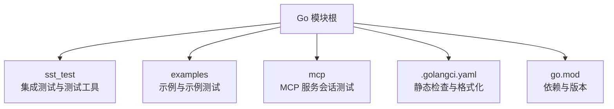
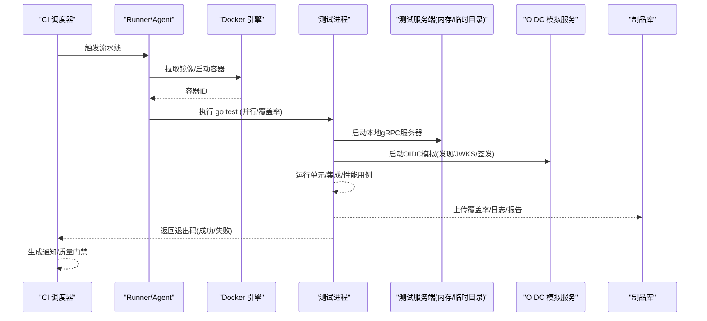
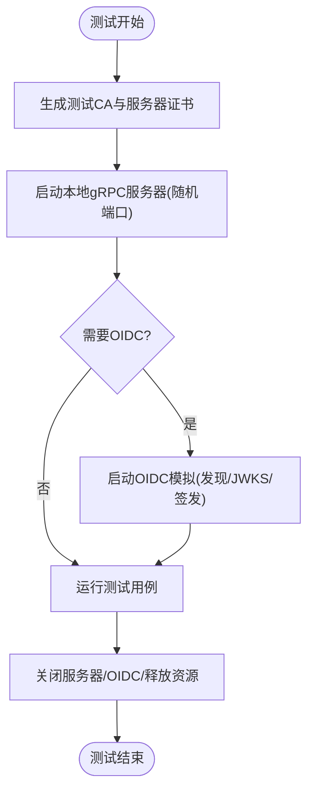
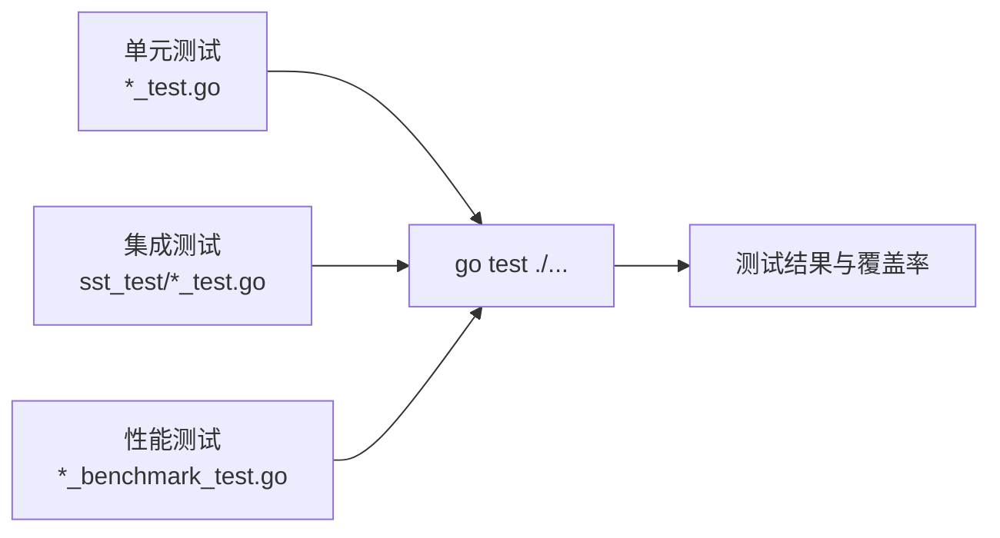
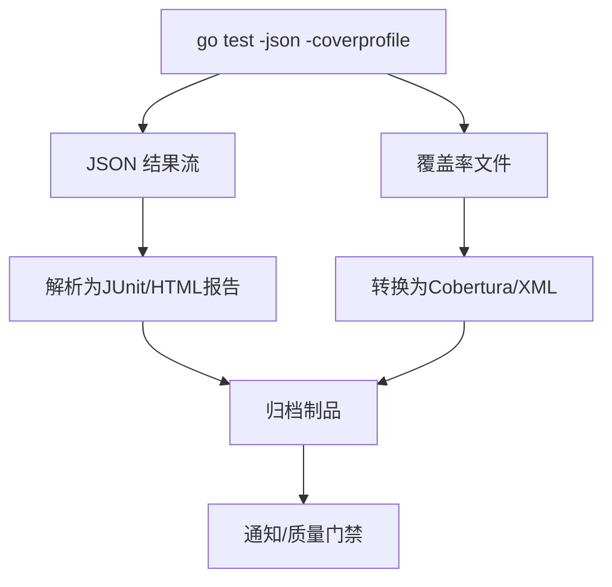
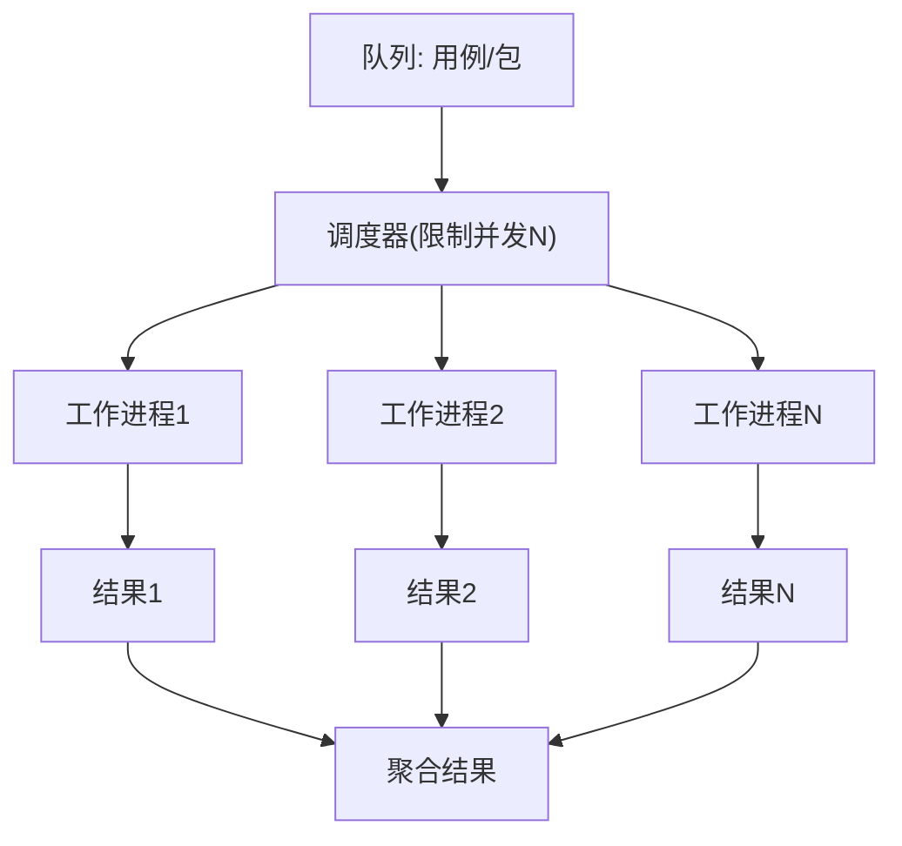
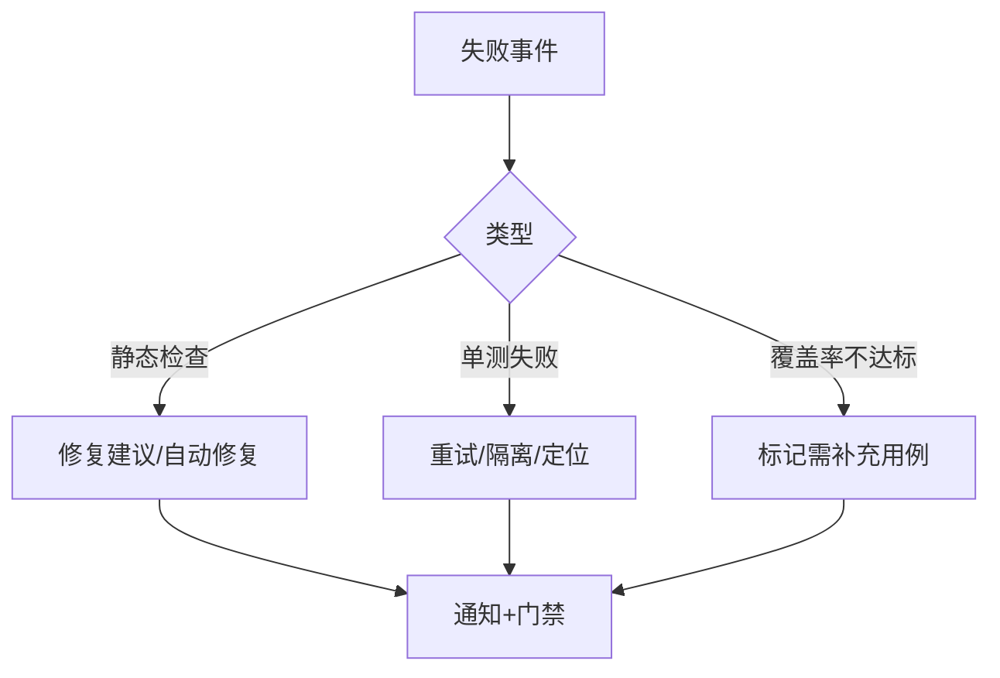
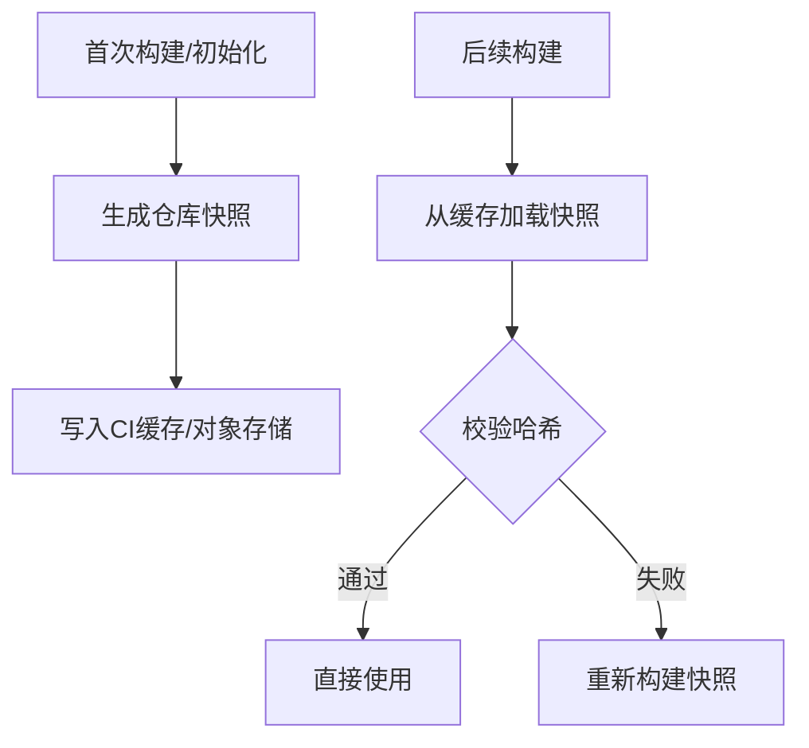
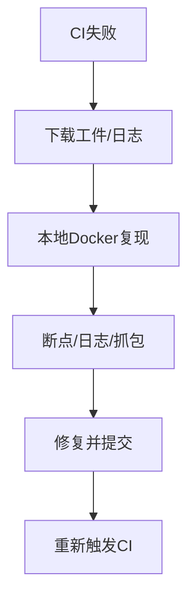
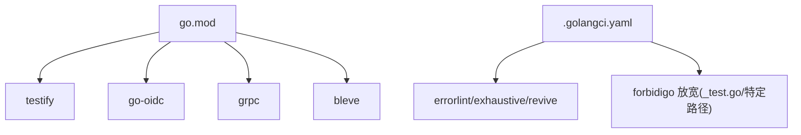

# 测试自动化和CI集成

<cite>
**本文引用的文件**
- [go.mod](file://go.mod)
- [.golangci.yaml](file://.golangci.yaml)
- [README.md](file://README.md)
- [testauth.go](file://sst_test/testutil/testauth.go)
- [oidc_provider.go](file://sst_test/testutil/oidc_provider.go)
- [remoteRepository_test.go](file://sst_test/remoteRepository_test.go)
- [remoteRepositoryMultipleCommits_test.go](file://sst_test/remoteRepositoryMultipleCommits_test.go)
- [searchInContext_test.go](file://sst_test/searchInContext_test.go)
- [repolocalbasic_test.go](file://examples/helloworldrepolocalbasic/repolocalbasic_test.go)
- [session_test.go](file://mcp/cmd/session_test.go)
</cite>

## 目录
1. [简介](#简介)
2. [项目结构](#项目结构)
3. [核心组件](#核心组件)
4. [架构总览](#架构总览)
5. [详细组件分析](#详细组件分析)
6. [依赖分析](#依赖分析)
7. [性能考虑](#性能考虑)
8. [故障排查指南](#故障排查指南)
9. [结论](#结论)
10. [附录](#附录)

## 简介
本文件面向在 CI/CD 中实现“完整的测试自动化与持续集成”的目标，结合当前仓库的测试结构与工具链，给出可落地的方案：如何组织并运行单元测试、集成测试与性能测试；如何在容器中隔离环境；如何收集覆盖率与生成报告；如何实现并行执行以缩短构建时间；如何处理失败与通知；以及如何持久化与恢复测试数据，并在 CI 中调试失败。

## 项目结构
仓库采用 Go 模块组织，测试代码集中在 sst_test 与 examples、mcp 等子包中，并通过 testutil 提供统一的测试基础设施（本地服务器、OIDC 模拟、TLS 证书与 gRPC 凭据）。静态检查通过 .golangci.yaml 配置。

**图表来源**
- [go.mod:1-80](file://go.mod#L1-L80)
- [.golangci.yaml:1-53](file://.golangci.yaml#L1-L53)

**章节来源**
- [README.md:1-15](file://README.md#L1-L15)
- [go.mod:1-80](file://go.mod#L1-L80)
- [.golangci.yaml:1-53](file://.golangci.yaml#L1-L53)

## 核心组件
- 测试基础设施
  - 本地 gRPC 服务器启动与生命周期管理（含 TLS）
  - OIDC 模拟提供者（发现文档、JWKS、签发 JWT）
  - gRPC 传输凭据与每 RPC 认证选项
- 典型测试场景
  - 远程仓库读写、分支与提交、多提交历史
  - 搜索上下文与取消/超时
  - MCP 会话全生命周期
  - 示例仓库基础操作

这些能力为在 CI 中稳定运行单元测试、集成测试与端到端测试提供了基础。

**章节来源**
- [testauth.go:103-174](file://sst_test/testutil/testauth.go#L103-L174)
- [oidc_provider.go:26-165](file://sst_test/testutil/oidc_provider.go#L26-L165)
- [oidc_provider.go:167-235](file://sst_test/testutil/oidc_provider.go#L167-L235)
- [remoteRepository_test.go:248-326](file://sst_test/remoteRepository_test.go#L248-L326)
- [remoteRepositoryMultipleCommits_test.go:38-71](file://sst_test/remoteRepositoryMultipleCommits_test.go#L38-L71)
- [searchInContext_test.go:645-679](file://sst_test/searchInContext_test.go#L645-L679)
- [session_test.go:25-1310](file://mcp/cmd/session_test.go#L25-L1310)
- [repolocalbasic_test.go:31-31](file://examples/helloworldrepolocalbasic/repolocalbasic_test.go#L31-L31)

## 架构总览
下图展示在 CI 中运行测试时的整体流程：从触发流水线到启动测试容器、准备环境、执行测试、收集结果与报告、归档产物与通知。

[此图为概念性流程图，不直接映射具体源码文件]

## 详细组件分析

### 测试环境与自动配置
- 本地服务器与证书
  - 使用测试 CA 与服务端证书，动态监听随机端口，测试结束自动关闭。
  - 提供 gRPC 客户端 TLS 传输凭据与每 RPC 的 OAuth2 凭据。
- OIDC 模拟
  - 暴露 /.well-known/openid-configuration 与 /keys，支持签发带 resource_access 的 JWT。
  - 提供 SuperServerServeWithPerRepoAuth 与 ServerServeWithOIDC 两种模式，便于不同权限策略的测试。
- 测试数据隔离
  - 使用 t.TempDir() 创建隔离目录，避免跨用例污染。
  - 所有服务端实例随测试生命周期自动清理。

**图表来源**
- [testauth.go:49-127](file://sst_test/testutil/testauth.go#L49-L127)
- [testauth.go:147-204](file://sst_test/testutil/testauth.go#L147-L204)
- [oidc_provider.go:37-71](file://sst_test/testutil/oidc_provider.go#L37-L71)
- [oidc_provider.go:131-165](file://sst_test/testutil/oidc_provider.go#L131-L165)

**章节来源**
- [testauth.go:49-127](file://sst_test/testutil/testauth.go#L49-L127)
- [testauth.go:147-204](file://sst_test/testutil/testauth.go#L147-L204)
- [oidc_provider.go:37-71](file://sst_test/testutil/oidc_provider.go#L37-L71)
- [oidc_provider.go:131-165](file://sst_test/testutil/oidc_provider.go#L131-L165)

### 单元测试、集成测试与性能测试的组织
- 单元测试
  - 位于各包的 *_test.go，覆盖数据结构、算法与工具函数。
  - 可通过 go test ./... 快速执行。
- 集成测试
  - 集中在 sst_test 与 mcp/cmd/session_test.go，验证仓库读写、分支/提交、搜索、MCP 会话等端到端流程。
  - 借助 testutil 启动真实服务端与 OIDC，确保与生产行为一致。
- 性能测试
  - 使用 Go 基准测试（如 hash_base58_benchmark_test.go），在 CI 中可单独跑 benchmark 或作为慢用例集合。

**章节来源**
- [remoteRepository_test.go:248-326](file://sst_test/remoteRepository_test.go#L248-L326)
- [remoteRepositoryMultipleCommits_test.go:38-71](file://sst_test/remoteRepositoryMultipleCommits_test.go#L38-L71)
- [searchInContext_test.go:645-679](file://sst_test/searchInContext_test.go#L645-L679)
- [session_test.go:25-1310](file://mcp/cmd/session_test.go#L25-L1310)

### 测试结果的收集与报告生成
- 覆盖率
  - 使用 go test -coverprofile=coverage.out 收集覆盖率，配合工具（如 gocover-cobertura、codecov）生成趋势与 PR 评论。
- 测试报告
  - 使用 go test -json 输出结构化结果，便于解析与可视化。
- 日志与产物
  - 将测试日志、覆盖率、报告与关键中间产物（如临时仓库快照）归档至制品库，便于回溯。

[此图为概念性流程图，不直接映射具体源码文件]

### 测试并行化执行策略
- 用例级并行
  - 使用 go test -parallel=N 提升吞吐，注意用例间无共享状态（已使用 t.TempDir 隔离）。
- 包级并行
  - 使用 make parallel-test 或自定义脚本按包并发执行，减少冷启动开销。
- 资源隔离
  - 每个测试进程独立端口与临时目录，避免端口冲突与数据竞争。
- 分阶段执行
  - 先跑快速单元用例，再跑慢速集成/性能用例，缩短反馈时间。

[此图为概念性流程图，不直接映射具体源码文件]

### 测试失败处理与通知机制
- 失败分类
  - 编译/静态检查失败（golangci-lint）
  - 单测/集成/性能失败
  - 覆盖率阈值未达标
- 处理策略
  - 阻断合并：任一关键阶段失败即中止流水线。
  - 重试策略：对网络/IO 类不稳定用例进行有限次重试。
  - 告警：邮件/IM/PR 评论通知，附带报告链接。
- 质量门禁
  - 覆盖率基线、新增代码覆盖率、回归检测。

[此图为概念性流程图，不直接映射具体源码文件]

### 测试数据的持久化与恢复
- 临时数据
  - 默认使用 t.TempDir()，测试结束后自动清理，保证干净环境。
- 可恢复数据
  - 对于耗时初始化（如索引构建），可将初始仓库快照持久化到缓存层（CI 缓存或对象存储），复用加速。
- 数据一致性
  - 通过只读校验与哈希比对，确保快照未被篡改。

[此图为概念性流程图，不直接映射具体源码文件]

### 在 CI 中调试测试失败
- 复现步骤
  - 下载失败工件（日志、覆盖率、快照），在本地 Docker 环境中复现。
- 断点与日志
  - 启用详细日志（Verbose），必要时在关键路径增加结构化日志。
- 最小化用例
  - 抽取失败用例为独立 main 或短用例，缩小范围定位问题。
- 网络与认证
  - 确认 OIDC/JWKS/TLS 配置正确，必要时抓包分析。

[此图为概念性流程图，不直接映射具体源码文件]

## 依赖分析
- 运行时与测试依赖
  - 测试依赖 testify/assert、go-oidc、grpc、bleve 等，用于断言、认证、搜索与通信。
- 静态检查
  - .golangci.yaml 启用了 errorlint、exhaustive、revive 等规则，并对 _test.go 与特定路径放宽 forbidigo 限制，利于测试与CLI/工具代码的灵活性。

**图表来源**
- [go.mod:1-80](file://go.mod#L1-L80)
- [.golangci.yaml:1-53](file://.golangci.yaml#L1-L53)

**章节来源**
- [go.mod:1-80](file://go.mod#L1-L80)
- [.golangci.yaml:1-53](file://.golangci.yaml#L1-L53)

## 性能考虑
- 并行度调优
  - 根据 Runner CPU 核数设置 -parallel，避免过度争用导致抖动。
- 缓存优化
  - 缓存 Go 模块与构建产物，复用测试快照，显著缩短冷启动时间。
- 选择性执行
  - 基于变更集仅运行受影响包与用例，减少无效计算。
- 资源上限
  - 为长耗时/高内存用例设置超时与内存限制，防止拖垮流水线。

[本节为通用指导，不直接引用具体文件]

## 故障排查指南
- 常见问题
  - 端口占用：确保使用随机端口并正确关闭服务。
  - 认证失败：检查 OIDC 发现文档、JWKS、JWT 签名与 audience。
  - TLS 错误：确认 CA/证书链与客户端信任池配置。
  - 数据竞争：确保用例间无共享可变状态，优先使用 t.TempDir。
- 定位方法
  - 查看 go test -json 输出与结构化日志。
  - 抓取 gRPC 请求/响应，核对鉴权头与消息体。
  - 对比快照哈希，确认数据一致性。

**章节来源**
- [testauth.go:103-174](file://sst_test/testutil/testauth.go#L103-L174)
- [oidc_provider.go:131-165](file://sst_test/testutil/oidc_provider.go#L131-L165)
- [remoteRepository_test.go:248-326](file://sst_test/remoteRepository_test.go#L248-L326)

## 结论
通过在 CI 中引入容器化隔离、统一测试基础设施、并行执行、覆盖率与报告收集、失败处理与通知、以及测试数据缓存与恢复，可以构建稳定、高效且可观测的测试自动化体系。该方案充分利用了仓库现有的 testutil 能力与丰富的集成测试场景，既满足日常开发反馈速度，又保障发布质量。

[本节为总结性内容，不直接引用具体文件]

## 附录
- 推荐命令（示例）
  - 运行全部测试并生成覆盖率：go test -race -coverprofile=coverage.out -json ./... > results.json
  - 仅运行受影响包：结合 diff 与 go test 过滤
  - 运行基准：go test -bench=. -benchmem ./...
- 制品归档
  - coverage.out、results.json、测试日志、快照压缩包

[本节为补充信息，不直接引用具体文件]