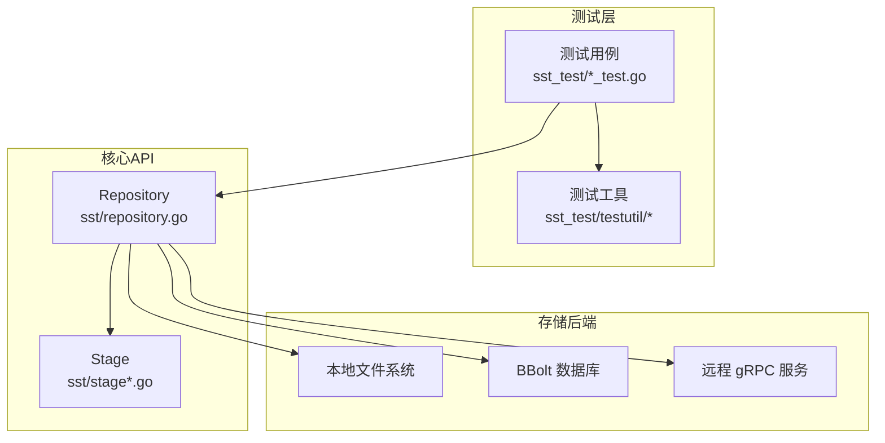
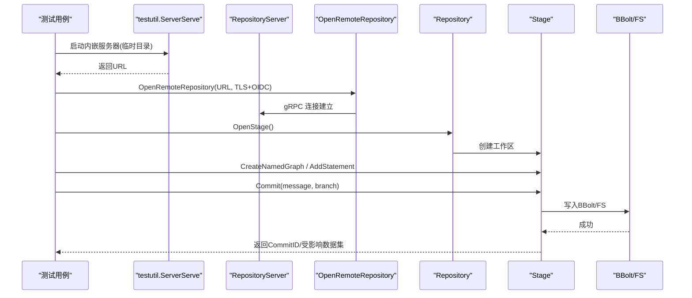
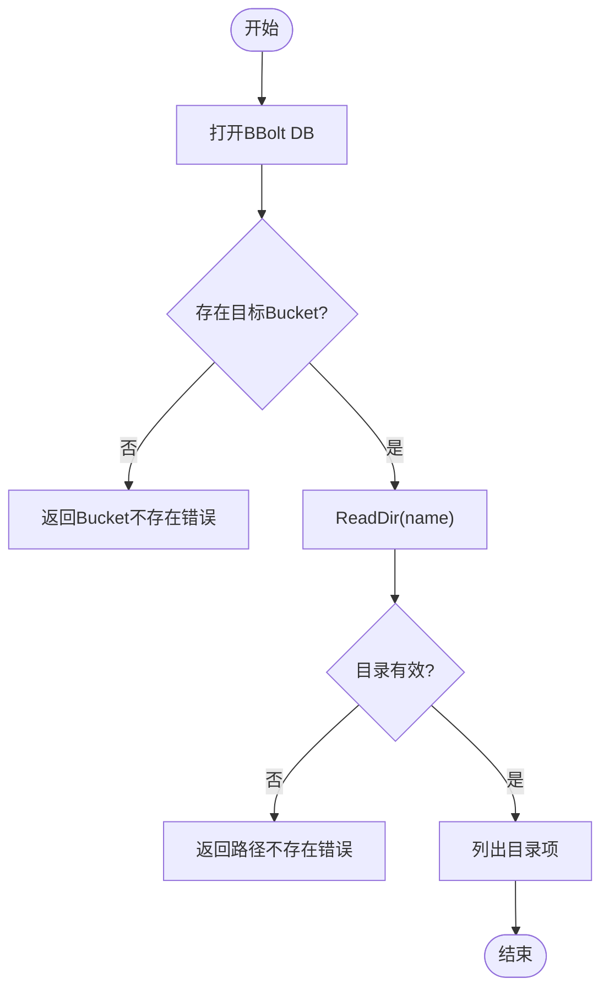
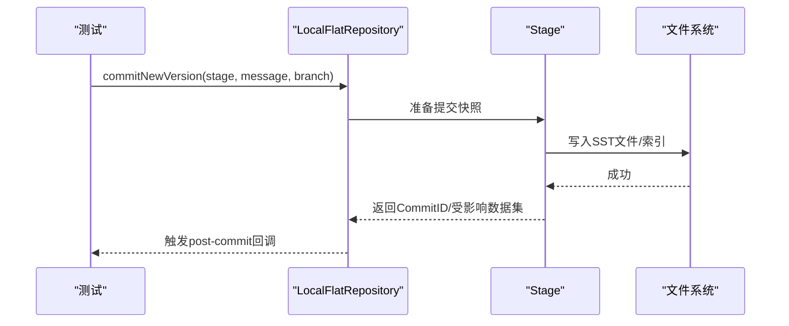
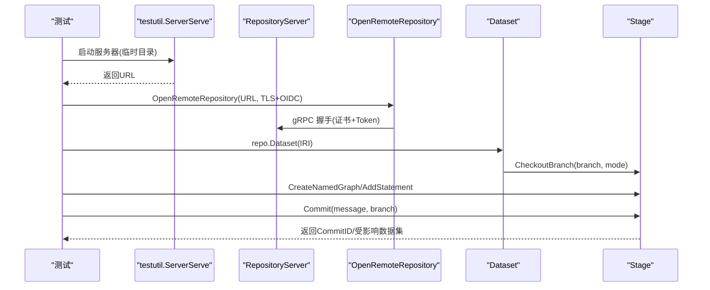
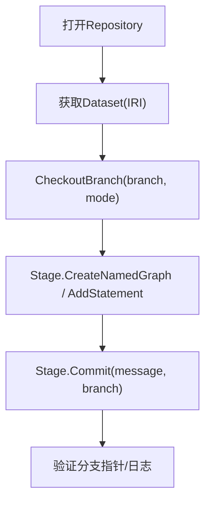
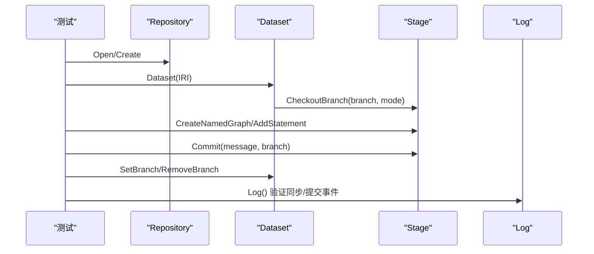
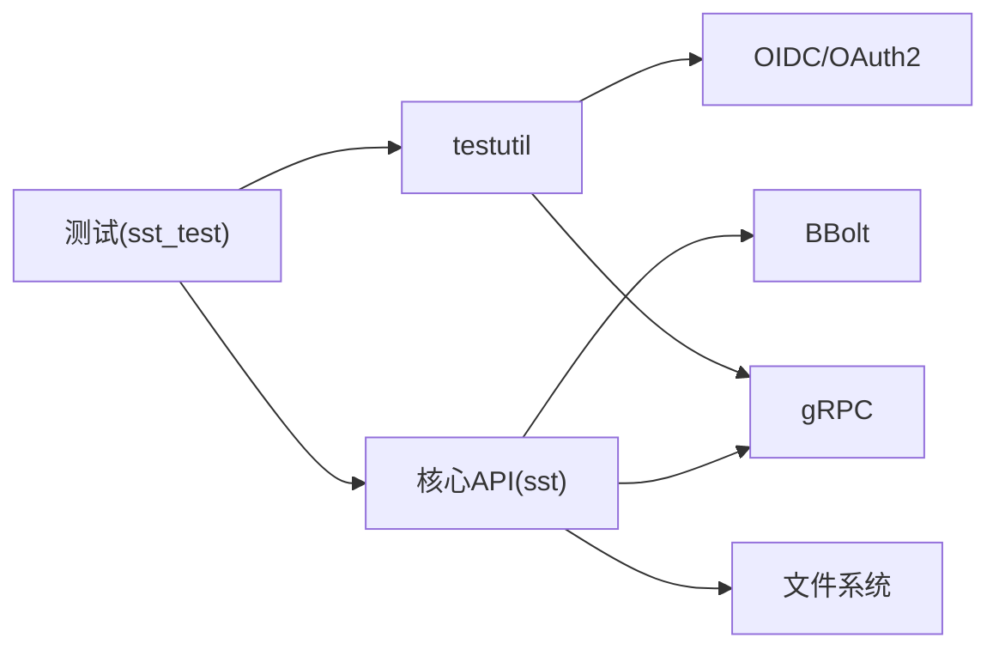

# 集成测试策略

<cite>
**本文引用的文件**
- [README.md](file://README.md)
- [go.mod](file://go.mod)
- [testauth.go](file://sst_test/testutil/testauth.go)
- [oidc_provider.go](file://sst_test/testutil/oidc_provider.go)
- [loadttl.go](file://sst_test/testutil/loadttl.go)
- [repository.go](file://sst/repository.go)
- [stagefslocalbasic_test.go](file://sst/stagefslocalbasic_test.go)
- [stagefsdatasets_test.go](file://sst/stagefsdatasets_test.go)
- [repolocalflat_test.go](file://sst/repolocalflat_test.go)
- [remoteRepository_test.go](file://sst_test/remoteRepository_test.go)
- [remoteRepositoryMultipleCommits_test.go](file://sst_test/remoteRepositoryMultipleCommits_test.go)
- [syncfrom_test.go](file://sst_test/syncfrom_test.go)
- [bbolt_version_update_test.go](file://sst_test/bbolt_version_update_test.go)
- [quota_remote_test.go](file://sst_test/quota_remote_test.go)
</cite>

## 目录
1. [简介](#简介)
2. [项目结构](#项目结构)
3. [核心组件](#核心组件)
4. [架构总览](#架构总览)
5. [详细组件分析](#详细组件分析)
6. [依赖关系分析](#依赖关系分析)
7. [性能考量](#性能考量)
8. [故障排查指南](#故障排查指南)
9. [结论](#结论)
10. [附录](#附录)

## 简介
本策略面向 SST Core 的集成测试，覆盖三类存储后端（本地文件系统、BBolt 数据库、远程仓库），并给出测试环境搭建与配置方法（含测试数据库初始化、网络服务模拟）、跨组件交互验证（Repository 与 Stage）、外部依赖模拟（gRPC 服务、文件系统替代方案）、端到端工作流（完整 CRUD 与版本控制流程）以及测试数据管理与清理策略。目标是确保在真实或接近真实的运行环境下，对 SST 的核心能力进行稳定、可重复、可观测的验证。

## 项目结构
SST Core 提供统一的 Repository/Stage API，支持本地 Basic/Flat/Full 三种实现与远程 gRPC 服务端。测试集中在 sst_test 包中，使用 testutil 提供的工具启动内嵌服务器、生成证书与 OIDC 提供者，并通过临时目录隔离测试数据。

图表来源
- [repository.go:386-531](file://sst/repository.go#L386-L531)
- [testauth.go:147-204](file://sst_test/testutil/testauth.go#L147-L204)
- [oidc_provider.go:167-235](file://sst_test/testutil/oidc_provider.go#L167-L235)

章节来源
- [README.md:1-15](file://README.md#L1-L15)
- [go.mod:1-80](file://go.mod#L1-L80)

## 核心组件
- Repository：统一的数据集与版本管理入口，支持本地 Basic/Flat/Full 与远程 gRPC 客户端。
- Stage：数据集的工作区，用于创建/修改 NamedGraph、提交变更、分支操作等。
- 存储后端：
  - 本地文件系统：基于目录结构的 Flat/Full 实现。
  - BBolt 数据库：Basic 实现及内部索引、日志等持久化。
  - 远程仓库：通过 gRPC 协议访问服务端实现的仓库。

章节来源
- [repository.go:386-531](file://sst/repository.go#L386-L531)

## 架构总览
下图展示了集成测试中常见的调用链：测试通过 testutil 启动内嵌 gRPC 服务器（本地目录作为仓库根），以 TLS + OIDC 认证建立安全连接；客户端打开远程仓库后，通过 Stage 进行 CRUD 与提交，最终落盘到 BBolt 或文件系统。

图表来源
- [testauth.go:147-204](file://sst_test/testutil/testauth.go#L147-L204)
- [oidc_provider.go:167-235](file://sst_test/testutil/oidc_provider.go#L167-L235)
- [remoteRepository_test.go:248-347](file://sst_test/remoteRepository_test.go#L248-L347)

## 详细组件分析

### 存储后端 A：BBolt 数据库（Basic 实现）
- 目标：验证 Basic 仓库在 BBolt 上的读写、事务、错误路径与目录映射。
- 关键场景：
  - 打开/读取 Bucket 中的文件条目
  - 列出目录项
  - 打开/写入文件
  - 数据集元数据桶为空或缺失时的错误处理
- 测试要点：
  - 构造最小化的 BBolt DB 与 Bucket，注入测试数据
  - 使用 t.TempDir() 隔离数据库文件
  - 断言错误类型（如“文件不存在”、“目录不存在”）
  - 写操作后校验持久化结果

图表来源
- [stagefslocalbasic_test.go:17-123](file://sst/stagefslocalbasic_test.go#L17-L123)
- [stagefslocalbasic_test.go:127-253](file://sst/stagefslocalbasic_test.go#L127-L253)
- [stagefsdatasets_test.go:15-50](file://sst/stagefsdatasets_test.go#L15-L50)
- [stagefsdatasets_test.go:46-174](file://sst/stagefsdatasets_test.go#L46-L174)

章节来源
- [stagefslocalbasic_test.go:17-123](file://sst/stagefslocalbasic_test.go#L17-L123)
- [stagefslocalbasic_test.go:127-253](file://sst/stagefslocalbasic_test.go#L127-L253)
- [stagefsdatasets_test.go:15-50](file://sst/stagefsdatasets_test.go#L15-L50)
- [stagefsdatasets_test.go:46-174](file://sst/stagefsdatasets_test.go#L46-L174)

### 存储后端 B：本地文件系统（Flat/Full 实现）
- 目标：验证基于目录的仓库行为，包括提交回调、多数据集提交、遍历与索引。
- 关键场景：
  - post-commit 通知回调触发
  - 单数据集多次提交
  - 多数据集提交后的状态一致性
- 测试要点：
  - 使用 t.TempDir() 创建仓库目录
  - 构造 Stage 并提交，验证回调参数与返回值
  - 检查提交后目录结构与索引更新

图表来源
- [repolocalflat_test.go:91-185](file://sst/repolocalflat_test.go#L91-L185)

章节来源
- [repolocalflat_test.go:91-185](file://sst/repolocalflat_test.go#L91-L185)

### 存储后端 C：远程仓库（gRPC + TLS + OIDC）
- 目标：验证通过 gRPC 访问远程仓库的完整生命周期，包括认证、CRUD、分支与提交。
- 关键场景：
  - 使用 testutil 启动内嵌服务器（TLS + OIDC）
  - 客户端以 TLS + OAuth2 凭证连接
  - 创建数据集、节点、提交、分支切换、查询
- 测试要点：
  - 使用 t.TempDir() 作为仓库根目录
  - 使用 TestTransportCreds() 建立 TLS 连接
  - 使用 ContextWithAuthProvider + TestProviderInstance 注入认证上下文
  - 验证提交后分支状态与数据集内容

图表来源
- [testauth.go:147-204](file://sst_test/testutil/testauth.go#L147-L204)
- [oidc_provider.go:167-235](file://sst_test/testutil/oidc_provider.go#L167-L235)
- [remoteRepository_test.go:248-347](file://sst_test/remoteRepository_test.go#L248-L347)
- [remoteRepositoryMultipleCommits_test.go:38-74](file://sst_test/remoteRepositoryMultipleCommits_test.go#L38-L74)

章节来源
- [remoteRepository_test.go:248-347](file://sst_test/remoteRepository_test.go#L248-L347)
- [remoteRepositoryMultipleCommits_test.go:38-74](file://sst_test/remoteRepositoryMultipleCommits_test.go#L38-L74)

### 跨组件协作：Repository 与 Stage
- 目标：验证 Dataset/Repository 与 Stage 的协作，包括分支检出、提交、日志同步。
- 关键场景：
  - 从 Repository 获取 Dataset，再 Checkout 得到 Stage
  - 在 Stage 上执行命名图操作并提交
  - 验证分支指针与日志记录
- 测试要点：
  - 使用 DefaultBranch 与 DefaultTriplexMode
  - 验证 Commit 返回的受影响数据集集合
  - 通过 Log 接口验证同步事件

图表来源
- [syncfrom_test.go:80-116](file://sst_test/syncfrom_test.go#L80-L116)
- [remoteRepositoryMultipleCommits_test.go:682-732](file://sst_test/remoteRepositoryMultipleCommits_test.go#L682-L732)

章节来源
- [syncfrom_test.go:80-116](file://sst_test/syncfrom_test.go#L80-L116)
- [remoteRepositoryMultipleCommits_test.go:682-732](file://sst_test/remoteRepositoryMultipleCommits_test.go#L682-L732)

### 外部依赖模拟：gRPC 服务与文件系统
- gRPC 服务模拟：
  - 使用 testutil.ServerServe/SuperServerServe 启动内嵌服务器，绑定随机端口，自动清理。
  - 使用 TestTransportCreds 配置 TLS，使用 ContextWithAuthProvider + TestProviderInstance 注入 OAuth2 Token。
  - 可选启用 OIDC：StartFakeOIDCProvider 提供 discovery/jwks 端点，签发带 resource_access 的 JWT。
- 文件系统替代方案：
  - 使用 t.TempDir() 为每个测试提供隔离目录。
  - 针对 BBolt 测试，直接构造 bbolt.DB 与 Bucket，注入测试数据，避免真实磁盘竞争。
  - 对于需要 fs.FS 的场景，使用内存或包装文件系统（如 wrfs）进行替换。

章节来源
- [testauth.go:147-204](file://sst_test/testutil/testauth.go#L147-L204)
- [oidc_provider.go:26-71](file://sst_test/testutil/oidc_provider.go#L26-L71)
- [oidc_provider.go:167-235](file://sst_test/testutil/oidc_provider.go#L167-L235)
- [stagefslocalbasic_test.go:17-123](file://sst/stagefslocalbasic_test.go#L17-L123)

### 端到端工作流：完整 CRUD 与版本控制
- 典型流程：
  - 创建/打开仓库（本地或远程）
  - 打开 Stage，创建命名图与节点，添加三元组
  - 提交变更，记录 CommitID 与受影响数据集
  - 分支操作：设置/删除分支，检出版本
  - 查询与遍历：按 IRI 获取命名图，遍历节点
- 示例覆盖：
  - 远程仓库多次提交与分支切换
  - 本地仓库同步（SyncFrom）与日志验证
  - BBolt 版本迁移与读取旧格式

图表来源
- [remoteRepositoryMultipleCommits_test.go:38-74](file://sst_test/remoteRepositoryMultipleCommits_test.go#L38-L74)
- [syncfrom_test.go:1-47](file://sst_test/syncfrom_test.go#L1-L47)
- [bbolt_version_update_test.go:38-90](file://sst_test/bbolt_version_update_test.go#L38-L90)

章节来源
- [remoteRepositoryMultipleCommits_test.go:38-74](file://sst_test/remoteRepositoryMultipleCommits_test.go#L38-L74)
- [syncfrom_test.go:1-47](file://sst_test/syncfrom_test.go#L1-L47)
- [bbolt_version_update_test.go:38-90](file://sst_test/bbolt_version_update_test.go#L38-L90)

### 测试数据管理与清理策略
- 数据加载：
  - 使用 LoadAllTTLFromDir 批量加载 .ttl 文件到参考 Stage，便于对比与断言。
  - 使用 LoadTriG 加载 TriG 格式数据。
- 清理策略：
  - 所有测试使用 t.TempDir() 创建隔离目录，测试结束后自动清理。
  - 服务器与 OIDC 提供者通过 t.Cleanup 优雅关闭。
  - 对 BBolt 文件与 SST 输出文件，显式 os.Remove 或在 Cleanup 阶段清理。
- 最佳实践：
  - 将测试数据放在 sst_test/testdata 下，避免污染源码树。
  - 对大型数据集，采用分片或按需加载，减少内存占用。
  - 对并发测试，确保端口与目录隔离，避免资源竞争。

章节来源
- [loadttl.go:18-78](file://sst_test/testutil/loadttl.go#L18-L78)
- [testauth.go:147-204](file://sst_test/testutil/testauth.go#L147-L204)
- [oidc_provider.go:64-71](file://sst_test/testutil/oidc_provider.go#L64-L71)

## 依赖关系分析
- 测试依赖：
  - testify/assert 与 require：用于断言与强制失败。
  - go-oidc/golang.org/x/oauth2：OIDC 发现与令牌处理。
  - google.golang.org/grpc：gRPC 客户端与服务端。
  - go.etcd.io/bbolt：本地数据库后端。
  - github.com/relab/wrfs：文件系统抽象，便于替换与测试。
- 耦合与内聚：
  - Repository 与 Stage 高内聚，通过接口解耦存储后端。
  - testutil 集中封装网络与认证细节，降低测试代码耦合度。
- 潜在循环依赖：
  - 测试与核心库之间无循环导入；testutil 仅依赖核心库导出接口。

图表来源
- [go.mod:1-80](file://go.mod#L1-L80)
- [testauth.go:147-204](file://sst_test/testutil/testauth.go#L147-L204)
- [oidc_provider.go:167-235](file://sst_test/testutil/oidc_provider.go#L167-L235)

章节来源
- [go.mod:1-80](file://go.mod#L1-L80)

## 性能考量
- 并发与隔离：
  - 使用 t.Parallel 时确保每个测试拥有独立目录与端口。
  - BBolt 文件锁与并发写入需谨慎，必要时串行化相关测试。
- 内存与IO：
  - 大数据集分批处理，避免一次性加载导致 OOM。
  - 使用流式读取/写入（bufio.Reader/Writer）提升吞吐。
- 网络与认证：
  - 复用 TLS 证书与 OIDC 提供者实例，减少启动开销。
  - 合理设置超时与重试，避免测试长时间阻塞。

[本节为通用指导，不直接分析具体文件]

## 故障排查指南
- 常见问题：
  - 连接失败：检查 TLS 证书与 OIDC 配置是否正确，确认服务器已启动且端口可用。
  - 权限错误：确认 BBolt 文件权限与目录可写性。
  - 数据不一致：检查提交顺序与分支指针，验证日志记录。
- 定位方法：
  - 开启详细日志（AtomicLevel.SetLevel），观察请求与响应。
  - 使用 Log 接口检索同步与提交事件，核对 affected_count 与 dataset_0 字段。
  - 对 BBolt 数据，直接打开数据库查看 Bucket 内容与键值。

章节来源
- [syncfrom_test.go:1549-1586](file://sst_test/syncfrom_test.go#L1549-L1586)
- [quota_remote_test.go:24-42](file://sst_test/quota_remote_test.go#L24-L42)

## 结论
本策略通过统一的测试基础设施（testutil）与清晰的存储后端隔离，覆盖了 SST Core 的本地文件系统、BBolt 数据库与远程仓库三大场景。借助 OIDC/TLS 安全通道、临时目录隔离与标准化数据加载，能够稳定地验证 Repository 与 Stage 的协作、完整的 CRUD 与版本控制流程，并提供有效的故障排查手段。建议在实际项目中沿用此模式，持续扩展端到端用例与性能基准。

[本节为总结，不直接分析具体文件]

## 附录
- 快速上手：
  - 启动内嵌服务器：testutil.ServerServe(t, dir)
  - 建立安全连接：grpc.WithTransportCredentials(credentials.NewClientTLSFromCert(...))
  - 注入认证上下文：sstauth.ContextWithAuthProvider(ctx, provider)
  - 加载测试数据：LoadAllTTLFromDir(t, dir)
- 推荐用例：
  - 远程仓库多次提交与分支切换
  - 本地仓库 SyncFrom 与日志验证
  - BBolt 版本迁移与读取旧格式

[本节为补充信息，不直接分析具体文件]