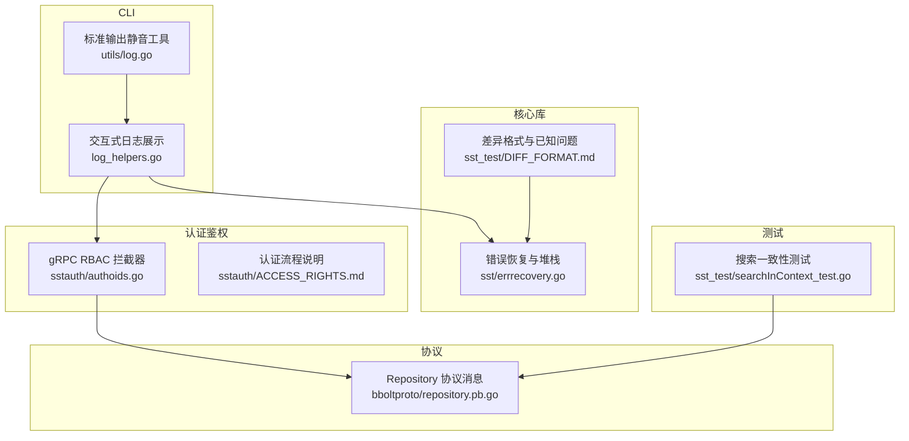
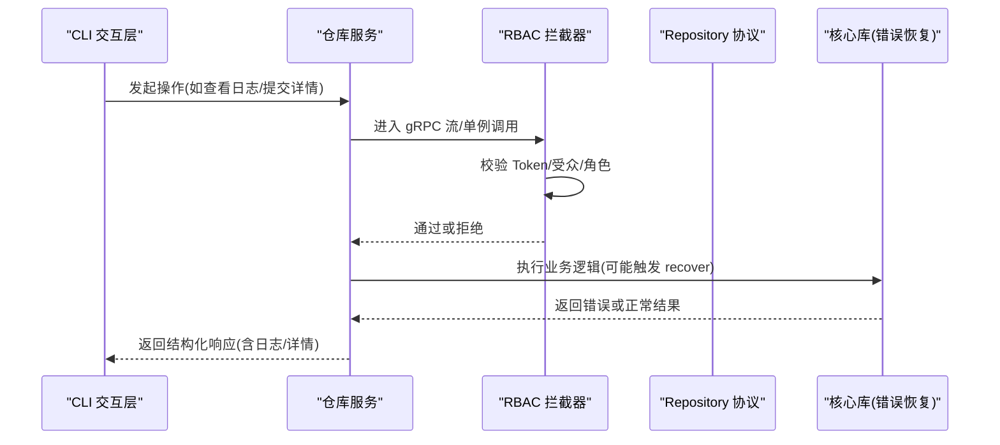
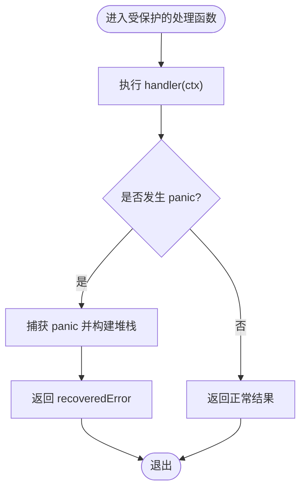
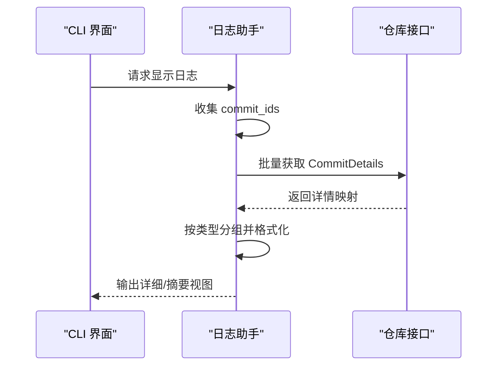
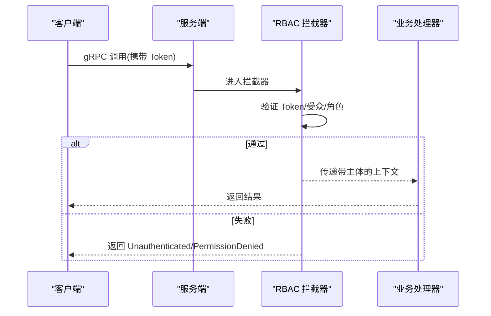
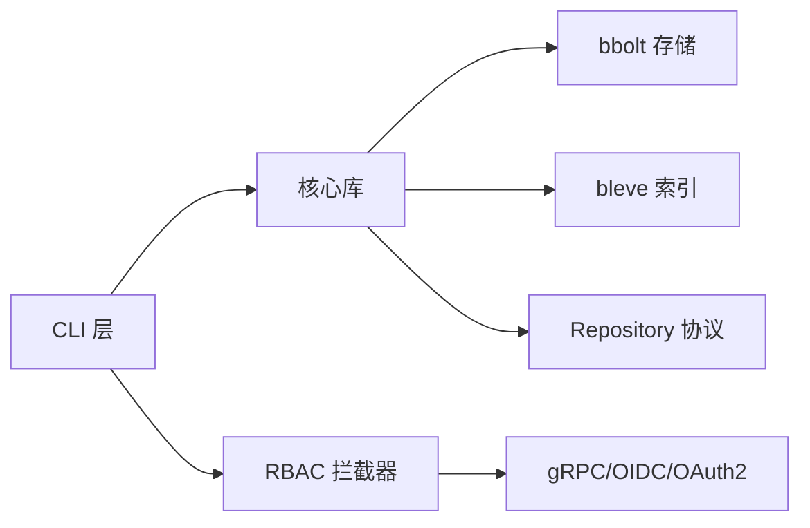

# 调试技巧和性能分析

<cite>
**本文引用的文件**
- [go.mod](file://go.mod)
- [errrecovery.go](file://sst/errrecovery.go)
- [log_helpers.go](file://cli/cmd/interactive/log_helpers.go)
- [log.go](file://cli/cmd/utils/log.go)
- [logger.go](file://tools/validate/logger.go)
- [DIFF_FORMAT.md](file://sst_test/DIFF_FORMAT.md)
- [authoids.go](file://sstauth/authoids.go)
- [ACCESS_RIGHTS.md](file://sstauth/ACCESS_RIGHTS.md)
- [repository.pb.go](file://bboltproto/repository.pb.go)
- [searchInContext_test.go](file://sst_test/searchInContext_test.go)
</cite>

## 目录
1. [简介](#简介)
2. [项目结构](#项目结构)
3. [核心组件](#核心组件)
4. [架构总览](#架构总览)
5. [详细组件分析](#详细组件分析)
6. [依赖关系分析](#依赖关系分析)
7. [性能考量](#性能考量)
8. [故障排查指南](#故障排查指南)
9. [结论](#结论)
10. [附录](#附录)

## 简介
本文件面向使用本仓库的开发者与运维人员，提供系统化的调试技巧与性能分析方法。内容涵盖：
- Go 调试器使用要点（断点、变量检查、堆栈跟踪）
- 日志系统的正确使用与级别配置
- 内存泄漏检测与 CPU 性能分析工具实践
- 网络请求调试与数据库查询优化技巧
- 常见问题诊断方法与解决方案
- 性能监控指标与告警建议
- 使用 pprof 进行性能剖析与优化建议

本仓库采用模块化组织，包含本地/远程仓库实现、CLI 交互层、验证工具、认证鉴权等。调试与性能分析贯穿各层，需结合具体模块特性进行定位与优化。

## 项目结构
- CLI 交互层：负责命令解析、日志展示、用户交互
- 核心库 sst：数据模型、阶段提交、差异读写、错误恢复等
- 认证鉴权 sstauth：gRPC 拦截器、RBAC、上下文主体注入
- 协议与序列化：protobuf 定义与生成代码
- 测试与示例：覆盖同步、搜索、分支、提交链一致性等场景
- 工具集：校验、转换、可视化等

图表来源
- [log_helpers.go:17-177](file://cli/cmd/interactive/log_helpers.go#L17-L177)
- [log.go:15-40](file://cli/cmd/utils/log.go#L15-L40)
- [errrecovery.go:13-92](file://sst/errrecovery.go#L13-L92)
- [DIFF_FORMAT.md:254-280](file://sst_test/DIFF_FORMAT.md#L254-L280)
- [authoids.go:338-423](file://sstauth/authoids.go#L338-L423)
- [repository.pb.go:6128-6379](file://bboltproto/repository.pb.go#L6128-L6379)
- [searchInContext_test.go:1012-1058](file://sst_test/searchInContext_test.go#L1012-L1058)

章节来源
- [go.mod:1-80](file://go.mod#L1-L80)

## 核心组件
- 错误恢复与堆栈捕获：统一将 panic 转换为可携带堆栈的错误对象，支持按环境变量控制堆栈粒度
- 交互式日志展示：对仓库日志进行分组、批量化获取提交详情、格式化输出
- 标准输出静音：在特定场景下屏蔽控制台输出，便于自动化或批量处理
- gRPC RBAC 拦截器：基于 OIDC token 的鉴权与授权，支持方法级角色控制
- Repository 协议：定义数据集、提交、引用等消息类型，支撑远程调用
- 搜索一致性测试：验证索引更新与查询结果的一致性，辅助定位缓存与并发问题

章节来源
- [errrecovery.go:13-92](file://sst/errrecovery.go#L13-L92)
- [log_helpers.go:17-177](file://cli/cmd/interactive/log_helpers.go#L17-L177)
- [log.go:15-40](file://cli/cmd/utils/log.go#L15-L40)
- [authoids.go:338-423](file://sstauth/authoids.go#L338-L423)
- [repository.pb.go:6128-6379](file://bboltproto/repository.pb.go#L6128-L6379)
- [searchInContext_test.go:1012-1058](file://sst_test/searchInContext_test.go#L1012-L1058)

## 架构总览
下图展示了从 CLI 到核心库、认证鉴权与协议的交互路径，以及日志与错误恢复在各层的体现。

图表来源
- [authoids.go:338-423](file://sstauth/authoids.go#L338-L423)
- [repository.pb.go:6128-6379](file://bboltproto/repository.pb.go#L6128-L6379)
- [errrecovery.go:81-92](file://sst/errrecovery.go#L81-L92)

## 详细组件分析

### 错误恢复与堆栈跟踪
- 设计要点
  - 将 panic 捕获为带堆栈的错误对象，便于上层统一处理与记录
  - 支持通过环境变量控制堆栈输出粒度，适配不同运行环境
  - 提供包含/不包含堆栈的控制方法，灵活用于生产与调试模式
- 使用建议
  - 在关键路径包裹 handleWithRecovery，确保异常不导致进程崩溃
  - 根据 GOTRACEBACK 设置调整堆栈信息量，避免生产环境过度开销
  - 将 recoveredError 记录到日志系统，并附带必要上下文字段

图表来源
- [errrecovery.go:81-92](file://sst/errrecovery.go#L81-L92)
- [errrecovery.go:13-50](file://sst/errrecovery.go#L13-L50)

章节来源
- [errrecovery.go:13-92](file://sst/errrecovery.go#L13-L92)

### 交互式日志展示与批处理
- 设计要点
  - 收集所有 commit_id，批量获取提交详情，减少往返开销
  - 按日志类型分组渲染，支持详细视图与摘要视图
  - 对同步事件、文档上传/下载、分支变更等进行结构化展示
- 使用建议
  - 在大量日志场景优先使用批量化获取提交详情
  - 根据用户选择切换详细/摘要视图，提升交互效率
  - 对未知类型日志保留字段键值，便于扩展与排错

图表来源
- [log_helpers.go:17-177](file://cli/cmd/interactive/log_helpers.go#L17-L177)

章节来源
- [log_helpers.go:17-177](file://cli/cmd/interactive/log_helpers.go#L17-L177)

### 标准输出静音
- 设计要点
  - 将 stdout 重定向到空设备，屏蔽 fmt.Printf 等输出
  - 提供恢复原状的方法，保证资源释放
- 使用建议
  - 在自动化脚本或批量任务中启用静音，减少无关输出
  - 注意在子进程或第三方库仍可能直接写 stdio 的场景

章节来源
- [log.go:15-40](file://cli/cmd/utils/log.go#L15-L40)

### gRPC RBAC 拦截器与认证流程
- 设计要点
  - 单例与流式拦截器分别处理一次性与长连接请求
  - 从上下文中提取主体，校验受众与角色，拒绝非法访问
  - 支持超级客户端与按仓库粒度的鉴权策略
- 使用建议
  - 在服务端注册拦截器，确保每个 RPC 都经过鉴权
  - 客户端正确附加 OAuth2 bearer token，避免未认证错误
  - 对敏感方法配置最小权限角色，遵循最小特权原则

图表来源
- [authoids.go:338-423](file://sstauth/authoids.go#L338-L423)
- [ACCESS_RIGHTS.md:52-100](file://sstauth/ACCESS_RIGHTS.md#L52-L100)

章节来源
- [authoids.go:338-423](file://sstauth/authoids.go#L338-L423)
- [ACCESS_RIGHTS.md:52-100](file://sstauth/ACCESS_RIGHTS.md#L52-L100)

### Repository 协议消息与远程调用
- 设计要点
  - 定义数据集、提交、引用等消息类型，支撑远程仓库通信
  - 通过 protobuf 生成代码，确保跨语言一致性与高效序列化
- 使用建议
  - 在远程调用中合理分页与限制返回大小，避免大对象传输
  - 对关键字段添加校验，防止恶意或畸形数据影响服务稳定性

章节来源
- [repository.pb.go:6128-6379](file://bboltproto/repository.pb.go#L6128-L6379)

### 搜索一致性与索引更新
- 设计要点
  - 测试验证无缓存情况下搜索结果的稳定性与即时性
  - 对比本地与远程索引行为，确保一致性
- 使用建议
  - 在高并发写入后，增加一致性检查用例
  - 对索引更新延迟进行监控与告警

章节来源
- [searchInContext_test.go:1012-1058](file://sst_test/searchInContext_test.go#L1012-L1058)

## 依赖关系分析
- 外部依赖
  - 日志框架：zap（结构化日志）
  - 搜索引擎：bleve（全文检索）
  - 存储后端：bbolt（嵌入式 KV 存储）
  - 网络与鉴权：grpc、OIDC、OAuth2
- 内部耦合
  - CLI 层依赖核心库的日志与仓库接口
  - 认证鉴权贯穿 gRPC 调用链路
  - 协议层为远程交互提供契约

图表来源
- [go.mod:1-80](file://go.mod#L1-L80)

章节来源
- [go.mod:1-80](file://go.mod#L1-L80)

## 性能考量
- 日志与 I/O
  - 使用结构化日志，避免频繁字符串拼接
  - 在批量场景中复用缓冲区，减少分配
  - 必要时屏蔽非必要输出，降低 I/O 压力
- 网络与远程调用
  - 合并请求，减少往返次数（如批量获取提交详情）
  - 合理设置超时与重试策略，避免雪崩
- 存储与索引
  - 关注 bbolt 写入放大与读放大，合理分片与压缩
  - bleve 索引更新频率与查询负载平衡，必要时引入缓存层
- 内存与 CPU
  - 使用 pprof 定位热点函数与内存分配
  - 避免不必要的对象创建与拷贝，利用池化技术

[本节为通用指导，不直接分析具体文件]

## 故障排查指南
- 差异读取异常
  - 症状：读取差异时出现“无法识别的差异条目”
  - 根因：当移除与新增计数均为 0 时，写入与读取对相同三元组计数的处理不一致，导致偏移错位
  - 解决：在写入阶段跳过相同三元组计数，保持读写一致
- 调试建议
  - 使用差异解析测试用例验证组合节点映射的正确性
  - 若出现读取漂移，优先检查写入端对相同三元组的处理逻辑
  - 核对谓词索引构建顺序是否与写入端一致

章节来源
- [DIFF_FORMAT.md:254-280](file://sst_test/DIFF_FORMAT.md#L254-L280)

## 结论
本仓库在错误恢复、日志展示、认证鉴权与协议设计上提供了良好的基础。通过系统化调试与性能分析方法，可有效定位问题并优化性能。建议在关键路径加入恢复与监控，结合 pprof 与结构化日志持续改进。

[本节为总结，不直接分析具体文件]

## 附录

### Go 调试器使用要点
- 断点设置
  - 在关键函数入口与边界条件处设置断点，观察输入输出
  - 针对差异读取、提交链遍历、搜索查询等热点路径重点标注
- 变量检查
  - 检查上下文中的主体、令牌、受众与角色
  - 验证日志字段与协议消息字段的完整性
- 堆栈跟踪
  - 利用错误恢复机制捕获堆栈，结合 GOTRACEBACK 控制输出粒度
  - 在生产环境谨慎开启全量堆栈，避免性能损耗

[本节为通用指导，不直接分析具体文件]

### 日志系统与级别配置
- 日志级别
  - 定义 Info、Warn、Error 等层级，区分正常信息与异常
  - 在验证工具中提供结构化日志接口，便于统一输出
- 配置建议
  - 开发环境提高日志级别，便于定位问题
  - 生产环境降低冗余日志，聚焦关键事件
  - 对敏感信息脱敏后再输出

章节来源
- [logger.go:11-31](file://tools/validate/logger.go#L11-L31)

### 内存泄漏检测与 CPU 性能分析
- 内存泄漏检测
  - 使用 pprof 的 heap 剖面，观察长时间运行后的内存增长
  - 关注大对象分配与未释放的资源（如文件句柄、网络连接）
- CPU 性能分析
  - 使用 pprof 的 cpu 剖面，定位热点函数
  - 结合火焰图分析调用链，优化算法与数据结构
- 实践建议
  - 在压测环境中采集剖面数据，模拟真实负载
  - 对关键路径进行基准测试，评估优化效果

[本节为通用指导，不直接分析具体文件]

### 网络请求调试与数据库查询优化
- 网络请求调试
  - 检查 gRPC 调用的超时、重试与错误码
  - 验证 Token 与受众匹配，避免未认证或权限不足
- 数据库查询优化
  - 对 bbolt 的读写路径进行剖析，减少锁竞争
  - 对 bleve 索引查询进行参数调优，提升命中率与速度

章节来源
- [authoids.go:338-423](file://sstauth/authoids.go#L338-L423)
- [repository.pb.go:6128-6379](file://bboltproto/repository.pb.go#L6128-L6379)

### 性能监控指标与告警配置
- 推荐指标
  - 请求延迟分布（P50/P95/P99）
  - 错误率（未认证、权限不足、超时）
  - 资源使用（CPU、内存、磁盘 I/O、网络带宽）
  - 索引更新延迟与查询吞吐
- 告警建议
  - 对高错误率与高延迟设置阈值告警
  - 对资源使用接近上限时提前预警
  - 对索引不一致或查询不稳定进行专项告警

[本节为通用指导，不直接分析具体文件]

### 使用 pprof 进行性能剖析与优化建议
- 数据采集
  - 在目标进程中集成 pprof 端点，采集 CPU、内存、阻塞、互斥等剖面
  - 在压测期间持续采集，确保数据代表性
- 分析与优化
  - 使用火焰图定位热点函数，减少计算复杂度
  - 优化数据结构与算法，减少内存分配与拷贝
  - 对 I/O 密集路径进行异步化与批量化处理

[本节为通用指导，不直接分析具体文件]