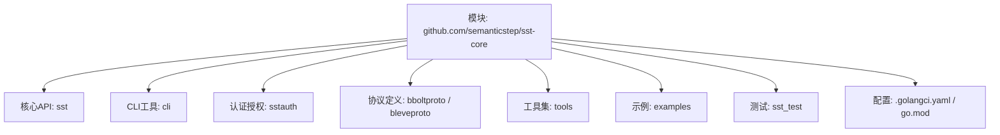
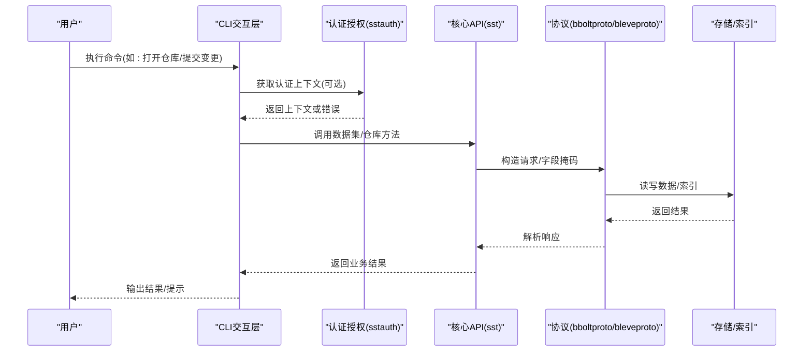
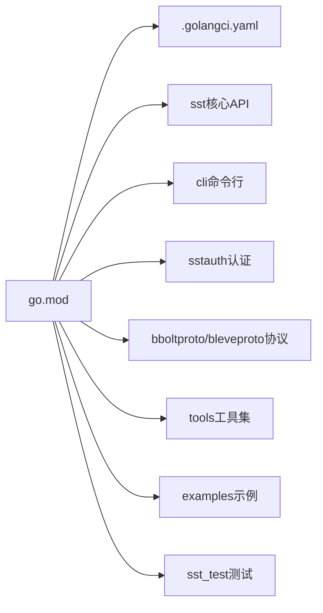

# 贡献流程和发布管理

<cite>
**本文引用的文件**
- [README.md](file://README.md)
- [go.mod](file://go.mod)
- [.golangci.yaml](file://.golangci.yaml)
- [CLI_INTRODUCTION.md](file://cli/CLI_INTRODUCTION.md)
- [sst/README.md](file://sst/README.md)
- [dataset_handler.go](file://cli/cmd/interactive/dataset_handler.go)
- [gettoken.go](file://cli/cmd/utils/gettoken.go)
- [authoids.go](file://sstauth/authoids.go)
- [repository.pb.go](file://bboltproto/repository.pb.go)
- [syncfrom_test.go](file://sst_test/syncfrom_test.go)
- [remoteRepository_test.go](file://sst_test/remoteRepository_test.go)
- [server.go](file://mcp/cmd/server.go)
- [copyright.tmpl](file://copyright.tmpl)
</cite>

## 目录
1. [简介](#简介)
2. [项目结构](#项目结构)
3. [核心组件](#核心组件)
4. [架构总览](#架构总览)
5. [详细组件分析](#详细组件分析)
6. [依赖关系分析](#依赖关系分析)
7. [性能与质量保障](#性能与质量保障)
8. [故障排查指南](#故障排查指南)
9. [结论](#结论)
10. [附录](#附录)

## 简介
本文件面向贡献者与发布负责人，提供完整的贡献工作流程与发布管理机制。内容涵盖Git工作流与分支策略、代码提交流程与Pull Request规范、提交信息与变更日志维护、版本标签与发布分支策略、文档与示例维护要求、许可证合规与版权信息、向后兼容性与迁移指南编写，以及发布前的质量保证与部署流程。该仓库为SST Core（语义化STEP技术）的核心库，提供SST API、CLI工具、MCP服务、协议定义与大量测试用例，适合以严谨的工程实践进行协作与发布。

## 项目结构
- 顶层模块与依赖：通过 go.mod 声明模块名与Go版本，集中管理第三方依赖。
- 核心API与实现：位于 sst 包，包含仓库、数据集、命名图、阶段、提交等概念的实现与说明。
- CLI工具：cli 包提供交互式命令行工具，用于调试、测试与日常操作。
- 认证与授权：sstauth 提供基于OIDC的访问控制与RBAC拦截器。
- 协议与序列化：bboltproto 与 bleveproto 提供存储与索引相关的Protobuf定义与生成代码。
- 工具与编译器：tools 提供编译、验证、转换等辅助工具。
- 示例与测试：examples 提供示例程序；sst_test 覆盖广泛的功能与集成测试。
- 文档：根级与子包内包含使用说明与接口说明。

**章节来源**
- [go.mod:1-80](file://go.mod#L1-L80)
- [README.md:1-15](file://README.md#L1-L15)

## 核心组件
- SST核心API（sst）：定义并实现数据集、命名图、阶段、提交、仓库同步、差异计算等能力，支持本地与远程仓库访问，使用二进制格式优化读写与比较。
- CLI（cli）：交互式命令界面，提供仓库打开、数据集操作、阶段管理、提交历史查看、RDF读取/写入、导入导出等功能，便于快速验证与调试。
- 认证与授权（sstauth）：基于OIDC令牌校验与角色映射，提供方法级访问控制拦截器，支持按仓库粒度鉴权。
- 协议层（bboltproto/bleveproto）：定义仓库元数据、提交请求、字段掩码等结构，支撑高效RPC与持久化。
- MCP服务（mcp）：提供工具调用接口，封装阶段提交、文档管理等能力，便于外部系统集成。

**章节来源**
- [sst/README.md:1-207](file://sst/README.md#L1-L207)
- [CLI_INTRODUCTION.md:1-936](file://cli/CLI_INTRODUCTION.md#L1-L936)
- [authoids.go:332-378](file://sstauth/authoids.go#L332-L378)
- [repository.pb.go:1-41](file://bboltproto/repository.pb.go#L1-L41)
- [server.go:397-432](file://mcp/cmd/server.go#L397-L432)

## 架构总览
下图展示从CLI到核心API、认证授权、协议层的交互路径，体现贡献者日常开发与发布过程中涉及的调用链路与关键节点。

**图表来源**
- [dataset_handler.go:199-378](file://cli/cmd/interactive/dataset_handler.go#L199-L378)
- [gettoken.go:235-277](file://cli/cmd/utils/gettoken.go#L235-L277)
- [authoids.go:332-378](file://sstauth/authoids.go#L332-L378)
- [repository.pb.go:1-41](file://bboltproto/repository.pb.go#L1-L41)

**章节来源**
- [dataset_handler.go:199-378](file://cli/cmd/interactive/dataset_handler.go#L199-L378)
- [gettoken.go:235-277](file://cli/cmd/utils/gettoken.go#L235-L277)
- [authoids.go:332-378](file://sstauth/authoids.go#L332-L378)
- [repository.pb.go:1-41](file://bboltproto/repository.pb.go#L1-L41)

## 详细组件分析

### Git工作流与分支管理策略
- 推荐分支模型
  - main：稳定主线，仅接受经过审查与测试通过的合并。
  - develop：开发集成分支，功能特性先合并至此，再定期打标签进入候选发布。
  - feature/*：功能分支，从develop创建，完成后发起PR至develop。
  - release/*：发布候选分支，从main或develop切出，修复阻塞问题后打标签。
  - hotfix/*：紧急修复分支，从main切出，修复后合并回main与develop。
- 分支命名与保护
  - 分支名遵循小写+短横线命名，避免特殊字符。
  - main与release/*启用保护规则，禁止强制推送，要求至少一名审查者批准。
- 提交与合并规范
  - 提交信息采用约定式提交（Conventional Commits），类型包括feat、fix、docs、refactor、test、chore等。
  - PR需关联Issue或任务编号，描述变更背景、影响范围与验证方式。
  - 合并前必须通过CI检查（lint、单元测试、集成测试）。

[本节为通用流程建议，不直接分析具体文件]

### 代码提交流程与Pull Request规范
- 提交流程
  - 在feature分支完成改动后，运行本地lint与测试，确保无新增告警。
  - 提交时附带清晰的提交信息与变更说明。
  - 推送分支并创建PR，填写模板中的必要信息。
- PR规范
  - 标题应简洁明确，正文包含动机、变更点、影响面、测试覆盖。
  - 需要至少一位具备权限的审查者批准。
  - 若涉及公共API或协议变更，需补充兼容性说明与迁移指南。
- 审查要点
  - 正确性：逻辑与边界条件是否完备。
  - 可维护性：命名、注释、复杂度是否合理。
  - 安全性：认证、授权、输入校验是否到位。
  - 性能：是否存在明显瓶颈或资源泄漏风险。

[本节为通用流程建议，不直接分析具体文件]

### 提交信息格式与变更日志维护
- 提交信息格式
  - 类型: 作用域: 简述（例如 feat(cli): 增加分支设置命令）
  - 正文可选，说明动机与影响。
  - 结尾可附加破坏性变更标记与关联Issue。
- 变更日志维护
  - 建议在仓库根目录维护CHANGELOG.md，按版本记录新增、修复、废弃与破坏性变更。
  - 每次发布前由维护者汇总PR中的变更条目，确保对外可见。

[本节为通用流程建议，不直接分析具体文件]

### 版本标签管理与发布分支策略
- 版本号策略
  - 采用语义化版本（SemVer）：主版本.次版本.修订号。
  - 主版本：破坏性变更；次版本：新增功能且保持兼容；修订号：缺陷修复。
- 标签与分支
  - 发布时在main上打tag（如v1.2.3），并创建release/v1.2.x分支用于后续补丁。
  - 热修复直接在hotfix分支处理，合并回main与develop，并重新打标签。
- 自动化
  - CI在打标签时触发构建与发布流水线，生成制品并上传至包管理器或发行平台。

[本节为通用流程建议，不直接分析具体文件]

### 文档更新与示例代码维护要求
- 文档更新
  - 任何API或行为变更需同步更新相关README与使用说明。
  - CLI新增命令需在CLI_INTRODUCTION.md中补充用法与示例。
- 示例代码
  - examples下的示例应保持可编译与可运行，必要时随版本升级调整。
  - 示例应覆盖典型场景（本地/远程仓库、读写、导入导出等）。

**章节来源**
- [CLI_INTRODUCTION.md:1-936](file://cli/CLI_INTRODUCTION.md#L1-L936)
- [sst/README.md:1-207](file://sst/README.md#L1-L207)

### 许可证合规检查与版权信息管理
- 许可证合规
  - 所有新增文件需包含版权声明头，遵循copyright.tmpl模板。
  - 第三方依赖需检查许可证兼容性，避免引入强传染性许可。
- 版权信息
  - 使用copyright.tmpl统一生成版权头，确保年份与持有者信息准确。
  - 在PR中自动检查版权头存在性，缺失则阻断合并。

**章节来源**
- [copyright.tmpl:1-1](file://copyright.tmpl#L1-L1)

### 向后兼容性检查与迁移指南编写
- 兼容性检查
  - 对公共API、协议字段、CLI命令参数进行兼容性评估。
  - 使用字段掩码与默认值策略降低破坏性影响。
- 迁移指南
  - 针对破坏性变更，提供逐步迁移步骤与替代方案。
  - 在CHANGELOG中标注破坏性变更与迁移指引。

**章节来源**
- [repository.pb.go:1-41](file://bboltproto/repository.pb.go#L1-L41)

### 发布前的质量保证与部署流程
- 质量保证
  - 静态检查：启用.golangci.yaml配置的linter与formatter，确保代码风格一致。
  - 单元测试：覆盖率达标，关键路径有充分断言。
  - 集成测试：模拟本地/远程仓库、认证、同步、索引等场景。
- 部署流程
  - CI在main或release分支触发构建，生成二进制与文档。
  - 发布制品包含CLI、库包、示例与手册，附签名与校验和。
  - 发布后通知社区，更新文档与示例链接。

**章节来源**
- [.golangci.yaml:1-53](file://.golangci.yaml#L1-L53)

## 依赖关系分析
- 模块与语言版本
  - 模块名为github.com/semanticstep/sst-core，Go版本为1.25.0。
- 主要依赖
  - 搜索与索引：blevesearch系列。
  - CLI框架：spf13/cobra与pflag。
  - 认证：coreos/go-oidc与golang.org/x/oauth2。
  - 存储：go.etcd.io/bbolt。
  - 网络与RPC：google.golang.org/grpc与protobuf。
  - 测试：stretchr/testify。
- 间接依赖
  - JSON、加密、文本处理等基础库。

**图表来源**
- [go.mod:1-80](file://go.mod#L1-L80)
- [.golangci.yaml:1-53](file://.golangci.yaml#L1-L53)

**章节来源**
- [go.mod:1-80](file://go.mod#L1-L80)

## 性能与质量保障
- 静态检查与格式化
  - 启用errorlint、exhaustive、forbidigo、godot、godox、revive、unconvert、unparam等linter。
  - 禁止使用fmt.Printf与标准log包输出，CLI输出使用GlobalLogger或打印函数，保证日志一致性。
  - 使用gofumpt进行格式化，提升可读性。
- 测试策略
  - 单元与集成测试覆盖仓库操作、分支管理、同步、认证、索引查询等关键路径。
  - 使用临时目录与内存对象隔离测试环境，避免污染。
- 性能考量
  - SST内部使用二进制格式与规范化排序，提升差异计算与存储效率。
  - 索引查询通过Bleve进行，注意查询限制与字段选择以减少开销。

**章节来源**
- [.golangci.yaml:1-53](file://.golangci.yaml#L1-L53)
- [sst/README.md:1-207](file://sst/README.md#L1-L207)

## 故障排查指南
- 常见问题定位
  - 认证失败：检查OIDC配置与令牌有效性，确认受众与角色映射正确。
  - 分支操作异常：确认分支名称与提交哈希有效，避免指向不存在的修订。
  - 同步不一致：核对源与目标仓库的分支过滤与数据集选择，检查日志与元数据。
- 诊断工具
  - CLI提供dump、history、diff等命令，便于查看内部结构与变更。
  - 使用MCP工具进行阶段提交与文档管理，简化调试流程。

**章节来源**
- [gettoken.go:235-277](file://cli/cmd/utils/gettoken.go#L235-L277)
- [dataset_handler.go:199-378](file://cli/cmd/interactive/dataset_handler.go#L199-L378)
- [syncfrom_test.go:43-1053](file://sst_test/syncfrom_test.go#L43-L1053)
- [remoteRepository_test.go:728-799](file://sst_test/remoteRepository_test.go#L728-L799)
- [server.go:397-432](file://mcp/cmd/server.go#L397-L432)

## 结论
本仓库提供了完善的SST核心能力与配套工具，适合以严格的工程实践进行协作与发布。通过明确的Git工作流、PR规范、提交信息约定、版本标签策略、文档与示例维护要求、许可证合规检查、兼容性评估与迁移指南，以及全面的质量保证与部署流程，可确保代码质量与发布稳定性。贡献者应遵循本文档与实践，共同维护项目的长期健康演进。

## 附录
- 常用命令参考
  - 构建CLI：参考CLI_INTRODUCTION.md中的构建与启动说明。
  - 运行测试：使用Go测试套件执行单元与集成测试。
  - 静态检查：执行golangci-lint与gofumpt。
- 参考文件
  - 模块与依赖：go.mod
  - 代码规范：.golangci.yaml
  - 核心API说明：sst/README.md
  - CLI使用：cli/CLI_INTRODUCTION.md
  - 认证授权：sstauth/authoids.go
  - 协议定义：bboltproto/repository.pb.go
  - 测试用例：sst_test/syncfrom_test.go、sst_test/remoteRepository_test.go
  - MCP工具：mcp/cmd/server.go
  - 版权模板：copyright.tmpl