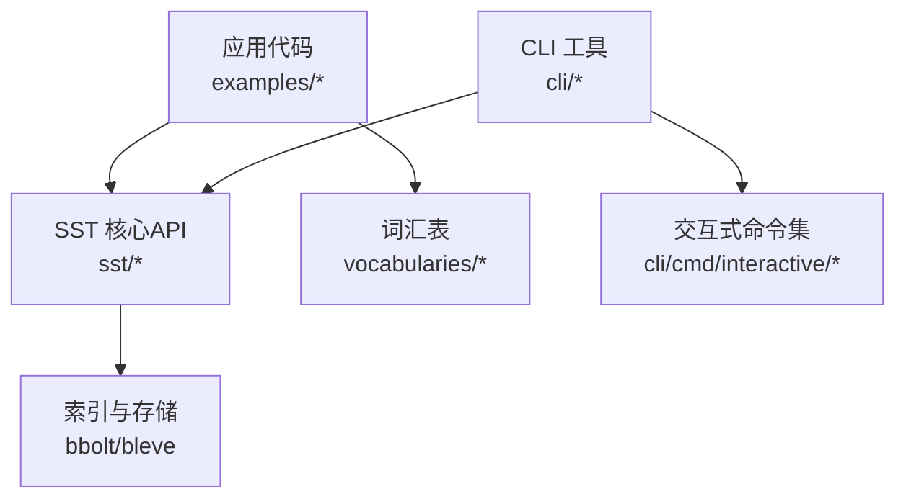
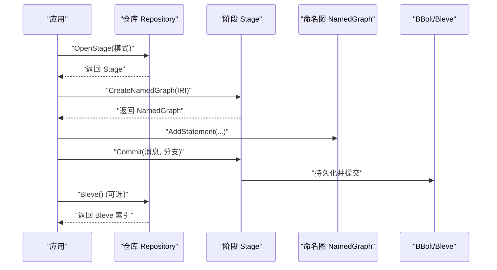
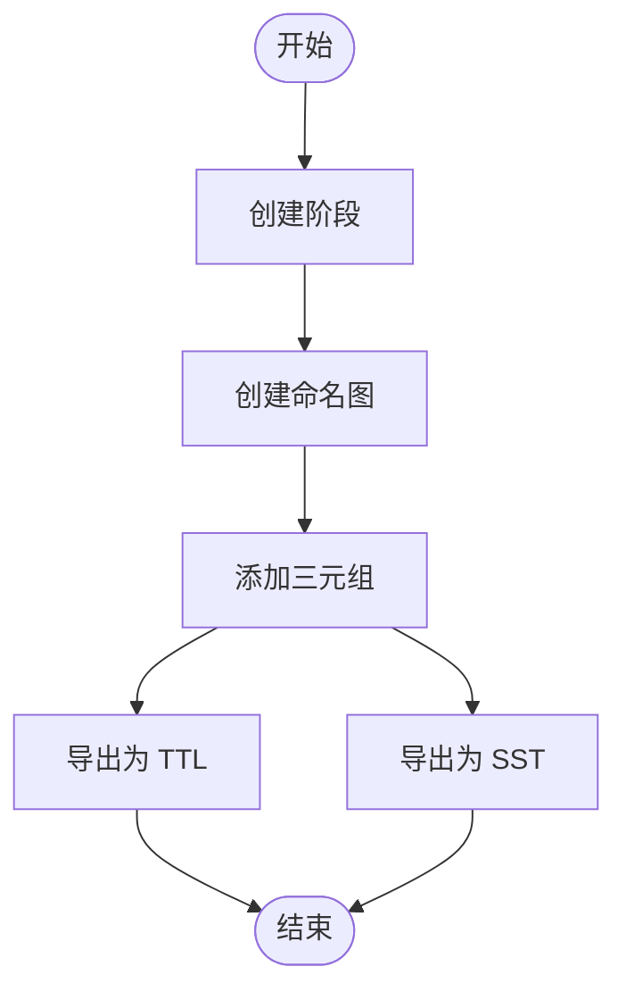
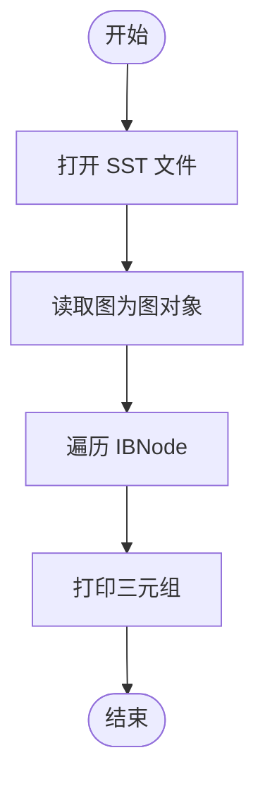
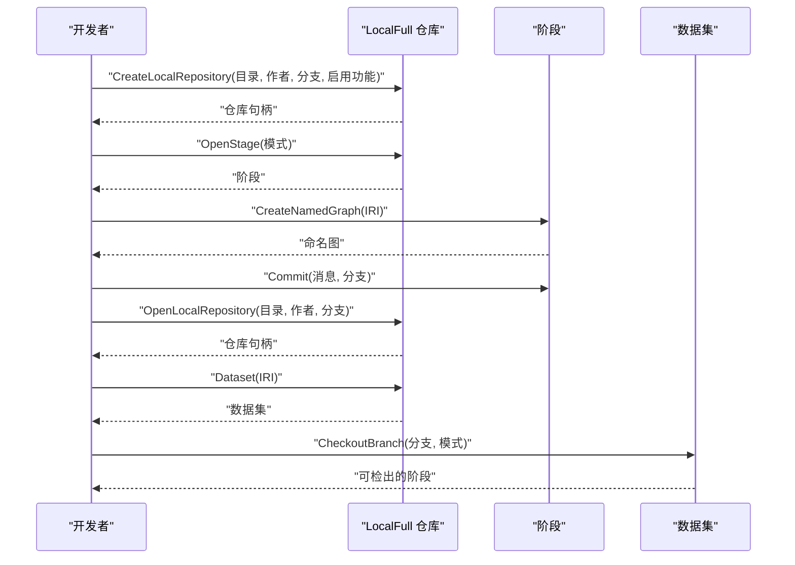
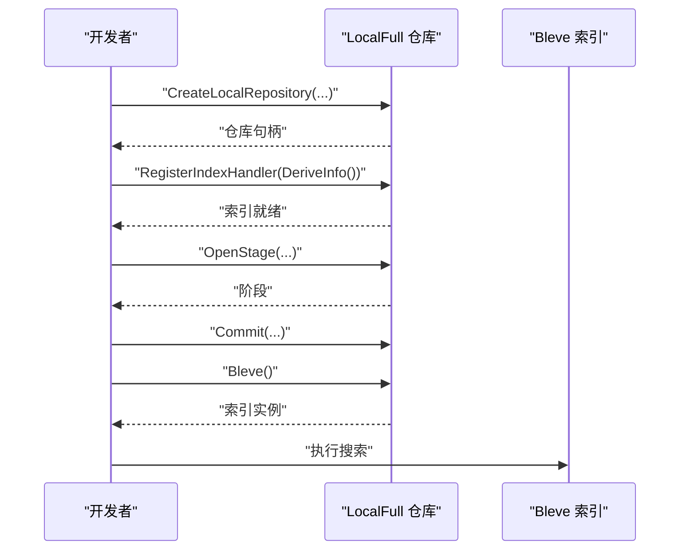
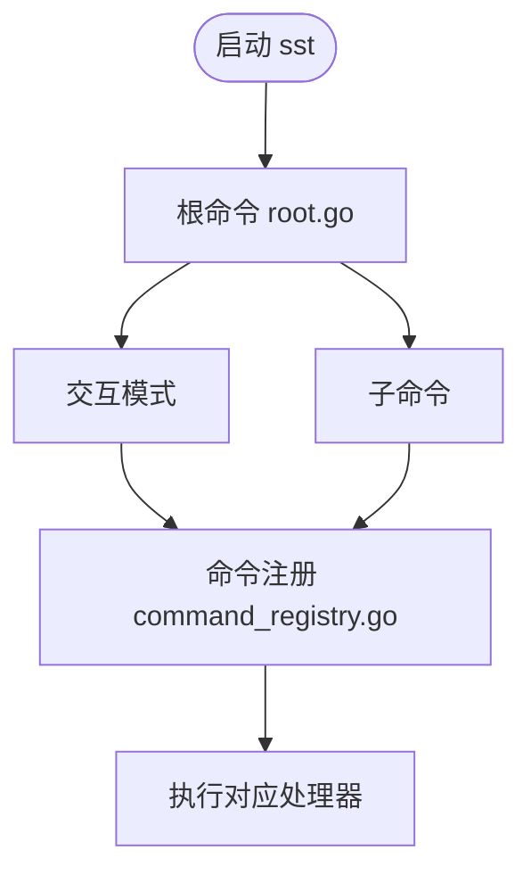
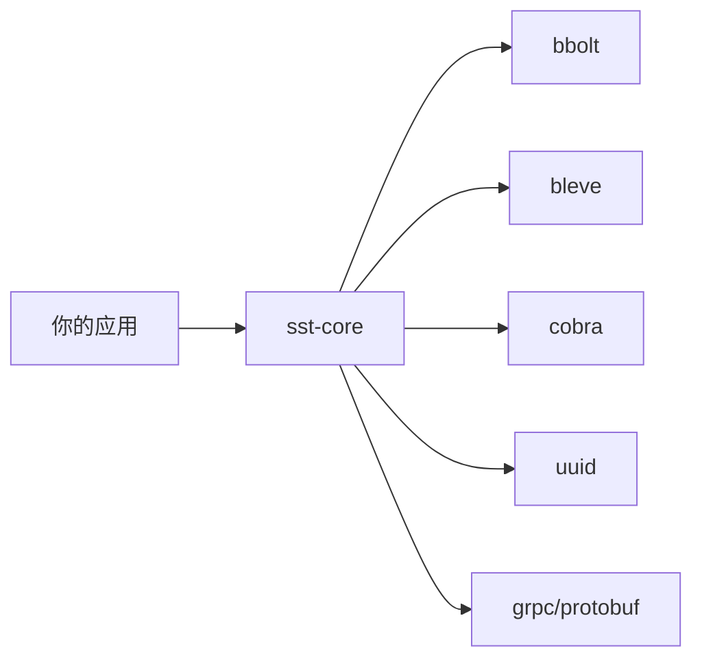

# 快速开始

<cite>
**本文引用的文件**
- [README.md](file://README.md)
- [go.mod](file://go.mod)
- [helloworldwrite.go](file://examples/helloworldwrite/helloworldwrite.go)
- [helloworldreadsst.go](file://examples/helloworldreadsst/helloworldreadsst.go)
- [repolocalfull.go](file://examples/helloworldrepolocalfull/repolocalfull.go)
- [repolocalfullwithbleve.go](file://examples/helloworldrepolocalfullwithbleve/repolocalfullwithbleve.go)
- [main.go](file://cli/main.go)
- [root.go](file://cli/cmd/root.go)
- [command_registry.go](file://cli/cmd/interactive/command_registry.go)
- [repository.go](file://sst/repository.go)
- [repolocalbasic.go](file://sst/repolocalbasic.go)
</cite>

## 目录
1. [简介](#简介)
2. [项目结构](#项目结构)
3. [核心组件](#核心组件)
4. [架构总览](#架构总览)
5. [详细组件分析](#详细组件分析)
6. [依赖分析](#依赖分析)
7. [性能考虑](#性能考虑)
8. [故障排除指南](#故障排除指南)
9. [结论](#结论)
10. [附录](#附录)

## 简介
本指南面向首次接触 SST Core 的开发者，目标是在 30 分钟内完成第一个 SST 应用的开发。你将学会：
- 准备 Go 环境并安装依赖
- 通过 Hello World 示例完成数据的写入与读取
- 创建本地仓库、添加数据、提交变更、导出/导入数据
- 使用 CLI 工具进行仓库初始化、查询、历史查看等常用操作
- 排查常见问题并掌握基本排错方法

## 项目结构
SST Core 提供核心 API、示例、词汇表、CLI 工具等模块。对普通应用开发者而言，最常用的是 sst 包、examples 示例、vocabularies 预编译词汇以及 cli 命令行工具。

图表来源
- [README.md:1-15](file://README.md#L1-L15)
- [main.go:1-18](file://cli/main.go#L1-L18)
- [root.go:13-52](file://cli/cmd/root.go#L13-L52)
- [repository.go:34-120](file://sst/repository.go#L34-L120)

章节来源
- [README.md:1-15](file://README.md#L1-L15)

## 核心组件
- 阶段（Stage）：用于在内存中构建和修改图数据的工作单元，支持提交到仓库。
- 命名图（NamedGraph）：一组三元组的集合，是读写的基本单位。
- 仓库（Repository）：持久化存储多个数据集，支持版本历史、日志、查询等能力。
- 索引（Bleve）：可选的全文检索索引，支持按字段查询。
- CLI：交互式或命令行方式管理仓库、数据集、阶段、文档等。

章节来源
- [repository.go:34-120](file://sst/repository.go#L34-L120)
- [repolocalbasic.go:34-65](file://sst/repolocalbasic.go#L34-L65)

## 架构总览
下图展示了从应用调用到数据存储与索引的关键路径。

图表来源
- [repolocalbasic.go:52-65](file://sst/repolocalbasic.go#L52-L65)
- [repository.go:60-120](file://sst/repository.go#L60-L120)

## 详细组件分析

### Hello World 写入与读取
- 写入示例：创建一个临时阶段，构造命名图，添加节点与三元组，导出为 Turtle 与二进制 SST 文件。
- 读取示例：从 SST 文件读取图，遍历 IBNode 及其三元组并输出。

图表来源
- [helloworldwrite.go:39-97](file://examples/helloworldwrite/helloworldwrite.go#L39-L97)

图表来源
- [helloworldreadsst.go:30-68](file://examples/helloworldreadsst/helloworldreadsst.go#L30-L68)

章节来源
- [helloworldwrite.go:39-97](file://examples/helloworldwrite/helloworldwrite.go#L39-L97)
- [helloworldreadsst.go:30-68](file://examples/helloworldreadsst/helloworldreadsst.go#L30-L68)

### 本地仓库：创建、提交、检出与验证
- 创建本地仓库：指定目录、作者与默认分支，开启完整功能。
- 工作流：打开阶段 -> 创建命名图 -> 添加节点与三元组 -> 提交 -> 导出 TTL -> 重新打开仓库 -> 检出数据集 -> 验证节点数量。

图表来源
- [repolocalfull.go:24-93](file://examples/helloworldrepolocalfull/repolocalfull.go#L24-L93)

章节来源
- [repolocalfull.go:24-93](file://examples/helloworldrepolocalfull/repolocalfull.go#L24-L93)

### 带索引的本地仓库：注册索引、提交与搜索
- 注册索引：使用默认派生信息配置 Bleve 索引。
- 工作流：创建仓库 -> 注册索引 -> 添加数据 -> 提交 -> 导出 TTL -> 搜索索引 -> 重新打开仓库并验证。

图表来源
- [repolocalfullwithbleve.go:44-80](file://examples/helloworldrepolocalfullwithbleve/repolocalfullwithbleve.go#L44-L80)
- [repolocalbasic.go:67-145](file://sst/repolocalbasic.go#L67-L145)

章节来源
- [repolocalfullwithbleve.go:44-80](file://examples/helloworldrepolocalfullwithbleve/repolocalfullwithbleve.go#L44-L80)
- [repolocalbasic.go:67-145](file://sst/repolocalbasic.go#L67-L145)

### CLI 工具快速上手
- 入口：CLI 主程序加载环境变量并执行命令。
- 根命令：默认进入交互模式；也可通过子命令直接执行。
- 常用命令：
  - 创建本地仓库：createlocalrepository <path> [--basic]
  - 打开本地仓库：openlocalrepository <path>
  - 列出数据集：datasets
  - 提交变更：commit <message> [branch]
  - 查看历史：log [-v|--verbose]
  - 导出 SST 文件：extractsstfile <hash>
  - 同步数据：syncfrom <源仓库别名> [分支] [数据集...]
  - 文档上传/下载：documentset / documentget / documentinfo / documents / documentdelete

图表来源
- [main.go:12-17](file://cli/main.go#L12-L17)
- [root.go:13-52](file://cli/cmd/root.go#L13-L52)
- [command_registry.go:45-90](file://cli/cmd/interactive/command_registry.go#L45-L90)

章节来源
- [main.go:12-17](file://cli/main.go#L12-L17)
- [root.go:13-52](file://cli/cmd/root.go#L13-L52)
- [command_registry.go:45-90](file://cli/cmd/interactive/command_registry.go#L45-L90)

## 依赖分析
- Go 版本要求：根据模块定义，需使用指定的较新版本。
- 关键外部依赖：
  - bbolt：本地键值存储，用于持久化仓库元数据与内容。
  - bleve：全文检索索引，支持字段级查询。
  - cobra：CLI 框架，提供命令解析与帮助。
  - uuid：生成唯一标识符。
  - grpc/protobuf：远程通信与序列化（在远程仓库场景中使用）。

图表来源
- [go.mod:1-80](file://go.mod#L1-L80)

章节来源
- [go.mod:1-80](file://go.mod#L1-L80)

## 性能考虑
- 批量写入：尽量在单个阶段内集中写入，减少频繁提交带来的开销。
- 索引更新：注册索引后，提交会触发增量更新；若索引配置变化，将重建索引，耗时较长。
- 大文件处理：优先使用二进制 SST 格式进行传输与存储，比文本格式更高效。
- 查询优化：合理设计索引字段，避免全表扫描；必要时分库分表或使用更细粒度的命名图。

[本节为通用指导，不直接分析具体文件]

## 故障排除指南
- 无法打开仓库或阶段
  - 检查路径权限与磁盘空间
  - 确认仓库是否已被其他进程占用
- 索引相关错误
  - 若索引信息与当前配置不一致，将触发重建；等待重建完成后再查询
  - 可通过 CLI 的 log 与 commitinfo 查看最近提交与状态
- 导入/导出失败
  - 确保输入文件格式正确（Turtle/TriG/SVG/P21）
  - 检查文件名与路径是否存在
- CLI 命令无效
  - 使用 help 查看可用命令与用法
  - 确认已正确打开仓库或阶段

章节来源
- [root.go:13-52](file://cli/cmd/root.go#L13-L52)
- [command_registry.go:45-90](file://cli/cmd/interactive/command_registry.go#L45-L90)

## 结论
通过本指南，你应能在 30 分钟内完成以下任务：
- 搭建 Go 环境并运行 Hello World 示例
- 创建本地仓库、添加数据、提交变更、导出/导入数据
- 使用 CLI 进行仓库管理与数据操作
- 了解索引注册与查询的基本流程
- 定位并解决常见环境问题

[本节为总结性内容，不直接分析具体文件]

## 附录

### 环境要求与安装步骤
- 安装 Go：建议使用 go.mod 中声明的版本或更高兼容版本。
- 获取源码：克隆仓库至本地。
- 安装依赖：在项目根目录执行依赖拉取。
- 构建 CLI：使用提供的入口构建可执行文件。
- 运行示例：进入 examples 目录，分别运行写入与读取示例。

章节来源
- [go.mod:1-80](file://go.mod#L1-L80)
- [main.go:12-17](file://cli/main.go#L12-L17)

### 快速操作步骤清单
- 写入 SST
  - 运行 helloworldwrite 示例，生成 .ttl 与 .sst 文件
- 读取 SST
  - 运行 helloworldreadsst 示例，读取上一步生成的 .sst 文件
- 本地仓库
  - 运行 repolocalfull 示例，演示创建仓库、提交、检出与验证
  - 运行 repolocalfullwithbleve 示例，演示注册索引与搜索
- CLI 常用命令
  - createlocalrepository/openlocalrepository/datasets/commit/log/extractsstfile/syncfrom/documentset/documentget/documentinfo/documents/documentdelete

章节来源
- [helloworldwrite.go:39-97](file://examples/helloworldwrite/helloworldwrite.go#L39-L97)
- [helloworldreadsst.go:30-68](file://examples/helloworldreadsst/helloworldreadsst.go#L30-L68)
- [repolocalfull.go:24-93](file://examples/helloworldrepolocalfull/repolocalfull.go#L24-L93)
- [repolocalfullwithbleve.go:44-80](file://examples/helloworldrepolocalfullwithbleve/repolocalfullwithbleve.go#L44-L80)
- [command_registry.go:45-90](file://cli/cmd/interactive/command_registry.go#L45-L90)