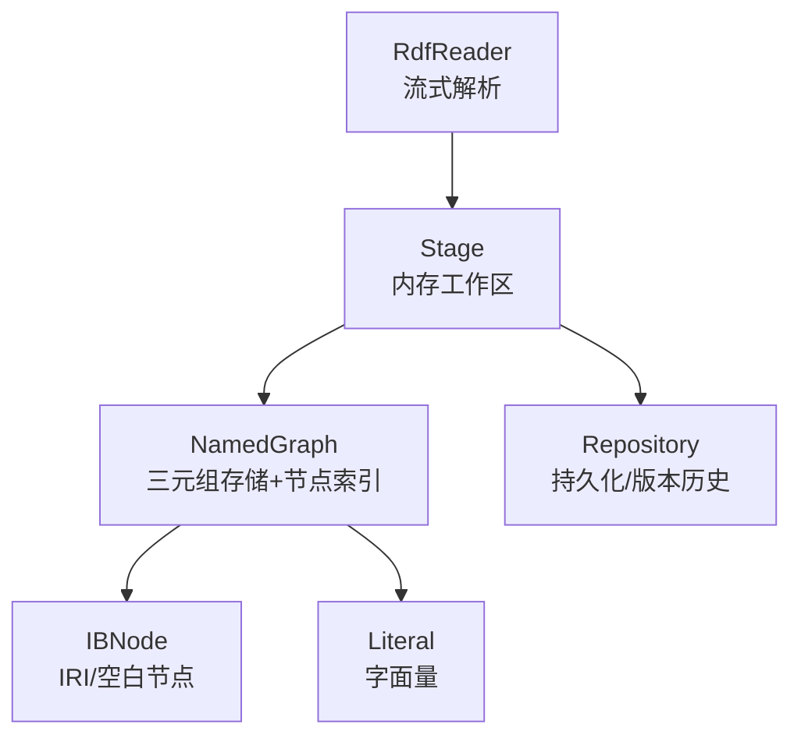
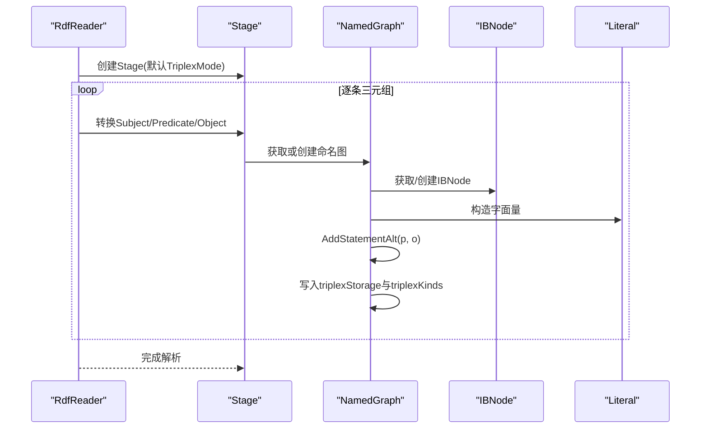
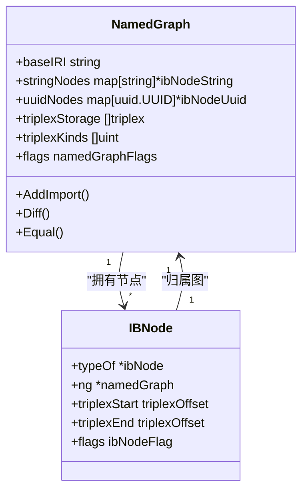
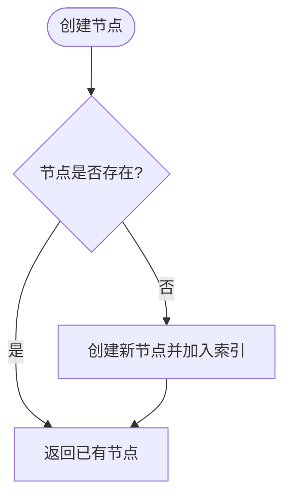
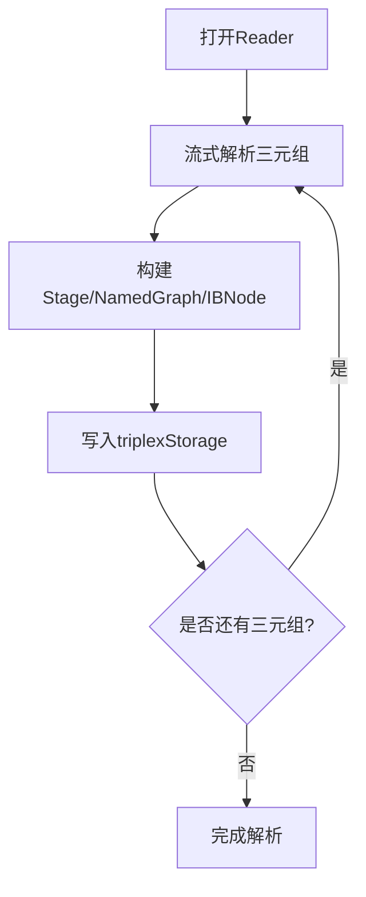
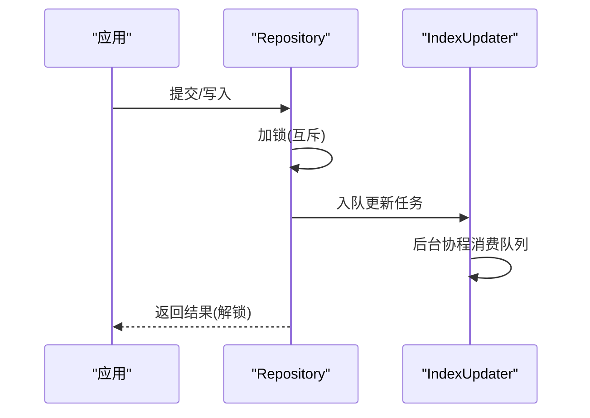
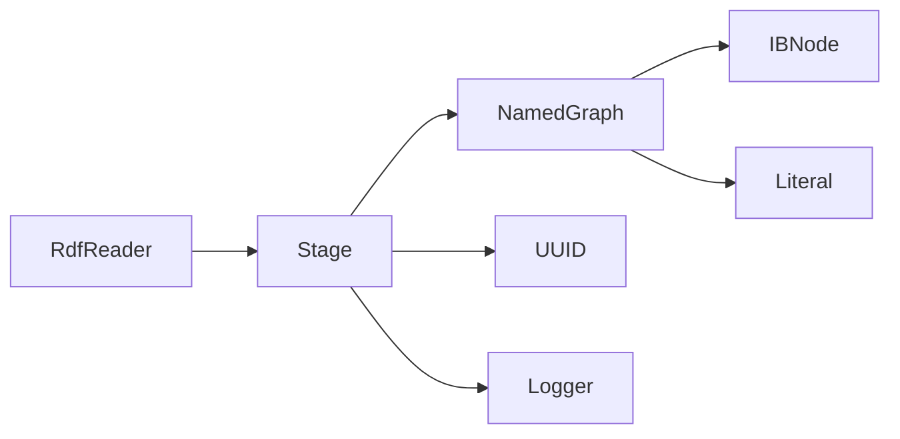

# 内存管理

<cite>
**本文引用的文件**
- [types.go](file://sst/types.go)
- [rdf.go](file://sst/rdf.go)
- [literals.go](file://sst/literals.go)
- [namedgraph.go](file://sst/namedgraph.go)
- [ibnode.go](file://sst/ibnode.go)
- [stage.go](file://sst/stage.go)
- [rdfreader.go](file://sst/rdfreader.go)
- [indexupdate.go](file://sst/indexupdate.go)
- [repolocalfull.go](file://sst/repolocalfull.go)
- [superlocalrepository.go](file://sst/superlocalrepository.go)
</cite>

## 目录
1. [简介](#简介)
2. [项目结构](#项目结构)
3. [核心组件](#核心组件)
4. [架构总览](#架构总览)
5. [详细组件分析](#详细组件分析)
6. [依赖关系分析](#依赖关系分析)
7. [性能与内存优化](#性能与内存优化)
8. [故障排查指南](#故障排查指南)
9. [结论](#结论)
10. [附录](#附录)

## 简介
本指南聚焦于SST在内存中如何表示RDF三元组、命名图、IRI节点与字面量，并系统阐述其内存分配、复用、并发访问控制与大文件流式读取的内存限制策略。文档面向希望深入理解SST内存模型与优化实践的读者，既提供概念性说明，也给出基于源码的结构化分析与可视化图示。

## 项目结构
SST将RDF数据以“命名图（NamedGraph）”为基本单位组织，每个命名图内部维护：
- IRI节点与空白节点的索引映射
- 紧凑的三元组存储（triplexStorage）与三元组类型位图（triplexKinds）
- 可选的谓词追踪标志与引用状态标记

Stage作为内存工作区，聚合多个命名图并提供创建、合并、提交等能力；RdfReader负责从Turtle/TriG流式解析到Stage。

**图表来源**
- [rdfreader.go:121-231](file://sst/rdfreader.go#L121-L231)
- [stage.go:53-73](file://sst/stage.go#L53-L73)
- [namedgraph.go:59-107](file://sst/namedgraph.go#L59-L107)
- [ibnode.go:634-660](file://sst/ibnode.go#L634-L660)

**章节来源**
- [stage.go:53-73](file://sst/stage.go#L53-L73)
- [namedgraph.go:59-107](file://sst/namedgraph.go#L59-L107)
- [rdfreader.go:121-231](file://sst/rdfreader.go#L121-L231)

## 核心组件
- 三元组与术语模型：定义RDF术语、三元组、四元组的序列化与比较逻辑，支撑流式读写。
- 命名图：内存中的图容器，维护三元组数组与三元组类型位图，支持导入、差异、等价比较等。
- IBNode：统一的节点抽象，包含IRI节点与空白节点，附带类型信息与三元组区间。
- 字面量：多种XSD/RDF字面量类型的封装，统一实现Term/Literal接口。
- Stage：内存阶段，管理本地与引用命名图，提供移动合并、提交、写入等操作。
- RdfReader：流式解析器，按三元组逐个产出，构建Stage。

**章节来源**
- [rdf.go:119-139](file://sst/rdf.go#L119-L139)
- [rdf.go:482-571](file://sst/rdf.go#L482-L571)
- [namedgraph.go:110-409](file://sst/namedgraph.go#L110-L409)
- [ibnode.go:634-660](file://sst/ibnode.go#L634-L660)
- [literals.go:12-442](file://sst/literals.go#L12-L442)
- [stage.go:74-234](file://sst/stage.go#L74-L234)
- [rdfreader.go:121-231](file://sst/rdfreader.go#L121-L231)

## 架构总览
下图展示了从RDF文本到内存结构的完整路径，以及命名图内部的三元组存储布局。

**图表来源**
- [rdfreader.go:121-231](file://sst/rdfreader.go#L121-L231)
- [namedgraph.go:59-107](file://sst/namedgraph.go#L59-L107)
- [ibnode.go:634-660](file://sst/ibnode.go#L634-L660)
- [literals.go:12-442](file://sst/literals.go#L12-L442)

## 详细组件分析

### RDF三元组在内存中的表示
- 术语与三元组：
  - 术语包括空白节点、IRI、字面量，分别实现统一的序列化与类型判断接口。
  - 三元组由主体、谓词、对象构成，支持序列化与相等性比较。
- 四元组：在三元组基础上增加上下文（命名图），用于TriG等多图格式。

这些设计使解析过程可以以最小中间态输出三元组，便于后续流式处理。

**章节来源**
- [rdf.go:119-139](file://sst/rdf.go#L119-L139)
- [rdf.go:482-571](file://sst/rdf.go#L482-L571)

### 命名图的内存布局与三元组存储
- 命名图包含：
  - stringNodes与uuidNodes两个索引映射，分别对应IRI片段与空白节点UUID。
  - triplexStorage：三元组连续存储，减少指针开销。
  - triplexKinds：压缩的三元组类型位图，标识每条三元组是subject/predicate/object三元组。
  - flags：是否被引用、是否跟踪谓词、是否修改、是否删除等状态。
- 三元组模式（TriplexMode）：
  - 默认模式同时维护subject、predicate、object三类三元组，利于双向遍历，但占用更多内存。
  - 可根据应用需求选择仅subject或subject+object的模式以平衡性能与内存。

**图表来源**
- [namedgraph.go:59-107](file://sst/namedgraph.go#L59-L107)
- [ibnode.go:634-660](file://sst/ibnode.go#L634-L660)

**章节来源**
- [stage.go:33-51](file://sst/stage.go#L33-L51)
- [namedgraph.go:59-107](file://sst/namedgraph.go#L59-L107)
- [ibnode.go:634-660](file://sst/ibnode.go#L634-L660)

### IRI节点与字面量的内存分配机制
- IRI节点：
  - 通过fragment或UUID区分不同节点，使用stringNodes/uuidNodes进行快速查找与复用。
  - 静态图（如RDF/XSD/SST内置词汇）以全局常量形式存在，避免重复分配。
- 字面量：
  - 多种字面量类型（字符串、整数、浮点、布尔、日期时间、语言标签等）均实现统一接口，返回对应的数据类型节点。
  - 字面量值以字符串形式存储，必要时缓存已解析的值以减少重复转换。

**图表来源**
- [types.go:9-234](file://sst/types.go#L9-L234)
- [literals.go:12-442](file://sst/literals.go#L12-L442)
- [namedgraph.go:741-782](file://sst/namedgraph.go#L741-L782)

**章节来源**
- [types.go:9-234](file://sst/types.go#L9-L234)
- [literals.go:12-442](file://sst/literals.go#L12-L442)
- [namedgraph.go:741-782](file://sst/namedgraph.go#L741-L782)

### 对象池、引用计数与垃圾回收优化
- 对象池：
  - 未显式实现通用对象池；通过三元组连续数组与位图压缩降低分配次数与碎片。
  - 静态资源（如内置词汇、类型节点）以包级变量常驻，避免重复创建。
- 引用计数：
  - 未采用显式引用计数；通过命名图的“引用状态”（isReferenced）与Stage生命周期管理所有权。
  - 被其他命名图引用的节点不会直接删除，需通过MoveAndMerge或Delete流程更新引用关系。
- 垃圾回收：
  - Stage.Close后释放引用，使底层对象可被GC回收。
  - 命名图删除时若仍被引用则转为引用状态，否则完全移除。

**章节来源**
- [stage.go:174-177](file://sst/stage.go#L174-L177)
- [namedgraph.go:277-294](file://sst/namedgraph.go#L277-L294)
- [types.go:9-234](file://sst/types.go#L9-L234)

### 大文件读取的分块处理、流式解析与内存限制控制
- 流式解析：
  - RdfReader以io.Reader为输入，逐条产出三元组，避免一次性加载整个文档。
  - 支持Turtle与TriG两种格式，TriG按命名图上下文分配三元组。
- 分块与缓冲：
  - 使用bufio.Reader包装输入，提高读取效率。
  - 解析过程中按需创建命名图与节点，增量写入triplexStorage。
- 内存限制控制：
  - 当前实现未提供显式的内存上限参数；可通过控制批处理大小、及时提交/落盘来限制峰值内存。
  - 建议在应用层对读取循环做节流或分批提交，避免长时间持有大量临时对象。

**图表来源**
- [rdfreader.go:121-231](file://sst/rdfreader.go#L121-L231)
- [rdfreader.go:470-537](file://sst/rdfreader.go#L470-L537)

**章节来源**
- [rdfreader.go:121-231](file://sst/rdfreader.go#L121-L231)
- [rdfreader.go:470-537](file://sst/rdfreader.go#L470-L537)

### 并发访问的内存同步与锁优化策略
- 仓库写入锁：
  - 本地仓库在写操作中使用互斥锁串行化配额检查与写入，避免并发冲突。
- 异步队列：
  - 索引更新使用带缓冲通道与停止通道的后台协程，批量处理更新任务，降低主线程阻塞。
- 读多写少场景：
  - 超级仓库使用读写锁保护共享状态，提升读并发度。

**图表来源**
- [repolocalfull.go:213](file://sst/repolocalfull.go#L213)
- [indexupdate.go:91-125](file://sst/indexupdate.go#L91-L125)
- [superlocalrepository.go:94](file://sst/superlocalrepository.go#L94)

**章节来源**
- [repolocalfull.go:213](file://sst/repolocalfull.go#L213)
- [indexupdate.go:91-125](file://sst/indexupdate.go#L91-L125)
- [superlocalrepository.go:94](file://sst/superlocalrepository.go#L94)

## 依赖关系分析
- 组件耦合：
  - RdfReader依赖Stage与NamedGraph进行数据构建。
  - NamedGraph依赖IBNode与Literal进行节点与字面量管理。
  - Stage管理多个NamedGraph，并提供跨库移动合并能力。
- 外部依赖：
  - UUID用于唯一标识与哈希计算。
  - 日志库用于调试与诊断。

**图表来源**
- [rdfreader.go:121-231](file://sst/rdfreader.go#L121-L231)
- [stage.go:53-73](file://sst/stage.go#L53-L73)
- [namedgraph.go:59-107](file://sst/namedgraph.go#L59-L107)
- [ibnode.go:634-660](file://sst/ibnode.go#L634-L660)
- [literals.go:12-442](file://sst/literals.go#L12-L442)

**章节来源**
- [rdfreader.go:121-231](file://sst/rdfreader.go#L121-L231)
- [stage.go:53-73](file://sst/stage.go#L53-L73)
- [namedgraph.go:59-107](file://sst/namedgraph.go#L59-L107)

## 性能与内存优化
- 三元组模式选择：
  - 根据查询方向选择仅subject或subject+object模式，减少内存占用。
- 三元组存储压缩：
  - 使用连续数组与位图存储三元组类型，降低指针与额外结构开销。
- 节点复用：
  - 通过stringNodes/uuidNodes索引复用节点，避免重复分配。
- 静态资源常驻：
  - 内置词汇与类型节点以包级变量存在，减少频繁分配。
- 流式处理：
  - 解析过程逐条处理，避免一次性加载大文件。
- 并发优化：
  - 写操作加锁保证一致性；索引更新异步化，降低主线程压力。
- 高内存消耗场景建议：
  - 分批提交：将大批量数据拆分为多次提交，及时释放中间对象。
  - 限制并行度：控制解析与写入的并发度，避免内存尖峰。
  - 监控与限流：结合运行时指标与日志，动态调整批大小。

[本节为通用指导，不直接分析具体文件]

## 故障排查指南
- 常见错误：
  - 重复三元组：添加前检查重复，避免panic或错误。
  - 非法主体：确保主体为IRI或空白节点。
  - 不支持的字面量：类型推断失败时需明确类型。
  - 空白节点跨图冲突：同一标签在不同图中出现会报错。
- 定位方法：
  - 使用Dump/PrintTriples输出命名图内容，检查三元组分布。
  - 借助日志记录解析过程中的关键步骤与错误行号。
- 恢复策略：
  - 严格模式与非严格模式切换，决定是否继续解析。
  - 对导入关系进行清理与重建，避免循环导入。

**章节来源**
- [rdfreader.go:75-86](file://sst/rdfreader.go#L75-L86)
- [namedgraph.go:20-40](file://sst/namedgraph.go#L20-L40)
- [ibnode.go:47-60](file://sst/ibnode.go#L47-L60)

## 结论
SST通过紧凑的三元组存储、节点索引复用、流式解析与合理的并发控制，实现了高效的RDF内存管理。针对大文件与高并发场景，建议结合三元组模式选择、分批提交与异步更新等策略，进一步优化内存与性能。对于需要更细粒度内存控制的场景，可在应用层引入批处理与监控机制，配合现有组件达到最佳效果。

[本节为总结，不直接分析具体文件]

## 附录
- 术语表：
  - 三元组：主体-谓词-对象
  - 四元组：三元组+上下文（命名图）
  - 命名图：RDF图的内存容器
  - IBNode：IRI或空白节点
  - Literal：字面量
- 参考路径：
  - 三元组模型与序列化：[rdf.go:482-571](file://sst/rdf.go#L482-L571)
  - 命名图结构与API：[namedgraph.go:110-409](file://sst/namedgraph.go#L110-L409)
  - 节点与三元组存储：[ibnode.go:634-660](file://sst/ibnode.go#L634-L660)
  - 字面量类型：[literals.go:12-442](file://sst/literals.go#L12-L442)
  - 流式解析入口：[rdfreader.go:121-231](file://sst/rdfreader.go#L121-L231)
  - 并发与锁：[repolocalfull.go:213](file://sst/repolocalfull.go#L213), [indexupdate.go:91-125](file://sst/indexupdate.go#L91-L125), [superlocalrepository.go:94](file://sst/superlocalrepository.go#L94)